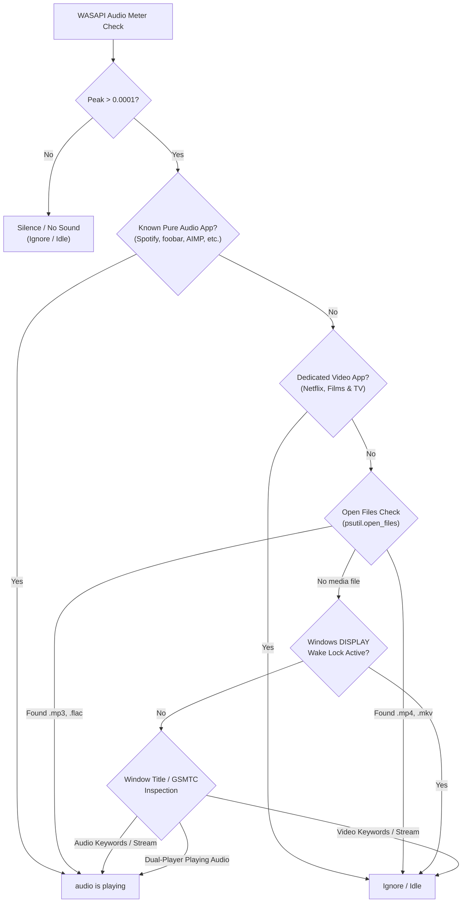

# 🎵 Audio Playback Detector Sentinel (विशिष्ट ऑडियो डिटेक्शन मॉड्यूल)

> **Dedicated Audio Playback Sentinel for Windows 10 & 11**  
> **Author:** Atul Verma (`aiprincekumar` / `aiprincekumar010100@gmail.com`)  
> **Location:** `Audio Detector/`  
> **मॉड्यूल का उद्देश्य / Core Purpose:**  
> Windows 10 और 11 पर केवल **AUDIO** प्लेबैक को सटीक रूप से डिटेक्ट करना।  
> अगर कोई **VIDEO** प्ले हो रहा है (चाहे VLC, PotPlayer, Modern Windows Media Player, YouTube, Netflix, आदि में हो), तो उसे **IDLE / IGNORE** माना जाता है।  
> जब भी किसी भी प्लेयर (Offline या Online Streaming) में कोई ऑडियो फॉर्मेट (.mp3, .wav, .flac, .aac, Spotify, YouTube Music, आदि) प्ले होता है, तो यह तुरंत `audio is playing` आउटपुट देता है।

---

## 📑 विषय-सूची (Table of Contents)

1. [विशेषताएं एवं आर्किटेक्चर (Features & Architecture)](#-विशेषताएं-एवं-आर्किटेक्चर-features--architecture)
2. [लीन 7-मॉड्यूल संरचना (Lean 7-Module Architecture)](#-लीन-7-मॉड्यूल-संरचना-lean-7-module-architecture)
3. [सपोर्टेड फॉर्मेट्स (Supported Formats Catalog)](#-सपोर्टेड-फॉर्मेट्स-supported-formats-catalog)
4. [मल्टी-लेयर डिटेक्शन रणनीति (Multi-Layer Detection Strategy)](#-मल्टी-लेयर-डिटेक्शन-रणनीति-multi-layer-detection-strategy)
5. [उपयोग विधि एवं लॉन्चर (Usage Instructions & Zero-Flash Launcher)](#-उपयोग-विधि-एवं-लॉन्चर-usage-instructions--zero-flash-launcher)
6. [सीक्वेंशियल CLI संदर्भ (CLI Reference)](#-सीक्वेंशियल-cli-संदर्भ-cli-reference)
7. [यूनिट टेस्टिंग (Unit Tests Verification)](#-यूनिट-टेस्टिंग-unit-tests-verification)
8. [डेवलपर जानकारी (Developer Profile)](#-डेवलपर-जानकारी-developer-profile)

---

## 🚀 विशेषताएं एवं आर्किटेक्चर (Features & Architecture)

- **Zero-False-Positive Audio Detection:**  
  यह प्लेयर के नाम पर निर्भर नहीं करता, बल्कि **वास्तविक मीडिया फ़ाइल फॉर्मेट (.mp3, .flac बनाम .mp4, .mkv)**, रनिंग प्रोसेस के **ओपन फाइल हैंडल्स (`open_files()`)**, **विंडो टाइटल्स**, **कमांड लाइन**, **Windows Display Wake Locks (`powercfg /requests`)**, और **Windows Global Media Transport Controls (GSMTC)** को गहराई से सत्यापित करता है।
- **Video Ignored As Idle:**  
  जब भी वीडियो प्ले हो रहा होता है, यह सिस्टम को आइडल मानता है और कोई आउटपुट नहीं देता (ignore कर देता है)।
- **Dual-Purpose Player Intelligence:**  
  VLC, PotPlayer, या Modern Windows Media Player जब `.mp3` या `.flac` बजाते हैं -> `audio is playing` डिटेक्ट होता है।  
  वही VLC या Media Player जब `.mp4` या `.mkv` वीडियो चलाते हैं -> उसे वीडियो मानकर इग्नोर कर दिया जाता है।
- **Online Streaming Disambiguation:**  
  - ब्राउज़र में **YouTube Music**, **Spotify Web**, **SoundCloud** -> `audio is playing`  
  - ब्राउज़र में **YouTube Video**, **Netflix**, **Twitch**, **Hotstar** -> **IGNORED (IDLE)**
- **Ultra-Fast Performance (<5ms):**  
  नेटिव Windows Core Audio API (WASAPI) और Win32 API का उपयोग करके हर चेक 5 मिलीसेकंड के अंदर निष्पादित होता है।
- **Rich 12-Field Live Dashboard Card:**  
  `Run_Audio_Detector.bat` सीधे लाइव डैशबोर्ड में प्रवेश करता है जिसमें Continuous Play, Continuous Pause, Audio Peak Meter, 60s Idle Timer, और 60m Activity Graph शामिल हैं।

---

## 🧱 लीन 7-मॉड्यूल संरचना (Lean 7-Module Architecture)

लाइव मॉनिटरिंग को सुपर-क्लीन, फास्ट और ब्लोट-फ्री रखने हेतु `core/` पैकेज को केवल 7 अनिवार्य मॉड्यूल्स में संरचित किया गया है:

```
Audio Detector/
├── audio_detector.py         # लीन मुख्य रनर एवं सीक्वेंशियल CLI
├── Run_Audio_Detector.bat    # 1-क्लिक ज़ीरो-फ़्लैश विंडोज़ लॉन्चर
├── run_audio_detector.ps1    # पावरशेल लॉन्चर (UTF-8 BOM)
├── test_audio_detector.py    # 71 व्यापक यूनिट टेस्ट्स
└── core/
    ├── constants.py          # ऑडियो/वीडियो फॉर्मेट्स, ऐप व्हाइटलिस्ट्स एवं क्लासिफिकेशन टाइप्स
    ├── wasapi.py             # Windows Core Audio API (WASAPI) COM vtable सेशन पीक मीटरिंग
    ├── wmp_classic.py        # Windows Media Player Legacy (wmplayer.exe) डेडिकेटेड क्लासिफायर
    ├── wmp_modern.py         # Windows 10/11 Modern Media Player डेडिकेटेड क्लासिफायर
    ├── dashboard.py          # 12-फील्ड फिक्स्ड-विड्थ ANSI इन-प्लेस डैशबोर्ड एवं प्रोग्रेस बार
    ├── detector.py           # डिटेक्शन ऑर्केस्ट्रेशन, जनरल प्लेयर क्लासिफिकेशन एवं डिसीजन लॉजिक
    └── __init__.py           # क्लीन पब्लिक API री-एक्सपोर्ट्स
```

---

## 📁 सपोर्टेड फॉर्मेट्स (Supported Formats Catalog)

### 1. Pure Audio Extensions
```python
AUDIO_EXTENSIONS = {
    '.mp3', '.wav', '.flac', '.aac', '.ogg', '.m4a', '.wma', '.opus',
    '.alac', '.aiff', '.mid', '.midi', '.ape', '.ac3', '.dts', '.amr',
    '.mka', '.mod', '.aif', '.oga', '.voc', '.mp2', '.mp1', '.m4b',
    '.m4p', '.cue', '.ra', '.ram'
}
```

### 2. Video Extensions (Ignored / Treated as Idle)
```python
VIDEO_EXTENSIONS = {
    '.mp4', '.mkv', '.avi', '.mov', '.wmv', '.flv', '.webm', '.m4v',
    '.3gp', '.ts', '.mpg', '.mpeg', '.vob', '.ogv', '.m2ts', '.mts',
    '.3g2', '.divx', '.asf', '.f4v', '.rmvb', '.rm', '.wtv'
}
```

---

## 🧠 मल्टी-लेयर डिटेक्शन रणनीति (Multi-Layer Detection Strategy)



1. **लेयर 0: WASAPI Peak Metering:**  
   Windows Core Audio API (`IAudioMeterInformation`) से जांचता है कि क्या कोई ऑडियो वास्तव में बज रहा है। यदि सब कुछ म्यूट या स्टॉप्ड है, तो तुरंत आइडल मान लेता है।
2. **लेयर 1: Known Pure Audio Apps:**  
   `spotify.exe`, `foobar2000.exe`, `aimp.exe`, `audacity.exe`, `musicbee.exe`, आदि यदि साउंड प्रोड्यूस कर रहे हैं, तो सीधे `AUDIO` के रूप में वर्गीकृत होते हैं।
3. **लेयर 2: Open Files Forensics (`psutil`):**  
   प्लेयर के वास्तविक फाइल हैंडल्स को रीड करता है। यदि `.mp3` खुला है तो ऑडियो, यदि `.mp4` खुला है तो वीडियो।
4. **लेयर 3: Windows Display Wake Lock (`powercfg /requests`):**  
   विंडोज ओएस का अकाट्य नियम: वीडियो रेंडरिंग के समय सिस्टम `[DISPLAY]` वेक लॉक सेट करता है ताकि स्क्रीन बंद न हो। प्योर ऑडियो में `[DISPLAY]` लॉक कभी नहीं लगता।
5. **लेयर 4: GSMTC (Global System Media Transport Controls):**  
   Windows Media Control सिस्टम से `PlaybackType` रीड करता है:  
   - `1` = Music (Audio)  
   - `2` = Video  

---

## 💻 उपयोग विधि एवं लॉन्चर (Usage Instructions & Zero-Flash Launcher)

### 1. 1-क्लिक डबल क्लिक लॉन्चर (Zero Flashing, Instant Dashboard)
```text
Run_Audio_Detector.bat
```
या:
```text
run_audio_detector.bat
```
डबल-क्लिक करते ही बिना किसी बैंनर टेक्स्ट या फ़्लैश के सीधे लाइव डैशबोर्ड में प्रवेश करता है।

### 2. पायथन CLI द्वारा लाइव डैशबोर्ड
```powershell
python audio_detector.py
```

### 3. सिंगल चेक (Scripts / Automation / CI)
```powershell
python audio_detector.py --once
```
- Exit Code `0`: System is Idle / Video Ignored.
- Exit Code `1`: Audio is actively playing.

### 4. स्ट्रक्चर्ड JSON आउटपुट
```powershell
python audio_detector.py --json
```

### 5. पायथन स्क्रिप्ट में इम्पोर्ट करना
```python
from audio_detector import is_audio_playing, AudioDetector, extract_media_details

# सिंपल बूलियन चेक
if is_audio_playing():
    print("Audio is playing!")

# डिटेल्ड रिज़ल्ट और ट्रैक/प्लेयर इंफो
detector = AudioDetector()
res = detector.check()
if res.is_audio_playing:
    title, player = extract_media_details(res)
    print(f"Track: {title} | Player: {player}")
```

---

## ⚙️ सीक्वेंशियल CLI संदर्भ (CLI Reference)

### `audio_detector.py` (12-फील्ड इन-प्लेस डैशबोर्ड)
| Flag | Description | Default |
| :--- | :--- | :--- |
| `--interval SECONDS` | रिफ्रेश अंतराल (सेकंड में, स्मूद 100ms अपडेट्स हेतु) | `0.1` |
| `--threshold SECONDS` | इनएक्टिविटी आइडल थ्रेसहोल्ड (सेकंड में) | `60.0` |
| `--once` | 1 बार 12-फील्ड कार्ड रेंडर कर तुरंत एग्जिट करें (0: Idle, 1: Audio Playing) | `False` |
| `--json` | 12-फील्ड कार्ड डेटा को संरचित JSON प्रारूप में प्राप्त करें | `False` |

---

## 🧪 यूनिट टेस्टिंग (Unit Tests Verification)

इस मॉड्यूल के साथ 92 व्यापक यूनिट टेस्ट शामिल हैं जो सभी परिदृश्यों (12-फील्ड लेआउट, Continuous Play/Pause गणना, WASAPI पीक मीटर, 60m टाइमलाइन ग्राफ, 60s टाइमर संचयन, प्रोग्रेस बार, Is Windows Idle? ट्रांज़िशन, VT मोड, वेक लॉक्स, WMP Legacy / Default IME फिल्टरिंग, और मॉक प्रोसेस) को 100% सत्यापित करते हैं:

```powershell
python test_audio_detector.py
```
**परिणाम:**
```text
Ran 92 tests in 0.512s

OK
```

---

## 👤 डेवलपर जानकारी (Developer Profile)

- **Developer:** Atul Verma
- **Git Username:** `aiprincekumar`
- **Email:** `aiprincekumar010100@gmail.com`
- **Workspace:** `Audio Detector`
