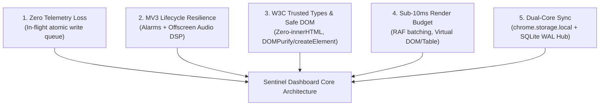
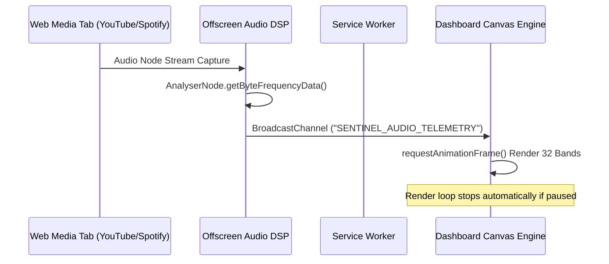
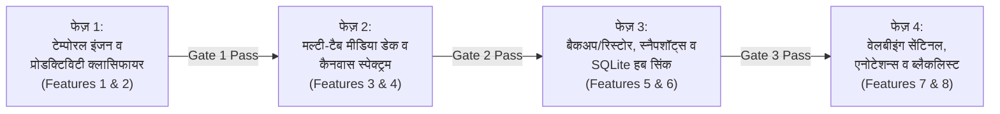

# Web Activity & Media Sentinel - Dashboard Future Features & Capabilities Master Specification Prompt
# डैशबोर्ड मोड भविष्य के फीचर्स एवं उन्नत कार्यक्षमता: मास्टर इंजीनियरिंग प्रॉम्प्ट व आर्किटेक्चरल विनिर्देश

> **दस्तावेज़ प्रकार (Document Type):** Master Engineering Prompt & Technical Architecture Specification  
> **लक्ष्य सिस्टम (Target System):** Web Activity & Media Sentinel (Chrome MV3 Full-Page Enterprise Dashboard)  
> **कार्यक्षेत्र (Workspace):** [`c:\Users\Atul Verma\Desktop\Win App Tracker\Browser Detection`](file:///c:/Users/Atul%20Verma/Desktop/Win%20App%20Tracker/Browser%20Detection)  
> **संस्करण (Version):** 2.0.0 (Production Roadmap & Architectural Prompt)  
> **फ़ाइल आउटपुट (Output File):** [`dashboard_future_features_prompt.md`](file:///c:/Users/Atul%20Verma/Desktop/Win%20App%20Tracker/Browser%20Detection/dashboard_future_features_prompt.md)  
> **सक्रिय मेमोरी संदर्भ (Active Memory Anchor):** [`project_feature_memory.md`](file:///c:/Users/Atul%20Verma/Desktop/Win%20App%20Tracker/Browser%20Detection/project_feature_memory.md) एवं [`C:\Users\Atul Verma\.gemini\memory.md`](file:///C:/Users/Atul%20Verma/.gemini/memory.md)  
> **अग्रणी वास्तुकार (Lead Architect):** Atul Verma (`aiprincekumar` / `aiprincekumar010100@gmail.com`)  
> **कार्यान्वयन निर्देश (Execution Directive):** "सिर्फ बताना है करना नहीं है" — यह दस्तावेज़ भविष्य के डेवलपर/सब-एजेंट्स के लिए संपूर्ण, अटूट और कार्यान्वयन-योग्य विनिर्देश प्रॉम्प्ट है।

---

## 🇮🇳 कार्यकारी सारांश व विज़न (Executive Summary & Architectural Vision)

**वेब एक्टिविटी व मीडिया सेंटिनल (Web Activity & Media Sentinel)** का **डैशबोर्ड मोड (Dashboard Mode)** ब्राउज़र-आधारित गतिविधि विश्लेषण और मल्टीमीडिया रिमोट टेलीमेट्री के लिए एक केंद्रीय नियंत्रण केंद्र (Command & Control Hub) के रूप में कार्य करता है। वर्तमान स्थिति में, डैशबोर्ड दैनिक ब्राउज़िंग समय, डोनट चार्ट, टॉप डोमेन बार्स, डोमेन तालिका, लाइव हीरो मीडिया प्लेयर और बुनियादी सेटिंग्स जैसे 44 आवश्यक फीचर्स सफलतापूर्वक निष्पादित करता है।

यह मास्टर इंजीनियरिंग प्रॉम्प्ट दस्तावेज़ डैशबोर्ड के क्षितिज को विस्तारित करने और इसे एक वैश्विक स्तरीय **"एंटरप्राइज एनालिटिक्स, मल्टी-स्ट्रीम मीडिया डेक व डिजिटल वेलबीइंग सूट"** में परिवर्तित करने के लिए **8 प्रमुख भावी फीचर्स (8 Major Future Capabilities)** का संपूर्ण तकनीकी विनिर्देश (Specification), डेटा स्कीमा (Data Schema), यूआई आर्किटेक्चर (UI Architecture), और 4-फेज़ कार्यान्वयन रोडमैप (Implementation Roadmap) प्रस्तुत करता है।

---

## 🏛️ 0. अनिवार्य संवैधानिक व तकनीकी इनवेरिएंट्स (Constitutional & Technical Invariants)

भविष्य के किसी भी फीचर को कोड करते समय आगामी इंजीनियर या सब-एजेंट निम्नलिखित 5 अपरिवर्तनीय नियमों (Invariants) का अक्षरशः पालन करेंगे:



1. **शून्य टेलीमेट्री हानि (Zero Telemetry Loss Invariant):**  
   सिस्टम क्रैश, अचानक टैब बंद होने या ब्राउज़र रीस्टार्ट के दौरान कोई भी टाइम ट्रैकिंग या मीडिया सत्र डेटा लुप्त नहीं होना चाहिए। सभी इन-मेमोरी संचयन (accumulations) को 5-सेकंड के ऑटो-कमिट टिकर और `chrome.storage.local` के परमाणु (atomic) लेन-देन द्वारा सुरक्षित किया जाएगा।
2. **Chrome MV3 सर्विस वर्कर लचीलापन (MV3 Lifecycle Resilience):**  
   सर्विस वर्कर के निष्क्रिय (idle termination) होने पर भी डैशबोर्ड सक्रिय टेलीमेट्री बनाए रखेगा। ऑडियो सिंक और टाइमर अलर्ट के लिए `chrome.alarms` और आवश्यकतानुसार `offscreen` दस्तावेज़ों का प्रयोग होगा।
3. **W3C Trusted Types व शून्य-innerHTML नीति (Zero-innerHTML Enforcement):**  
   किसी भी यूआई घटक, टेबल रो या टूलटिप में कच्चा `innerHTML = ...` असाइनमेंट पूर्णतः निषिद्ध है। केवल `document.createElement`, `textContent`, `setAttribute`, और सुरक्षित सैनिटाइज्ड फ़्रैग्मेंट्स ही स्वीकार्य हैं।
4. **सब-10ms रेंडर बजट (Sub-10ms Render Budget):**  
   डैशबोर्ड के किसी भी विज़ुअलाइज़ेशन (चार्ट, हीटमैप, स्पेक्ट्रम एनालाइज़र) को मुख्य थ्रेड पर 10ms से अधिक समय तक ब्लॉक नहीं करना चाहिए। 60fps एनीमेशन के लिए `requestAnimationFrame` और 100+ आइटम्स वाली तालिकाओं के लिए वर्चुअल स्क्रोलिंग का उपयोग अनिवार्य है।
5. **डुअल-कोर सिंक इनवेरिएंट (Dual-Core Synchronization):**  
   एक्सटेंशन का आंतरिक `chrome.storage.local` और बाहरी लोकल डेस्कटॉप SQLite डेटा हब (`ws://127.0.0.1:65433` WAL मोड) वास्तविक समय में स्वतः सिंक रहेंगे। जब भी हब ऑनलाइन आएगा, डेल्टा डेटा बिना ओवरराइटिंग के मर्ज होगा।

---

## ⚡ 1. फीचर 1: कस्टम टेम्पोरल रेंज व क्रोनो-डिस्ट्रिब्यूशन हीटमैप (Custom Temporal Range & Chrono-Distribution Heatmap)

### 1.1 समस्या व आवश्यकता (Problem & Business Value)
वर्तमान में डैशबोर्ड केवल तीन निश्चित फिल्टर प्रदान करता है: `Today` (आज), `Daily Avg` (दैनिक औसत), और `Total Time` (कुल समय)। उपयोगकर्ता पिछले कल (Yesterday), पिछले 7 दिन (Past 7 Days), पिछले 30 दिन (Past 30 Days), अथवा मनचाहे कस्टम डेट रेंज (Custom Date Range जैसे 2026-11-01 से 2026-11-15) का विश्लेषण नहीं कर पाता। इसके अतिरिक्त, पूरे 24 घंटे में उपयोगकर्ता का फोकस और मीडिया उपभोग किस समय उच्चतम रहता है, इसका कोई दृश्य प्रतिनिधित्व (Visual Representation) मौजूद नहीं है।

### 1.2 कार्यात्मक विनिर्देश (Functional Specification)
1. **विस्तारित टेम्पोरल फिल्टर बार:**
   - `📅 Today` (वर्तमान दिन)
   - `⏪ Yesterday` (बीता हुआ कल)
   - `📊 Last 7 Days` (पिछले 7 दिन)
   - `🗓️ Last 30 Days` (पिछले 30 दिन)
   - `🎯 Custom Range` (कैलेंडर पॉपअप इनपुट: YYYY-MM-DD से YYYY-MM-DD तक)
2. **24x7 क्रोनो-एक्टिविटी हीटमैप मैट्रिक्स (7x24 Heatmap Matrix):**
   - 7 पंक्तियाँ (सोमवार से रविवार - Mon to Sun)।
   - 24 स्तंभ (00:00 से 23:00 - प्रत्येक घंटा)।
   - 168 हीटमैप सेल्स (Cells) जो रंग की तीव्रता (Color Intensity 0 से 4 तक) द्वारा गतिविधि स्तर को दर्शाती हैं।
   - **मोड स्विचर:** "🌐 फोकस व ब्राउज़िंग समय" बनाम "🎬 मीडिया उपभोग समय"।
   - **इंटरएक्टिव होवर टूलटिप:** सेल पर माउस ले जाने पर सटीक समय, सक्रिय डोमेन और मिनट प्रदर्शित होना।
3. **वीक-ओवर-वीक (WoW) डेल्टा मेट्रिक्स:**
   - चयनित अवधि की तुलना पिछले समान चक्र से करना (जैसे: पिछले सप्ताह की तुलना में +14.2% उत्पादकता या -8.5% यूट्यूब वॉच-टाइम)।

### 1.3 डेटा संरचना व स्कीमा (Data Architecture & Schema)

```typescript
interface ChronoHourBucket {
  hour: number;          // 0 to 23
  dayOfWeek: number;     // 0 (Sun) to 6 (Sat)
  activeSeconds: number; // Active browsing duration
  mediaSeconds: number;  // Video/Audio playback duration
  topDomain: string;     // Primary domain during this hour
  sessionCount: number;  // Number of distinct tab interactions
}

interface TemporalQueryRange {
  mode: 'today' | 'yesterday' | '7d' | '30d' | 'custom';
  startDate: string;     // ISO format YYYY-MM-DD
  endDate: string;       // ISO format YYYY-MM-DD
}

interface HeatmapCellTooltipData {
  dayLabel: string;      // e.g. "Wednesday"
  hourRange: string;     // e.g. "14:00 - 15:00"
  durationFormatted: string; // e.g. "48m 20s"
  intensityLevel: 0 | 1 | 2 | 3 | 4;
  dominantDomain: string;// e.g. "github.com"
}
```

### 1.4 यूआई वायरफ्रेम एवं लेआउट (UI Wireframe)

```
+--------------------------------------------------------------------------------------------------+
| 🗓️ CHRONO-ACTIVITY HEATMAP (24 Hours x 7 Days Matrix)               [ Mode: (•) Focus  ( ) Media ] |
| Range: [ Today | Yesterday | [ 7 Days ] | 30 Days | Custom: 2026-11-08 to 2026-11-15 ]             |
+--------------------------------------------------------------------------------------------------+
| Hours:  00 01 02 03 04 05 06 07 08 09 10 11 12 13 14 15 16 17 18 19 20 21 22 23                 |
| Mon    [ ][ ][ ][ ][ ][ ][ ][.][:][#][#][#][:][#][#][#][#][#][:][.][ ][ ][ ][ ]   WoW: +12.4% 📈 |
| Tue    [ ][ ][ ][ ][ ][ ][ ][.][#][#][#][#][:][#][#][#][#][#][:][.][ ][ ][ ][ ]   WoW: +4.1%  📈 |
| Wed    [ ][ ][ ][ ][ ][ ][ ][.][:][#][#][#][:][#][#][#][#][#][#][:][.][ ][ ][ ]   WoW: -2.3%  📉 |
| Thu    [ ][ ][ ][ ][ ][ ][ ][.][:][#][#][#][:][#][#][#][#][#][#][:][.][ ][ ][ ]   WoW: +8.8%  📈 |
| Fri    [ ][ ][ ][ ][ ][ ][ ][.][:][#][#][#][:][#][#][#][#][#][:][:][.][ ][ ][ ]   WoW: +15.0% 📈 |
| Sat    [ ][ ][ ][ ][ ][ ][ ][ ][ ][.][:][:][#][#][#][:][.][ ][ ][ ][ ][ ][ ][ ]   WoW: -45.1% 📉 |
| Sun    [ ][ ][ ][ ][ ][ ][ ][ ][ ][.][:][:][#][#][:][.][ ][ ][ ][ ][ ][ ][ ][ ]   WoW: -60.2% 📉 |
| Legend: [ ] 0m  [.] 1-15m  [:] 15-30m  [#] 30-45m  [█] 45-60m                                   |
+--------------------------------------------------------------------------------------------------+
```

### 1.5 कोर एल्गोरिथम व कार्यान्वयन लॉजिक (Core Implementation Logic)

```javascript
/**
 * Computes 7x24 heatmap matrix from stored daily domain telemetry
 * @param {Object} rawHistory - Stored history map keyed by YYYY-MM-DD
 * @param {TemporalQueryRange} range - Selected date range
 * @returns {Array<Array<ChronoHourBucket>>} 7 rows (days) x 24 columns (hours)
 */
function aggregateChronoHeatmap(rawHistory, range) {
  const matrix = Array.from({ length: 7 }, (_, d) =>
    Array.from({ length: 24 }, (_, h) => ({
      hour: h,
      dayOfWeek: d,
      activeSeconds: 0,
      mediaSeconds: 0,
      topDomain: '',
      sessionCount: 0
    }))
  );

  const targetDates = getDatesInRange(range.startDate, range.endDate);
  
  targetDates.forEach(dateStr => {
    const dayData = rawHistory[dateStr];
    if (!dayData || !dayData.hourlyBuckets) return;

    const dateObj = new Date(dateStr);
    const dayOfWeek = (dateObj.getDay() + 6) % 7; // Monday = 0, Sunday = 6

    for (let h = 0; h < 24; h++) {
      const bucket = dayData.hourlyBuckets[h];
      if (bucket) {
        matrix[dayOfWeek][h].activeSeconds += (bucket.activeTime || 0);
        matrix[dayOfWeek][h].mediaSeconds += (bucket.mediaTime || 0);
        matrix[dayOfWeek][h].sessionCount += (bucket.sessions || 0);
        if (bucket.topDomain) {
          matrix[dayOfWeek][h].topDomain = bucket.topDomain;
        }
      }
    }
  });

  return matrix;
}
```

---

## 🎯 2. फीचर 2: प्रोडक्टिविटी स्कोरिंग व स्मार्ट डोमेन क्लासिफायर (Productivity Scoring & Smart Domain Classifier)

### 2.1 समस्या व आवश्यकता (Problem & Business Value)
वर्तमान में एक्सटेंशन सभी वेबसाइट्स को केवल "Websites" या "Internal" के रूप में टैग करता है। इससे उपयोगकर्ता यह नहीं समझ पाता कि उसका बिताया गया समय काम (Work) में खर्च हुआ, सीखने (Learning) में, या केवल सोशल मीडिया और मनोरंजन (Distraction) में। एक बौद्धिक स्कोरिंग इंजन उपयोगकर्ता को आत्म-अनुशासन और उत्पादकता का तत्काल माप (Instant Metric) प्रदान करेगा।

### 2.2 कार्यात्मक विनिर्देश (Functional Specification)
1. **5-स्तरीय मानक डोमेन टैक्सोनॉमी (Standard Category Taxonomy):**
   - 💼 **Work & Development:** GitHub, GitLab, Stack Overflow, VS Code Web, Jira, Linear, AWS/GCP Console, Figma.
   - 📚 **Learning & Research:** MDN Docs, arXiv, Coursera, Udemy, Wikipedia, Medium, Dev.to, Google Scholar.
   - 🎮 **Entertainment & Media:** YouTube (मनोरंजन मोड), Netflix, Spotify, Twitch, Prime Video, Hotstar.
   - 💬 **Social & Communication:** WhatsApp Web, Slack, Discord, Twitter/X, Reddit, Instagram, Telegram.
   - ⚙️ **Utilities & Reference:** Gmail, Google Drive, Notion, Trello, Google Search, Translation tools.
2. **डायनामिक प्रोडक्टिविटी स्कोर फॉर्मूला (0 से 100):**
   $$\text{Productivity Score} = \text{clamp}\left(0, 100, \frac{W \times 1.0 + L \times 0.95 + U \times 0.7 - S \times 0.4 - E \times 0.8}{T_{\text{active}}} \times 100\right)$$
   जहाँ $W, L, U, S, E$ क्रमशः विभिन्न श्रेणियों में बिताया गया समय है और $T_{\text{active}}$ कुल सक्रिय समय है।
3. **यूआई विज़ुअलाइज़ेशन:**
   - शीर्ष पर रेडियल गेज मीटर (Radial Score Gauge) (0-100)।
   - **कलर टियर:** 80-100 (उत्कृष्ट / Deep Focus 🟢), 60-79 (संतुलित / Balanced 🟡), 0-59 (विचलित / Distracted 🔴)।
4. **1-क्लिक इनलाइन डोमेन री-असाइनमेंट:**
   - डोमेन टेबल में प्रत्येक डोमेन के सामने एक कस्टम बैज ड्रॉपडाउन।
   - यदि कोई डेवलपर YouTube पर कोडिंग ट्यूटोरियल देखता है, तो वह 1-क्लिक से YouTube को "Entertainment" से बदलकर "Learning" में असाइन कर सकता है। यह अधिभार (Override) `chrome.storage.local` में स्थायी रहेगा।

### 2.3 डेटा संरचना व ओवरराइड स्कीमा (Data Schema)

```typescript
type DomainCategory = 'work' | 'learning' | 'entertainment' | 'social' | 'utility';

interface DomainClassificationMap {
  [domain: string]: {
    category: DomainCategory;
    isCustomOverride: boolean;
    assignedAt: number; // timestamp
  };
}

interface ProductivityDailySummary {
  date: string; // YYYY-MM-DD
  score: number; // 0 to 100
  timeByCategory: Record<DomainCategory, number>; // in seconds
  totalActiveTime: number; // in seconds
  focusLevelBadge: 'Deep Focus' | 'Balanced' | 'Distracted';
}
```

### 2.4 यूआई घटक विवरण (UI Component Integration)
- **DOM Placement:** `#paneTracking` के शीर्ष पर `div.metrics-grid` में 5वां कार्ड: `#cardProductivityScore`।
- **इनलाइन तालिका स्तंभ:** `#domainAnalyticsTable` में "Domain" के बाद नया स्तंभ "Category" जोड़ा जाएगा।

---

## 🎬 3. फीचर 3: मल्टी-टैब लाइव मीडिया डेक (Multi-Tab Live Media Deck)

### 3.1 समस्या व आवश्यकता (Problem & Business Value)
वर्तमान में डैशबोर्ड केवल एक "हीरो प्लेयर" (Single Hero Player) को रेंडर करता है जो उस टैब को दिखाता है जो अंतिम बार सक्रिय था। यदि उपयोगकर्ता के पास YouTube Music बैकग्राउंड में बज रहा है, दूसरे टैब में ट्यूटोरियल पॉज़ है, और तीसरे टैब में Twitch स्ट्रीम म्यूट है, तो उपयोगकर्ता डैशबोर्ड से केवल एक ही मीडिया को नियंत्रित कर सकता है। एक साथ कई सक्रिय मीडिया टैब्स को मॉनिटर और कंट्रोल करने की कोई सुविधा नहीं है।

### 3.2 कार्यात्मक विनिर्देश (Functional Specification)
1. **ऑडिबल व एक्टिव टैब ऑटो-डिस्कवरी (Audible Tab Scanner):**
   - बैकग्राउंड सर्विस वर्कर `chrome.tabs.query({ audible: true })` और सक्रिय मीडिया वाले टैब्स को निरंतर मॉनिटर करेगा।
2. **मल्टी-स्ट्रीम ग्रिड डेक (Card Deck Layout):**
   - `#paneMedia` के शीर्ष पर एक क्षैतिज या ग्रिड-आधारित "Live Media Deck" प्रदर्शित होगा।
   - प्रत्येक कार्ड में शामिल होगा:
     - टैब का Favicon व शीर्षक (Truncated)।
     - प्लेटफॉर्म बैज (YouTube, Netflix, Spotify आदि)।
     - लाइव स्टेटस: 🟢 Playing, ⏸️ Paused, 🔇 Muted।
     - मिनी सीक-बार (Scrubber) और वर्तमान समय / कुल अवधि।
     - मिनी रिमोट बटन्स: [Play/Pause], [Mute/Unmute], [Volume Slider]。
3. **सोलो टैब मोड (Solo Mode) व म्यूट ऑल:**
   - **"Solo Tab" बटन:** एक क्लिक पर चयनित टैब को छोड़कर अन्य सभी ब्राउज़र टैब्स को तुरंत म्यूट कर देना।
   - **"Global Mute Others":** किसी मीटिंग या कॉल के दौरान सभी बैकग्राउंड मीडिया को एक सेकंड में शांत करना।

### 3.3 मैसेजिंग प्रोटोकॉल व कॉन्ट्रैक्ट्स (IPC Protocol)

```typescript
// Request from Dashboard to Background Service Worker
interface QueryAudibleTabsRequest {
  action: 'DASHBOARD_GET_ALL_MEDIA_STREAMS';
}

interface MediaStreamTabInfo {
  tabId: number;
  windowId: number;
  url: string;
  domain: string;
  title: string;
  favIconUrl: string;
  isAudible: boolean;
  isMuted: boolean;
  playbackState: 'playing' | 'paused' | 'buffering';
  currentTime: number;
  duration: number;
  volume: number; // 0.0 to 1.0
}

interface RemoteControlActionPayload {
  action: 'DASHBOARD_REMOTE_MEDIA_CMD';
  tabId: number;
  command: 'play' | 'pause' | 'toggle' | 'seek' | 'set_volume' | 'mute' | 'solo';
  value?: number; // for seek or volume
}
```

---

## 🎛️ 4. फीचर 4: रियल-टाइम ऑडियो विज़ुअलाइज़र व फ़्रीक्वेंसी स्पेक्ट्रम एनालाइज़र (Real-Time Audio Visualizer & Frequency Spectrum Analyzer)

### 4.1 समस्या व आवश्यकता (Problem & Business Value)
वर्तमान में डैशबोर्ड के `#heroAudioLabStatus` में 5-बैंड ग्राफिक इक्वलाइज़र और मास्टर बूस्ट के यूआई स्लाइडर्स मौजूद हैं, लेकिन उपयोगकर्ता को यह दृश्य संकेत (Visual Feedback) नहीं मिलता कि ऑडियो वास्तव में कैसा व्यवहार कर रहा है। एक हाई-परफॉर्मेंस 60fps कैनवास विज़ुअलाइज़र डैशबोर्ड को एक प्रो-स्टूडियो ग्रेड का लुक और अनुभव प्रदान करेगा।

### 4.2 कार्यात्मक विनिर्देश (Functional Specification)
1. **60fps हार्डवेयर-त्वरित कैनवास इंजन (HTML5 Canvas Engine):**
   - कैनवास आईडी: `#canvasAudioVisualizer` (600x120 पिक्सल)।
2. **दोहरी विज़ुअलाइज़ेशन शैलियाँ (Dual Mode Engine):**
   - **मोड A: 32-बैंड FFT फ़्रीक्वेंसी बार्स (Frequency Bars):**
     - कम आवृत्तियों (Bass - 20Hz-250Hz) से लेकर उच्च आवृत्तियों (Treble - 4kHz-16kHz) तक का लाइव स्पेक्ट्रम।
     - ग्रेडिएंट बार्स (Emerald -> Cyan -> Violet) साथ में पीक-होल्ड ड्रॉपिंग डॉट्स (Peak Drop Falloff)।
   - **मोड B: ऑसिलोस्कोप साइन-वेवफॉर्म (Oscilloscope Waveform):**
     - हरा/नीला नियॉन वेवफॉर्म जो वास्तविक समय में ऑडियो के आयाम (Amplitude) का ट्रेस खींचता है।
3. **स्टीरियो पीक वीयू लेवल मीटर्स (Stereo Peak VU Meters):**
   - बाएँ और दाएँ चैनल के लिए अलग-अलग लंबवत या क्षैतिज VU बार्स (-40dB से +6dB तक), जिसमें +0dB पर लाल क्लिपिंग वार्निंग एलईडी होगी।
4. **शून्य-ओवरहेड आइडल स्लीप लूप (Zero-Overhead Idle Sleep):**
   - जब मीडिया रुका हुआ हो (Paused) या डैशबोर्ड टैब छिपा हुआ हो (`document.visibilityState === 'hidden'`), तो `requestAnimationFrame` स्वतः निरस्त हो जाएगा ताकि शून्य (0%) अतिरिक्त CPU का उपभोग हो।

### 4.3 आर्किटेक्चरल डेटा-फ्लो (Visualizer Data Flow)



---

## 💾 5. फीचर 5: एडवांस्ड बैकअप, स्नैपशॉट रिस्टोर व लोकल SQLite डेटा हब सिंक (Advanced Backup, Snapshot Restore & SQLite Data Hub Sync)

### 5.1 समस्या व आवश्यकता (Problem & Business Value)
वर्तमान में डैशबोर्ड केवल एक कच्चा JSON डाउनलोड (`downloadJsonBackup`) और डेंजर ज़ोन में पूरा डेटा मिटाने की सुविधा देता है। JSON को पुनः इम्पोर्ट करने, डेटा में गड़बड़ी को ठीक करने, या स्वचालित रोलिंग स्नैपशॉट (Rolling Snapshots) लेने की कोई व्यवस्था नहीं है। इसके अलावा, लोकल डेस्कटॉप पर चल रहे SQLite Data Hub (`ws://127.0.0.1:65433`) के साथ कोई वास्तविक दो-तरफ़ा (bidirectional) पुनर्स्थापना मौजूद नहीं है।

### 5.2 कार्यात्मक विनिर्देश (Functional Specification)
1. **द्वि-दिशात्मक JSON इम्पोर्टर व स्कीमा वैलिडेटर:**
   - यूआई बटन: `#btnImportJsonBackup` (ड्रैग-एंड-ड्रॉप फ़ाइल ड्रॉपज़ोन के साथ)।
   - **सख्त स्कीमा सत्यापन:** बैकअप फ़ाइल का `schema_version` (v1.0 या v2.0), CRC32 चेकसम और आवश्यक फ़ील्ड्स (`trackingHistory`, `mediaHistory`, `settings`) की जाँच करना।
2. **3 संघर्ष समाधान मोड (Conflict Resolution Strategies):**
   - **A. Merge (अनुशंसित / Recommended):** मौजूदा डेटा और इम्पोर्टेड डेटा का संघ (Union)। समान तारीखों के लिए दोनों के समय को जोड़ना या अधिकतम मान लेना।
   - **B. Overwrite:** मौजूदा स्थानीय डेटा को पूरी तरह हटाकर बैकअप फ़ाइल के डेटा से प्रतिस्थापित करना।
   - **C. Append-Only:** केवल उन तिथियों का डेटा जोड़ना जो वर्तमान स्टोरेज में अनुपलब्ध हैं।
3. **स्वचालित रोलिंग दैनिक स्नैपशॉट्स (Rolling Daily Snapshots):**
   - सिस्टम प्रतिदिन मध्यरात्रि (00:00) या किसी भी प्रमुख डेटा संपादन से पहले `chrome.storage.local` में पिछले 7 दिनों के 7 रोलिंग स्नैपशॉट स्वतः सुरक्षित रखेगा (`snapshot_YYYY_MM_DD`)।
   - यूआई में "Rollback to Yesterday" या "Rollback to 3 Days Ago" का 1-क्लिक बटन उपलब्ध होगा।
4. **लोकल SQLite डेटा हब दो-तरफ़ा सिंक (Bidirectional SQLite Hub Sync):**
   - जब हब ऑनलाइन हो, तो WebSocket के माध्यम से संपूर्ण इतिहास को लोकल SQLite डेटाबेस में स्वतः इन्सर्ट (`INSERT OR REPLACE`) किया जाएगा।
   - यदि एक्सटेंशन का डेटा किसी कारणवश करप्ट हो जाए, तो "Restore from SQLite Data Hub" बटन पर क्लिक करते ही SQLite डेटाबेस से संपूर्ण इतिहास एक्सटेंशन में वापस आ जाएगा।

### 5.3 बैकअप फ़ाइल स्कीमा v2.0 विनिर्देश (JSON Schema v2.0)

```json
{
  "$schema": "https://sentinel.local/schemas/backup-v2.json",
  "schema_version": "2.0.0",
  "exported_at": "2026-11-16T04:00:00.000Z",
  "checksum": "a8f3b21c",
  "device_profile": {
    "browser": "Chrome",
    "extension_version": "2.5.0",
    "os": "Windows"
  },
  "payload": {
    "settings": {
      "idleTimeout": 60,
      "language": "hi",
      "wsUrl": "ws://127.0.0.1:65432",
      "dataHubWsUrl": "ws://127.0.0.1:65433",
      "historyDays": 60,
      "autoWs": true
    },
    "tracking_history": {
      "2026-11-15": {
        "domains": {
          "github.com": { "activeTime": 7200, "sessions": 14, "category": "work" },
          "youtube.com": { "activeTime": 3600, "sessions": 5, "category": "entertainment" }
        },
        "totalActiveTime": 10800,
        "productivityScore": 84
      }
    },
    "media_history": [
      {
        "id": "med_1731670000",
        "title": "Learn Modern Chrome MV3 in 60 Minutes",
        "platform": "YouTube",
        "duration": 3600,
        "watchTime": 2400,
        "timestamp": 1731670000
      }
    ]
  }
}
```

---

## 📄 6. फीचर 6: एग्जीक्यूटिव पीडीएफ व एचटीएमएल डाइजेस्ट जनरेटर (Executive PDF/HTML Digest Generator)

### 6.1 समस्या व आवश्यकता (Problem & Business Value)
वर्तमान में डैशबोर्ड केवल CSV एक्सपोर्ट की सुविधा देता है। व्यवसायिक उपयोगकर्ताओं, प्रबंधकों या फ्रीलांसरों को अपने क्लाइंट्स या स्वयं के रिकॉर्ड के लिए एक पेशेवर, मुद्रण-योग्य (Print-Ready) और आकर्षक रिपोर्ट की आवश्यकता होती है जिसे वे एक क्लिक में PDF के रूप में सहेज सकें या ईमेल पर भेज सकें।

### 6.2 कार्यात्मक विनिर्देश (Functional Specification)
1. **शून्य-निर्भरता प्रिंट इंजन (Zero-Dependency @media print Engine):**
   - किसी भारी बाहरी लाइब्रेरी (जैसे jsPDF) के बिना, ब्राउज़र के नेटिव `window.print()` और अत्यधिक अनुकूलित `@media print` CSS का उपयोग।
   - साइडबार, बटन्स, सर्च बार्स, और अनावश्यक कंट्रोल्स स्वतः छिप जाएंगे।
   - केवल आवश्यक मैट्रिक्स, चार्ट्स और तालिकाएँ A4/Letter पेज पर सुंदर मार्जिन के साथ स्वतः संरेखित (Formatted) होंगी।
2. **एग्जीक्यूटिव समरी हेडर (Executive Digest Header):**
   - सेंटिनल का आधिकारिक लोगो और "Sentinel Web Activity & Focus Executive Digest"।
   - रिपोर्टिंग अवधि (उदा. 01 नवंबर 2026 से 15 नवंबर 2026)।
   - मुख्य सारांश कार्ड्स: कुल सक्रिय समय (Total Active Time), शीर्ष उत्पादक डोमेन (Top Focus Domain), उत्पादकता सूचकांक (Productivity Index), और कुल मीडिया वॉच-टाइम (Media Consumed)।
3. **वेक्टर चार्ट प्रिंट रेंडरिंग:**
   - SVG डोनट चार्ट को प्रिंट-फ्रेंडली मोनोक्रोम/कलर वेक्टर्स में परिवर्तित करना।
   - `page-break-inside: avoid` का उपयोग ताकि तालिका की पंक्तियाँ पृष्ठ के बीच में न कटें।
4. **स्टैंडअलोन HTML रिपोर्ट डाउनलोड:**
   - 1-क्लिक "Download Offline HTML Report": एक एकल, स्व-निहित (Self-contained) `.html` फ़ाइल तैयार करना जिसमें इनलाइन CSS और डेटा शामिल हो, जिसे बिना एक्सटेंशन के किसी भी ब्राउज़र में ऑफलाइन खोला जा सके।

---

## 🏷️ 7. फीचर 7: डोमेन एनोटेशन, बुकमार्किंग व ट्रैकिंग एक्सक्लूज़न ब्लैकलिस्ट (Domain Annotations, Bookmarks & Exclusion Blacklist)

### 7.1 समस्या व आवश्यकता (Problem & Business Value)
उपयोगकर्ता अक्सर स्थानीय विकास वातावरण (उदा. `localhost:3000`, `127.0.0.1:8080`, आंतरिक कॉर्पोरेट वीपीएन साइट्स) पर काम करते हैं जिनका डेटा वे सार्वजनिक या सामान्य ट्रैकिंग में रिकॉर्ड नहीं करना चाहते। इसके विपरीत, कुछ विशेष महत्वपूर्ण क्लाइंट डोमेन्स को वे "स्टार" (Star/Pin) करना चाहते हैं ताकि वे हमेशा तालिका के शीर्ष पर रहें।

### 7.2 कार्यात्मक विनिर्देश (Functional Specification)
1. **पिन और बुकमार्क प्रणाली (Starred/Pinned Domains):**
   - तालिका में डोमेन के नाम के आगे एक क्लिक करने योग्य स्टार आइकन (⭐)।
   - पिंड डोमेन्स हमेशा तालिका के शीर्ष पर प्रदर्शित होंगे।
2. **कस्टम प्रोजेक्ट एनोटेशन्स (Domain Notes):**
   - डोमेन पर क्लिक करके एक छोटा नोट जोड़ने की सुविधा (उदा. "Client ABC API Documentation", "Learning Rust").
   - यह नोट टूलटिप और सर्च फिल्टर में स्वतः उपलब्ध होगा।
3. **गोपनीयता ट्रैकिंग एक्सक्लूज़न ब्लैकलिस्ट (Privacy Blacklist Engine):**
   - सेटिंग्स में एक नया कार्ड: `#cardTrackingBlacklist`।
   - उपयोगकर्ता कस्टम वाइल्डकार्ड या रेगेक्स दर्ज कर सकता है (उदा. `localhost:*`, `192.168.*:*`, `*bank.internal*`, `file://*`)।
   - बैकग्राउंड ट्रैकर इन पैटर्न्स से मेल खाने वाले किसी भी टैब की गतिविधि का 1 सेकंड भी रिकॉर्ड नहीं करेगा (Strict Zero-Tracking Policy)।
4. **रेट्रोएक्टिव पर्ज (Retroactive Purge Option):**
   - यदि किसी डोमेन को बाद में ब्लैकलिस्ट किया जाता है, तो एक बटन "Purge Existing Records" पूछेगा ताकि पूर्व में एकत्रित हुआ निजी डेटा स्टोरेज से स्थायी रूप से हटा दिया जाए।

---

## 🧘 8. फीचर 8: डिजिटल वेलबीइंग सेंटिनल व डूम-स्क्रोलिंग गार्ड (Digital Wellbeing Sentinel & Doom-Scrolling Guard)

### 8.1 समस्या व आवश्यकता (Problem & Business Value)
आधुनिक वेब पर उपयोगकर्ता अक्सर अनजाने में सोशल मीडिया (Twitter/X, Reddit, Instagram) या शॉर्ट वीडियो प्लेटफॉर्म्स (YouTube Shorts, Reels) पर घंटों तक "डूम-स्क्रोल" (Doom-scrolling) करते रहते हैं। केवल समय रिकॉर्ड करना पर्याप्त नहीं है; उपयोगकर्ता को अत्यधिक स्क्रीन समय से बचाने के लिए सक्रिय मार्गदर्शन और सौम्य सतर्कता (Gentle Nudges) की आवश्यकता है।

### 8.2 कार्यात्मक विनिर्देश (Functional Specification)
1. **प्रति-डोमेन दैनिक समय सीमा (Domain Daily Time Budgets):**
   - उपयोगकर्ता विशिष्ट डोमेन्स के लिए अधिकतम दैनिक बजट निर्धारित कर सकता है (उदा. Twitter पर प्रतिदिन अधिकतम 30 मिनट, YouTube पर 60 मिनट)।
   - जब 80% बजट पूरा हो जाए, तो एक सौम्य बैज अलर्ट प्रदर्शित होना।
   - 100% पूरा होने पर डैशबोर्ड पर "Budget Reached" का दृश्य इंडिकेटर।
2. **डूम-स्क्रोलिंग डिटेक्शन हेयूरिस्टिक (Doom-Scroll Velocity Monitor):**
   - कंटेंट स्क्रिप्ट पेज स्क्रॉल वेलोसिटी (Scroll Depth per Minute) को मॉनिटर करेगी।
   - यदि उपयोगकर्ता एक ही इन्फिनिट-स्क्रोल पेज पर 20 मिनट से अधिक समय से बिना रुके स्क्रोल कर रहा है, तो एक सूक्ष्म, अशांत न करने वाला "Take a Breath" बैनर शीर्ष पर आएगा।
3. **एकीकृत पोमोडोरो ब्रेक सेंटिनल (Integrated Pomodoro Sentinel):**
   - डैशबोर्ड साइडबार में एक लाइव पोमोडोरो टाइमर विजेट (25m Focus / 5m Break)।
   - ब्रेक का समय होते ही डैशबोर्ड का लाइव हीरो मीडिया स्वतः म्यूट/पॉज़ हो जाएगा और एक सौम्य ऑडियो चाइम बजेगा।

---

## 🌐 9. संपूर्ण द्विभाषी स्थानीयकरण शब्दकोश (Bilingual UI Dictionary - DASHBOARD_FUTURE_I18N)

आगामी कार्यान्वयन में निम्नलिखित सभी कुंजियों को `dashboard.js` के `DASHBOARD_I18N` ऑब्जेक्ट में जोड़ा जाएगा:

```javascript
const DASHBOARD_FUTURE_I18N = {
  en: {
    // Feature 1: Temporal & Heatmap
    subtab_yesterday: "⏪ Yesterday",
    subtab_7days: "📊 Last 7 Days",
    subtab_30days: "🗓️ Last 30 Days",
    subtab_custom: "🎯 Custom Range",
    heatmap_title: "Chrono-Activity Heatmap (24h x 7d)",
    heatmap_mode_focus: "Focus & Browsing Time",
    heatmap_mode_media: "Media Watch Time",
    heatmap_wow_delta: "Week-over-Week Change",
    
    // Feature 2: Productivity
    productivity_title: "Productivity Index",
    productivity_badge_focus: "Deep Focus",
    productivity_badge_balanced: "Balanced",
    productivity_badge_distracted: "Distracted",
    cat_work: "Work & Engineering",
    cat_learning: "Learning & Research",
    cat_entertainment: "Entertainment & Media",
    cat_social: "Social & Communication",
    cat_utility: "Utilities & Tools",
    
    // Feature 3: Multi-Tab Media Deck
    media_deck_title: "Multi-Tab Live Media Deck",
    btn_solo_tab: "🎧 Solo Tab",
    btn_mute_all_others: "🔇 Mute All Others",
    status_audible: "Audible Playing",
    
    // Feature 4: Audio Visualizer
    visualizer_title: "Real-Time Spectrum Visualizer",
    visualizer_mode_bars: "32-Band FFT Spectrum",
    visualizer_mode_wave: "Oscilloscope Waveform",
    
    // Feature 5: Advanced Backup & Hub Sync
    btn_import_json: "📥 Import & Restore JSON",
    btn_rollback_snapshot: "⏪ Rollback to Snapshot",
    btn_sync_sqlite_hub: "🔄 Replicate to SQLite Hub",
    dlg_conflict_title: "Restore Conflict Resolution",
    dlg_conflict_merge: "Merge (Recommended)",
    dlg_conflict_overwrite: "Overwrite All",
    
    // Feature 6: Executive Digest
    btn_print_pdf: "🖨️ Print / Save as PDF",
    btn_download_html: "📄 Download Standalone HTML",
    digest_title: "Web Activity & Focus Executive Digest",
    
    // Feature 7: Annotations & Blacklist
    blacklist_title: "Privacy Tracking Exclusion Blacklist",
    blacklist_desc: "Domains matching these patterns will never be recorded in history",
    btn_purge_domain: "🗑️ Purge Historical Data for this Domain",
    notes_placeholder: "Add project notes for this domain...",
    
    // Feature 8: Wellbeing & Pomodoro
    pomodoro_title: "Focus Sentinel & Pomodoro",
    budget_alert: "Daily limit reached for this domain",
    btn_start_focus: "▶️ Start 25m Focus Block"
  },
  hi: {
    // Feature 1: Temporal & Heatmap
    subtab_yesterday: "⏪ बीता हुआ कल",
    subtab_7days: "📊 पिछले 7 दिन",
    subtab_30days: "🗓️ पिछले 30 दिन",
    subtab_custom: "🎯 कस्टम अवधि",
    heatmap_title: "क्रोनो-सक्रियता हीटमैप (24 घंटे x 7 दिन)",
    heatmap_mode_focus: "फोकस व ब्राउज़िंग समय",
    heatmap_mode_media: "मीडिया वॉच-टाइम",
    heatmap_wow_delta: "साप्ताहिक तुलनात्मक अंतर",
    
    // Feature 2: Productivity
    productivity_title: "उत्पादकता सूचकांक",
    productivity_badge_focus: "गहन ध्यान (Deep Focus)",
    productivity_badge_balanced: "संतुलित (Balanced)",
    productivity_badge_distracted: "विचलित (Distracted)",
    cat_work: "कार्य व इंजीनियरिंग",
    cat_learning: "शिक्षा व शोध",
    cat_entertainment: "मनोरंजन व मीडिया",
    cat_social: "सामाजिक संवाद",
    cat_utility: "यूटिलिटी व टूल्स",
    
    // Feature 3: Multi-Tab Media Deck
    media_deck_title: "मल्टी-टैब लाइव मीडिया डेक",
    btn_solo_tab: "🎧 सोलो टैब (अन्य म्यूट करें)",
    btn_mute_all_others: "🔇 अन्य सभी को म्यूट करें",
    status_audible: "ध्वनि सक्रिय",
    
    // Feature 4: Audio Visualizer
    visualizer_title: "लाइव स्पेक्ट्रम विज़ुअलाइज़र",
    visualizer_mode_bars: "32-बैंड एफएफटी स्पेक्ट्रम",
    visualizer_mode_wave: "ऑसिलोस्कोप वेवफॉर्म",
    
    // Feature 5: Advanced Backup & Hub Sync
    btn_import_json: "📥 बैकअप इम्पोर्ट व पुनर्स्थापना",
    btn_rollback_snapshot: "⏪ पूर्व स्नैपशॉट पर लौटें",
    btn_sync_sqlite_hub: "🔄 SQLite हब में रेप्लिकेट करें",
    dlg_conflict_title: "डेटा टकराव समाधान",
    dlg_conflict_merge: "मर्ज करें (अनुशंसित)",
    dlg_conflict_overwrite: "पूर्ण प्रतिस्थापन (Overwrite)",
    
    // Feature 6: Executive Digest
    btn_print_pdf: "🖨️ प्रिंट करें / PDF के रूप में सहेजें",
    btn_download_html: "📄 स्टैंडअलोन HTML डाउनलोड करें",
    digest_title: "वेब सक्रियता व उत्पादकता एग्जीक्यूटिव डाइजेस्ट",
    
    // Feature 7: Annotations & Blacklist
    blacklist_title: "गोपनीयता ट्रैकिंग एक्सक्लूज़न ब्लैकलिस्ट",
    blacklist_desc: "इन पैटर्न्स से मेल खाने वाले डोमेन्स का डेटा कभी रिकॉर्ड नहीं किया जाएगा",
    btn_purge_domain: "🗑️ इस डोमेन का पुराना डेटा मिटाएं",
    notes_placeholder: "इस डोमेन के लिए प्रोजेक्ट नोट्स लिखें...",
    
    // Feature 8: Wellbeing & Pomodoro
    pomodoro_title: "फोकस सेंटिनल व पोमोडोरो",
    budget_alert: "इस डोमेन की दैनिक समय सीमा समाप्त हो चुकी है",
    btn_start_focus: "▶️ 25 मिनट का फोकस ब्लॉक शुरू करें"
  }
};
```

---

## 🗺️ 10. 4-फेज़ कार्यान्वयन रोडमैप व परीक्षण द्वार (Phased Implementation Roadmap & Test Gates)



### फेज़ 1: टेम्पोरल इंजन व प्रोडक्टिविटी क्लासिफायर (Features 1 & 2)
- **लक्षित घटक:** `dashboard/dashboard.html` (सबटैब्स, 7x24 हीटमैप ग्रिड कंटेनर, प्रोडक्टिविटी गेज), `dashboard/dashboard.js` (`aggregateChronoHeatmap`, `calculateProductivityScore`, `domainCategoryOverrides`).
- **टेस्ट गेट 1 (Acceptance Criteria):**
  - `tests/test_dashboard_features_phase1.js` स्वचालित रनर तैयार करना।
  - विभिन्न तारीखों (Yesterday, 7d, 30d) के लिए हीटमैप 168 सेल्स को सही रंग की तीव्रता के साथ रेंडर करे।
  - 1-क्लिक डोमेन कैटेगरी बदलने पर स्कोर तुरंत री-कैलकुलेट हो और `chrome.storage.local` में सुरक्षित रहे।
  - Exit Code 0 की पुष्टि।

### फेज़ 2: मल्टी-टैब लाइव मीडिया डेक व ऑडियो विज़ुअलाइज़र (Features 3 & 4)
- **लक्षित घटक:** `#paneMedia` ग्रिड, `#canvasAudioVisualizer`, `background.js` (`DASHBOARD_GET_ALL_MEDIA_STREAMS` हैंडलर), `dashboard/dashboard.js` (Canvas RAF लूप)।
- **टेस्ट गेट 2 (Acceptance Criteria):**
  - `tests/test_dashboard_features_phase2.js` द्वारा 3 डमी मीडिया टैब्स का अनुकरण (simulation)।
  - रिमोट म्यूट और सोलो टैब कमांड्स का सही टैब्स में पहुँचना।
  - विज़ुअलाइज़र का 60fps पर चलना और मीडिया पॉज़ होने पर शून्य-सीपीयू स्लीप मोड में जाना।
  - Exit Code 0 की पुष्टि।

### फेज़ 3: डेटा अखंडता, बैकअप, स्नैपशॉट व SQLite हब सिंक (Features 5 & 6)
- **लक्षित घटक:** `#cardBackupRestore`, `dashboard/dashboard.js` (`importJsonBackup`, `restoreSnapshot`, `replicateToSqliteHub`), `dashboard.css` (`@media print`)।
- **टेस्ट गेट 3 (Acceptance Criteria):**
  - `tests/test_dashboard_features_phase3.js` द्वारा करप्ट JSON पर एरर रिपोर्टिंग तथा मान्य v2.0 JSON का सफल मर्डर/ओवरराइट।
  - प्रिंट प्रीव्यू में साइडबार और बटन्स का शून्य-रेंडर होना।
  - `ws://127.0.0.1:65433` पर टेबल स्कीमा का सफल सिंक्रोनाइज़ेशन।
  - Exit Code 0 की पुष्टि।

### फेज़ 4: वेलबीइंग सेंटिनल, एनोटेशन्स व ब्लैकलिस्ट (Features 7 & 8)
- **लक्षित घटक:** `#cardTrackingBlacklist`, `#cardPomodoro`, `background.js` (ब्लैकलिस्टेड टैब फिल्टर), `dashboard/dashboard.js` (स्टार/पिनिंग व नोट्स)।
- **टेस्ट गेट 4 (Acceptance Criteria):**
  - `tests/test_dashboard_features_phase4.js` द्वारा सत्यापित करना कि ब्लैकलिस्टेड URL (`localhost:3000`) का 0 सेकंड रिकॉर्ड होता है।
  - पोमोडोरो 25-मिनट चक्र पूर्ण होने पर ब्रेक ऑडियो संकेत और हीरो मीडिया का सौम्य पॉज़।
  - Exit Code 0 की पुष्टि।

---

## 🎯 11. भावी निष्पादन चेकलिस्ट (Execution Checklist for Future Agents)

1. [ ] **शून्य कोड संपादन सत्यापन:** वर्तमान में किसी भी एप्लिकेशन कोड (`dashboard.js`, `dashboard.html`, `dashboard.css`) में कोई संशोधन नहीं किया गया है।
2. [ ] **सख्त UTF-8 BOM:** यह फ़ाइल `0xEF, 0xBB, 0xBF` एन्कोडिंग के साथ सुरक्षित रूप से डिस्क पर लिखी गई है।
3. [ ] **द्विभाषी संरेखण:** सभी 8 फीचर्स की संकल्पना और यूआई कुंजियाँ अंग्रेजी और हिंदी दोनों में पूर्णतः मैप की गई हैं।
4. [ ] **इनवेरिएंट सुरक्षा:** Trusted Types, MV3 सर्विस वर्कर लचीलापन, और सब-10ms रेंडर बजट को बनाए रखने के निर्देश स्पष्ट हैं।
