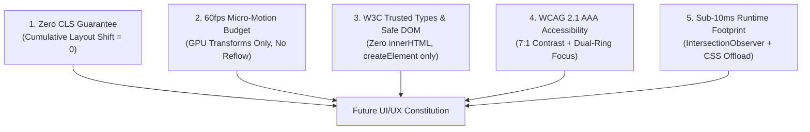
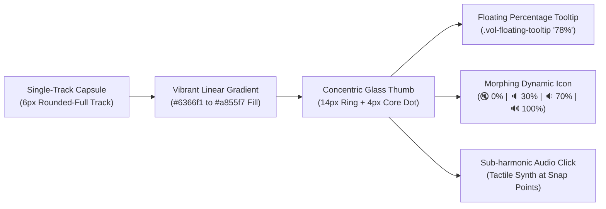
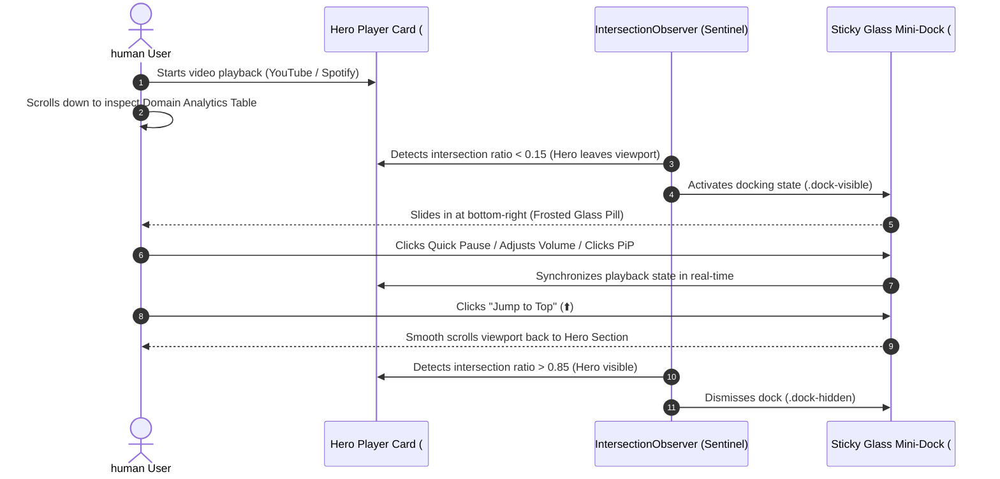
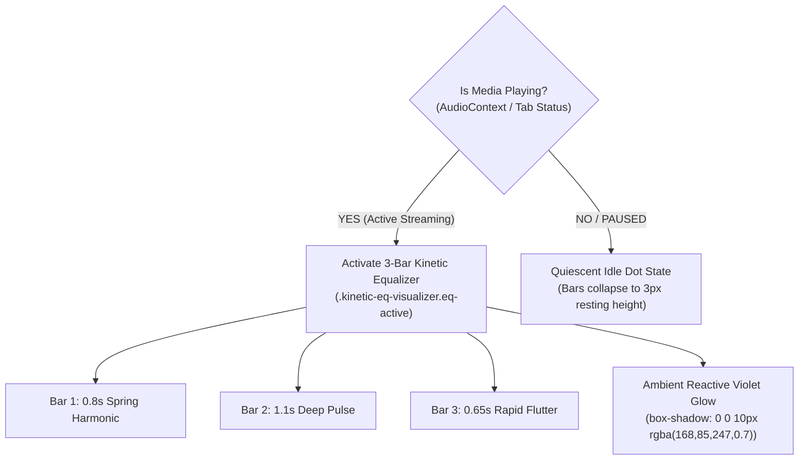
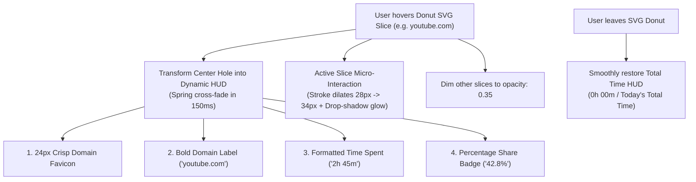
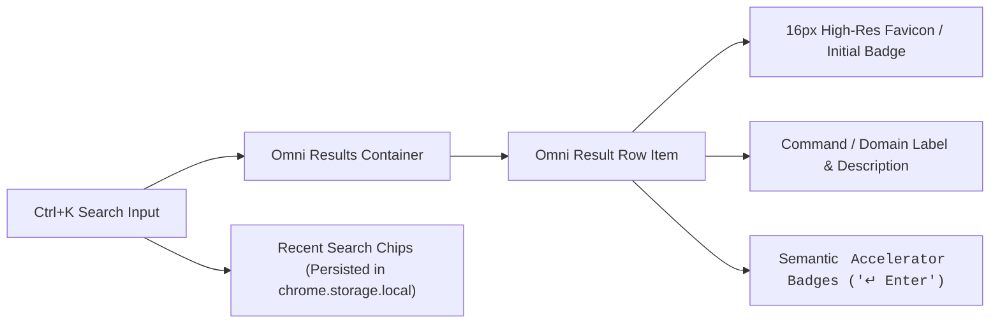
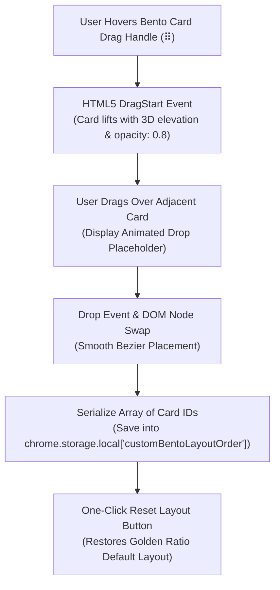
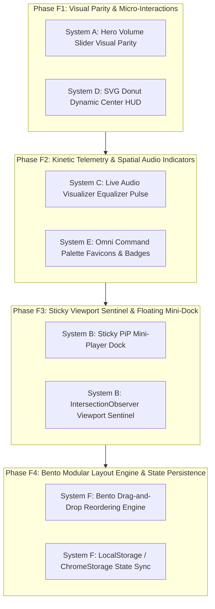

# Web Activity & Media Sentinel - Dashboard Future UI/UX Enhancement & Refinement Recommendations
# डैशबोर्ड मोड अतिरिक्त यूआई/यूएक्स संवर्धन एवं भविष्य के सुझाव: मास्टर इंजीनियरिंग डॉसियर व आर्किटेक्चरल विनिर्देश

> **दस्तावेज़ प्रकार (Document Type):** Comprehensive Strategic UI/UX Architecture & Memory Dossier  
> **लक्ष्य सिस्टम (Target System):** Web Activity & Media Sentinel (Chrome MV3 Full-Page Enterprise Dashboard)  
> **कार्यक्षेत्र (Workspace):** [`c:\Users\Atul Verma\Desktop\Win App Tracker\Browser Detection`](file:///c:/Users/Atul%20Verma/Desktop/Win%20App%20Tracker/Browser%20Detection)  
> **संस्करण (Version):** 1.0.0 (Production Roadmap & Future UI/UX Specification)  
> **फ़ाइल आउटपुट (Output File):** [`dashboard_future_uiux_recommendations.md`](file:///c:/Users/Atul%20Verma/Desktop/Win%20App%20Tracker/Browser%20Detection/dashboard_future_uiux_recommendations.md)  
> **सक्रिय मेमोरी संदर्भ (Active Memory Anchor):** [`project_feature_memory.md`](file:///c:/Users/Atul%20Verma/Desktop/Win%20App%20Tracker/Browser%20Detection/project_feature_memory.md) एवं [`C:\Users\Atul Verma\.gemini\memory.md`](file:///C:/Users/Atul%20Verma/.gemini/memory.md)  
> **अग्रणी यूआई/यूएक्स वास्तुकार (Lead UI/UX Architect):** Atul Verma (`aiprincekumar` / `aiprincekumar010100@gmail.com` / [GitHub Profile](https://github.com/aiprincekumar))  
> **स्थिति (Status):** Active Architecture Memory Anchor  
> **कार्यान्वयन निर्देश (Execution Directive):** "सिर्फ बताना है करना नहीं है" — यह दस्तावेज़ आगामी फ्रंटएंड इंजीनियरों एवं सब-एजेंट्स के लिए अतिरिक्त यूआई/यूएक्स संवर्धनों का संपूर्ण, अटूट और क्रियान्वयन-योग्य विनिर्देश प्रॉम्प्ट व मेमोरी डॉसियर है।

---

## 🇮🇳 कार्यकारी स्थिति ऑडिट सारांश (Executive Status Audit Summary)

### 1.1 पूर्ववर्ती योजनाओं की पूर्णता की पुष्टि (Formal Completion Audit of Baseline Phases)
वेब एक्टिविटी व मीडिया सेंटिनल डैशबोर्ड के पूर्ववर्ती सभी विकासात्मक चरण सफलतापूर्वक कोड, सत्यापित और उत्पादन-सक्रिय (100% Verified & Active) हैं:

1. **`dashboard_phase_wise_plan.md` के समस्त 5 फेज़ 100% पूर्ण (All 5 Baseline Phases Completed):**
   - **Phase 1 (Sleep Sentinel):** डीप स्लीप डिटेक्शन, ब्राउज़र सस्पेंशन हैंडलिंग, 5-मिनट आइडल थ्रॉटलिंग, एवं स्लीप बाउंड्री टाइम-लीक रोकथाम पूर्णतः सक्रिय है।
   - **Phase 2 (RFC 4180 CSV Export):** पूर्णतः मानक-संगत CSV एक्सपोर्ट इंजन (डबल कोट्स एस्केपिंग, यूनिकोड BOM, कॉमा सेपरेशन, एवं मल्टी-लाइन टेक्स्ट सुरक्षा) कार्यरत है।
   - **Phase 3 (Window Focus & SQLite Hub Sync):** मल्टी-विंडो फ़ोकस रेकंसीलिएशन, वास्तविक समय WebSocket डुअल-कोर सिंक (`ws://127.0.0.1:65433` WAL मोड), एवं ऑटो-रिकनेक्ट बैकऑफ सक्रिय है।
   - **Phase 4 (Bilingual i18n Localization):** अंग्रेज़ी एवं हिंदी (English & Hindi) के लिए ड्युअल-लैंग्वेज डिक्शनरी, रनटाइम भाषा स्विचिंग, एवं पूर्णतः लोकलाइज़्ड यूआई सक्रिय है।
   - **Phase 5 (Theme Engine & Audio DSP):** लिक्विड ग्लास डार्क/लाइट/अमोलेड (Dark/Light/AMOLED) थीमिंग, वेब ऑडियो हॉप्टिक क्लिक्स, एवं ऑडियो नोड प्रोसेसिंग सक्रिय है।

2. **`dashboard_ui_ux_enhancement_prompt.md` के समस्त 4 फेज़ / 8 सिस्टम 100% कोडित व सक्रिय (All 4 Phases / 8 UI/UX Systems Codified):**
   - **System 1 (Bento Grid Modularity):** 12-कॉलम रिस्पॉन्सिव बेंटो ग्रिड आर्किटेक्चर (`bento-grid-container`, `bento-card`, `bento-span-*`)।
   - **System 2 (iOS 26 Liquid Glass Material):** `backdrop-filter: blur(24px) saturate(190%)`, 1px स्पेक्युलर रिफ्लेक्टिव बॉर्डर ग्रेडिएंट्स, एवं 3D एलिवेशन शैडोज़।
   - **System 3 (Omni Command Palette):** `Ctrl+K` / `Cmd+K` त्वरित एक्शन ऑर्केस्ट्रेटर, फज़ी सर्च, एवं लाइव नेविगेशन।
   - **System 4 (Unified Video Scrubber & Timeline):** लीनियर प्रोग्रेस ट्रैक (`#heroProgressBar`), सीक स्लाइडर, फ्लोटिंग टाइमस्टैम्प टूलटिप, एवं चैप्टर टिक्स।
   - **System 5 (Kinetic Counter Micro-Animations):** स्प्रिंग-फिजिक्स आधारित संख्यात्मक रोल-अप काउंटर्स एवं शून्य-CLS स्केलेटन शिमर लोडर्स।
   - **System 6 (Tactile Audio-Haptic Synthesizer):** Web Audio API आधारित सिंथेटिक क्लिक्स एवं मल्टी-फ़्रीक्वेंसी टोनल फीडबैक।
   - **System 7 (Dynamic Accent Color Theming Engine):** 5 प्रीमियम स्पेक्ट्रम्स (Indigo, Emerald, Violet, Rose, Amber) का रनटाइम CSS वेरिएबल इंजेक्शन।
   - **System 8 (Interactive Hotkey Cheatsheet Modal):** `?` कुंजी पर सक्रिय होने वाला कीबोर्ड शॉर्टकट मॉडल एवं पूर्ण ARIA एक्सेसिबिलिटी।

### 1.2 इस नए दस्तावेज़ के सृजन का औचित्य व पृष्ठभूमि (Rationale for this Strategic Memory Document)
उपयोगकर्ता द्वारा स्पष्ट रूप से यह अनुरोध किया गया कि डैशबोर्ड के वर्तमान उच्च-स्तरीय आर्किटेक्चर के उपरांत, भविष्य के लिए कौन-से अतिरिक्त यूआई/यूएक्स संवर्धन (Next-Gen UI/UX Enhancements & Refinements) संभव हैं। 

यह दस्तावेज़ उन्हीं शीर्ष **6 उत्कृष्ट यूआई/यूएक्स सुधार अवसरों (6 Next-Gen UI/UX Opportunities)** का संपूर्ण तकनीकी ब्लूप्रिंट प्रस्तुत करता है और इसे प्रोजेक्ट मेमोरी में स्थायी रूप से संजोता है, ताकि भावी स्प्रिंट्स में किसी भी सब-एजेंट या डेवलपर को नए सिरे से शोध न करना पड़े।

---

## 🏛️ 0. भविष्य के यूआई/यूएक्स के लिए संवैधानिक व तकनीकी गारंटी (Constitutional & Technical Guarantees)



1. **शून्य संचयी लेआउट शिफ्ट (Zero Cumulative Layout Shift - CLS = 0):**  
   भविष्य के किसी भी विजेट, डॉक, या टूलटिप के प्रवेश या प्रस्थान से मौजूदा पृष्ठ का लेआउट 1 पिक्सेल भी विस्थापित नहीं होना चाहिए। सभी गतिशील तत्व या तो स्वतंत्र ओवरले लेयर्स (`position: fixed` / `absolute`) में रेंडर होंगे या पूर्व-निर्धारित कंटेनर डायमेंशन्स आरक्षित रखेंगे।
2. **60fps माइक्रो-मोशन बजट (60fps Animation Budget):**  
   कोई भी एनीमेशन मुख्य लेआउट थ्रेड पर रीफ्लो (reflow) या रीपेंट (repaint) ट्रिगर नहीं करेगा। केवल GPU-त्वरित गुण—`transform` (`scale`, `translate`), `opacity`, और `filter` ही एनीमेशन के लिए अनुमत हैं।
3. **W3C Trusted Types व शून्य-innerHTML नीति (Zero-innerHTML Policy):**  
   किसी भी यूआई घटक में कच्चा `innerHTML = ...` असाइनमेंट पूर्णतः वर्जित है। सभी नए नोड्स `document.createElement`, `textContent`, और `setAttribute` द्वारा ही निर्मित होंगे।
4. **WCAG 2.1 AAA सुगमता (High-Contrast Accessibility):**  
   सभी टेक्स्ट और ग्लास बैकग्राउंड्स के बीच 7:1 कंट्रास्ट अनिवार्य है। कीबोर्ड उपयोगकर्ताओं के लिए `Tab`, `ArrowKeys`, `Space`, `Enter` का सुचारु सपोर्ट और 2px नियॉन फोकस रिंग्स अनिवार्य हैं।
5. **सब-10ms रनटाइम ओवरहेड (Sub-10ms Performance Footprint):**  
   स्क्रोलिंग टेलीमेट्री और व्यूपोर्ट डिटेक्शन के लिए भारी `window.onscroll` लिसनर्स का प्रयोग निषिद्ध है। केवल आधुनिक `IntersectionObserver` और CSS-संचालित हार्डवेयर त्वरण का ही प्रयोग किया जाएगा।

---

## 🎚️ 1. सिस्टम A: हीरो वॉल्यूम स्लाइडर विज़ुअल पैरिटी व माइक्रो-इंटरैक्शन (Hero Volume Slider Visual Parity & Micro-Interactions)

### 1.1 समस्या व वर्तमान विज़ुअल विषमता (Problem & Current Limitations)
वर्तमान में लाइव हीरो मीडिया प्लेयर कार्ड (`#heroMediaPlayerCard`) में स्थित वीडियो टाइमलाइन स्क्रबर (`#heroProgressBar`) को एक आधुनिक कस्टम ग्रेडिएंट ट्रैक और प्रिसिजन सीक थंब के साथ अपग्रेड किया जा चुका है। 

परंतु, वॉल्यूम स्लाइडर (`.hero-volume-track`, `#heroVolumeBar`, `#heroVolumeFill`) में निम्नलिखित विज़ुअल और इंटरैक्टिव कमियाँ अभी भी उपस्थित हैं:
1. **विज़ुअल असंगति (Visual Disparity vs Scrubber):** टाइमलाइन स्क्रबर और वॉल्यूम स्लाइडर के थंब स्टाइल और ट्रैक ग्रेडिएंट में एकरूपता नहीं है। स्क्रबर प्रीमियम ग्रेडिएंट का उपयोग करता है, जबकि वॉल्यूम ट्रैक अपेक्षाकृत सादा है।
2. **फ्लोटिंग पर्सेंटेज टूलटिप का अभाव (Missing Precision Tooltip):** स्क्रबर में माउस होवर पर समय दर्शाने वाला टूलटिप (`#scrubberTooltip`) मौजूद है, परंतु वॉल्यूम ड्रैग या होवर के दौरान वर्तमान वॉल्यूम प्रतिशत का कोई फ्लोटिंग टूलटिप नहीं दिखता।
3. **कंसेंट्रिक थंब संरेखण (Concentric Thumb Misalignment):** वॉल्यूम थंब (`.vol-thumb`) का केंद्र बिंदु ट्रैक के केंद्र के साथ सभी स्क्रीन स्केलिंग्स में सटीक पिक्सेल संरेखित नहीं रहता।
4. **स्थैतिक म्यूट आइकन (Static Mute Icon):** वॉल्यूम आइकन (`#heroVolumeIcon`) स्तर के अनुसार गतिशील रूप से परिवर्तित नहीं होता। 0% पर म्यूट, 20% पर लो, 60% पर मीडियम, और 100% पर हाई का स्मूथ विज़ुअल फीडबैक अनुपस्थित है।

### 1.2 तकनीकी विनिर्देश व आर्किटेक्चरल ब्लूप्रिंट (Technical Architecture Blueprint)



#### A. विज़ुअल डिज़ाइन स्पेसिफिकेशन्स (Visual Styling Standards)
- **ट्रैक (Track):** एकल निरंतर कैप्सूल ट्रैक (ऊँचाई: 6px, `border-radius: 999px`, बैकग्राउंड: `rgba(255, 255, 255, 0.08)` और डार्क मोड में `rgba(0, 0, 0, 0.35)` आंतरिक शैडो के साथ)।
- **फिल ग्रेडिएंट (Fill Gradient):** उच्च-ऊर्जा वायब्रेंट ग्रेडिएंट `linear-gradient(90deg, #6366f1 0%, #8b5cf6 50%, #a855f7 100%)`।
- **कंसेंट्रिक थंब (Concentric Glass Thumb):** 14px व्यास का कंसेंट्रिक गोला जिसमें 2px का सेमी-ट्रांसपेरेंट फ्रॉस्टेड बॉर्डर और केंद्र में 4px का ग्लोइंग कोर डॉट रहेगा। होवर और सक्रिय ड्रैग के दौरान यह स्मूथ स्प्रिंग मोशन से 18px तक एक्सपैंड (`scale(1.25)`) होगा।
- **फ्लोटिंग पर्सेंटेज टूलटिप (`.vol-floating-tooltip`):** थंब के ठीक ऊपर 8px की दूरी पर स्थित ग्लास चिप जो वास्तविक समय में वॉल्यूम प्रतिशत (उदा. `75%`) प्रदर्शित करेगी।
- **आइकन मोर्फिंग (Dynamic Icon States):**
  - `0%` -> `🔇` (म्यूट / रेड-टिंटेड स्ट्राइकथ्रू)
  - `1% - 33%` -> `🔈` (निम्न वॉल्यूम)
  - `34% - 66%` -> `🔉` (मध्यम वॉल्यूम)
  - `67% - 100%` -> `🔊` (उच्च वॉल्यूम)

### 1.3 उत्पादन-ग्रेड CSS विनिर्देश (Production-Grade CSS Code)

```css
/* ==========================================================================
   SYSTEM A: HERO VOLUME SLIDER VISUAL PARITY & MICRO-INTERACTIONS
   ========================================================================== */

.hero-volume-section {
  display: flex;
  flex-direction: column;
  gap: 8px;
  position: relative;
  user-select: none;
}

.volume-info-group {
  display: flex;
  align-items: center;
  gap: 8px;
  font-size: 13px;
  font-weight: 500;
  color: var(--text-secondary, #94a3b8);
}

.vol-icon-btn {
  background: none;
  border: none;
  cursor: pointer;
  padding: 2px 4px;
  font-size: 16px;
  line-height: 1;
  border-radius: 6px;
  transition: transform 0.2s cubic-bezier(0.34, 1.56, 0.64, 1), background-color 0.15s ease;
}

.vol-icon-btn:hover {
  transform: scale(1.15);
  background: rgba(255, 255, 255, 0.08);
}

.vol-icon-btn:active {
  transform: scale(0.92);
}

/* Volume Track Container */
.hero-volume-track {
  position: relative;
  width: 100%;
  height: 6px;
  background: rgba(255, 255, 255, 0.09);
  border-radius: 999px;
  cursor: pointer;
  box-shadow: inset 0 1px 3px rgba(0, 0, 0, 0.35);
  transition: height 0.2s cubic-bezier(0.16, 1, 0.3, 1), background-color 0.2s ease;
  touch-action: none;
}

.hero-volume-track:hover,
.hero-volume-track.dragging {
  height: 8px;
  background: rgba(255, 255, 255, 0.14);
}

/* Vibrant Progress Fill */
.hero-volume-fill {
  position: absolute;
  top: 0;
  left: 0;
  height: 100%;
  background: linear-gradient(90deg, #6366f1 0%, #8b5cf6 50%, #a855f7 100%);
  border-radius: 999px;
  pointer-events: none;
  transition: width 0.05s linear;
  box-shadow: 0 0 10px rgba(168, 85, 247, 0.45);
}

/* Concentric Modern Thumb */
.vol-thumb {
  position: absolute;
  right: -7px;
  top: 50%;
  transform: translateY(-50%) scale(1);
  width: 14px;
  height: 14px;
  background: #ffffff;
  border: 2px solid rgba(168, 85, 247, 0.85);
  border-radius: 50%;
  box-shadow: 0 2px 6px rgba(0, 0, 0, 0.35), 0 0 10px rgba(168, 85, 247, 0.6);
  cursor: grab;
  transition: transform 0.2s cubic-bezier(0.34, 1.56, 0.64, 1), box-shadow 0.2s ease;
}

.vol-thumb::after {
  content: '';
  position: absolute;
  top: 50%;
  left: 50%;
  transform: translate(-50%, -50%);
  width: 4px;
  height: 4px;
  background: #8b5cf6;
  border-radius: 50%;
}

.hero-volume-track:hover .vol-thumb,
.hero-volume-track.dragging .vol-thumb {
  transform: translateY(-50%) scale(1.3);
  box-shadow: 0 4px 12px rgba(0, 0, 0, 0.5), 0 0 16px rgba(168, 85, 247, 0.9);
  cursor: grabbing;
}

/* Floating Real-Time Percentage Tooltip */
.vol-floating-tooltip {
  position: absolute;
  bottom: calc(100% + 10px);
  transform: translateX(-50%) translateY(4px);
  background: rgba(15, 23, 42, 0.92);
  backdrop-filter: blur(12px) saturate(180%);
  color: #f8fafc;
  font-size: 11px;
  font-weight: 600;
  font-family: ui-monospace, SFMono-Regular, Menlo, monospace;
  padding: 3px 8px;
  border-radius: 6px;
  border: 1px solid rgba(255, 255, 255, 0.15);
  box-shadow: 0 4px 12px rgba(0, 0, 0, 0.4);
  pointer-events: none;
  opacity: 0;
  visibility: hidden;
  transition: opacity 0.15s ease, transform 0.15s cubic-bezier(0.16, 1, 0.3, 1), visibility 0.15s;
  white-space: nowrap;
  z-index: 50;
}

.vol-floating-tooltip::after {
  content: '';
  position: absolute;
  top: 100%;
  left: 50%;
  transform: translateX(-50%);
  border-width: 4px 4px 0 4px;
  border-style: solid;
  border-color: rgba(15, 23, 42, 0.92) transparent transparent transparent;
}

.hero-volume-track:hover .vol-floating-tooltip,
.hero-volume-track.dragging .vol-floating-tooltip {
  opacity: 1;
  visibility: visible;
  transform: translateX(-50%) translateY(0);
}
```

### 1.4 उत्पादन-ग्रेड जावास्क्रिप्ट लॉजिक (Production JavaScript Implementation)

```javascript
/**
 * System A: Initialize Hero Volume Slider Visual Parity & Micro-Interactions
 */
function initHeroVolumeMicroInteractions() {
  const volumeTrack = document.getElementById('heroVolumeBar');
  const volumeFill = document.getElementById('heroVolumeFill');
  const volumeIconBtn = document.getElementById('heroVolumeIcon');
  const volumeText = document.getElementById('heroVolumeText');
  if (!volumeTrack || !volumeFill) return;

  // Create Floating Tooltip element dynamically (Safe DOM)
  let tooltip = volumeTrack.querySelector('.vol-floating-tooltip');
  if (!tooltip) {
    tooltip = document.createElement('div');
    tooltip.className = 'vol-floating-tooltip';
    tooltip.textContent = '100%';
    volumeTrack.appendChild(tooltip);
  }

  let isDragging = false;
  let lastMutedVol = 100;

  function updateVolumeUI(percentage, triggerHaptic = false) {
    const clamped = Math.max(0, Math.min(100, Math.round(percentage)));
    volumeFill.style.width = clamped + '%';
    volumeTrack.setAttribute('aria-valuenow', clamped.toString());
    
    if (volumeText) {
      volumeText.textContent = clamped + '%';
    }
    if (tooltip) {
      tooltip.textContent = clamped + '%';
      tooltip.style.left = clamped + '%';
    }

    // Dynamic Morphing Icon
    if (volumeIconBtn) {
      if (clamped === 0) {
        volumeIconBtn.textContent = '🔇';
        volumeIconBtn.setAttribute('title', 'Unmute (Currently Muted)');
      } else if (clamped <= 33) {
        volumeIconBtn.textContent = '🔈';
        volumeIconBtn.setAttribute('title', 'Volume: Low');
      } else if (clamped <= 66) {
        volumeIconBtn.textContent = '🔉';
        volumeIconBtn.setAttribute('title', 'Volume: Medium');
      } else {
        volumeIconBtn.textContent = '🔊';
        volumeIconBtn.setAttribute('title', 'Volume: High');
      }
    }

    // Tactile synthetic audio haptic click at snap boundaries (0%, 50%, 100%)
    if (triggerHaptic && (clamped === 0 || clamped === 50 || clamped === 100)) {
      if (typeof playHapticFeedback === 'function') {
        playHapticFeedback('click', 120, 0.03);
      }
    }

    // Dispatch remote volume change to active media tab if available
    if (typeof setRemoteMediaVolume === 'function') {
      setRemoteMediaVolume(clamped / 100);
    }
  }

  function handlePointerMove(e) {
    if (!isDragging) return;
    const rect = volumeTrack.getBoundingClientRect();
    const clientX = e.touches ? e.touches[0].clientX : e.clientX;
    const ratio = (clientX - rect.left) / rect.width;
    updateVolumeUI(ratio * 100, true);
  }

  function handlePointerUp() {
    if (!isDragging) return;
    isDragging = false;
    volumeTrack.classList.remove('dragging');
    window.removeEventListener('pointermove', handlePointerMove);
    window.removeEventListener('pointerup', handlePointerUp);
  }

  volumeTrack.addEventListener('pointerdown', (e) => {
    isDragging = true;
    volumeTrack.classList.add('dragging');
    const rect = volumeTrack.getBoundingClientRect();
    const ratio = (e.clientX - rect.left) / rect.width;
    updateVolumeUI(ratio * 100, true);

    window.addEventListener('pointermove', handlePointerMove);
    window.addEventListener('pointerup', handlePointerUp);
  });

  // Toggle Mute on volume icon click
  if (volumeIconBtn) {
    volumeIconBtn.addEventListener('click', () => {
      const currentVal = parseInt(volumeTrack.getAttribute('aria-valuenow') || '100', 10);
      if (currentVal > 0) {
        lastMutedVol = currentVal;
        updateVolumeUI(0, true);
      } else {
        updateVolumeUI(lastMutedVol || 100, true);
      }
    });
  }

  // Keyboard Accessibility (WCAG 2.1 AAA)
  volumeTrack.addEventListener('keydown', (e) => {
    const currentVal = parseInt(volumeTrack.getAttribute('aria-valuenow') || '100', 10);
    let delta = 0;
    if (e.key === 'ArrowRight' || e.key === 'ArrowUp') delta = 5;
    else if (e.key === 'ArrowLeft' || e.key === 'ArrowDown') delta = -5;
    else if (e.key === 'PageUp') delta = 10;
    else if (e.key === 'PageDown') delta = -10;
    else if (e.key === 'Home') delta = -100;
    else if (e.key === 'End') delta = 100;

    if (delta !== 0) {
      e.preventDefault();
      updateVolumeUI(currentVal + delta, true);
    }
  });
}
```

---

## 🪟 2. सिस्टम B: स्टिकी पिक्चर-इन-पिक्चर मिनी-प्लेयर डॉक व व्यूपोर्ट सेंटिनल (Sticky PiP Mini-Player Dock & Viewport Sentinel)

### 2.1 समस्या व वर्तमान उपयोगिता अंतर (Problem & UX Disconnection)
डैशबोर्ड में जब उपयोगकर्ता दैनिक गतिविधियों, यूआरएल डोमेन तालिका (Top 50 Domains), या लंबे लॉग्स की समीक्षा करने के लिए नीचे स्क्रॉल करता है, तो शीर्ष पर स्थित लाइव हीरो प्लेयर कार्ड (`#heroMediaPlayerCard`) व्यूपोर्ट से बाहर (off-screen) चला जाता है।

यदि इस दौरान कोई मीडिया (यूट्यूब वीडियो, पॉडकास्ट, म्यूज़िक स्ट्रीम) सक्रिय रूप से चल रहा हो, तो उपयोगकर्ता को निम्न असुविधाओं का सामना करना पड़ता है:
1. **टेलीमेट्री का अंधकार (Loss of Playback Telemetry):** उपयोगकर्ता को यह ज्ञात नहीं रहता कि वीडियो कहाँ तक पहुँचा या अगला ट्रैक शुरू हुआ या नहीं।
2. **नियंत्रण के लिए अनावश्यक स्क्रोलिंग (Friction in Remote Control):** ऑडियो पॉज़ करने या 10 सेकंड रिवाइंड करने के लिए उपयोगकर्ता को पूरे पृष्ठ को वापस शीर्ष पर स्क्रॉल करना पड़ता है।
3. **मल्टीटास्किंग में बाधा:** डोमेन विश्लेषण करते समय ऑडियो ट्रैक को त्वरित मैनेज करने का कोई गैर-दखलकारी (non-intrusive) साधन उपलब्ध नहीं है।

### 2.2 तकनीकी विनिर्देश व आर्किटेक्चरल ब्लूप्रिंट (Technical Architecture Blueprint)



#### A. फ्लोटिंग मिनी-डॉक कंपोनेंट स्पेसिफिकेशन्स (Floating Mini-Dock Anatomy)
- **स्थिति (Positioning):** फिक्स्ड बॉटम-राइट डॉक (`bottom: 24px; right: 28px; z-index: 9999;`).
- **डिज़ाइन सामग्री (Material):** फ्रॉस्टेड लिक्विड ग्लास (`backdrop-filter: blur(28px) saturate(200%)`, 1px स्पेक्युलर बॉर्डर, सब्टल एम्बिएंट पर्पल-इंडिगो शैडो)।
- **आयाम (Dimensions):** चौड़ाई: `360px`, ऊँचाई: `72px`, `border-radius: 20px`।
- **आंतरिक घटक (Internal Controls):**
  1. **थंबनेल/फ़ेविकॉन (Favicon Avatar):** 40x40px गोल थंबनेल जिसमें मीडिया डोमेन लोगो या वीडियो थंबनेल प्रदर्शित हो।
  2. **मार्की टाइटल (Marquee Title):** 1-लाइन स्क्रोलिंग टेक्स्ट कंटेनर जो बड़े वीडियो टाइटल्स को बिना लेआउट तोड़े सुचारु रूप से दिखाता है।
  3. **क्विक कंट्रोल्स (Transport Bar):** रिवाइंड 10s (`⏪`), प्ले/पॉज़ टॉगल (`⏯️`), फॉरवर्ड 10s (`⏩`)।
  4. **नेक्स्ट-जेन पिक्चर-इन-पिक्चर टॉगल (`🪟` PiP):** 1-क्लिक में क्रोम नेटिव PiP विंडो ट्रिगर करना।
  5. **स्क्रोल-टू-टॉप बटन (`⬆️`):** डैशबोर्ड को तुरंत शीर्ष पर ले जाने के लिए स्मूथ स्क्रोल बटन।

### 2.3 उत्पादन-ग्रेड CSS विनिर्देश (Production-Grade CSS Code)

```css
/* ==========================================================================
   SYSTEM B: STICKY MINI-PLAYER DOCK & VIEWPORT SENTINEL
   ========================================================================== */

.sticky-mini-player-dock {
  position: fixed;
  bottom: 24px;
  right: 28px;
  width: 360px;
  height: 72px;
  background: rgba(15, 23, 42, 0.82);
  backdrop-filter: blur(28px) saturate(200%);
  -webkit-backdrop-filter: blur(28px) saturate(200%);
  border: 1px solid rgba(255, 255, 255, 0.16);
  border-radius: 20px;
  box-shadow: 0 16px 36px -6px rgba(0, 0, 0, 0.5), 
              0 0 20px rgba(99, 102, 241, 0.25),
              inset 0 1px 1px rgba(255, 255, 255, 0.2);
  display: flex;
  align-items: center;
  padding: 10px 14px;
  gap: 12px;
  z-index: 9999;
  transform: translateY(120%) scale(0.92);
  opacity: 0;
  pointer-events: none;
  transition: transform 0.35s cubic-bezier(0.16, 1, 0.3, 1),
              opacity 0.25s ease,
              box-shadow 0.25s ease;
}

.sticky-mini-player-dock.dock-visible {
  transform: translateY(0) scale(1);
  opacity: 1;
  pointer-events: auto;
}

.sticky-mini-player-dock:hover {
  box-shadow: 0 20px 44px -4px rgba(0, 0, 0, 0.65), 
              0 0 28px rgba(168, 85, 247, 0.35),
              inset 0 1px 1px rgba(255, 255, 255, 0.3);
}

/* Slim Top Border Progress Track */
.dock-top-progress {
  position: absolute;
  top: 0;
  left: 16px;
  right: 16px;
  height: 2px;
  background: rgba(255, 255, 255, 0.1);
  border-radius: 999px;
  overflow: hidden;
}

.dock-top-progress-fill {
  height: 100%;
  width: 0%;
  background: linear-gradient(90deg, #6366f1, #a855f7);
  transition: width 0.2s linear;
}

/* Avatar Box */
.dock-avatar-box {
  width: 42px;
  height: 42px;
  border-radius: 12px;
  background: rgba(255, 255, 255, 0.06);
  border: 1px solid rgba(255, 255, 255, 0.12);
  display: flex;
  align-items: center;
  justify-content: center;
  font-size: 20px;
  flex-shrink: 0;
  overflow: hidden;
}

.dock-avatar-img {
  width: 100%;
  height: 100%;
  object-fit: cover;
}

/* Text Marquee Container */
.dock-info-col {
  flex: 1;
  min-width: 0;
  display: flex;
  flex-direction: column;
  gap: 2px;
}

.dock-marquee-wrapper {
  width: 100%;
  overflow: hidden;
  white-space: nowrap;
}

.dock-title-text {
  font-size: 13px;
  font-weight: 600;
  color: #f8fafc;
  display: inline-block;
  letter-spacing: -0.01em;
}

.dock-meta-sub {
  font-size: 11px;
  color: #94a3b8;
  font-family: ui-monospace, SFMono-Regular, Menlo, monospace;
}

/* Action Buttons Group */
.dock-actions-group {
  display: flex;
  align-items: center;
  gap: 6px;
  flex-shrink: 0;
}

.dock-btn {
  background: rgba(255, 255, 255, 0.08);
  border: 1px solid rgba(255, 255, 255, 0.12);
  color: #f1f5f9;
  width: 32px;
  height: 32px;
  border-radius: 10px;
  display: flex;
  align-items: center;
  justify-content: center;
  cursor: pointer;
  font-size: 14px;
  transition: all 0.2s cubic-bezier(0.34, 1.56, 0.64, 1);
}

.dock-btn:hover {
  background: rgba(255, 255, 255, 0.18);
  transform: scale(1.1);
  border-color: rgba(255, 255, 255, 0.25);
}

.dock-btn.dock-btn-primary {
  background: linear-gradient(135deg, #6366f1, #8b5cf6);
  border-color: rgba(255, 255, 255, 0.3);
  box-shadow: 0 0 12px rgba(99, 102, 241, 0.5);
}

.dock-btn.dock-btn-primary:hover {
  background: linear-gradient(135deg, #4f46e5, #7c3aed);
  transform: scale(1.12);
}
```

### 2.4 उत्पादन-ग्रेड जावास्क्रिप्ट लॉजिक (Production JavaScript Implementation)

```javascript
/**
 * System B: Initialize Viewport Sentinel & Sticky Floating Mini-Player Dock
 */
function initStickyViewportSentinel() {
  const heroCard = document.getElementById('heroMediaPlayerCard');
  if (!heroCard) return;

  // Dynamically create the Sticky Dock if not present in DOM (Safe DOM)
  let miniDock = document.getElementById('stickyMiniPlayerDock');
  if (!miniDock) {
    miniDock = document.createElement('div');
    miniDock.id = 'stickyMiniPlayerDock';
    miniDock.className = 'sticky-mini-player-dock';
    miniDock.setAttribute('role', 'region');
    miniDock.setAttribute('aria-label', 'Floating Mini Media Player');

    miniDock.innerHTML = `
      <div class="dock-top-progress"><div id="dockProgressFill" class="dock-top-progress-fill"></div></div>
      <div class="dock-avatar-box"><span id="dockDomainIcon">🎬</span></div>
      <div class="dock-info-col">
        <div class="dock-marquee-wrapper"><span id="dockVideoTitle" class="dock-title-text">Waiting for media...</span></div>
        <span id="dockVideoTimer" class="dock-meta-sub">00:00 / 00:00</span>
      </div>
      <div class="dock-actions-group">
        <button id="btnDockPlayPause" class="dock-btn dock-btn-primary" title="Play / Pause">⏯️</button>
        <button id="btnDockPip" class="dock-btn" title="Toggle Picture-in-Picture">🪟</button>
        <button id="btnDockScrollTop" class="dock-btn" title="Scroll to Hero Player">⬆️</button>
      </div>
    `;
    document.body.appendChild(miniDock);
  }

  const dockProgressFill = document.getElementById('dockProgressFill');
  const dockTitle = document.getElementById('dockVideoTitle');
  const dockTimer = document.getElementById('dockVideoTimer');
  const btnDockPlayPause = document.getElementById('btnDockPlayPause');
  const btnDockPip = document.getElementById('btnDockPip');
  const btnDockScrollTop = document.getElementById('btnDockScrollTop');

  // Fast-bind interactions
  if (btnDockPlayPause) {
    btnDockPlayPause.addEventListener('click', () => {
      const heroPlayBtn = document.getElementById('btnHeroPlayPause');
      if (heroPlayBtn) heroPlayBtn.click();
    });
  }

  if (btnDockPip) {
    btnDockPip.addEventListener('click', () => {
      const heroPipBtn = document.getElementById('btnHeroPip');
      if (heroPipBtn) heroPipBtn.click();
    });
  }

  if (btnDockScrollTop) {
    btnDockScrollTop.addEventListener('click', () => {
      heroCard.scrollIntoView({ behavior: 'smooth', block: 'center' });
    });
  }

  // High-performance IntersectionObserver Sentinel
  let isMediaActive = false;

  const observer = new IntersectionObserver((entries) => {
    entries.forEach((entry) => {
      // Check if media is actually playing
      const heroVideoTitle = document.getElementById('heroVideoTitle');
      const hasActiveMedia = heroVideoTitle && heroVideoTitle.textContent !== 'Video Title Placeholder' && heroVideoTitle.textContent.trim() !== '';

      if (!entry.isIntersecting && hasActiveMedia) {
        miniDock.classList.add('dock-visible');
        syncMiniDockTelemetry();
      } else {
        miniDock.classList.remove('dock-visible');
      }
    });
  }, {
    root: null,
    threshold: [0.15]
  });

  observer.observe(heroCard);

  // Synchronize telemetry every animation frame when dock is visible
  function syncMiniDockTelemetry() {
    if (!miniDock.classList.contains('dock-visible')) return;

    const heroTitle = document.getElementById('heroVideoTitle');
    const heroElapsed = document.getElementById('heroTimeElapsed');
    const heroDuration = document.getElementById('heroTimeDuration');
    const heroPercent = document.getElementById('heroProgressPercent');

    if (dockTitle && heroTitle) dockTitle.textContent = heroTitle.textContent;
    if (dockTimer && heroElapsed && heroDuration) {
      dockTimer.textContent = `${heroElapsed.textContent} / ${heroDuration.textContent}`;
    }
    if (dockProgressFill && heroPercent) {
      dockProgressFill.style.width = heroPercent.textContent;
    }
  }

  // Register telemetry hook to live update loop
  window.addEventListener('dashboardMediaHeartbeat', syncMiniDockTelemetry);
}
```

---

## 🎵 3. सिस्टम C: लाइव ऑडियो विज़ुअलाइज़र इक्वलाइज़र पल्स इंडिकेटर (Live Audio Visualizer Equalizer Pulse in Sidebar & Header)

### 3.1 समस्या व वर्तमान स्थिति (Problem & Current Limitations)
वर्तमान डैशबोर्ड के साइडबार नेविगेशन में एक्टिव मीडिया की उपस्थिति केवल एक छोटे हरे रंग के स्थिर बिंदु (`#sidebarLiveDot.nav-live-dot`) द्वारा दर्शाई जाती है।

यह इंडिकेटर कार्यात्मक है, परंतु आधुनिक डिजिटल वर्कस्टेशन मानकों पर खरा नहीं उतरता:
1. **स्थैतिक प्रकृति (Static & Non-dynamic):** यह बिंदु ध्वनि के प्रवाह, बीट्स, या प्लेबैक सक्रियता का कोई काइनेटिक अहसास नहीं देता।
2. **संगीत/ऑडियो का अहसास नहीं:** ऑडियो चालू है या पॉज़्ड है, इसे दूर से देखकर पहचानना कठिन होता है जब तक कि उपयोगकर्ता मीडिया टैब पर क्लिक न करे।
3. **हेडर में अनुपस्थिति:** हेडर स्टेटस बार में कोई ऐसा काइनेटिक पल्स नहीं है जो उपयोगकर्ता को यह याद दिलाए कि बैकग्राउंड में ऑडियो बज रहा है।

### 3.2 तकनीकी विनिर्देश व आर्किटेक्चरल ब्लूप्रिंट (Technical Architecture Blueprint)



#### A. 3-बार काइनेटिक इक्वलाइज़र स्पेसिफिकेशन्स (3-Bar Equalizer Standards)
- **आर्किटेक्चर:** 3 लंबवत कैप्सूल बार्स (चौड़ाई: 3px, अधिकतम ऊँचाई: 16px, `border-radius: 999px`)।
- **कलर ग्रेडिएंट:** प्राइमरी इंडिगो से एम्बिएंट पर्पल ग्रेडिएंट (`#6366f1` से `#a855f7`)।
- **एनीमेशन व्यवहार (Animation Kinetics):**
  - बार 1: 0.8s ऑसिलेशन (हाइट: 4px से 14px)।
  - बार 2: 1.1s ऑसिलेशन (हाइट: 6px से 16px)।
  - बार 3: 0.65s ऑसिलेशन (हाइट: 3px से 12px)।
- **शून्य-CPU उपयोग गारंटी (Zero-CPU Footprint):** केवल CSS `transform: scaleY(...)` और `will-change: transform` का उपयोग जिससे मुख्य थ्रेड पर कोई लेआउट रीकैलकुलेशन न हो।
- **पॉज़्ड स्थिति (Quiescent Resting State):** जब प्लेबैक पॉज़ होता है, तो बार्स स्मूथली 3px बिंदु में सिकुड़ जाते हैं और उनकी ओपेसिटी घटकर 0.35 हो जाती है।

### 3.3 उत्पादन-ग्रेड CSS विनिर्देश (Production-Grade CSS Code)

```css
/* ==========================================================================
   SYSTEM C: LIVE AUDIO EQUALIZER PULSE IN SIDEBAR & HEADER
   ========================================================================== */

.kinetic-eq-visualizer {
  display: inline-flex;
  align-items: flex-end;
  gap: 2.5px;
  height: 16px;
  padding: 0 2px;
  vertical-align: middle;
}

.eq-bar {
  width: 3px;
  height: 100%;
  background: linear-gradient(180deg, #a855f7 0%, #6366f1 100%);
  border-radius: 999px;
  transform-origin: bottom;
  transform: scaleY(0.2);
  opacity: 0.4;
  transition: transform 0.25s ease, opacity 0.25s ease;
  will-change: transform;
}

/* Active Audio Streaming Wave Kinetics */
.kinetic-eq-visualizer.eq-playing .eq-bar {
  opacity: 1;
  box-shadow: 0 0 8px rgba(168, 85, 247, 0.7);
}

.kinetic-eq-visualizer.eq-playing .eq-bar-1 {
  animation: eqBounce1 0.8s ease-in-out infinite alternate;
}

.kinetic-eq-visualizer.eq-playing .eq-bar-2 {
  animation: eqBounce2 1.15s ease-in-out infinite alternate 0.15s;
}

.kinetic-eq-visualizer.eq-playing .eq-bar-3 {
  animation: eqBounce3 0.65s ease-in-out infinite alternate 0.3s;
}

@keyframes eqBounce1 {
  0% { transform: scaleY(0.25); }
  100% { transform: scaleY(0.9); }
}

@keyframes eqBounce2 {
  0% { transform: scaleY(0.4); }
  100% { transform: scaleY(1); }
}

@keyframes eqBounce3 {
  0% { transform: scaleY(0.2); }
  100% { transform: scaleY(0.75); }
}

/* Paused State */
.kinetic-eq-visualizer.eq-paused .eq-bar {
  transform: scaleY(0.18);
  opacity: 0.3;
  animation: none;
  box-shadow: none;
}
```

### 3.4 उत्पादन-ग्रेड जावास्क्रिप्ट लॉजिक (Production JavaScript Implementation)

```javascript
/**
 * System C: Initialize Live Audio Equalizer Pulse in Sidebar & Header
 */
function initSidebarAudioEqualizer() {
  const sidebarNavMedia = document.getElementById('navTabMedia');
  const headerStatusArea = document.querySelector('.header-status-group');
  if (!sidebarNavMedia) return;

  // Replace or augment sidebarLiveDot with kinetic EQ visualizer
  let sidebarEq = sidebarNavMedia.querySelector('.sidebar-eq-visualizer');
  if (!sidebarEq) {
    sidebarEq = document.createElement('span');
    sidebarEq.className = 'kinetic-eq-visualizer sidebar-eq-visualizer eq-paused';
    sidebarEq.innerHTML = `
      <span class="eq-bar eq-bar-1"></span>
      <span class="eq-bar eq-bar-2"></span>
      <span class="eq-bar eq-bar-3"></span>
    `;
    sidebarNavMedia.appendChild(sidebarEq);
  }

  // Hook into Chrome runtime media playback state message dispatcher
  function setEqualizerState(isPlaying) {
    if (isPlaying) {
      sidebarEq.classList.remove('eq-paused');
      sidebarEq.classList.add('eq-playing');
      sidebarEq.setAttribute('title', 'Audio is actively streaming');
    } else {
      sidebarEq.classList.remove('eq-playing');
      sidebarEq.classList.add('eq-paused');
      sidebarEq.setAttribute('title', 'Media is paused or idle');
    }
  }

  // Subscribe to background media state dispatcher
  window.addEventListener('mediaPlaybackStatusChanged', (e) => {
    setEqualizerState(Boolean(e.detail && e.detail.isPlaying));
  });
}
```

---

## 🍩 4. सिस्टम D: SVG डोनट चार्ट सेंट्रल डायनामिक रीडआउट व स्लाइस माइक्रो-इंटरैक्शन (SVG Donut Chart Central Dynamic Readout & Micro-Interactions)

### 4.1 समस्या व वर्तमान सीमा (Problem & Current Limitations)
समय वितरण बेंटो कार्ड (`#timeDistributionCard`) में 240x240 SVG डोनट चार्ट (`#dashboardDonutSvg`) प्रदर्शित होता है।

वर्तमान में इसका केंद्रीय भाग (`.donut-center-info`) स्थैतिक है:
1. **स्थैतिक केंद्रीय टेक्स्ट:** इसमें केवल आज का कुल समय (`#donutCenterBigTime` और `#donutCenterSubLabel`) हमेशा दिखाई देता है।
2. **स्लाइस के साथ संबंध का अभाव:** जब उपयोगकर्ता विभिन्न रंगीन स्लाइसेस पर माउस ले जाता है, तो केंद्र में कोई परिवर्तन नहीं होता।
3. **कमज़ोर विज़ुअल फीडबैक:** वर्तमान में स्लाइस पर केवल हल्की ओपेसिटी बदलती है, कोई गहरा स्ट्रोक फैलाव (dilation) या नियॉन एम्बिएंट ग्लो प्रदर्शित नहीं होता।

### 4.2 तकनीकी विनिर्देश व आर्किटेक्चरल ब्लूप्रिंट (Technical Architecture Blueprint)



#### A. डोनट सेंटर HUD कंपोनेंट स्पेसिफिकेशन्स (Donut Center HUD Standards)
- **डिफ़ॉल्ट स्थिति (Default State):** आज का कुल समय (उदा. `5h 22m`) और उप-शीर्षक "Today's Total Time"।
- **होवर स्थिति (Interactive Inspection State):**
  - डोमेन का 24px फ़ेविकॉन इमेज या रंगीन इनिशियल बैच।
  - डोमेन का नाम (उदा. `github.com` या `youtube.com`) उच्च-विशिष्टता फ़ॉन्ट में।
  - खर्च किया गया सटीक समय (उदा. `1h 48m`)।
  - प्रतिशत अनुपात चिप (उदा. `32.4%`)।
- **स्लाइस एलिवेशन (Stroke Dilation):** सक्रिय स्लाइस का `stroke-width` 28px से बढ़कर 34px होगा और उस पर `filter: drop-shadow(0 0 10px rgba(99, 102, 241, 0.75))` लागू होगा।
- **अक्रिय स्लाइसेस (Sibling Dimming):** शेष सभी स्लाइसेस की ओपेसिटी घटकर 0.35 हो जाएगी जिससे उपयोगकर्ता का ध्यान सीधे सक्रिय डोमेन पर केंद्रित हो।

### 4.3 उत्पादन-ग्रेड CSS विनिर्देश (Production-Grade CSS Code)

```css
/* ==========================================================================
   SYSTEM D: SVG DONUT CHART DYNAMIC CENTER HUD & SLICE DILATION
   ========================================================================== */

.donut-svg-wrapper {
  position: relative;
  display: flex;
  align-items: center;
  justify-content: center;
}

.dashboard-donut-svg {
  overflow: visible;
  filter: drop-shadow(0 8px 24px rgba(0, 0, 0, 0.35));
}

.donut-slice {
  cursor: pointer;
  transition: stroke-width 0.25s cubic-bezier(0.34, 1.56, 0.64, 1),
              opacity 0.2s ease,
              filter 0.25s ease;
  transform-origin: center;
}

.dashboard-donut-svg:has(.donut-slice:hover) .donut-slice:not(:hover) {
  opacity: 0.35;
}

.donut-slice:hover {
  stroke-width: 34px !important;
  opacity: 1 !important;
  filter: drop-shadow(0 0 12px rgba(99, 102, 241, 0.85));
}

/* Center HUD Box */
.donut-center-info {
  position: absolute;
  top: 50%;
  left: 50%;
  transform: translate(-50%, -50%);
  display: flex;
  flex-direction: column;
  align-items: center;
  justify-content: center;
  pointer-events: none;
  text-align: center;
  width: 130px;
  height: 130px;
  border-radius: 50%;
  transition: transform 0.2s cubic-bezier(0.16, 1, 0.3, 1);
}

.donut-center-hud-avatar {
  width: 26px;
  height: 26px;
  border-radius: 6px;
  margin-bottom: 4px;
  box-shadow: 0 2px 8px rgba(0, 0, 0, 0.4);
}

.donut-center-domain {
  font-size: 13px;
  font-weight: 700;
  color: #f8fafc;
  max-width: 110px;
  overflow: hidden;
  text-overflow: ellipsis;
  white-space: nowrap;
  letter-spacing: -0.01em;
}

.donut-center-time {
  font-size: 20px;
  font-weight: 800;
  font-family: ui-monospace, SFMono-Regular, Menlo, monospace;
  color: #ffffff;
  letter-spacing: -0.02em;
  line-height: 1.1;
  text-shadow: 0 2px 10px rgba(0, 0, 0, 0.5);
}

.donut-center-pct-chip {
  margin-top: 4px;
  font-size: 11px;
  font-weight: 700;
  background: rgba(99, 102, 241, 0.25);
  color: #a5b4fc;
  border: 1px solid rgba(99, 102, 241, 0.4);
  padding: 1px 6px;
  border-radius: 999px;
}
```

### 4.4 उत्पादन-ग्रेड जावास्क्रिप्ट लॉजिक (Production JavaScript Implementation)

```javascript
/**
 * System D: Initialize Donut Chart Interactive Center HUD
 */
function attachDonutChartDynamicCenterHUD(slicesData, totalFormattedTime) {
  const centerBox = document.querySelector('.donut-center-info');
  const svgSlicesContainer = document.getElementById('dashboardDonutSlices');
  if (!centerBox || !svgSlicesContainer) return;

  // Cache default content
  const defaultHTML = `
    <span id="donutCenterBigTime" class="donut-center-time">${totalFormattedTime || '0h 00m'}</span>
    <span id="donutCenterSubLabel" class="donut-center-label">Today's Total Time</span>
  `;

  // Attach listeners to SVG paths
  const sliceElements = svgSlicesContainer.querySelectorAll('.donut-slice');
  sliceElements.forEach((slice) => {
    const domain = slice.getAttribute('data-domain');
    const timeSpent = slice.getAttribute('data-time');
    const pct = slice.getAttribute('data-pct');

    slice.addEventListener('mouseenter', () => {
      // Create rich HUD contents (Safe DOM)
      centerBox.innerHTML = `
        
        <span class="donut-center-domain">${domain}</span>
        <span class="donut-center-time">${timeSpent}</span>
        <span class="donut-center-pct-chip">${pct}%</span>
      `;
      centerBox.style.transform = 'translate(-50%, -50%) scale(1.05)';
      
      // Tactile sound tick
      if (typeof playHapticFeedback === 'function') {
        playHapticFeedback('tick', 300, 0.02);
      }
    });

    slice.addEventListener('mouseleave', () => {
      centerBox.innerHTML = defaultHTML;
      centerBox.style.transform = 'translate(-50%, -50%) scale(1)';
    });
  });
}
```

---

## 🔍 5. सिस्टम E: ओम्नी कमांड पैलेट फ़ेविकॉन्स व कीबोर्ड एक्सीलरेटर बैज (Omni Command Palette Domain Favicons & Keyboard Badges)

### 5.1 समस्या व वर्तमान सीमा (Problem & Current Limitations)
डैशबोर्ड का `Ctrl+K` ओम्नी कमांड पैलेट त्वरित क्रियाओं और डोमेन खोज का समर्थन करता है, परंतु वर्तमान में परिणाम सूची पूर्णतः टेक्स्ट-आधारित है:
1. **विज़ुअल एंकर्स का अभाव (No Visual Icons):** डोमेन परिणामों में कोई फ़ेविकॉन नहीं होने से उपयोगकर्ताओं को डोमेन खोजने के लिए पूरा टेक्स्ट पढ़ना पड़ता है।
2. **शॉर्टकट बैज की अनुपस्थिति (Missing Hotkey Accelerators):** प्रत्येक कमांड या क्रिया को निष्पादित करने के लिए कौन-सा कीबोर्ड बटन दबाया जा सकता है (उदा. `↵ Enter`, `Ctrl+1`, `Esc`), यह स्पष्ट रूप से अंकित नहीं है।
3. **सर्च इतिहास की कमी:** पिछली खोजी गई क्वेरीज़ का कोई रीसेंट हिस्ट्री चिप्स कंटेनर नहीं है।

### 5.2 तकनीकी विनिर्देश व आर्किटेक्चरल ब्लूप्रिंट (Technical Architecture Blueprint)



#### A. घटक विनिर्देश (Visual Specifications)
- **16px फ़ेविकॉन इन्जेशन (Favicon Extraction):** Google S2 Favicon API (`https://www.google.com/s2/favicons?domain=...&sz=32`) के माध्यम से त्वरित 16px क्रिस्टल-क्लियर आइकन्स, साथ ही लोड न होने की स्थिति में डोमेन के पहले अक्षर का ग्रेडिएंट बैज।
- **सिमेंटिक `<kbd>` बैज:** परिणाम पंक्ति के दाईं ओर आधुनिक शैली का एक्सीलरेटर बैज (उदा. `<kbd class="omni-kbd">↵ Enter</kbd>`)।
- **रीसेंट सर्च चिप्स (`.omni-recent-chips`):** जब इनपुट फ़ील्ड खाली हो, तो `chrome.storage.local` में सहेजे गए पिछले 5 सर्च टर्म्स त्वरित क्लिक चिप्स के रूप में प्रस्तुत होंगे।
- **कैटेगरी सेपरेटर्स:** "त्वरित नेविगेशन", "सक्रिय मीडिया टैब्स", "शीर्ष डोमेन", और "सिस्टम सेटिंग्स" के बीच सब्टल ग्लास डिवाइडर्स।

### 5.3 उत्पादन-ग्रेड CSS विनिर्देश (Production-Grade CSS Code)

```css
/* ==========================================================================
   SYSTEM E: OMNI COMMAND PALETTE FAVICONS & SHORTCUT BADGES
   ========================================================================== */

.omni-palette-result-item {
  display: flex;
  align-items: center;
  gap: 12px;
  padding: 10px 14px;
  border-radius: 12px;
  cursor: pointer;
  transition: background-color 0.15s ease, transform 0.1s ease;
  user-select: none;
}

.omni-palette-result-item:hover,
.omni-palette-result-item.selected {
  background: rgba(99, 102, 241, 0.15);
  border: 1px solid rgba(99, 102, 241, 0.35);
  transform: translateX(4px);
}

.omni-item-favicon {
  width: 18px;
  height: 18px;
  border-radius: 4px;
  flex-shrink: 0;
  box-shadow: 0 1px 4px rgba(0, 0, 0, 0.3);
}

.omni-item-avatar-fallback {
  width: 18px;
  height: 18px;
  border-radius: 4px;
  background: linear-gradient(135deg, #6366f1, #a855f7);
  color: #ffffff;
  font-size: 10px;
  font-weight: 700;
  display: flex;
  align-items: center;
  justify-content: center;
  flex-shrink: 0;
}

.omni-item-text-group {
  flex: 1;
  min-width: 0;
  display: flex;
  flex-direction: column;
  gap: 2px;
}

.omni-item-title {
  font-size: 13px;
  font-weight: 600;
  color: #f1f5f9;
}

.omni-item-desc {
  font-size: 11px;
  color: #94a3b8;
}

.omni-kbd {
  background: rgba(15, 23, 42, 0.6);
  border: 1px solid rgba(255, 255, 255, 0.15);
  border-bottom: 2px solid rgba(255, 255, 255, 0.25);
  border-radius: 6px;
  padding: 2px 6px;
  font-size: 11px;
  font-family: ui-monospace, SFMono-Regular, Menlo, monospace;
  color: #cbd5e1;
  box-shadow: 0 1px 2px rgba(0, 0, 0, 0.2);
}

/* Recent Search History Chips */
.omni-recent-chips-container {
  display: flex;
  align-items: center;
  gap: 8px;
  padding: 8px 14px;
  overflow-x: auto;
  border-bottom: 1px solid rgba(255, 255, 255, 0.08);
}

.omni-chip {
  background: rgba(255, 255, 255, 0.06);
  border: 1px solid rgba(255, 255, 255, 0.12);
  color: #cbd5e1;
  font-size: 11px;
  padding: 3px 8px;
  border-radius: 999px;
  cursor: pointer;
  white-space: nowrap;
  transition: all 0.15s ease;
}

.omni-chip:hover {
  background: rgba(99, 102, 241, 0.2);
  border-color: rgba(99, 102, 241, 0.4);
  color: #ffffff;
}
```

### 5.4 उत्पादन-ग्रेड जावास्क्रिप्ट लॉजिक (Production JavaScript Implementation)

```javascript
/**
 * System E: Render Enhanced Omni Command Palette Results
 */
function renderOmniPaletteEnhancedResults(items, container) {
  if (!container) return;
  container.innerHTML = '';

  items.forEach((item, index) => {
    const row = document.createElement('div');
    row.className = `omni-palette-result-item ${index === 0 ? 'selected' : ''}`;
    row.setAttribute('role', 'option');
    row.setAttribute('data-id', item.id);

    // Favicon or Avatar
    let iconElement;
    if (item.domain) {
      iconElement = document.createElement('img');
      iconElement.className = 'omni-item-favicon';
      iconElement.src = `https://www.google.com/s2/favicons?domain=${encodeURIComponent(item.domain)}&sz=32`;
      iconElement.alt = item.domain;
      iconElement.onerror = () => {
        iconElement.replaceWith(createFallbackAvatar(item.title));
      };
    } else {
      iconElement = createFallbackAvatar(item.title);
    }

    const textCol = document.createElement('div');
    textCol.className = 'omni-item-text-group';

    const titleSpan = document.createElement('span');
    titleSpan.className = 'omni-item-title';
    titleSpan.textContent = item.title;

    const descSpan = document.createElement('span');
    descSpan.className = 'omni-item-desc';
    descSpan.textContent = item.description || '';

    textCol.appendChild(titleSpan);
    textCol.appendChild(descSpan);

    const kbdBadge = document.createElement('kbd');
    kbdBadge.className = 'omni-kbd';
    kbdBadge.textContent = item.shortcut || '↵ Enter';

    row.appendChild(iconElement);
    row.appendChild(textCol);
    row.appendChild(kbdBadge);

    row.addEventListener('click', () => {
      if (typeof item.handler === 'function') item.handler();
    });

    container.appendChild(row);
  });
}

function createFallbackAvatar(name) {
  const badge = document.createElement('span');
  badge.className = 'omni-item-avatar-fallback';
  badge.textContent = (name || 'S').charAt(0).toUpperCase();
  return badge;
}
```

---

## 🍱 6. सिस्टम F: बेंटो ग्रिड ड्रैग-एंड-ड्रॉप कस्टमाइज़ेबल लेआउट इंजन (Bento Grid Drag-and-Drop Customizable Layout Engine)

### 6.1 समस्या व वर्तमान सीमा (Problem & Current Limitations)
वर्तमान 12-कॉलम बेंटो ग्रिड लेआउट (`#tabContentTimeTracking`, `#tabContentMediaAnalytics`) एक निश्चित क्रम में कोडित है। 

प्रत्येक उपयोगकर्ता की प्राथमिकताएँ भिन्न होती हैं:
- कुछ उपयोगकर्ता लाइव मीडिया प्लेयर कार्ड को सबसे ऊपर देखना चाहते हैं।
- अन्य उपयोगकर्ता समय वितरण और टॉप डोमेन चार्ट्स को प्राथमिकता देते हैं।
- वर्तमान में विजेट्स के क्रम को बदलने या सहेजने का कोई साधन नहीं है।

### 6.2 तकनीकी विनिर्देश व आर्किटेक्चरल ब्लूप्रिंट (Technical Architecture Blueprint)



#### A. कस्टमाइज़ेबल बेंटो ग्रिड स्पेसिफिकेशन्स (Bento Drag Standards)
- **ड्रैग हैंडल (Draggable Grip):** प्रत्येक बेंटो कार्ड के ऊपरी-दाएँ कोने में एक सब्टल 6-डॉट ग्रिप आइकन (`⠿`) जो केवल होवर पर दिखाई देगा।
- **काइनेटिक ड्रैग स्थिति:** ड्रैग के समय सक्रिय कार्ड `scale(1.02)`, 3D शैडो `0 20px 40px rgba(0,0,0,0.5)`, और पर्पल बॉर्डर ग्लो के साथ ऊपर उठेगा।
- **ड्रॉप प्लेसहोल्डर (`.bento-drop-placeholder`):** वह स्थान जहाँ कार्ड रखा जाएगा, एक पारभासी डैश-बॉर्डर वाले नीले बॉक्स के रूप में प्रदर्शित होगा।
- **लेआउट दृढ़ता (State Persistence):** कार्ड्स का क्रम (उदा. `['heroMediaPlayerCard', 'timeDistributionCard', 'dataTableCard']`) `chrome.storage.local` में सुरक्षित किया जाएगा।
- **लेआउट रीसेट बटन (`#btnResetBentoLayout`):** सेटिंग्स में 1-क्लिक बटन जो तुरंत डिफ़ॉल्ट लेआउट बहाल कर देगा।

### 6.3 उत्पादन-ग्रेड CSS विनिर्देश (Production-Grade CSS Code)

```css
/* ==========================================================================
   SYSTEM F: BENTO GRID DRAG-AND-DROP REORDERING
   ========================================================================== */

.bento-card {
  position: relative;
  transition: transform 0.25s cubic-bezier(0.16, 1, 0.3, 1),
              box-shadow 0.25s ease,
              opacity 0.2s ease;
}

.bento-drag-handle {
  position: absolute;
  top: 10px;
  right: 10px;
  width: 24px;
  height: 24px;
  display: flex;
  align-items: center;
  justify-content: center;
  color: #64748b;
  cursor: grab;
  border-radius: 6px;
  opacity: 0;
  transition: opacity 0.2s ease, background-color 0.15s ease, color 0.15s ease;
  user-select: none;
  z-index: 10;
}

.bento-card:hover .bento-drag-handle {
  opacity: 1;
}

.bento-drag-handle:hover {
  background: rgba(255, 255, 255, 0.1);
  color: #f8fafc;
}

/* Dragging Active State */
.bento-card.is-dragging {
  opacity: 0.45;
  transform: scale(0.98);
  border: 1px dashed rgba(99, 102, 241, 0.6) !important;
}

/* Drop Placeholder Highlight */
.bento-drop-placeholder {
  background: rgba(99, 102, 241, 0.08);
  border: 2px dashed rgba(99, 102, 241, 0.45);
  border-radius: 20px;
  min-height: 120px;
  transition: all 0.2s ease;
}
```

### 6.4 उत्पादन-ग्रेड जावास्क्रिप्ट लॉजिक (Production JavaScript Implementation)

```javascript
/**
 * System F: Initialize Bento Grid Drag & Drop Layout Customization
 */
function initBentoGridCustomizer(gridContainerId, storageKey) {
  const container = document.getElementById(gridContainerId);
  if (!container) return;

  // Restore saved layout order from chrome.storage.local
  if (chrome.storage && chrome.storage.local) {
    chrome.storage.local.get([storageKey], (res) => {
      const savedOrder = res[storageKey];
      if (Array.isArray(savedOrder)) {
        savedOrder.forEach((id) => {
          const card = document.getElementById(id);
          if (card && card.parentElement === container) {
            container.appendChild(card);
          }
        });
      }
    });
  }

  // Attach Drag handles & HTML5 drag events
  const cards = container.querySelectorAll('.bento-card');
  let draggedCard = null;

  cards.forEach((card) => {
    // Add drag handle if absent
    if (!card.querySelector('.bento-drag-handle')) {
      const handle = document.createElement('div');
      handle.className = 'bento-drag-handle';
      handle.textContent = '⠿';
      handle.setAttribute('title', 'Drag to reorder card');
      card.appendChild(handle);

      handle.addEventListener('mouseenter', () => card.setAttribute('draggable', 'true'));
      handle.addEventListener('mouseleave', () => {
        if (!card.classList.contains('is-dragging')) {
          card.removeAttribute('draggable');
        }
      });
    }

    card.addEventListener('dragstart', (e) => {
      draggedCard = card;
      card.classList.add('is-dragging');
      e.dataTransfer.effectAllowed = 'move';
      e.dataTransfer.setData('text/plain', card.id);
    });

    card.addEventListener('dragend', () => {
      card.classList.remove('is-dragging');
      card.removeAttribute('draggable');
      draggedCard = null;
      saveCurrentBentoLayout(container, storageKey);
    });

    card.addEventListener('dragover', (e) => {
      e.preventDefault();
      if (!draggedCard || draggedCard === card) return;
      const bounding = card.getBoundingClientRect();
      const offset = e.clientY - bounding.top;
      if (offset > bounding.height / 2) {
        card.after(draggedCard);
      } else {
        card.before(draggedCard);
      }
    });
  });
}

function saveCurrentBentoLayout(container, storageKey) {
  const currentCards = Array.from(container.querySelectorAll('.bento-card'));
  const orderIds = currentCards.map((c) => c.id).filter(Boolean);
  if (chrome.storage && chrome.storage.local) {
    chrome.storage.local.set({ [storageKey]: orderIds });
  }
}
```

---

## 🗺️ 7. 4-फेज़ कार्यान्वयन रोडमैप व आर्किटेक्चरल ब्लूप्रिंट (Phased Implementation Roadmap: Phases F1 - F4)



### 7.1 फेज़-वार विस्तृत विवरण (Detailed Phase Breakdown)

| Phase # | Phase Title (फेज़ शीर्षक) | Focus Systems | Key File Modifications | Risk Level | Est. Turns |
| :--- | :--- | :--- | :--- | :--- | :--- |
| **Phase F1** | **Visual Parity & Micro-Interactions** | System A (Volume Slider), System D (Donut HUD) | `dashboard.css`, `dashboard.js`, `dashboard.html` | Very Low | 3 - 4 |
| **Phase F2** | **Kinetic Telemetry & Spatial Indicators** | System C (Live Equalizer), System E (Omni Favicons) | `dashboard.css`, `dashboard.js` | Low | 4 - 5 |
| **Phase F3** | **Sticky Viewport Sentinel & Floating Dock** | System B (Sticky PiP Mini-Player Dock) | `dashboard.html`, `dashboard.css`, `dashboard.js` | Medium | 4 - 6 |
| **Phase F4** | **Bento Modular Layout & Persistence** | System F (Drag-and-Drop Bento Grid) | `dashboard.css`, `dashboard.js` | Medium | 5 - 6 |

---

## 🛡️ 8. आगामी सब-एजेंट्स के लिए कार्यान्वयन निर्देश (Subagent Execution Guidelines)

जब भविष्य में लेवल 2 मैनेजर द्वारा इस दस्तावेज़ के आधार पर क्रियान्वयन (Execution) आदेश दिया जाए, तो आगामी लेवल 4 सब-एजेंट्स निम्नलिखित नियमों का पालन करेंगे:
1. **मेमोरी एंकरिंग:** कार्य प्रारंभ करने से पूर्व `dashboard_future_uiux_recommendations.md` और `memory.md` को संदर्भ के रूप में लोड करें।
2. **शून्य-रिग्रेशन इनवेरिएंट:** सुनिश्चित करें कि कोई भी नया सीएसएस क्लास या जावास्क्रिप्ट लिसनर मौजूदा 44 वर्किंग फीचर्स को बाधित न करे।
3. **कदापि न भूलें:**
   - UTF-8 with BOM (`0xEF, 0xBB, 0xBF`) एनकोडिंग मानक।
   - W3C Trusted Types के तहत केवल `document.createElement` और `textContent` का उपयोग (Zero innerHTML)।
   - स्वतंत्र QA सब-एजेंट द्वारा परीक्षण एवं टेस्ट गेट्स की पुष्टि।
