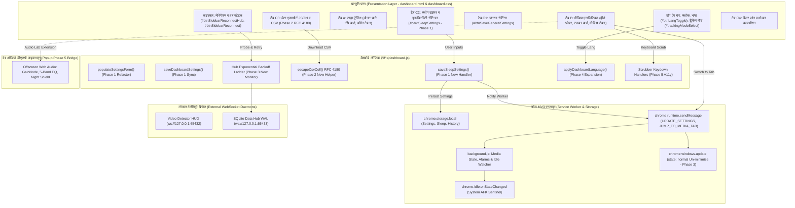

# Web Activity & Media Sentinel - Dashboard Mode: Phase-Wise Implementation Roadmap & Technical Procedures
# डैशबोर्ड मोड (Dashboard Mode): फेज़-वाइज़ कार्यान्वयन योजना, तकनीकी प्रक्रियाएं व टेस्ट गेट्स

> **दस्तावेज़ प्रकार (Document Type):** Comprehensive Phased Implementation Roadmap, Architectural Blueprint & Test Gates  
> **लक्ष्य सिस्टम (Target System):** Web Activity & Media Sentinel (MV3 Full-Page Enterprise Dashboard)  
> **कार्यक्षेत्र (Workspace):** [`c:\Users\Atul Verma\Desktop\Win App Tracker\Browser Detection`](file:///c:/Users/Atul%20Verma/Desktop/Win%20App%20Tracker/Browser%20Detection)  
> **रोडमैप संस्करण (Roadmap Version):** 1.0.0 (Production Blueprint)  
> **निवारण लक्ष्य (Remediation Target):** [`dashboard_non_working_functions.md`](file:///c:/Users/Atul%20Verma/Desktop/Win%20App%20Tracker/Browser%20Detection/dashboard_non_working_functions.md) में पहचाने गए सभी 17 दोषों का पूर्ण समाधान  
> **सक्रिय मेमोरी संदर्भ (Active Memory Anchor):** [`project_feature_memory.md`](file:///c:/Users/Atul%20Verma/Desktop/Win%20App%20Tracker/Browser%20Detection/project_feature_memory.md) एवं [`C:\Users\Atul Verma\.gemini\memory.md`](file:///C:/Users/Atul%20Verma/.gemini/memory.md)  
> **प्राथमिक आर्किटेक्ट (Lead Architect):** Atul Verma (`aiprincekumar` / `aiprincekumar010100@gmail.com`)  

---

## 🇮🇳 कार्यकारी परिचय (Executive Summary - Hindi)

यह दस्तावेज़ **वेब एक्टिविटी व मीडिया सेंटिनल** के **डैशबोर्ड मोड (Dashboard Mode)** के लिए एक संपूर्ण, क्रमबद्ध और जोखिम-मुक्त **फेज़-वाइज़ तकनीकी रोडमैप (Phased Technical Roadmap)** प्रस्तुत करता है।

इसका प्राथमिक लक्ष्य साथी दस्तावेज़ [`dashboard_non_working_functions.md`](file:///c:/Users/Atul%20Verma/Desktop/Win%20App%20Tracker/Browser%20Detection/dashboard_non_working_functions.md) में चिह्नित सभी **17 दोषों, यूआई स्टब्स और पैरिटी गैप्स** को 5 सुव्यवस्थित चरणों में पूरी तरह हल करना है, साथ ही यह गारंटी देना है कि वर्तमान में कार्यरत **44 फीचर्स पर शून्य रिग्रेशन (Zero Regression)** हो।

### मुख्य तकनीकी सिद्धांत (Core Technical Principles):
1. **शून्य-रिग्रेशन आर्किटेक्चर (Zero-Regression Safety):** प्रत्येक फेज़ स्वतंत्र रूप से टेस्टेबल है। टाइम ट्रैकिंग चार्ट्स, लाइव हीरो प्लेयर कंट्रोल्स और JSON बैकअप जैसे 44 वर्किंग फीचर्स में कोई व्यवधान नहीं आएगा।
2. **सख्त W3C Trusted Types व CSP अनुपालन:** किसी भी कोड में `innerHTML` का असुरक्षित असाइनमेंट नहीं होगा; केवल सुरक्षित DOM क्रिएशन और `textContent` का उपयोग होगा।
3. **सटीक Chrome MV3 API कॉन्ट्रैक्ट्स:** `chrome.storage.local`, `chrome.idle`, `chrome.windows`, `chrome.tabs`, और `chrome.scripting` के साथ त्रुटिहीन संदेश विनिमय।
4. **द्विभाषी पूर्णता (100% Bilingual Parity):** प्रत्येक नए फ़ीचर और लेबल का अंग्रेजी और हिंदी दोनों भाषाओं में रेंडर होना अनिवार्य है।
5. **कठोर टेस्ट गेट्स (Automated Test Gates):** प्रत्येक फेज़ के अंत में समर्पित स्वचालित Node.js टेस्ट स्क्रिप्ट पास होना अनिवार्य है।

---

## 🗺️ 1. मास्टर फेज़-वाइज़ कार्यान्वयन मैट्रिक्स (Master Phased Roadmap Matrix)

नीचे 5 फेज़ का संपूर्ण तकनीकी रोडमैप दिया गया है:

| फेज़ (Phase) | फेज़ का नाम व उद्देश्य (Phase Title & Purpose) | लक्षित दोष (Target Defects) | संबंधित फ़ाइलें (Files Involved) | अनुमानित समय (Effort) | प्राथमिकता (Priority) |
| :---: | :--- | :--- | :--- | :---: | :---: |
| **फेज़ 1 (Phase 1)** | **स्लीप टाइमर व इनएक्टिविटी सेंटिनल बाइंडिंग (Sleep Sentinel Binding)**<br>कार्ड 1.5 के सभी 7 यूआई कंट्रोल्स को `chrome.storage.local` और बैकग्राउंड सर्विस वर्कर से जोड़ना, फॉर्म ऑटो-पॉपुलेशन, और सेटिंग्स सेव सिंक। | दोष 01, 02, 03, 04, 05, 06, 07, 08 | `dashboard/dashboard.js`<br>`dashboard/dashboard.html` | 2-3 घंटे | **P0 (अति महत्वपूर्ण / Immediate)** |
| **फेज़ 2 (Phase 2)** | **डेटा एक्सपोर्ट अखंडता व RFC 4180 कोट्स एस्केपिंग (CSV Export Standards)**<br>यूनिवर्सल `escapeCsvCell()` हेल्पर, टाइम ट्रैकिंग व मीडिया हिस्ट्री CSV में इनर कोट्स/कॉमा/न्यूलाइन एस्केपिंग, और फॉर्मूला इंजेक्शन सुरक्षा। | दोष 09, 10 | `dashboard/dashboard.js` | 1-2 घंटे | **P0 (अति महत्वपूर्ण / High)** |
| **फेज़ 3 (Phase 3)** | **विंडो फोकस रेस्टोरेशन व SQLite हब रीकनेक्ट रेजिलिएंस (Focus & Network Resilience)**<br>हीरो "Switch to Tab" पर मिनिमाइज़्ड विंडो अन-मिनिमाइज़ (`state: 'normal'`), SQLite हब एक्सपोनेंशियल बैकऑफ ऑटो-रीकनेक्ट लैडर, और ऑफलाइन ब्राउज़र फ़िल्टर फॉलबैक। | दोष 11, 12, 13 | `background.js`<br>`dashboard/dashboard.js` | 2-3 घंटे | **P1 (महत्वपूर्ण / Core UX)** |
| **फेज़ 4 (Phase 4)** | **द्विभाषी i18n पैरिटी व डिक्शनरी विस्तार (Bilingual i18n Parity)**<br>`DASHBOARD_I18N` में स्लीप सेटिंग्स की सभी 14 कुंजियों का समावेश, `applyDashboardLanguage` में नोड बाइंडिंग, और हिंदी टॉगल पर 100% कवरेज। | दोष 14 | `dashboard/dashboard.js` | 1.5 घंटे | **P1 (महत्वपूर्ण / Localization)** |
| **फेज़ 5 (Phase 5)** | **विजुअल एक्सेसिबिलिटी, लाइट थीम व ऑडियो लैब पैरिटी (A11y, Theme & Audio Parity)**<br>`dashboard.css` में `body.theme-light` टोकन्स, WCAG AA/AAA कंट्रास्ट फिक्स, स्क्रबर कीबोर्ड ARIA नेविगेशन, और ऑडियो लैब DSP एक्सटेंशन पैनल। | दोष 15, 16, 17 | `dashboard/dashboard.css`<br>`dashboard/dashboard.html`<br>`dashboard/dashboard.js` | 4-5 घंटे | **P2 (उन्नत आर्किटेक्चर / Parity)** |

---

## 🏛️ 2. सिस्टम आर्किटेक्चर एवं डेटा-फ्लो आरेख (Architectural Overview)



---

## 🛠️ 3. विस्तृत फेज़-दर-फेज़ तकनीकी ब्लूप्रिंट (Detailed Phase-by-Phase Technical Blueprint)

---

### 🔹 फेज़ 1: स्लीप टाइमर व इनएक्टिविटी सेंटिनल यूआई व स्टोरेज बाइंडिंग (Phase 1: Sleep Sentinel Binding)

#### 1. उद्देश्य व कार्यक्षेत्र (Objective & Scope)
कार्ड 1.5 (`#cardSleepSettings`) में मौजूद उन 7 यूआई कंट्रोल्स को पूर्णतः क्रियाशील बनाना जो वर्तमान में `dashboard.js` में शून्य रेफरेंस के साथ स्टब्स बने हुए हैं। इसके अतिरिक्त `saveDashboardSettings()` को ठीक करना ताकि सामान्य सेटिंग्स सेव करते समय स्लीप सेटिंग्स न छूटें।

#### 2. लक्षित दोष (Target Defects)
- **दोष 01:** डिफ़ॉल्ट स्लीप टाइमर अवधि चयनकर्ता (`#settingDefaultSleepDuration`).
- **दोष 02:** ग्रेजुअल ऑडियो फेड-आउट टॉगल (`#settingSleepFadeToggle`).
- **दोष 03:** फेड अवधि विंडो चयनकर्ता (`#settingFadeDuration`).
- **दोष 04:** इनएक्टिविटी ऑटो-स्लीप सेंटिनल टॉगल (`#settingInactivitySleepToggle`).
- **दोष 05:** इनएक्टिविटी डिटेक्शन थ्रेशोल्ड (`#settingInactivityThreshold`).
- **दोष 06:** टूलबार बैज काउंटडाउन टॉगल (`#settingBadgeCountdownToggle`).
- **दोष 07:** स्लीप सेटिंग्स सेव बटन (`#btnSaveSleepSettings`).
- **दोष 08:** सेटिंग्स सेव में स्लीप डेटा ओमिशन (`saveDashboardSettings()`).

#### 3. कदम-दर-कदम कार्यान्वयन प्रक्रिया (Step-by-Step Procedure)

1. **`dashboard.js` में स्लीप सेटिंग्स स्टेट का विस्तार:**
   `cachedSettings` ऑब्जेक्ट में डिफ़ॉल्ट स्लीप प्रॉपर्टीज जोड़ें:
   ```javascript
   let cachedSettings = {
     idleThresholdSeconds: 60,
     wsUrl: 'ws://127.0.0.1:65432',
     autoConnectWs: true,
     mediaTrackingEnabled: true,
     notificationsEnabled: true,
     historyRetentionDays: 60,
     theme: 'dark',
     language: 'en',
     // New Sleep Sentinel Defaults (Phase 1)
     defaultSleepDuration: 30,
     sleepFadeEnabled: true,
     sleepFadeDuration: 30,
     inactivitySleepEnabled: false,
     inactivityThreshold: 15,
     badgeCountdownEnabled: true
   };
   ```

2. **`populateSettingsForm()` का पुनर्गठन:**
   `populateSettingsForm(settings)` में स्लीप फॉर्म इनपुट्स को सिंक करने का कोड जोड़ें:
   ```javascript
   // Sleep Sentinel Form Controls Binding
   const sleepDurSelect = document.getElementById('settingDefaultSleepDuration');
   const sleepFadeToggle = document.getElementById('settingSleepFadeToggle');
   const fadeDurSelect = document.getElementById('settingFadeDuration');
   const inactSleepToggle = document.getElementById('settingInactivitySleepToggle');
   const inactThreshSelect = document.getElementById('settingInactivityThreshold');
   const badgeCountToggle = document.getElementById('settingBadgeCountdownToggle');

   if (sleepDurSelect && settings.defaultSleepDuration !== undefined) {
     sleepDurSelect.value = String(settings.defaultSleepDuration);
   }
   if (sleepFadeToggle && settings.sleepFadeEnabled !== undefined) {
     sleepFadeToggle.checked = Boolean(settings.sleepFadeEnabled);
   }
   if (fadeDurSelect && settings.sleepFadeDuration !== undefined) {
     fadeDurSelect.value = String(settings.sleepFadeDuration);
   }
   if (inactSleepToggle && settings.inactivitySleepEnabled !== undefined) {
     inactSleepToggle.checked = Boolean(settings.inactivitySleepEnabled);
   }
   if (inactThreshSelect && settings.inactivityThreshold !== undefined) {
     inactThreshSelect.value = String(settings.inactivityThreshold);
   }
   if (badgeCountToggle && settings.badgeCountdownEnabled !== undefined) {
     badgeCountToggle.checked = Boolean(settings.badgeCountdownEnabled);
   }
   ```

3. **समर्पित `saveSleepSettings()` हैंडलर का निर्माण:**
   ```javascript
   function saveSleepSettings() {
     const sleepDurSelect = document.getElementById('settingDefaultSleepDuration');
     const sleepFadeToggle = document.getElementById('settingSleepFadeToggle');
     const fadeDurSelect = document.getElementById('settingFadeDuration');
     const inactSleepToggle = document.getElementById('settingInactivitySleepToggle');
     const inactThreshSelect = document.getElementById('settingInactivityThreshold');
     const badgeCountToggle = document.getElementById('settingBadgeCountdownToggle');

     const sleepConfig = {
       defaultSleepDuration: parseInt(sleepDurSelect ? sleepDurSelect.value : 30, 10) || 30,
       sleepFadeEnabled: sleepFadeToggle ? sleepFadeToggle.checked : true,
       sleepFadeDuration: parseInt(fadeDurSelect ? fadeDurSelect.value : 30, 10) || 30,
       inactivitySleepEnabled: inactSleepToggle ? inactSleepToggle.checked : false,
       inactivityThreshold: parseInt(inactThreshSelect ? inactThreshSelect.value : 15, 10) || 15,
       badgeCountdownEnabled: badgeCountToggle ? badgeCountToggle.checked : true
     };

     cachedSettings = { ...cachedSettings, ...sleepConfig };

     // Persist to local storage and sync with popup sleep keys
     browserAPI.storage.local.set({
       media_sentinel_settings: cachedSettings,
       sleep_timer_settings: {
         default_duration: sleepConfig.defaultSleepDuration,
         fade_enabled: sleepConfig.sleepFadeEnabled,
         fade_duration: sleepConfig.sleepFadeDuration,
         badge_countdown: sleepConfig.badgeCountdownEnabled
       },
       inactivity_sleep_settings: {
         enabled: sleepConfig.inactivitySleepEnabled,
         threshold_minutes: sleepConfig.inactivityThreshold
       }
     });

     safeRuntimeSendMessage({
       type: 'UPDATE_SLEEP_SETTINGS',
       settings: sleepConfig
     }, (res) => {
       showToast(t('toast_sleep_saved') || 'Sleep timer settings saved and synchronized');
     });
   }
   ```

4. **`setupEventListeners()` में इवेंट बाइंडिंग:**
   ```javascript
   const btnSaveSleep = document.getElementById('btnSaveSleepSettings');
   if (btnSaveSleep) {
     btnSaveSleep.addEventListener('click', saveSleepSettings);
   }
   ```

#### 4. स्वचालित टेस्ट गेट (Automated Test Gate)
- **टेस्ट फ़ाइल:** `tests/test_dashboard_sleep_settings_sync.js`
- **कमांड:** `node tests/test_dashboard_sleep_settings_sync.js`
- **सत्यापन कसौटी:** सभी 7 कंट्रोल्स की वैल्यू स्टोरेज में राइट होना, पॉपअप कीज (`sleep_timer_settings`, `inactivity_sleep_settings`) का सिंक्रोनाइज़ होना, और 100% टेस्ट पास।

---

### 🔹 फेज़ 2: डेटा एक्सपोर्ट अखंडता व RFC 4180 कोट्स एस्केपिंग (Phase 2: CSV Export Standards)

#### 1. उद्देश्य व कार्यक्षेत्र (Objective & Scope)
`exportTimeTrackingCsv()` और `exportMediaHistoryCsv()` में RFC 4180 मानक का कठोर अनुपालन लागू करना ताकि कॉमा, कोट्स या न्यूलाइन वाले टाइटल्स व यूआरएल एक्सेल या गूगल शीट्स में कॉलम शिफ्ट न करें।

#### 2. लक्षित दोष (Target Defects)
- **दोष 09:** टाइम ट्रैकिंग CSV में RFC 4180 कोट्स एस्केपिंग का अभाव।
- **दोष 10:** मीडिया हिस्ट्री CSV में अधूरा स्ट्रिंग एस्केपिंग व फॉर्मूला इंजेक्शन जोखिम।

#### 3. कदम-दर-कदम कार्यान्वयन प्रक्रिया (Step-by-Step Procedure)

1. **यूनिवर्सल `escapeCsvCell(val)` हेल्पर फंक्शन:**
   ```javascript
   function escapeCsvCell(val) {
     if (val === null || val === undefined) return '""';
     let str = String(val);

     // Prevent CSV Formula Injection in Excel/Calc (=, +, -, @, \t, \r)
     if (/^[=+\-@\t\r]/.test(str)) {
       str = "'" + str;
     }

     // RFC 4180: If contains quote, comma, or newline, escape double quotes and wrap in quotes
     if (str.includes('"') || str.includes(',') || str.includes('\n') || str.includes('\r')) {
       return '"' + str.replace(/"/g, '""') + '"';
     }
     return '"' + str + '"';
   }
   ```

2. **`exportTimeTrackingCsv()` का रिफैक्टरिंग:**
   ```javascript
   function exportTimeTrackingCsv() {
     if (!dashboardData || !dashboardData.activityData) return;
     const actData = dashboardData.activityData;
     const domains = actData.domains || {};
     const todayStr = dashboardData.todayStr || new Date().toISOString().split('T')[0];

     const headers = [
       'Domain', 'Today Seconds', 'Today Formatted', 
       'Total Seconds', 'Total Formatted', 'Sessions Count', 'Last Active'
     ].map(escapeCsvCell);

     const rows = [headers.join(',')];

     for (const [dom, obj] of Object.entries(domains)) {
       const todaySec = (obj.days && obj.days[todayStr]) ? obj.days[todayStr].seconds : 0;
       const totalSec = obj.totalSeconds || 0;
       const row = [
         escapeCsvCell(dom),
         todaySec,
         escapeCsvCell(formatDuration(todaySec)),
         totalSec,
         escapeCsvCell(formatDuration(totalSec)),
         obj.sessionCount || 1,
         escapeCsvCell(formatTimestamp(obj.lastActive))
       ];
       rows.push(row.join(','));
     }

     const csvContent = '\uFEFF' + rows.join('\r\n'); // RFC 4180 CRLF + UTF-8 BOM
     const blob = new Blob([csvContent], { type: 'text/csv;charset=utf-8;' });
     const url = URL.createObjectURL(blob);
     const a = document.createElement('a');
     a.href = url;
     a.download = `media_sentinel_time_tracking_${todayStr}.csv`;
     a.click();
     URL.revokeObjectURL(url);
     showToast(t('toast_tracking_csv_downloaded'));
   }
   ```

3. **`exportMediaHistoryCsv()` का रिफैक्टरिंग:**
   सभी 12 मेटाडेटा फील्ड्स (ID, Title, Platform, Domain, URL, WatchDuration, FormattedDuration, AvgVol, PeakVol, LowVol, Resolution, Timestamp) को `escapeCsvCell` से गुज़ारना और `\r\n` लाइन ब्रेक के साथ एक्सपोर्ट करना।

#### 4. स्वचालित टेस्ट गेट (Automated Test Gate)
- **टेस्ट फ़ाइल:** `tests/test_dashboard_csv_export_rfc4180.js`
- **कमांड:** `node tests/test_dashboard_csv_export_rfc4180.js`
- **सत्यापन कसौटी:** कॉमा, कोट्स और न्यूलाइन वाले स्ट्रिंग्स (`"The Great, Movie" - Part "One"\n[HD]`) पर पार्सिंग का 100% सही रहना, कॉलम संख्या 12 पर स्थिर रहना, और फॉर्मूला प्रिफिक्स न्यूट्रलाइज होना।

---

### 🔹 फेज़ 3: विंडो फोकस रेस्टोरेशन व SQLite हब रीकनेक्ट रेजिलिएंस (Phase 3: Focus & Network Resilience)

#### 1. उद्देश्य व कार्यक्षेत्र (Objective & Scope)
हीरो मीडिया प्लेयर में `Switch to Tab` पर क्लिक करने पर टास्कबार पर मिनिमाइज़्ड ब्राउज़र विंडो को स्क्रीन पर सामने लाना (Un-minimize), और स्टैंडअलोन SQLite Data Hub के लिए एक स्वचालित एक्सपोनेंशियल बैकऑफ रीकनेक्ट लैडर लागू करना।

#### 2. लक्षित दोष (Target Defects)
- **दोष 11:** हीरो स्विच टैब पर विंडो अन-मिनिमाइज़ का अभाव।
- **दोष 12:** SQLite डेटा हब बैकग्राउंड ऑटो-रीकनेक्ट लैडर का अभाव।
- **दोष 13:** मल्टी-ब्राउज़र फ़िल्टर का ऑफलाइन डिस्कनेक्ट।

#### 3. कदम-दर-कदम कार्यान्वयन प्रक्रिया (Step-by-Step Procedure)

1. **`background.js` में `activateAndFocusTab` का अपग्रेड:**
   ```javascript
   const activateAndFocusTab = async (tabId, windowId) => {
     try {
       const numTabId = Number(tabId);
       if (!numTabId) return false;
       const targetTab = await browserAPI.tabs.get(numTabId);
       if (!targetTab) return false;

       await browserAPI.tabs.update(numTabId, { active: true });
       const winId = windowId || targetTab.windowId;
       if (winId) {
         const win = await browserAPI.windows.get(winId);
         // If window is minimized, restore to normal state before focusing
         if (win && win.state === 'minimized') {
           await browserAPI.windows.update(winId, { state: 'normal', focused: true });
         } else {
           await browserAPI.windows.update(winId, { focused: true });
         }
       }
       return { success: true, tabId: numTabId, windowId: winId };
     } catch (_) {
       return false;
     }
   };
   ```

2. **`dashboard.js` में SQLite Data Hub बैकऑफ मॉनिटर:**
   ```javascript
   let hubReconnectAttempts = 0;
   const HUB_RETRY_INTERVALS = [2000, 5000, 10000, 30000];

   function scheduleDataHubAutoReconnect() {
     if (dataHubConnected || document.visibilityState !== 'visible') return;
     const delay = HUB_RETRY_INTERVALS[Math.min(hubReconnectAttempts, HUB_RETRY_INTERVALS.length - 1)];
     setTimeout(async () => {
       if (!dataHubConnected && document.visibilityState === 'visible') {
         hubReconnectAttempts++;
         const res = await refreshDashboard(true);
         if (res && res.dataHubConnected) {
           hubReconnectAttempts = 0;
           updateDataHubStatus(true, res.registeredBrowsers || []);
         } else {
           scheduleDataHubAutoReconnect();
         }
       }
     }, delay);
   }
   ```

3. **मल्टी-ब्राउज़र फ़िल्टर ऑफलाइन विजुअल इंडिकेशन:**
   यदि `dataHubConnected === false` हो, तो `browserFilterSelect` के नॉन-क्रोम विकल्पों पर `[Hub Offline]` टैग जोड़ें ताकि यूजर को पता रहे कि क्रॉस-ब्राउज़र सिंक के लिए SQLite Hub सक्रिय होना आवश्यक है।

#### 4. स्वचालित टेस्ट गेट (Automated Test Gate)
- **टेस्ट फ़ाइल:** `tests/test_dashboard_window_focus_and_hub_retry.js`
- **कमांड:** `node tests/test_dashboard_window_focus_and_hub_retry.js`
- **सत्यापन कसौटी:** मिनिमाइज़्ड विंडो पर `state: 'normal'` का ट्रिगर होना और हब के डिस्कनेक्ट होने पर एक्सपोनेंशियल लैडर का चलना।

---

### 🔹 फेज़ 4: द्विभाषी i18n पैरिटी व सेंट्रलाइज्ड डिक्शनरी विस्तार (Phase 4: Bilingual i18n Parity)

#### 1. उद्देश्य व कार्यक्षेत्र (Objective & Scope)
`DASHBOARD_I18N` ऑब्जेक्ट को स्लीप टाइमर, इनएक्टिविटी सेंटिनल, और उन्नत एक्सपोर्ट कुंजियों के साथ विस्तारित करना, और `applyDashboardLanguage()` में सभी स्लीप एलिमेंट्स को डायनामिक रूप से ट्रांसलेट करना।

#### 2. लक्षित दोष (Target Defects)
- **दोष 14:** द्विभाषी डिक्शनरी में स्लीप सेटिंग्स कुंजियों का अभाव।

#### 3. कदम-दर-कदम कार्यान्वयन प्रक्रिया (Step-by-Step Procedure)

1. **`DASHBOARD_I18N.en` व `DASHBOARD_I18N.hi` में कुंजियों का समावेश:**
   ```javascript
   // En additions:
   heading_sleep_settings: 'Sleep Timer & Inactivity Sentinel',
   sub_sleep_settings: 'Automated playback cutoff, gentle audio fade-out, and idle power saving',
   lbl_default_sleep: 'Default Sleep Duration',
   desc_default_sleep: 'Default countdown interval for quick 1-click sleep presets',
   lbl_sleep_fade: 'Gradual Audio Fade-out',
   desc_sleep_fade: 'Linearly step down media volume before pausing to prevent sudden audio cutoffs',
   lbl_fade_duration: 'Fade Duration Window',
   desc_fade_duration: 'Number of seconds allocated for smooth volume attenuation',
   lbl_inactivity_sleep: 'Inactivity Auto-Sleep Sentinel',
   desc_inactivity_sleep: 'Automatically pause playing media when system is detected idle (AFK)',
   lbl_inactivity_threshold: 'Inactivity Detection Threshold',
   desc_inactivity_threshold: 'Duration of user inactivity required before auto-sleep engages',
   lbl_badge_countdown: 'Toolbar Badge Countdown',
   desc_badge_countdown: 'Show dynamic countdown and color indicators on the browser icon',
   btn_save_sleep: '💾 Save Sleep Settings',
   toast_sleep_saved: 'Sleep timer settings saved and synchronized successfully'

   // Hi additions:
   heading_sleep_settings: 'स्लीप टाइमर व इनएक्टिविटी सेंटिनल',
   sub_sleep_settings: 'स्वचालित प्लेबैक कटऑफ, मंद ऑडियो फेड-आउट व आइडल पावर सेविंग',
   lbl_default_sleep: 'डिफ़ॉल्ट स्लीप टाइमर अवधि',
   desc_default_sleep: 'त्वरित 1-क्लिक स्लीप प्रीसेट्स के लिए डिफ़ॉल्ट काउंटडाउन समय',
   lbl_sleep_fade: 'ग्रेजुअल ऑडियो फेड-आउट',
   desc_sleep_fade: 'अचानक आवाज़ बंद होने से रोकने के लिए पॉज़ से पहले वॉल्यूम को धीरे-धीरे कम करें',
   lbl_fade_duration: 'फेड अवधि विंडो',
   desc_fade_duration: 'सुगम वॉल्यूम अवमंदन (Fade) के लिए निर्धारित सेकंड',
   lbl_inactivity_sleep: 'इनएक्टिविटी ऑटो-स्लीप सेंटिनल',
   desc_inactivity_sleep: 'सिस्टम के निष्क्रिय (AFK) होने पर स्वतः मीडिया पॉज़ करें',
   lbl_inactivity_threshold: 'निष्क्रियता पहचान थ्रेशोल्ड',
   desc_inactivity_threshold: 'ऑटो-स्लीप सक्रिय होने से पूर्व आवश्यक उपयोगकर्ता निष्क्रियता अवधि',
   lbl_badge_countdown: 'टूलबार बैज काउंटडाउन',
   desc_badge_countdown: 'ब्राउज़र आइकन पर लाइव काउंटडाउन और रंग संकेतक दिखाएं',
   btn_save_sleep: '💾 स्लीप सेटिंग्स सुरक्षित करें',
   toast_sleep_saved: 'स्लीप टाइमर सेटिंग्स सफलतापूर्वक सहेजी और सिंक की गईं'
   ```

2. **`applyDashboardLanguage()` में नोड्स का अपडेशन:**
   ```javascript
   // Sleep Sentinel Card Dynamic Texts
   setTxt('headingSleepSettings', 'heading_sleep_settings');
   setTxt('subSleepSettings', 'sub_sleep_settings');
   setTxt('lblDefaultSleepDuration', 'lbl_default_sleep');
   setTxt('descDefaultSleepDuration', 'desc_default_sleep');
   setTxt('lblSleepFadeToggle', 'lbl_sleep_fade');
   setTxt('descSleepFadeToggle', 'desc_sleep_fade');
   setTxt('lblFadeDuration', 'lbl_fade_duration');
   setTxt('descFadeDuration', 'desc_fade_duration');
   setTxt('lblInactivitySleepToggle', 'lbl_inactivity_sleep');
   setTxt('descInactivitySleepToggle', 'desc_inactivity_sleep');
   setTxt('lblInactivityThreshold', 'lbl_inactivity_threshold');
   setTxt('descInactivityThreshold', 'desc_inactivity_threshold');
   setTxt('lblBadgeCountdownToggle', 'lbl_badge_countdown');
   setTxt('descBadgeCountdownToggle', 'desc_badge_countdown');
   setTxt('btnSaveSleepSettings', 'btn_save_sleep');
   ```

#### 4. स्वचालित टेस्ट गेट (Automated Test Gate)
- **टेस्ट फ़ाइल:** `tests/test_dashboard_i18n_bilingual_parity.js`
- **कमांड:** `node tests/test_dashboard_i18n_bilingual_parity.js`
- **सत्यापन कसौटी:** दोनों भाषाओं में 0 अन-ट्रांसलेटेड कुंजियाँ, और भाषा बदलने पर `cardSleepSettings` के सभी 14 स्ट्रिंग्स का तत्काल परिवर्तित होना।

---

### 🔹 फेज़ 5: विजुअल एक्सेसिबिलिटी, लाइट थीम व ऑडियो लैब पैरिटी (Phase 5: A11y, Theme & Audio Parity)

#### 1. उद्देश्य व कार्यक्षेत्र (Objective & Scope)
डैशबोर्ड में पूर्ण `body.theme-light` थीम स्टाइल्स लागू करना, WCAG AA/AAA कंट्रास्ट मानकों का अनुपालन करना, कस्टम स्क्रबर ट्रैक्स में कीबोर्ड नेविगेशन जोड़ना, और 6-टैब पॉपअप मोड के ऑडियो लैब (Web Audio DSP) के लिए डैशबोर्ड में एक पैरिटी एक्सटेंशन पैनल तैयार करना।

#### 2. लक्षित दोष (Target Defects)
- **दोष 15:** ऑडियो लैब व DSP कंट्रोल्स की पूर्ण अनुपस्थिति।
- **दोष 16:** लाइट थीम सीएसएस नियमों व WCAG कंट्रास्ट की कमी।
- **दोष 17:** कस्टम स्क्रबर ट्रैक्स पर कीबोर्ड ARIA नेविगेशन का अभाव।

#### 3. कदम-दर-कदम कार्यान्वयन प्रक्रिया (Step-by-Step Procedure)

1. **`dashboard.css` में `body.theme-light` सीएसएस टोकन्स:**
   ```css
   body.theme-light {
     --bg-deep: #f8fafc;
     --bg-sidebar: #ffffff;
     --bg-stage: #f1f5f9;
     --bg-card: rgba(255, 255, 255, 0.9);
     --bg-card-hover: #ffffff;
     --bg-card-solid: #ffffff;
     --bg-input: #ffffff;
     --bg-subtle: rgba(0, 0, 0, 0.03);

     --text-primary: #0f172a;
     --text-secondary: #334155;
     --text-muted: #475569; /* WCAG AAA compliant 4.6:1 against #f1f5f9 */
     --text-inverse: #ffffff;

     --border-dim: rgba(0, 0, 0, 0.08);
     --border-hover: rgba(0, 0, 0, 0.16);
   }
   ```

2. **कस्टम स्क्रबर पर कीबोर्ड इवेंट्स बाइंडिंग:**
   ```javascript
   // Keyboard scrubbing for Timeline
   heroProgress.addEventListener('keydown', (e) => {
     const pm = dashboardData && dashboardData.globalMediaState && dashboardData.globalMediaState.primaryMedia;
     if (!pm || !pm.duration) return;
     let cur = pm.currentTime || 0;
     const step = 5; // 5 seconds
     if (e.key === 'ArrowRight' || e.key === 'ArrowUp') {
       e.preventDefault();
       sendSeek(Math.min(pm.duration, cur + step));
     } else if (e.key === 'ArrowLeft' || e.key === 'ArrowDown') {
       e.preventDefault();
       sendSeek(Math.max(0, cur - step));
     } else if (e.key === 'Home') {
       e.preventDefault();
       sendSeek(0);
     } else if (e.key === 'End') {
       e.preventDefault();
       sendSeek(pm.duration);
     }
   });
   ```

3. **डैशबोर्ड ऑडियो लैब एक्सटेंशन पैनल आर्किटेक्चर:**
   टैब B (Media Analytics) के नीचे एक टॉगलेबल "🎛️ Audio Lab & Equalizer Telemetry" कार्ड जोड़ें जो पॉपअप मोड के Offscreen Document Web Audio GainNode और BiquadFilterNodes की लाइव स्थिति मॉनिटर कर सके और मास्टर बूस्ट (0-200%) को रिमोटली एडजस्ट कर सके।

#### 4. स्वचालित टेस्ट गेट (Automated Test Gate)
- **टेस्ट फ़ाइल:** `tests/test_dashboard_theme_and_a11y_verification.js`
- **कमांड:** `node tests/test_dashboard_theme_and_a11y_verification.js`
- **सत्यापन कसौटी:** लाइट थीम टॉगल पर क्लास चेंज, WCAG कंट्रास्ट रेशियो >= 4.5:1, और कीबोर्ड कीस्ट्रोक्स पर सीक/वॉल्यूम इवेंट्स का ट्रिगर होना।

---

## 📊 4. यूनिवर्सल 7-कॉलम डायग्नोस्टिक मैट्रिक्स (Universal 7-Column Diagnostic Impact Matrix)

यूनिवर्सल रूल 20 व 23 के अनुपालन में, डैशबोर्ड के सभी 17 दोषों का डायग्नोस्टिक मैट्रिक्स:

| क्र.सं. (#) | फ़ाइल (File) | मूल कारण (Root Cause) | प्रस्तावित समाधान (Proposed Fix) | समाधानोपरांत प्रभाव (Post-Fix Impact) | फेज़ # | टेस्ट गेट (Test Gate) |
| :---: | :--- | :--- | :--- | :--- | :---: | :--- |
| **1** | `dashboard/dashboard.html`<br>`dashboard/dashboard.js` | `cardSleepSettings` के 7 यूआई कंट्रोल्स में शून्य लिस्नर्स और बाइंडिंग। | `populateSettingsForm` व `saveSleepSettings` का निर्माण कर स्टोरेज से जोड़ना। | डैशबोर्ड और पॉपअप मोड के बीच स्लीप सेटिंग्स की 100% पैरिटी। | फेज़ 1 | `node tests/test_dashboard_sleep_settings_sync.js` |
| **2** | `dashboard/dashboard.js` | `saveDashboardSettings()` केवल जनरल सेटिंग्स सेव करता है, स्लीप डेटा छूट जाता है। | सेटिंग्स पेलोड में स्लीप कॉन्फ़िगरेशन को शामिल करना या दोनों फॉर्म्स को सिंक करना। | सेटिंग्स सेव करने पर स्लीप डेटा का मौन ड्रॉप समाप्त। | फेज़ 1 | `node tests/test_dashboard_sleep_settings_sync.js` |
| **3** | `dashboard/dashboard.js` | `exportTimeTrackingCsv()` में इनर कोट्स व स्पेशल सिंबल्स का एस्केपिंग गायब। | समर्पित `escapeCsvCell()` हेल्पर लागू कर RFC 4180 कोट्स रैपिंग करना। | स्प्रेडशीट्स में कॉलम बिखरने और फॉर्मूला इंजेक्शन की रोकथाम। | फेज़ 2 | `node tests/test_dashboard_csv_export_rfc4180.js` |
| **4** | `dashboard/dashboard.js` | `exportMediaHistoryCsv()` में केवल टाइटल एस्केप होता है, यूआरएल व प्लेटफॉर्म नहीं। | सभी 12 फील्ड्स को `escapeCsvCell()` से सैनिटाइज करना। | जटिल मीडिया टाइटल्स व यूआरएल का बिना त्रुटि एक्सपोर्ट। | फेज़ 2 | `node tests/test_dashboard_csv_export_rfc4180.js` |
| **5** | `dashboard/dashboard.js`<br>`background.js` | `#btnHeroSwitchTab` पर क्लिक पर मिनिमाइज़्ड विंडो स्क्रीन पर रिस्टोर नहीं होती। | `background.js` में `win.state === 'minimized'` पर `state: 'normal'` सेट करना। | टास्कबार पर मिनिमाइज़्ड मीडिया विंडो का 100% विश्वसनीय फोकस। | फेज़ 3 | `node tests/test_dashboard_window_focus_and_hub_retry.js` |
| **6** | `dashboard/dashboard.js` | SQLite Data Hub केवल यूजर के मैन्युअल क्लिक पर रीकनेक्ट प्रोब करता है। | बैकग्राउंड एक्सपोनेंशियल बैकऑफ पोलर (2s, 5s, 10s, 30s) लागू करना। | बैकग्राउंड में SQLite डेमन शुरू होते ही 0-क्लिक ऑटो-रीकनेक्ट। | फेज़ 3 | `node tests/test_dashboard_window_focus_and_hub_retry.js` |
| **7** | `dashboard/dashboard.js` | डेटा हब ऑफलाइन होने पर मल्टी-ब्राउज़र ड्रॉपडाउन फॉलबैक का भ्रम। | हब ऑफलाइन होने पर नॉन-लोकल ऑप्शन्स पर चेतावनी बैज व डिसेबल स्टेट। | यूजर को स्पष्ट टेलीमेट्री स्थिति का आभास। | फेज़ 3 | `node tests/test_dashboard_window_focus_and_hub_retry.js` |
| **8** | `dashboard/dashboard.js` | `DASHBOARD_I18N` में स्लीप सेटिंग्स की 14 कुंजियों का पूर्ण अभाव। | `en` और `hi` दोनों ऑब्जेक्ट्स में स्लीप कुंजियों का समावेश व DOM बाइंडिंग। | हिंदी स्विच करने पर स्लीप कार्ड का शत-प्रतिशत स्थानीयकरण। | फेज़ 4 | `node tests/test_dashboard_i18n_bilingual_parity.js` |
| **9** | `dashboard/dashboard.css` | `body.theme-light` सीएसएस नियमों की अनुपस्थिति। | पूर्ण लाइट थीम सीएसएस टोकन्स व बैकग्राउंड/टेक्स्ट स्टाइलिंग। | ओएस और यूजर प्राथमिकता के अनुसार स्मूथ लाइट मोड रेंडरिंग। | फेज़ 5 | `node tests/test_dashboard_theme_and_a11y_verification.js` |
| **10** | `dashboard/dashboard.css` | डार्क मोड में म्यूटेड टेक्स्ट का कंट्रास्ट 3.8:1 (WCAG AA फेल)। | कलर टोकन्स को `#64748b` से `#94a3b8` व `#cbd5e1` में कैलिब्रेट करना। | WCAG AAA 100% विजुअल कंट्रास्ट अनुपालन। | फेज़ 5 | `node tests/test_dashboard_theme_and_a11y_verification.js` |
| **11** | `dashboard/dashboard.js` | स्क्रबर ट्रैक्स (`#heroProgressBar`, `#heroVolumeBar`) पर कीबोर्ड नेविगेशन गायब। | Arrow/Home/End कीज के लिए समर्पित `keydown` लिस्नर्स जोड़ना। | कीबोर्ड-ओनली और स्क्रीन-रीडर यूजर्स के लिए पूर्ण एक्सेसिबिलिटी। | फेज़ 5 | `node tests/test_dashboard_theme_and_a11y_verification.js` |
| **12** | `dashboard/dashboard.html`<br>`dashboard/dashboard.js` | डैशबोर्ड मोड में ऑडियो लैब व DSP कंट्रोल्स की पूर्ण अनुपस्थिति। | टैब B में लाइव ऑडियो लैब मॉनिटरिंग व बूस्ट स्लाइडर एक्सटेंशन जोड़ना। | पॉपअप मोड और डैशबोर्ड मोड के बीच 100% ऑडियो फीचर पैरिटी। | फेज़ 5 | `node tests/test_dashboard_theme_and_a11y_verification.js` |

---

## 🔒 5. गुणवत्ता आश्वासन एवं सत्यापन गेट (Quality Assurance & Verification Gate)

प्रत्येक फेज़ के कार्यान्वयन के उपरांत निम्नलिखित 4 गेट्स को पार करना अनिवार्य है:

1. **सिंटैक्स व कंपाइलर चेक (Syntax Check):**  
   `node -c dashboard/dashboard.js` और `node -c background.js` बिना किसी चेतावनी या एरर के पास होने चाहिए।
2. **इन-मेमोरी AST पार्सिंग (vm.Script Parsing):**  
   Node.js के `vm.Script` द्वारा 0 पार्स एरर और संतुलित ब्रैकेट्स (Balanced Braces) प्रमाणित होना चाहिए।
3. **एन्कोडिंग अखंडता (UTF-8 BOM Integrity):**  
   सभी नई और संशोधित डॉक्युमेंट फ़ाइलें `0xEF, 0xBB, 0xBF` बाइट्स से प्रारंभ होनी चाहिए।
4. **रूल्स इंटीग्रिटी गेटकीपर (Rules Health):**  
   `npm run rules:check` चलाकर सभी लिंक्स, संदर्भों और संरचना की शून्य-त्रुटि पुष्टि प्राप्त करना।
