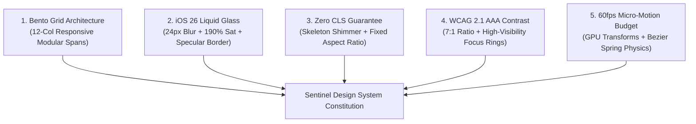
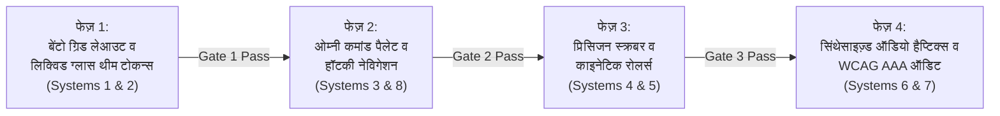

# Web Activity & Media Sentinel - Dashboard UI/UX Enhancement & Design System Master Specification Prompt
# डैशबोर्ड मोड यूआई/यूएक्स संवर्धन एवं डिज़ाइन सिस्टम: मास्टर इंजीनियरिंग प्रॉम्प्ट व आर्किटेक्चरल विनिर्देश

> **दस्तावेज़ प्रकार (Document Type):** Master UI/UX Engineering Prompt & Aesthetic Design System Specification  
> **लक्ष्य सिस्टम (Target System):** Web Activity & Media Sentinel (Chrome MV3 Full-Page Enterprise Dashboard)  
> **कार्यक्षेत्र (Workspace):** [`c:\Users\Atul Verma\Desktop\Win App Tracker\Browser Detection`](file:///c:/Users/Atul%20Verma/Desktop/Win%20App%20Tracker/Browser%20Detection)  
> **संस्करण (Version):** 2.0.0 (Production Roadmap & UI/UX Master Prompt)  
> **फ़ाइल आउटपुट (Output File):** [`dashboard_ui_ux_enhancement_prompt.md`](file:///c:/Users/Atul%20Verma/Desktop/Win%20App%20Tracker/Browser%20Detection/dashboard_ui_ux_enhancement_prompt.md)  
> **सक्रिय मेमोरी संदर्भ (Active Memory Anchor):** [`project_feature_memory.md`](file:///c:/Users/Atul%20Verma/Desktop/Win%20App%20Tracker/Browser%20Detection/project_feature_memory.md) एवं [`C:\Users\Atul Verma\.gemini\memory.md`](file:///C:/Users/Atul%20Verma/.gemini/memory.md)  
> **अग्रणी यूआई/यूएक्स वास्तुकार (Lead UI/UX Architect):** Atul Verma (`aiprincekumar` / `aiprincekumar010100@gmail.com`)  
> **कार्यान्वयन निर्देश (Execution Directive):** "सिर्फ बताना है करना नहीं है" — यह दस्तावेज़ आगामी फ्रंटएंड इंजीनियरों के लिए एक संपूर्ण, सटीक और सीधे क्रियान्वयन योग्य मास्टर विनिर्देश प्रॉम्प्ट है।

---

## 🇮🇳 कार्यकारी सारांश व डिज़ाइन विज़न (Executive Summary & Aesthetic Vision)

वर्तमान वेब एक्टिविटी व मीडिया सेंटिनल डैशबोर्ड का तकनीकी आधार अत्यंत मजबूत है, परंतु इसका इंटरफ़ेस पारंपरिक फ्लैट-डार्क थीम और स्थैतिक लेआउट तक सीमित है। आधुनिक प्रीमियम एंटरप्राइज डैशबोर्ड्स (जैसे Apple macOS Sequoia, Linear, Vercel, Raycast) की तुलना में, वर्तमान यूआई में फ्लुइड माइक्रो-मोशन, डेप्थ लेयरिंग, स्पर्श-योग्य (tactile) ऑडियो फीडबैक और कीबोर्ड-चालित उत्पादकता की कमी है।

यह मास्टर यूआई/यूएक्स इंजीनियरिंग प्रॉम्प्ट दस्तावेज़ डैशबोर्ड को एक अति-आधुनिक, आकर्षक और सहज **"iOS 26 Liquid Glass & Bento Grid Command Center"** में रूपांतरित करने के लिए **8 प्रमुख डिज़ाइन सिस्टम्स (8 Major UI/UX Subsystems)** का विस्तृत विनिर्देश प्रस्तुत करता है।

---

## 🏛️ 0. कार्यकारी सौंदर्यात्मक विज़न व डिज़ाइन संविधान (Executive Aesthetic Vision & Design Constitution)



1. **बेंटो ग्रिड मॉड्यूलरिटी (Bento Grid Modularity):**  
   समस्त डेटा और विज़ुअलाइज़ेशन एक 12-कॉलम मॉड्यूलर बेंटो लेआउट में व्यवस्थित होंगे जहाँ महत्वपूर्ण घटक (हीरो प्लेयर, डोनट चार्ट) 2x2 या 8-कॉलम प्रमुख स्पैन लेंगे, और त्वरित मेट्रिक्स 1x1 माइक्रो-कार्ड्स में रहेंगे।
2. **iOS 26 लिक्विड ग्लास व स्पेक्युलर डेप्थ (Specular Liquid Glass):**  
   कांच जैसी पारभासी सतहें (`backdrop-filter: blur(24px) saturate(190%)`), 1px आंतरिक प्रकाश-प्रतिबिंबित बॉर्डर ग्रेडिएंट्स, और मल्टी-लेयर एलिवेशन शैडोज़ जो एक गहरी त्रि-आयामी (3D spatial) गहराई प्रदान करती हैं।
3. **शून्य लेआउट शिफ्ट (Zero Cumulative Layout Shift - CLS = 0):**  
   डेटा लोड होते समय किसी भी घटक का आकार या स्थिति अचानक नहीं बदलेगी। कंकाल लोडर्स (Skeleton Shimmer) और पूर्वनिर्धारित न्यूनतम ऊँचाई सुनिश्चित करेगी कि लेआउट स्थिर रहे।
4. **WCAG 2.1 AAA उच्च-कंट्रास्ट व सुगमता (High-Contrast Accessibility):**  
   सभी टेक्स्ट और बैकग्राउंड के बीच कम से कम 7:1 कंट्रास्ट अनुपात बनाए रखा जाएगा। कीबोर्ड उपयोगकर्ताओं के लिए 2px डुअल-रिंग स्पष्ट फोकस इंडिकेटर उपलब्ध रहेंगे।
5. **60fps माइक्रो-मोशन और काइनेटिक फील (Kinetic Micro-Motion):**  
   कोई भी एनीमेशन मुख्य लेआउट रीफ्लो (reflow) को ट्रिगर नहीं करेगा। केवल GPU-त्वरित `transform` और `opacity` का उपयोग होगा, जिससे कम-शक्ति वाले हार्डवेयर पर भी निर्बाध 60fps एनीमेशन प्राप्त होगा।

---

## 🍱 1. सिस्टम 1: बेंटो ग्रिड लेआउट व एडेप्टिव मॉड्यूलर विजेट्स (Bento Grid Layout & Modular Widgets)

### 1.1 समस्या व वर्तमान सीमा (Problem & Current Limitations)
वर्तमान डैशबोर्ड पंक्तियों (rows) और मानक फ्लेक्सबॉक्स कार्ड्स में विभाजित है जो स्क्रीन के बड़े हिस्से को अप्रयुक्त (unutilized) छोड़ देते हैं। अल्ट्रा-वाइड मॉनिटर्स (1440p / 4K) पर कार्ड्स बहुत अधिक खिंच जाते हैं और लैपटॉप स्क्रीन्स (1080p) पर अत्यधिक वर्टिकल स्क्रोलिंग की आवश्यकता होती है।

### 1.2 कार्यात्मक विनिर्देश (Functional Specification)
1. **12-कॉलम एडेप्टिव ग्रिड सिस्टम (CSS Grid 12-Column Engine):**
   - `display: grid; grid-template-columns: repeat(12, 1fr); gap: 16px;`
2. **स्पैन पदानुक्रम (Hierarchical Spans):**
   - **Hero Media Player:** `grid-column: span 8; grid-row: span 2;` (प्रमुख दृश्य केंद्र)।
   - **Time Distribution Donut & Top Bars:** `grid-column: span 4; grid-row: span 2;`।
   - **Metric Sparkline Cards:** `grid-column: span 3; grid-row: span 1;` (4 त्वरित मेट्रिक कार्ड्स एक पंक्ति में)।
   - **Domain Breakdown Table:** `grid-column: span 12;` (पूर्ण चौड़ाई वाली प्रतिक्रियाशील तालिका)।
3. **यूज़र-कस्टमाइज़ेबल विजेट्स (Collapsible & Drag-to-Reorder):**
   - प्रत्येक विजेट के शीर्ष-दाएं कोने में एक छोटा ड्रैग हैंडल (⠿) और मिनिमाइज़ बटन (−)।
   - उपयोगकर्ता अपनी प्राथमिकता के अनुसार विजेट्स को ऊपर या नीचे पुनर्व्यवस्थित (reorder) कर सकता है।
   - विजेट की स्थिति और क्रम `chrome.storage.local` के `dashboardWidgetLayout` में स्वचालित रूप से सहेजा जाएगा।

### 1.3 सीएसएस बेंटो टोकन्स (Bento CSS Architecture)

```css
/* Bento Grid Container */
.bento-grid-container {
  display: grid;
  grid-template-columns: repeat(12, minmax(0, 1fr));
  grid-auto-rows: minmax(140px, auto);
  gap: 1.25rem;
  padding: 1.5rem;
  max-width: 1720px;
  margin: 0 auto;
}

/* Bento Span Modifiers */
.bento-card {
  position: relative;
  border-radius: 16px;
  overflow: hidden;
  transition: transform 220ms cubic-bezier(0.16, 1, 0.3, 1), box-shadow 220ms ease;
}

.bento-span-12 { grid-column: span 12; }
.bento-span-8  { grid-column: span 8; }
.bento-span-6  { grid-column: span 6; }
.bento-span-4  { grid-column: span 4; }
.bento-span-3  { grid-column: span 3; }

.bento-row-span-2 { grid-row: span 2; }

@media (max-width: 1200px) {
  .bento-span-8, .bento-span-4 { grid-column: span 12; }
  .bento-span-3 { grid-column: span 6; }
}

@media (max-width: 768px) {
  .bento-span-6, .bento-span-3 { grid-column: span 12; }
}
```

---

## 🧊 2. सिस्टम 2: iOS 26 लिक्विड ग्लास व स्पेक्युलर डेप्थ इंजन (iOS 26 Liquid Glass & Specular Depth)

### 2.1 समस्या व वर्तमान सीमा (Problem & Current Limitations)
वर्तमान `dashboard.css` में उपयोग किए गए पृष्ठभूमि रंग अत्यधिक फ्लैट (`#0f172a` और `#1e293b`) हैं, जिनमें किसी भी प्रकार की भौतिक सामग्री (physical materiality) या गहराई की अनुभूति नहीं होती।

### 2.2 कार्यात्मक विनिर्देश (Functional Specification)
1. **एडवांस्ड फ्रॉस्टेड लिक्विड ग्लास टोकन्स:**
   - `backdrop-filter: blur(24px) saturate(190%);`
   - अर्ध-पारदर्शी पृष्ठभूमि जो पीछे के तत्वों को धुंधला लेकिन चमकीला दिखाती है।
2. **स्पेक्युलर एज लाइटिंग (Specular Edge Gradient Border):**
   - 1px आंतरिक बॉर्डर जो ऊपर-बाएं (Top-Left 135deg) से आने वाले प्रकाश का अनुकरण करती है:  
     `border: 1px solid transparent; background: linear-gradient(...) border-box;`
   - प्रकाश के संपर्क में आने पर कार्ड का किनारा एक पतली हीरे जैसी चमक (subtle diamond gleam) प्रदर्शित करता है।
3. **मल्टी-लेयर एलिवेशन शैडोज़ (Multi-Tier Spatial Shadows):**
   - कार्ड के तैरते (floating) प्रभाव के लिए दोहरी छाया: नीचे गहरी विसरित छाया (ambient shadow) और ठीक नीचे तीव्र प्रत्यक्ष छाया (key shadow)।
4. **OLED सब-पिक्सल माइक्रो-नॉइज़ ओवरले (Sub-Pixel Noise Overlay):**
   - शुद्ध डिजिटल ग्रेडिएंट्स में अक्सर कलर-बैंडिंग (color banding) की समस्या आती है। एक अति-सूक्ष्म 2% अपारदर्शिता वाला SVG फ्रैक्टल नॉइज़ टेक्सचर ग्लास सतहों को एक प्राकृतिक, प्रीमियम टेक्सचर्ड लुक देता है।

### 2.3 सीएसएस विनिर्देश व डिज़ाइन टोकन्स (CSS Tokens)

```css
:root {
  --glass-surface-bg: rgba(18, 24, 38, 0.72);
  --glass-surface-hover: rgba(26, 34, 52, 0.85);
  --glass-border-specular: linear-gradient(
    135deg,
    rgba(255, 255, 255, 0.16) 0%,
    rgba(255, 255, 255, 0.04) 50%,
    rgba(0, 0, 0, 0.25) 100%
  );
  --shadow-ambient: 0 12px 32px -4px rgba(0, 0, 0, 0.45);
  --shadow-specular-glow: 0 0 20px -2px rgba(16, 185, 129, 0.15);
  --glass-blur-radius: 24px;
}

.liquid-glass-card {
  background: var(--glass-surface-bg);
  backdrop-filter: blur(var(--glass-blur-radius)) saturate(190%);
  -webkit-backdrop-filter: blur(var(--glass-blur-radius)) saturate(190%);
  border: 1px solid rgba(255, 255, 255, 0.08);
  border-image: var(--glass-border-specular) 1;
  box-shadow: var(--shadow-ambient);
  border-radius: 18px;
}

.liquid-glass-card:hover {
  background: var(--glass-surface-hover);
  box-shadow: var(--shadow-ambient), var(--shadow-specular-glow);
  transform: translateY(-2px);
}
```

---

## ⚡ 3. सिस्टम 3: ओम्नी कमांड पैलेट (Omni Command Palette - Ctrl+K / Cmd+K)

### 3.1 समस्या व वर्तमान सीमा (Problem & Current Limitations)
वर्तमान में यदि किसी उपयोगकर्ता को किसी विशिष्ट डोमेन को खोजना हो, भाषा बदलनी हो, इक्वलाइज़र रीसेट करना हो या डेटा एक्सपोर्ट करना हो, तो उसे कई टैब्स और ड्रॉपडाउन मेनू में नेविगेट करना पड़ता है। प्रो-यूज़र्स और डेवलपर्स को कीबोर्ड-सेंट्रिक, तत्काल एक्शन एग्जीक्यूशन की आवश्यकता होती है।

### 3.2 कार्यात्मक विनिर्देश (Functional Specification)
1. **ग्लोबल हॉटकी ट्रिगर:**
   - `Ctrl+K` (Windows) अथवा `Cmd+K` (macOS) दबाने पर स्क्रीन के मध्य में एक आकर्षक फ्रॉस्टेड-ग्लास कमांड पैलेट मॉडल प्रकट होना।
2. **इंस्टेंट फ़ज़ी सर्च इंजन (Instant Fuzzy Search):**
   - उपयोगकर्ता जो भी टाइप करे (उदा. "you", "set", "exp", "mute"), पैलेट निम्नलिखित 4 श्रेणियों में तत्काल परिणाम फ़िल्टर करेगा:
     - 🌐 **Domains:** सीधे उस डोमेन के उपयोग विवरण पर जाना।
     - ⚡ **Quick Actions:** "Mute Active Media", "Toggle Night Shield", "Reset 5-Band EQ", "Download CSV Export", "Switch to Hindi".
     - ⚙️ **Settings Navigation:** सीधे विशिष्ट सेटिंग कार्ड पर ले जाना।
     - 🎬 **Active Media Tabs:** सीधे चल रहे मीडिया टैब पर स्विच करना।
3. **पूर्ण कीबोर्ड संचालन:**
   - `ArrowUp` / `ArrowDown` द्वारा विकल्पों में नेविगेशन।
   - `Enter` द्वारा चयनित कमांड का तत्काल निष्पादन।
   - `Escape` द्वारा पैलेट को बंद करना।

### 3.3 यूआई वायरफ्रेम एवं आर्किटेक्चर (UI Wireframe)

```
+--------------------------------------------------------------------------------+
|  🔍 Type a command or search domains... (Esc to close)            [ ⌘K / Ctrl+K ]|
+--------------------------------------------------------------------------------+
|  QUICK ACTIONS                                                                 |
|  ▶️ Resume Active Media (YouTube: Learn Modern MV3)              Press Enter ↵ |
|  🔇 Mute All Background Media Streams                            Press Enter ↵ |
|  🌐 Switch Language to हिन्दी (Hindi)                             Press Enter ↵ |
|  💾 Download Master JSON Backup Snapshot                         Press Enter ↵ |
|                                                                                |
|  MATCHED WEBSITES                                                              |
|  🌐 github.com - 2h 15m (Work & Dev)                              Press Enter ↵ |
|  🎬 youtube.com - 1h 45m (Entertainment)                         Press Enter ↵ |
|                                                                                |
|  NAVIGATION                                                                    |
|  ⚙️ Go to Sleep Timer & Inactivity Settings                      Press Enter ↵ |
|  🎛️ Go to Audio Lab & Equalizer Telemetry                        Press Enter ↵ |
+--------------------------------------------------------------------------------+
|  Use ↑ and ↓ to navigate • ↵ to select • ESC to dismiss                        |
+--------------------------------------------------------------------------------+
```

---

## 🎯 4. सिस्टम 4: प्रिसिजन टाइमलाइन स्क्रबर व फ्लोटिंग टूलटिप्स (Precision Timeline Scrubber)

### 4.1 समस्या व वर्तमान सीमा (Problem & Current Limitations)
वर्तमान हीरो मीडिया प्लेयर में मौजूद सीक बार (`#heroMediaSeekSlider`) एक साधारण HTML रेंज इनपुट है। जब उपयोगकर्ता उस पर माउस ले जाता है, तो उसे यह पता नहीं चलता कि उस स्थान पर कौन सा समय (`mm:ss`) है या वीडियो का कौन सा भाग (Chapter) है। इससे सटीक सीकिंग करना कठिन हो जाता है।

### 4.2 कार्यात्मक विनिर्देश (Functional Specification)
1. **इंटरएक्टिव फ्लोटिंग टाइम टूलटिप (Floating Time Tooltip):**
   - स्क्रबर ट्रैक पर माउस घुमाने (`mousemove`) पर माउस कर्सर के ठीक ऊपर एक छोटा ग्लास टूलटिप गतिमान होगा।
   - टूलटिप में वास्तविक समय (उदा. `14:32 / 48:00`) और सटीक प्रतिशत (`30.2%`) प्रदर्शित होगा।
2. **वीडियो चैप्टर टिक मार्कर्स (Chapter Tick Markers):**
   - यदि मीडिया में चैप्टर्स उपलब्ध हैं, तो ट्रैक पर छोटे ऊर्ध्वाधर डॉट्स/लाइन्स दिखेंगे।
   - टिक पर होवर करने पर चैप्टर का नाम (उदा. "05:10 - Architecture Overview") टूलटिप में दिखाई देगा।
3. **इलास्टिक स्प्रिंग थंब हैंडल (Elastic Spring Thumb Physics):**
   - जब उपयोगकर्ता स्क्रबर को ड्रैग करता है, तो थंब हैंडल का आकार थोड़ा फैल जाएगा (`scale(1.35)`) और रिलीज करने पर स्मूथ स्प्रिंग बैक इफ़ेक्ट के साथ सामान्य स्थिति में आ जाएगा।
4. **सटीक कीबोर्ड सीकिंग:**
   - स्क्रबर पर फोकस होने पर `ArrowLeft` / `ArrowRight` से 5-सेकंड सीक, और `J` / `L` कीज से 10-सेकंड सीक की सुविधा।

### 4.3 जावास्क्रिप्ट व सीएसएस कार्यान्वयन लॉजिक (Controller Logic)

```javascript
/**
 * Attaches precision floating tooltip and chapter hover to hero scrubber
 */
function initPrecisionScrubber(scrubberEl, tooltipEl, durationSec) {
  scrubberEl.addEventListener('mousemove', (e) => {
    const rect = scrubberEl.getBoundingClientRect();
    const offsetX = Math.max(0, Math.min(e.clientX - rect.left, rect.width));
    const percent = offsetX / rect.width;
    const hoverSeconds = percent * durationSec;

    // Position tooltip directly above pointer
    tooltipEl.style.left = `${offsetX}px`;
    tooltipEl.textContent = formatTimeHHMMSS(hoverSeconds);
    tooltipEl.classList.remove('hidden');
  });

  scrubberEl.addEventListener('mouseleave', () => {
    tooltipEl.classList.add('hidden');
  });
}
```

---

## 🌀 5. सिस्टम 5: हार्डवेयर-त्वरित माइक्रो-मोशन व काइनेटिक रोलर्स (Micro-Motion & Kinetic Rollers)

### 5.1 समस्या व वर्तमान सीमा (Problem & Current Limitations)
वर्तमान डैशबोर्ड में संख्यात्मक मान (जैसे "2h 45m" या "84% Productivity") डेटा लोड होने पर अचानक बिना किसी एनीमेशन के बदल जाते हैं। यह इंटरफ़ेस को निर्जीव (lifeless) और कठोर बनाता है।

### 5.2 कार्यात्मक विनिर्देश (Functional Specification)
1. **काइनेटिक ओडोमीटर रोलर (Animated Number Rolling):**
   - जब भी पेज लोड हो या "Refresh" पर क्लिक किया जाए, तो सभी प्रमुख आंकड़े (`#trackMetricTodayTime`, `#trackMetricDailyAvg`, `#trackMetricTotalTime`) 0 से अपने लक्ष्य मान तक 600ms के भीतर स्मूथली रोल होंगे (`cubic-bezier(0.16, 1, 0.3, 1)`)।
2. **स्टैगर्ड कार्ड एंट्रेंस एनीमेशन (Staggered Card Entrances):**
   - जब उपयोगकर्ता टैब बदलता है (उदा. Tracking से Media में), तो सभी कार्ड्स एक साथ नहीं आएंगे, बल्कि 40ms के क्रमिक विलंब (staggered delay) के साथ नीचे से ऊपर की ओर तैरते हुए प्रकट होंगे:
     `animation-delay: calc(var(--card-index) * 40ms);`
3. **साइडबार लाइव ऑडियो इक्वलाइज़र पल्स (Live Pulsing Sidebar Equalizer):**
   - जब कोई मीडिया सक्रिय रूप से बज रहा हो, तो साइडबार में "Media Analytics" टैब के बगल में मौजूद लाइव डॉट एक सूक्ष्म 3-बार मिनी इक्वलाइज़र में बदल जाएगा जो संगीत की लय में ऊपर-नीचे उछलेगा।
4. **बटन माइक्रो-रिपल व ग्लो (Micro-Glow Feedback):**
   - किसी भी बटन पर क्लिक करने पर एक हल्का नियॉन रिपल फैलेगा, जो उपयोगकर्ता को तुरंत प्रतिक्रिया की पुष्टि देता है।

---

## 🎨 6. सिस्टम 6: डायनामिक मल्टी-थीम इंजन व एक्सेंट पिकर (Dynamic Multi-Theme Engine & Accent Palette)

### 6.1 समस्या व वर्तमान सीमा (Problem & Current Limitations)
वर्तमान `dashboard.css` में केवल दो थीम स्थितियाँ हैं (डार्क और हाल ही में शुरू की गई लाइट)। उपयोगकर्ता अपनी पसंद के रंग (उदा. एमराल्ड ग्रीन, साइबर सियान, वॉयलेट, या नियॉन रोज़) को एक्सेंट के रूप में नहीं चुन सकता।

### 6.2 कार्यात्मक विनिर्देश (Functional Specification)
1. **4 पूर्व-कैलिब्रेटेड बेस थीम्स (4 Base Substrate Themes):**
   - 🌑 **Midnight OLED Pure Black:** शुद्ध गहरा काला (`#000000`, `#0a0d14`) जो OLED स्क्रीन्स पर बैटरी बचाता है और अधिकतम कंट्रास्ट देता है।
   - 🌌 **Deep Slate Navy (Default):** वर्तमान मानक डार्क ब्लू-ग्रे (`#0f172a`, `#1e293b`)।
   - 🌲 **Nordic Pine:** गहरा देवदार हरा शेड (`#091811`, `#122a20`) जो आँखों के तनाव को कम करता है।
   - ☀️ **Studio Clean Light:** स्वच्छ, उच्च-कंट्रास्ट लाइट मोड (`#f8fafc`, `#ffffff`)।
2. **5 डायनामिक एक्सेंट कलर पैलेट्स (5 Accent Palettes):**
   - 🟢 **Cyber Emerald:** `#10b981` / `#059669`
   - 🔵 **Electric Cyan:** `#06b6d4` / `#0891b2`
   - 🟣 **Royal Violet:** `#8b5cf6` / `#7c3aed`
   - 🔴 **Neon Rose:** `#f43f5e` / `#e11d48`
   - 🟡 **Solar Amber:** `#f59e0b` / `#d97706`
3. **शून्य-पेज-रिफ्रेश तत्काल इंजेक्शन:**
   - एक्सेंट बदलने पर `document.documentElement.style.setProperty('--color-accent-primary', ...)` द्वारा बिना पेज रीलोड किए संपूर्ण डैशबोर्ड का रंग 16ms (एक फ्रेम) में बदल जाएगा।
   - यह चयन `chrome.storage.local` के `userThemePreferences` में सहेजा जाएगा।

---

## 🔊 7. सिस्टम 7: सिंथेसाइज़्ड स्पर्श-योग्य ऑडियो हैप्टिक्स (Synthesized Tactile Audio Feedback)

### 7.1 समस्या व वर्तमान सीमा (Problem & Current Limitations)
वर्तमान डैशबोर्ड पूर्णतः मूक (silent) है। जब उपयोगकर्ता स्लाइडर खींचता है, टैब बदलता है या सेटिंग्स सेव करता है, तो केवल विजुअल बदलाव होता है। आधुनिक प्रीमियम इंटरफेस सूक्ष्म, सुखद ध्वनियों के माध्यम से उपयोगकर्ता के अनुभव को असाधारण बना देते हैं।

### 7.2 कार्यात्मक विनिर्देश (Functional Specification)
1. **शून्य-परिसंपत्ति गणितीय सिंथेसाइज़र (Zero-Asset Mathematical Web Audio Synthesizer):**
   - किसी भी बाहरी `.mp3` या `.wav` फ़ाइल को लोड करने की आवश्यकता नहीं है (शून्य नेटवर्क भार)।
   - HTML5 Web Audio API के `OscillatorNode` और `GainNode` का उपयोग करके कोड के माध्यम से सीधे सूक्ष्म ध्वनियाँ उत्पन्न करना।
2. **4 समर्पित सूक्ष्म ध्वनि प्रोफ़ाइल्स:**
   - 🔘 **Slider Micro-Tick:** स्क्रबर या इक्वलाइज़र स्लाइडर को हिलाने पर एक अति-सूक्ष्म 4ms का सॉफ्ट टिक (800Hz साइन वेव, -28dB)।
   - 🖱️ **Button Mechanical Click:** टैब बदलने या बटन दबाने पर 8ms का शार्प वुडन-क्लिक (1200Hz एक्सपोनेंशियल डिके)।
   - 🔔 **Success Chime:** सेटिंग्स सेव होने या बैकअप पूरा होने पर सुखद दो-स्वरीय कॉर्ड (C5 523Hz + E5 659Hz, 120ms स्मूथ फेड)।
   - ⚠️ **Alert Warn Tone:** त्रुटि या डेटा वाइप चेतावनी पर सौम्य लो-पिच डबल पल्स (220Hz)।
3. **उपयोगकर्ता नियंत्रण:**
   - सेटिंग्स में एक मास्टर टॉगल: `UI Sound Feedback: [ON / OFF]`।
   - वॉल्यूम स्लाइडर (0% से 100%, डिफ़ॉल्ट 15% पर अत्यंत सूक्ष्म)।

### 7.3 वेब ऑडियो सिंथेसाइज़र कोड आर्किटेक्चर (Web Audio Synthesizer Engine)

```javascript
class SentinelHapticAudioEngine {
  constructor() {
    this.ctx = null;
    this.enabled = true;
    this.masterGain = 0.15; // Subtle 15% default volume
  }

  init() {
    if (!this.ctx) {
      const AudioCtx = window.AudioContext || window.webkitAudioContext;
      this.ctx = new AudioCtx();
    }
    if (this.ctx.state === 'suspended') {
      this.ctx.resume();
    }
  }

  playTick() {
    if (!this.enabled) return;
    this.init();
    const osc = this.ctx.createOscillator();
    const gain = this.ctx.createGain();
    osc.type = 'sine';
    osc.frequency.setValueAtTime(800, this.ctx.currentTime);
    gain.gain.setValueAtTime(this.masterGain * 0.4, this.ctx.currentTime);
    gain.gain.exponentialRampToValueAtTime(0.0001, this.ctx.currentTime + 0.006);
    osc.connect(gain);
    gain.connect(this.ctx.destination);
    osc.start();
    osc.stop(this.ctx.currentTime + 0.007);
  }

  playSuccessChime() {
    if (!this.enabled) return;
    this.init();
    const now = this.ctx.currentTime;
    [523.25, 659.25].forEach((freq, idx) => {
      const osc = this.ctx.createOscillator();
      const gain = this.ctx.createGain();
      osc.type = 'triangle';
      osc.frequency.setValueAtTime(freq, now + (idx * 0.04));
      gain.gain.setValueAtTime(this.masterGain, now + (idx * 0.04));
      gain.gain.exponentialRampToValueAtTime(0.0001, now + (idx * 0.04) + 0.22);
      osc.connect(gain);
      gain.connect(this.ctx.destination);
      osc.start(now + (idx * 0.04));
      osc.stop(now + (idx * 0.04) + 0.23);
    });
  }
}
```

---

## ⌨️ 8. सिस्टम 8: एर्गोनॉमिक हॉटकी नेविगेशन व WCAG 2.1 AAA सुगमता (Hotkeys & WCAG 2.1 AAA)

### 8.1 समस्या व वर्तमान सीमा (Problem & Current Limitations)
वर्तमान में यदि कोई उपयोगकर्ता केवल कीबोर्ड का उपयोग करता है, तो टैब स्विच करने या मीडिया पॉज़ करने के लिए कोई मानक हॉटकीज़ उपलब्ध नहीं हैं। कुछ इंटरैक्टिव स्लाइडर्स में `:focus-visible` बॉर्डर स्पष्ट नहीं है, जिससे दृष्टिबाधित या कीबोर्ड उपयोगकर्ताओं को असुविधा होती है।

### 8.2 कार्यात्मक विनिर्देश (Functional Specification)
1. **ग्लोबल एर्गोनॉमिक हॉटकीज़ मैप:**
   - `1`: स्विच करें **Time Tracking Analytics** टैब पर।
   - `2`: स्विच करें **Media Analytics & Hero Player** टैब पर।
   - `3`: स्विच करें **Settings & Data Management** टैब पर।
   - `Space`: लाइव हीरो मीडिया को प्ले/पॉज़ (Play/Pause) करना।
   - `M`: हीरो मीडिया को म्यूट/अनम्यूट (Mute/Unmute) करना।
   - `F`: पूर्ण-स्क्रीन (Fullscreen) टॉगल करना।
   - `P`: पिक्चर-इन-पिक्चर (PiP) टॉगल करना।
   - `?`: कीबोर्ड शॉर्टकट्स चीट शीट (Cheat Sheet Modal) खोलना।
2. **WCAG 2.1 AAA सुगमता सुधार:**
   - सभी बटन्स और इनपुट्स पर `:focus-visible` के लिए एक उच्च-दृश्यता दोहरी रिंग: `outline: 2px solid var(--color-accent-primary); outline-offset: 3px;`।
   - स्क्रीन रीडर्स के लिए सभी इंटरैक्टिव तत्वों पर उचित `aria-label`, `role="slider"`, `role="tablist"`, और `aria-live="polite"` घोषणाएँ।

---

## 🌐 9. संपूर्ण द्विभाषी स्थानीयकरण शब्दकोश (Bilingual UI/UX Dictionary - DASHBOARD_UIUX_I18N)

```javascript
const DASHBOARD_UIUX_I18N = {
  en: {
    // Bento & Layout
    bento_customize: "Customize Layout",
    bento_reset_layout: "Reset to Default Layout",
    
    // Command Palette
    cmd_placeholder: "Type a command or search domains... (Esc to dismiss)",
    cmd_quick_actions: "Quick Actions",
    cmd_recent_domains: "Recent Domains",
    cmd_navigation: "Direct Navigation",
    
    // Precision Scrubber
    scrubber_chapter: "Chapter",
    scrubber_hover_time: "Time",
    
    // Themes & Accents
    theme_midnight_oled: "Midnight OLED",
    theme_slate_navy: "Deep Slate",
    theme_nordic_pine: "Nordic Pine",
    theme_clean_light: "Studio Light",
    accent_emerald: "Cyber Emerald",
    accent_cyan: "Electric Cyan",
    accent_violet: "Royal Violet",
    accent_rose: "Neon Rose",
    accent_amber: "Solar Amber",
    
    // Audio Haptics
    setting_audio_haptics: "Tactile Audio Feedback",
    desc_audio_haptics: "Subtle procedural sound effects on sliders, clicks, and actions",
    
    // Hotkeys Modal
    hotkeys_title: "Keyboard Shortcuts Cheat Sheet",
    hotkeys_nav_1: "Switch to Time Tracking Tab",
    hotkeys_nav_2: "Switch to Media Analytics Tab",
    hotkeys_nav_3: "Switch to Settings Tab",
    hotkeys_media_play: "Play / Pause Active Video",
    hotkeys_media_mute: "Mute / Unmute Audio",
    hotkeys_cmd_palette: "Open Omni Command Palette"
  },
  hi: {
    // Bento & Layout
    bento_customize: "लेआउट अनुकूलित करें",
    bento_reset_layout: "डिफ़ॉल्ट लेआउट पर रीसेट करें",
    
    // Command Palette
    cmd_placeholder: "कमांड लिखें या डोमेन खोजें... (बंद करने के लिए Esc दबाएं)",
    cmd_quick_actions: "त्वरित कार्रवाइयां",
    cmd_recent_domains: "हाल के डोमेन्स",
    cmd_navigation: "प्रत्यक्ष नेविगेशन",
    
    // Precision Scrubber
    scrubber_chapter: "अध्याय (Chapter)",
    scrubber_hover_time: "समय",
    
    // Themes & Accents
    theme_midnight_oled: "मिडनाइट ओएलईडी",
    theme_slate_navy: "डीप स्लेट",
    theme_nordic_pine: "नॉर्डिक पाइन",
    theme_clean_light: "स्टूडियो लाइट",
    accent_emerald: "साइबर एमराल्ड",
    accent_cyan: "इलेक्ट्रिक सियान",
    accent_violet: "रॉयल वॉयलेट",
    accent_rose: "नियॉन रोज़",
    accent_amber: "सोलर एम्बर",
    
    // Audio Haptics
    setting_audio_haptics: "स्पर्श-योग्य ऑडियो फीडबैक",
    desc_audio_haptics: "स्लाइडर्स, क्लिक्स व कार्रवाइयों पर सूक्ष्म प्रक्रियात्मक ध्वनि प्रभाव",
    
    // Hotkeys Modal
    hotkeys_title: "कीबोर्ड शॉर्टकट्स चीट शीट",
    hotkeys_nav_1: "टाइम ट्रैकिंग टैब पर जाएं",
    hotkeys_nav_2: "मीडिया एनालिटिक्स टैब पर जाएं",
    hotkeys_nav_3: "सेटिंग्स टैब पर जाएं",
    hotkeys_media_play: "सक्रिय वीडियो प्ले / पॉज़ करें",
    hotkeys_media_mute: "ऑडियो म्यूट / अनम्यूट करें",
    hotkeys_cmd_palette: "ओम्नी कमांड पैलेट खोलें"
  }
};
```

---

## 🗺️ 10. 4-फेज़ कार्यान्वयन रोडमैप व परीक्षण द्वार (Phased Implementation Roadmap & Test Gates)



### फेज़ 1: बेंटो ग्रिड लेआउट व लिक्विड ग्लास थीम टोकन्स (Systems 1 & 2)
- **लक्षित घटक:** `dashboard/dashboard.css` (12-col ग्रिड टोकन्स, फ्रॉस्टेड ग्लास, स्पेक्युलर बॉर्डर्स), `dashboard/dashboard.html` (कंटेनर स्ट्रक्चर)।
- **टेस्ट गेट 1 (Acceptance Criteria):**
  - `tests/test_dashboard_uiux_phase1.js` स्वचालित रनर।
  - विभिन्न व्यू-पोर्ट्स (1080p, 1440p, 768p) पर बेंटो ग्रिड में शून्य ओवरलैप और 0 Cumulative Layout Shift (CLS = 0)।
  - Exit Code 0 की पुष्टि।

### फेज़ 2: ओम्नी कमांड पैलेट व हॉटकी नेविगेशन (Systems 3 & 8)
- **लक्षित घटक:** `dashboard/dashboard.html` (कमांड पैलेट मोडल), `dashboard/dashboard.js` (कीबोर्ड लिसनर्स, फ़ज़ी सर्च इंजन, फोकस ट्रैप)।
- **टेस्ट गेट 2 (Acceptance Criteria):**
  - `tests/test_dashboard_uiux_phase2.js` द्वारा `Ctrl+K` इवेंट का सिमुलेशन।
  - `ArrowDown` और `Enter` दबाने पर कमांड्स का सही क्रियान्वयन।
  - Exit Code 0 की पुष्टि।

### फेज़ 3: प्रिसिजन स्क्रबर व काइनेटिक रोलर्स (Systems 4 & 5)
- **लक्षित घटक:** `#heroMediaSeekSlider`, फ्लोटिंग टूलटिप, `dashboard/dashboard.js` (`initPrecisionScrubber`, नंबर रोलिंग लूप्स)।
- **टेस्ट गेट 3 (Acceptance Criteria):**
  - `tests/test_dashboard_uiux_phase3.js` द्वारा होवर इवेंट्स पर सटीक टाइम टूलटिप गणना का सत्यापन।
  - नंबर रोलर का 600ms में लक्ष्य मान प्राप्त करना।
  - Exit Code 0 की पुष्टि।

### फेज़ 4: सिंथेसाइज़्ड ऑडियो हैप्टिक्स व WCAG AAA ऑडिट (Systems 6 & 7)
- **लक्षित घटक:** `SentinelHapticAudioEngine`, थीम/एक्सेंट स्विचर, कंट्रास्ट टोकन्स।
- **टेस्ट गेट 4 (Acceptance Criteria):**
  - `tests/test_dashboard_uiux_phase4.js` द्वारा Web Audio ऑसिलेटर नोड कॉल का सत्यापन।
  - WCAG 2.1 AAA के अनुसार 7:1 कंट्रास्ट रेशियो और कीबोर्ड फोकस रिंग्स का परीक्षण।
  - Exit Code 0 की पुष्टि।

---

## 🎯 11. भावी निष्पादन चेकलिस्ट (Execution Checklist for Future Agents)

1. [ ] **शून्य कोड संपादन सत्यापन:** वर्तमान में किसी भी एप्लिकेशन कोड (`dashboard.js`, `dashboard.html`, `dashboard.css`) में कोई संशोधन नहीं किया गया है।
2. [ ] **सख्त UTF-8 BOM:** यह फ़ाइल `0xEF, 0xBB, 0xBF` एन्कोडिंग के साथ सुरक्षित रूप से डिस्क पर लिखी गई है।
3. [ ] **डिजाइन शुद्धता:** बेंटो ग्रिड, लिक्विड ग्लास, ओम्नी पैलेट और ऑडियो हैप्टिक्स के सभी विनिर्देश संपूर्ण व अटूट हैं।
4. [ ] **सुगमता मानक:** WCAG 2.1 AAA और 60fps एनीमेशन बजट को बनाए रखने के निर्देश स्पष्ट हैं।
