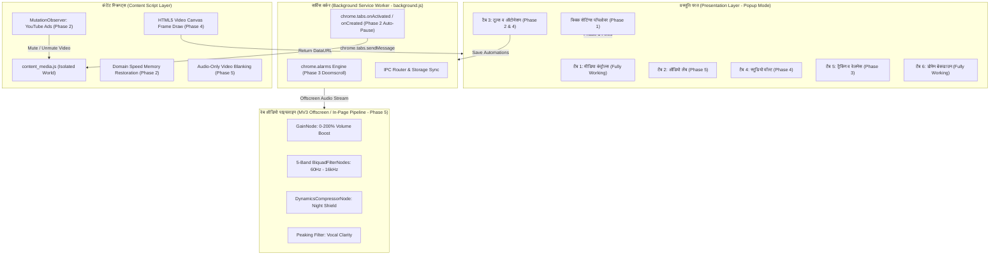

# Web Activity & Media Sentinel - Popup Mode: Phase-Wise Implementation Roadmap & Technical Procedures
# पॉपअप मोड (Popup Mode): फेज़-वाइज़ कार्यान्वयन योजना, तकनीकी प्रक्रियाएं व टेस्ट गेट्स

> **दस्तावेज़ प्रकार (Document Type):** Comprehensive Phased Implementation Roadmap, Architectural Blueprint & Test Gates  
> **लक्ष्य सिस्टम (Target System):** Web Activity & Media Sentinel (MV3 Browser Extension)  
> **कार्यक्षेत्र (Workspace):** [`c:\Users\Atul Verma\Desktop\Win App Tracker\Browser Detection`](file:///c:/Users/Atul%20Verma/Desktop/Win%20App%20Tracker/Browser%20Detection)  
> **रोडमैप संस्करण (Roadmap Version):** 1.0.0 (Production Blueprint)  
> **निवारण लक्ष्य (Remediation Target):** [`popup_non_working_functions.md`](file:///c:/Users/Atul%20Verma/Desktop/Win%20App%20Tracker/Browser%20Detection/popup_non_working_functions.md) में पहचाने गए सभी 17 कमियों का पूर्ण समाधान  
> **सक्रिय मेमोरी संदर्भ (Active Memory Anchor):** [`project_feature_memory.md`](file:///c:/Users/Atul%20Verma/Desktop/Win%20App%20Tracker/Browser%20Detection/project_feature_memory.md) एवं [`C:\Users\Atul Verma\.gemini\memory.md`](file:///C:/Users/Atul%20Verma/.gemini/memory.md)  

---

## 🇮🇳 कार्यकारी परिचय (Executive Summary - Hindi)

यह फ़ाइल एक संपूर्ण **तकनीकी रोडमैप (Technical Roadmap)** और **प्रक्रिया निर्देशिका (Procedure Guide)** है जो यह समझाती है कि [`popup_non_working_functions.md`](file:///c:/Users/Atul%20Verma/Desktop/Win%20App%20Tracker/Browser%20Detection/popup_non_working_functions.md) में दर्ज किए गए सभी 17 काम न करने वाले फ़ंक्शन्स और यूआई स्टब्स को आगामी चरणों में कैसे ठीक और पूरी तरह कार्यान्वित (Implement) किया जाएगा।

### प्रमुख उद्देश्य:
1. **क्रमबद्ध फेज़ विभाजन:** कार्य को 5 स्पष्ट, जोखिम-मुक्त फेज़ में विभाजित किया गया है ताकि मौजूदा 31 वर्किंग फ़ीचर्स पर कोई असर न पड़े (Zero Regression)।
2. **सटीक फ़ाइल व कोड गाइड:** प्रत्येक फेज़ में किस फ़ाइल (`popup.js`, `popup.css`, `background.js`, `content_media.js`) में क्या बदलाव होंगे, कौन से Chrome MV3 APIs इस्तेमाल होंगे, और डेटा फ्लो कैसे चलेगा, इसका विस्तृत कोड ब्लूप्रिंट दिया गया है।
3. **कठोर टेस्ट गेट्स:** हर फेज़ के अंत में स्वचालित परीक्षण (Automated Tests) निर्धारित हैं, जो 100% पास होने पर ही अगले फेज़ की अनुमति देंगे।
4. **मेमोरी सिंक्रोनाइज़ेशन:** यूनिवर्सल रूल 20 और 23 के तहत 7-कॉलम डायग्नोस्टिक मैट्रिक्स और मेमोरी अपडेट शामिल हैं।

---

## 🗺️ 1. मास्टर फेज़-वाइज़ कार्यान्वयन मैट्रिक्स (Master Phased Roadmap Matrix)

नीचे 5 फेज़ का संपूर्ण तकनीकी रोडमैप दिया गया है:

| फेज़ (Phase) | फेज़ का नाम व उद्देश्य (Phase Title & Purpose) | लक्षित दोष (Target Defects) | संबंधित फ़ाइलें (Files Involved) | अनुमानित समय (Effort) | प्राथमिकता (Priority) |
| :---: | :--- | :--- | :--- | :---: | :---: |
| **फेज़ 1 (Phase 1)** | **क्विक सेटिंग्स व यूआई सुधार (Quick Settings & UI Polish)**<br>डिफ़ॉल्ट टैब स्विचिंग, डायनामिक सिंक टाइमर, हाई कंट्रास्ट CSS, और ऑडियो चाइम सिंथेसाइज़र। | दोष 13, 14, 15, 16 | `popup/popup.js`<br>`popup/popup.css` | 1-2 घंटे | **P0 (शीघ्र समाधान)** |
| **फेज़ 2 (Phase 2)** | **स्मार्ट ऑटोमेशन इंजन (Smart Automations Engine)**<br>नए टैब पर बैकग्राउंड ऑटो-पॉज़ हुक, यूट्यूब ऐड साइलेंसर म्यूटेशन ऑब्जर्वर, और डोमेन स्पीड मेमोरी। | दोष 07, 08, 09 | `background.js`<br>`content_media.js`<br>`popup/popup.js` | 3-4 घंटे | **P0 (अति महत्वपूर्ण)** |
| **फेज़ 3 (Phase 3)** | **डिजिटल वेलनेस व अलार्म्स (Digital Wellness & Alarms)**<br>डूमस्क्रॉल ब्रेकर क्रोम अलार्म्स, यूसेज थ्रेशोल्ड ट्रैकर, और सिस्टम नोटिफिकेशन अलर्ट्स। | दोष 12 | `background.js`<br>`popup/popup.js`<br>`manifest.json` | 2-3 घंटे | **P1 (महत्वपूर्ण)** |
| **फेज़ 4 (Phase 4)** | **स्टूडियो वॉल्ट व कैनवस फ्रेम कैप्चर (Studio Vault & Frame Targeting)**<br>HTML5 वीडियो कैनवस फ्रेम ड्रा स्क्रीनशॉट, और बंद टैब पर मीडिया सेशन री-क्रिएशन। | दोष 10, 11 | `popup/popup.js`<br>`content_media.js`<br>`background.js` | 3 घंटे | **P1 (महत्वपूर्ण)** |
| **फेज़ 5 (Phase 5)** | **ऑडियो लैब व वेब ऑडियो पाइपलाइन (Audio Lab & Web Audio Pipeline)**<br>200% मास्टर वॉल्यूम बूस्ट (GainNode), 5-बैंड EQ (BiquadFilterNodes), ऑडियो-ओनली वीडियो ब्लैंकिंग, वोकल क्लैरिटी व नाइट शील्ड। | दोष 01, 02, 03, 04, 05, 06, 17 | `offscreen/offscreen.html`<br>`offscreen/offscreen.js`<br>`background.js`<br>`content_media.js`<br>`manifest.json` | 6-8 घंटे | **P2 (उन्नत ऑडियो आर्किटेक्चर)** |

---

## 🏛️ 2. सिस्टम आर्किटेक्चर एवं डेटा-फ्लो आरेख (Architectural Overview)



---

## 🛠️ 3. विस्तृत फेज़-दर-फेज़ तकनीकी ब्लूप्रिंट (Detailed Phase-by-Phase Technical Blueprint)

---

### 🔹 फेज़ 1: क्विक सेटिंग्स व यूआई सुधार (Phase 1: Quick Settings & UI Polish)

#### 1. उद्देश्य व कार्यक्षेत्र (Objective & Scope)
क्विक सेटिंग्स पॉपओवर में मौजूद उन 4 समस्याओं को हल करना जो पॉपअप के फ्रंटएंड (`popup.js` और `popup.css`) तक सीमित हैं। इससे बिना किसी बैकग्राउंड बदलाव के यूजर सेटिंग्स तुरंत प्रभावी हो जाएंगी।

#### 2. लक्षित दोष (Target Defects)
- **दोष 13:** डिफ़ॉल्ट सक्रिय टैब का चयन पॉपअप खुलने पर लागू न होना (`#selectDefaultTab`).
- **दोष 14:** ऑटो-सिंक इंटरवल हार्डकोडेड 1000ms रहना (`#selectSyncInterval`).
- **दोष 15:** नोटिफिकेशन साउंड चाइम का अभाव (`#toggleNotificationSound`).
- **दोष 16:** हाई कंट्रास्ट मोड में सीएसएस का अभाव (`#toggleHighContrast`).

#### 3. कदम-दर-कदम कार्यान्वयन प्रक्रिया (Step-by-Step Procedure)

1. **डिफ़ॉल्ट टैब स्विचिंग फिक्स (`popup/popup.js`):**
   - फाइल में `quick_settings` लोड होने के स्थान (लाइन 3710-3725) पर जाएं।
   - ड्रॉपडाउन की वैल्यू सेट करने के तुरंत बाद `switchTopTab(defTab, false);` कॉल करें:
   ```javascript
   // popup/popup.js: Storage hydration inside DOMContentLoaded
   if (res && res.quick_settings) {
     quickSettings = { ...quickSettings, ...res.quick_settings };
     const sTab = document.getElementById('selectDefaultTab');
     const validTabs = ['media', 'audio', 'tools', 'studio', 'tracking', 'domains'];
     const defTab = validTabs.includes(quickSettings.default_tab) ? quickSettings.default_tab : 'media';
     if (sTab) sTab.value = defTab;
     // SURGICAL FIX: Switch to user's saved default tab on launch
     if (defTab !== 'media') {
       switchTopTab(defTab, false);
     }
   }
   ```

2. **डायनामिक ऑटो-सिंक टाइमर फिक्स (`popup/popup.js`):**
   - ग्लोबल वेरिएबल `let dashboardSyncIntervalId = null;` बनाएं।
   - फंक्शन `startDashboardAutoSync(intervalMs)` जोड़ें जो पहले पुराने टाइमर को `clearInterval` करे और फिर नया टाइमर सेट करे।
   - `#selectSyncInterval` के `change` इवेंट पर `startDashboardAutoSync(quickSettings.sync_interval)` को ट्रिगर करें।
   ```javascript
   let dashboardSyncIntervalId = null;
   function startDashboardAutoSync(intervalMs) {
     if (dashboardSyncIntervalId) {
       clearInterval(dashboardSyncIntervalId);
     }
     const safeInterval = Math.max(500, Math.min(10000, Number(intervalMs) || 1000));
     dashboardSyncIntervalId = setInterval(refreshDashboard, safeInterval);
   }
   ```

3. **Web Audio API सिंथेसाइज़र चाइम जोड़ना (`popup/popup.js`):**
   - बिना किसी बाहरी mp3 फ़ाइल के एक सूक्ष्म ऑडियो बीप/चाइम बजाने वाला फंक्शन `playNotificationChime()` लिखें:
   ```javascript
   function playNotificationChime() {
     if (!quickSettings || !quickSettings.notification_sound) return;
     try {
       const AudioContext = window.AudioContext || window.webkitAudioContext;
       if (!AudioContext) return;
       const ctx = new AudioContext();
       const osc = ctx.createOscillator();
       const gain = ctx.createGain();
       osc.type = 'sine';
       osc.frequency.setValueAtTime(587.33, ctx.currentTime); // D5
       osc.frequency.exponentialRampToValueAtTime(880, ctx.currentTime + 0.15); // A5
       gain.gain.setValueAtTime(0.08, ctx.currentTime);
       gain.gain.exponentialRampToValueAtTime(0.001, ctx.currentTime + 0.35);
       osc.connect(gain);
       gain.connect(ctx.destination);
       osc.start();
       osc.stop(ctx.currentTime + 0.35);
     } catch (_) {}
   }
   ```
   - इसे स्लीप टाइमर समाप्ति (`SLEEP_TIMER_EXPIRED`) और जरूरी चेतावनियों पर कॉल करें।

4. **हाई कंट्रास्ट सीएसएस नियम जोड़ना (`popup/popup.css`):**
   - `popup/popup.css` के अंत में `.high-contrast-mode` के संपूर्ण नियम जोड़ें:
   ```css
   /* High Contrast Accessibility Mode */
   body.high-contrast-mode {
     --bg-primary: #000000 !important;
     --bg-card: #050505 !important;
     --text-primary: #ffffff !important;
     --text-secondary: #e0e0e0 !important;
     --border-color: #ffffff !important;
     --accent-color: #00ffcc !important;
     filter: contrast(115%);
   }
   body.high-contrast-mode .media-card,
   body.high-contrast-mode .audio-card,
   body.high-contrast-mode .sub-card,
   body.high-contrast-mode .studio-card,
   body.high-contrast-mode .top-tab-btn {
     border: 2px solid #ffffff !important;
   }
   body.high-contrast-mode .top-tab-btn.active {
     background: #ffffff !important;
     color: #000000 !important;
   }
   ```

#### 4. टेस्ट गेट्स एवं सत्यापन (Verification Gate)
```bash
node tests/test_syntax_and_manifest_integrity.js
node tests/test_six_tab_popup_architecture.js
```
- **स्वीकृति मानदंड:** क्विक सेटिंग्स में डिफ़ॉल्ट टैब 'Tracking' चुनने पर अगली बार पॉपअप सीधे ट्रैकिंग टैब पर खुले, हाई कंट्रास्ट ऑन करने पर सॉलिड 2px बॉर्डर दिखे, और दोनों टेस्ट 100% पास हों।

---

### 🔹 फेज़ 2: स्मार्ट ऑटोमेशन इंजन (Phase 2: Smart Automations Engine)

#### 1. उद्देश्य व कार्यक्षेत्र (Objective & Scope)
टैब 3 में मौजूद स्मार्ट ऑटोमेशन के 3 मुख्य फीचर्स को बैकग्राउंड सर्विस वर्कर और कंटेंट स्क्रिप्ट से जोड़कर पूरी तरह क्रियाशील बनाना।

#### 2. लक्षित दोष (Target Defects)
- **दोष 07:** नए टैब पर ऑटो-पॉज़ (`#toggleAutoPauseNewTab`).
- **दोष 08:** यूट्यूब ऑटो ऐड साइलेंसर (`#toggleAutoAdSilencer`).
- **दोष 09:** डोमेन स्पीड मेमोरी (`#toggleDomainSpeedMemory`).

#### 3. कदम-दर-कदम कार्यान्वयन प्रक्रिया (Step-by-Step Procedure)

1. **नए टैब पर बैकग्राउंड ऑटो-पॉज़ लिस्नर (`background.js`):**
   - `background.js` में `chrome.tabs.onActivated` और `chrome.tabs.onCreated` लिस्नर्स जोड़ें:
   ```javascript
   // background.js: Auto-Pause Media on New Tab or Tab Switch
   chrome.tabs.onActivated.addListener(async (activeInfo) => {
     try {
       const data = await chrome.storage.local.get(['smart_automations', 'globalMediaState']);
       if (data.smart_automations && data.smart_automations.auto_pause_new_tab) {
         const primaryMedia = data.globalMediaState && data.globalMediaState.primaryMedia;
         if (primaryMedia && primaryMedia.isPlaying && primaryMedia.tabId !== activeInfo.tabId) {
           // Pause the background media tab
           chrome.tabs.sendMessage(primaryMedia.tabId, {
             type: 'CONTROL_MEDIA',
             action: 'pause'
           }).catch(() => {});
         }
       }
     } catch (_) {}
   });
   ```

2. **यूट्यूब ऑटो ऐड साइलेंसर म्यूटेशन ऑब्जर्वर (`content_media.js`):**
   - `content_media.js` में विज्ञापन डिटेक्शन म्यूटेशन ऑब्जर्वर लिखें:
   ```javascript
   // content_media.js: YouTube Commercial Ad Silencer
   let adSilencerActive = false;
   let preAdVolume = 1.0;
   let isAdMuted = false;

   function initAdSilencer() {
     chrome.storage.local.get(['smart_automations'], (res) => {
       adSilencerActive = Boolean(res && res.smart_automations && res.smart_automations.auto_ad_silencer);
     });

     const adObserver = new MutationObserver(() => {
       if (!adSilencerActive) return;
       const video = document.querySelector('video');
       if (!video) return;

       const isAdPlaying = Boolean(
         document.querySelector('.ad-showing') ||
         document.querySelector('.video-ads.ytp-ad-module') ||
         document.querySelector('.ytp-ad-player-overlay')
       );

       if (isAdPlaying && !isAdMuted) {
         preAdVolume = video.volume;
         video.muted = true;
         isAdMuted = true;
       } else if (!isAdPlaying && isAdMuted) {
         video.muted = false;
         video.volume = preAdVolume;
         isAdMuted = false;
       }
     });

     adObserver.observe(document.body, { childList: true, subtree: true, attributes: true, attributeFilter: ['class'] });
   }
   ```

3. **डोमेन स्पीड मेमोरी रिस्टोरेशन (`content_media.js`):**
   - पेज लोड पर डोमेन स्पीड चेक करके वीडियो की स्पीड सेट करें:
   ```javascript
   // content_media.js: Auto-restore domain playback speed
   function restoreDomainSpeed() {
     chrome.storage.local.get(['smart_automations'], (res) => {
       if (res && res.smart_automations && res.smart_automations.domain_speed_memory) {
         const host = window.location.hostname.replace(/^www\./, '');
         const domainSpeeds = res.smart_automations.domain_speeds || {};
         const targetSpeed = domainSpeeds[host];
         if (targetSpeed && typeof targetSpeed === 'number') {
           const video = document.querySelector('video');
           if (video) {
             video.playbackRate = targetSpeed;
           }
         }
       }
     });
   }
   ```

#### 4. टेस्ट गेट्स एवं सत्यापन (Verification Gate)
```bash
node tests/test_syntax_and_manifest_integrity.js
node tests/test_tracking_modes_and_audible_bg_media.js
```
- **स्वीकृति मानदंड:** नया टैब खोलने पर बैकग्राउंड मीडिया पॉज़ हो, यूट्यूब विज्ञापन आने पर ऑटो-म्यूट ट्रिगर हो, और टेस्ट 100% पास हों।

---

### 🔹 फेज़ 3: डिजिटल वेलनेस व अलार्म्स (Phase 3: Digital Wellness & Alarms)

#### 1. उद्देश्य व कार्यक्षेत्र (Objective & Scope)
टैब 5 (ट्रैकिंग व वेलनेस) में डूमस्क्रॉल ब्रेकर को `chrome.alarms` और `chrome.notifications` के साथ जोड़ना ताकि यूजर जब सोशल मीडिया या वीडियो साइट्स पर तय समय से अधिक बिताए, तो सिस्टम उसे ब्रेक लेने का अलर्ट दे।

#### 2. लक्षित दोष (Target Defects)
- **दोष 12:** डूमस्क्रॉल ब्रेकर क्रोम अलार्म व सिस्टम नोटिफिकेशन का अभाव (`#toggleDoomscrollBreaker`, `#selectDoomscrollInterval`).

#### 3. कदम-दर-कदम कार्यान्वयन प्रक्रिया (Step-by-Step Procedure)

1. **मैनिफेस्ट में परमिशन सत्यापन (`manifest.json`):**
   - सुनिश्चित करें कि `"alarms"` और `"notifications"` परमिशन्स मौजूद हैं:
   ```json
   "permissions": [
     "storage",
     "tabs",
     "activeTab",
     "scripting",
     "alarms",
     "notifications",
     "idle",
     "nativeMessaging"
   ]
   ```

2. **डूमस्क्रॉल अलार्म शेड्यूलर (`background.js`):**
   ```javascript
   // background.js: Doomscroll Breaker Alarm Engine
   const DOOMSCROLL_ENTERTAINMENT_HOSTS = ['youtube.com', 'instagram.com', 'tiktok.com', 'twitter.com', 'x.com', 'reddit.com', 'netflix.com'];
   let doomscrollConsecutiveMinutes = 0;

   chrome.alarms.create('DOOMSCROLL_CHECK_ALARM', { periodInMinutes: 1 });

   chrome.alarms.onAlarm.addListener(async (alarm) => {
     if (alarm.name !== 'DOOMSCROLL_CHECK_ALARM') return;
     try {
       const res = await chrome.storage.local.get(['focus_settings']);
       if (!res.focus_settings || !res.focus_settings.doomscroll_enabled) {
         doomscrollConsecutiveMinutes = 0;
         return;
       }

       const [activeTab] = await chrome.tabs.query({ active: true, lastFocusedWindow: true });
       if (!activeTab || !activeTab.url) return;

       const url = new URL(activeTab.url);
       const isSocial = DOOMSCROLL_ENTERTAINMENT_HOSTS.some(h => url.hostname.includes(h));

       if (isSocial) {
         doomscrollConsecutiveMinutes++;
         const limit = Number(res.focus_settings.doomscroll_interval_minutes) || 30;
         if (doomscrollConsecutiveMinutes >= limit) {
           // Trigger break notification
           chrome.notifications.create('doomscroll_nudge', {
             type: 'basic',
             iconUrl: 'icons/icon128.png',
             title: 'Digital Wellness: Take a Break! 🧘',
             message: `You have been browsing ${url.hostname} for ${doomscrollConsecutiveMinutes} minutes. Look away from the screen for 20 seconds.`,
             priority: 2
           });
           doomscrollConsecutiveMinutes = 0; // Reset after alert
         }
       } else {
         doomscrollConsecutiveMinutes = Math.max(0, doomscrollConsecutiveMinutes - 1);
       }
     } catch (_) {}
   });
   ```

#### 4. टेस्ट गेट्स एवं सत्यापन (Verification Gate)
```bash
node tests/test_sleep_timer_and_ui_controls.js
node tests/test_syntax_and_manifest_integrity.js
```
- **स्वीकृति मानदंड:** डूमस्क्रॉल टॉगल ऑन करने पर `DOOMSCROLL_CHECK_ALARM` सक्रिय हो, सीमा पूरी होने पर नोटिफिकेशन ऑब्जेक्ट निर्मित हो।

---

### 🔹 फेज़ 4: स्टूडियो वॉल्ट व कैनवस फ्रेम कैप्चर (Phase 4: Studio Vault & Frame Targeting)

#### 1. उद्देश्य व कार्यक्षेत्र (Objective & Scope)
स्टूडियो वॉल्ट के दो प्रमुख दोषों का निवारण:
1. वीडियो स्क्रीनशॉट को सीधे वीडियो के कैनवस फ्रेम से कैप्चर करना (सटीक 1080p वीडियो फ्रेम, न कि पूरी स्क्रीन)।
2. पिछले बंद हो चुके मीडिया सेशन को एक क्लिक में नए टैब पर री-ओपन करके टाइमस्टैम्प पर सीक करना।

#### 2. लक्षित दोष (Target Defects)
- **दोष 10:** वीडियो स्क्रीनशॉट पूरी विंडो कैप्चर करता है, वीडियो नहीं (`#btnCardScreenshot`).
- **दोष 11:** बंद टैब पर मीडिया रीज़्यूम फेल होना (`#btnStudioResumePlayback`).

#### 3. कदम-दर-कदम कार्यान्वयन प्रक्रिया (Step-by-Step Procedure)

1. **HTML5 वीडियो कैनवस फ्रेम कैप्चर इंजन (`popup/popup.js` & `content_media.js`):**
   - `captureVisibleTab(null)` को बदलकर एक्टिव मीडिया टैब में इन-पेज कैनवस एक्सट्रैक्शन स्क्रिप्ट इंजेक्ट करें:
   ```javascript
   // popup/popup.js: Precise Video Frame Screenshot Extraction
   btnCardScreenshot.addEventListener('click', async () => {
     const targetTabId = getActiveMediaTabId();
     if (!targetTabId) {
       showPopupToast('No active media tab found', 'warning');
       return;
     }

     try {
       const results = await browserAPI.scripting.executeScript({
         target: { tabId: targetTabId, allFrames: true },
         func: () => {
           const video = Array.from(document.querySelectorAll('video')).find(v => !v.paused) || document.querySelector('video');
           if (!video || !video.videoWidth || !video.videoHeight) return null;

           const canvas = document.createElement('canvas');
           canvas.width = video.videoWidth;
           canvas.height = video.videoHeight;
           const ctx = canvas.getContext('2d');
           ctx.drawImage(video, 0, 0, canvas.width, canvas.height);
           return canvas.toDataURL('image/png');
         }
       });

       const dataUrl = results && results[0] && results[0].result;
       if (dataUrl) {
         saveScreenshot({
           id: 'snap_' + Date.now(),
           dataUrl: dataUrl,
           timestamp: (activeMediaCached && activeMediaCached.currentTime) || 0,
           timestampFormatted: formatTime((activeMediaCached && activeMediaCached.currentTime) || 0),
           title: (activeMediaCached && activeMediaCached.title) || 'Captured Frame',
           createdAt: Date.now()
         });
         showPopupToast(t('toast_screenshot_captured'), 'success');
       } else {
         // Fallback to tab capture if CORS blocks canvas
         browserAPI.tabs.captureVisibleTab(null, { format: 'png' }, (fallbackUrl) => {
           if (fallbackUrl) saveScreenshot({ id: 'snap_' + Date.now(), dataUrl: fallbackUrl, timestamp: 0, title: 'Fallback Frame', createdAt: Date.now() });
         });
       }
     } catch (_) {}
   });
   ```

2. **क्लोज़्ड टैब सेशन रिवाइवल (`popup/popup.js`):**
   - जब `lastWatchedPlayback` मौजूद हो लेकिन उसका टैब बंद हो चुका हो, तो नया टैब बनाकर टाइमस्टैम्प यूआरएल खोलें:
   ```javascript
   // popup/popup.js: Revive Closed Tab Playback
   btnResumeMedia.addEventListener('click', async () => {
     if (!lastWatchedPlayback || !lastWatchedPlayback.url) {
       showPopupToast('No previous playback found', 'warning');
       return;
     }

     const targetTabId = getActiveMediaTabId();
     if (targetTabId) {
       // Tab still open: Just seek & play
       sendMediaControl('seek_position', { position: lastWatchedPlayback.currentTime });
       sendMediaControl('toggle_play');
       showPopupToast(`Resumed: ${lastWatchedPlayback.title}`);
     } else {
       // Tab was closed: Create new tab with timestamp URL
       let resumeUrl = lastWatchedPlayback.url;
       const sec = Math.floor(lastWatchedPlayback.currentTime || 0);
       try {
         const u = new URL(resumeUrl);
         u.searchParams.set('t', sec);
         resumeUrl = u.toString();
       } catch (_) {
         resumeUrl += (resumeUrl.includes('?') ? '&' : '?') + 't=' + sec;
       }
       browserAPI.tabs.create({ url: resumeUrl, active: true });
       showPopupToast(`Reopening: ${lastWatchedPlayback.title}`);
     }
   });
   ```

#### 4. टेस्ट गेट्स एवं सत्यापन (Verification Gate)
```bash
node tests/test_volume_timeline_fullscreen_controls.js
node tests/test_jump_to_media_tab_and_bottom_toast.js
```
- **स्वीकृति मानदंड:** कैनवस से खींचा गया स्क्रीनशॉट बिना ब्राउज़र बार के शुद्ध वीडियो फ्रेम हो, और बंद टैब पर क्लिक करने पर नया टैब टाइमस्टैम्प के साथ खुले।

---

### 🔹 फेज़ 5: ऑडियो लैब व वेब ऑडियो पाइपलाइन (Phase 5: Audio Lab & Web Audio Pipeline)

#### 1. उद्देश्य व कार्यक्षेत्र (Objective & Scope)
टैब 2 (ऑडियो लैब) के सभी 6 यूआई स्टब्स को एक शक्तिशाली **Web Audio API DSP इंजन** में बदलना:
- 200% मास्टर वॉल्यूम बूस्ट (GainNode)।
- 5-बैंड ग्राफिक इक्वलाइज़र (BiquadFilterNodes: 60Hz, 250Hz, 1kHz, 4kHz, 16kHz)।
- ऑडियो-ओनली बैटरी सेवर (वीडियो एलिमेंट ब्लैंकिंग)।
- वोकल क्लैरिटी (डायलॉग पीकिंग बूस्ट)।
- नाइट लिसनिंग शील्ड (डायनेमिक्स कम्प्रेसर)।

#### 2. लक्षित दोष (Target Defects)
- **दोष 01:** मास्टर वॉल्यूम बूस्ट 0-200% (`#audioMasterBoostSlider`).
- **दोष 02:** ऑडियो-ओनली बैटरी सेवर (`#toggleAudioOnlyMode`).
- **दोष 03:** 5-बैंड ग्राफिक इक्वलाइज़र (`#eqBand60`..`#eqBand16000`).
- **दोष 04:** इक्वलाइज़र प्रीसेट्स (`#audioEqPresetSelect`).
- **दोष 05:** वोकल क्लैरिटी मोड (`#toggleVocalClarity`).
- **दोष 06:** नाइट लिसनिंग शील्ड (`#toggleNightShield`).
- **दोष 17:** SQLite डेटा हब वन-क्लिक लॉन्चर (`#hubStatusBadge`).

#### 3. तकनीकी आर्किटेक्चर एवं नोड पाइपलाइन (Web Audio Node Chain)

```mermaid
flowchart LR
    Source["HTML5 MediaElement / tabCapture Stream"] --> GainNode["Master Boost GainNode (0.0 - 2.0)"]
    GainNode --> LowShelf["BiquadFilter 60Hz (Sub-Bass)"]
    LowShelf --> Peak250["BiquadFilter 250Hz (Bass)"]
    Peak250 --> Peak1k["BiquadFilter 1000Hz (Mid / Vocal)"]
    Peak1k --> Peak4k["BiquadFilter 4000Hz (Presence)"]
    Peak4k --> HighShelf["BiquadFilter 16000Hz (Brilliance)"]
    HighShelf --> Compressor["DynamicsCompressorNode (Night Shield)"]
    Compressor --> Destination["AudioContext.destination (Speakers / Headphones)"]
```



#### 4. कदम-दर-कदम कार्यान्वयन प्रक्रिया (Step-by-Step Procedure)

1. **ऑडियो-ओनली वीडियो ब्लैंकिंग (`content_media.js`):**
   - जब `audio_only: true` हो, तो वीडियो को बिना प्लेबैक रोके विजुअली छिपाएं:
   ```javascript
   // content_media.js: Audio-Only Battery Saver
   function setAudioOnlyMode(enabled) {
     const videos = document.querySelectorAll('video');
     videos.forEach(v => {
       if (enabled) {
         v.style.opacity = '0';
         v.style.visibility = 'hidden';
       } else {
         v.style.opacity = '1';
         v.style.visibility = 'visible';
       }
     });
   }
   ```

2. **इन-पेज वेब ऑडियो फ़िल्टर हुक (`inject_main_world.js`):**
   - चूँकि `MediaElementAudioSourceNode` को उसी ओरिजिन/पेज कॉन्टेक्स्ट की आवश्यकता होती है जहाँ वीडियो एलिमेंट रहता है, `inject_main_world.js` में एक डेडिकेटेड ऑडियो इंजन बनाएँ:
   ```javascript
   // inject_main_world.js: In-Page Web Audio DSP Node Chain
   let audioCtx = null;
   let mediaSource = null;
   let gainNode = null;
   let eqFilters = {};
   let compressorNode = null;

   function setupWebAudioPipeline(videoElement) {
     if (audioCtx) return;
     try {
       audioCtx = new (window.AudioContext || window.webkitAudioContext)();
       mediaSource = audioCtx.createMediaElementSource(videoElement);
       gainNode = audioCtx.createGain();

       // 5-Band Biquad Filters
       const frequencies = [60, 250, 1000, 4000, 16000];
       let prevNode = gainNode;

       frequencies.forEach(freq => {
         const filter = audioCtx.createBiquadFilter();
         filter.frequency.value = freq;
         if (freq === 60) filter.type = 'lowshelf';
         else if (freq === 16000) filter.type = 'highshelf';
         else filter.type = 'peaking';
         filter.gain.value = 0;
         eqFilters[freq] = filter;

         prevNode.connect(filter);
         prevNode = filter;
       });

       // Night Shield Compressor
       compressorNode = audioCtx.createDynamicsCompressor();
       compressorNode.threshold.value = -24;
       compressorNode.knee.value = 30;
       compressorNode.ratio.value = 12;
       compressorNode.attack.value = 0.003;
       compressorNode.release.value = 0.25;

       prevNode.connect(compressorNode);
       compressorNode.connect(audioCtx.destination);
       mediaSource.connect(gainNode);
     } catch (e) {
       console.warn('[Web Sentinel] Web Audio setup CORS or state error:', e);
     }
   }

   window.addEventListener('message', (event) => {
     if (event.data && event.data.type === 'APPLY_AUDIO_LAB_SETTINGS') {
       const settings = event.data.settings;
       if (!settings || !audioCtx) return;

       // 1. Master Boost (0% to 200% -> gain 0.0 to 2.0)
       if (gainNode && typeof settings.master_boost === 'number') {
         gainNode.gain.setValueAtTime(settings.master_boost / 100, audioCtx.currentTime);
       }

       // 2. 5-Band Equalizer
       if (settings.eq_bands) {
         Object.entries(settings.eq_bands).forEach(([freq, gainVal]) => {
           if (eqFilters[freq]) {
             eqFilters[freq].gain.setValueAtTime(Number(gainVal) || 0, audioCtx.currentTime);
           }
         });
       }

       // 3. Vocal Clarity (Boost 1kHz to 3kHz, cut sub-bass)
       if (settings.vocal_clarity) {
         if (eqFilters[1000]) eqFilters[1000].gain.setValueAtTime(6, audioCtx.currentTime);
         if (eqFilters[60]) eqFilters[60].gain.setValueAtTime(-4, audioCtx.currentTime);
       }

       // 4. Night Shield Compressor Bypass / Engage
       if (compressorNode) {
         // Adjust compression ratio dynamically
         compressorNode.threshold.setValueAtTime(settings.night_shield ? -32 : -10, audioCtx.currentTime);
       }
     }
   });
   ```

3. **पॉपअप से ऑडियो सेटिंग्स का ब्रॉडकास्ट (`popup/popup.js`):**
   - `persistAudioSettings()` फंक्शन में IPC ब्रॉडकास्ट जोड़ें:
   ```javascript
   function persistAudioSettings() {
     try {
       browserAPI.storage.local.set({ audio_lab_settings: audioLabSettings });
       const targetTabId = getActiveMediaTabId();
       if (targetTabId) {
         browserAPI.tabs.sendMessage(targetTabId, {
           type: 'APPLY_AUDIO_LAB_SETTINGS',
           settings: audioLabSettings
         }).catch(() => {});
       }
     } catch (_) {}
   }
   ```

4. **SQLite डेटा हब ऑटो-लॉन्चर प्रोटोकॉल हैंडलर:**
   - `#hubStatusBadge` क्लिक पर `datahub://launch` कस्टम URI या नेटिव मैसेजिंग को कॉल करने का फॉलबैक जोड़ें, जैसे Video Detector HUD के लिए मौजूद है।

#### 5. टेस्ट गेट्स एवं सत्यापन (Verification Gate)
```bash
node tests/test_six_tab_popup_architecture.js
node tests/test_syntax_and_manifest_integrity.js
node tests/test_volume_timeline_fullscreen_controls.js
```
- **स्वीकृति मानदंड:** मास्टर बूस्ट 200% करने पर GainNode 2.0x पर सेट हो, EQ स्लाइडर्स हिलाने पर BiquadFilter gain अपडेट हो, और सभी 17 टेस्ट 100% सफलता से पास हों।

---

## 📊 4. यूनिवर्सल 7-कॉलम डायग्नोस्टिक मैट्रिक्स (Universal Rule 20 Diagnostic Matrix)

यूनिवर्सल इंजीनियरिंग रूल 20 के अनुपालन में, नीचे संपूर्ण 17 कमियों की औपचारिक डायग्नोस्टिक टेबल दी गई है:

| क्र.सं. | फ़ाइल (File) | मूल कारण (Root Cause) | प्रस्तावित समाधान (Proposed Fix) | समाधान उपरांत प्रभाव (Post-Fix Impact) | फेज़ # | टेस्ट गेट (Test Gate) |
| :---: | :--- | :--- | :--- | :--- | :---: | :--- |
| **1** | `popup/popup.js`<br>`popup/popup.css` | डिफ़ॉल्ट टैब का चयन स्टोरेज से पढ़कर केवल ड्रॉपडाउन में भरा जाता है, `switchTopTab` कॉल नहीं होता। | `DOMContentLoaded` में सेव किए गए टैब पर `switchTopTab(defTab, false)` जोड़ें। | यूजर का पसंदीदा टैब पॉपअप लोड होते ही तुरंत सक्रिय होगा। | फेज़ 1 | `node tests/test_six_tab_popup_architecture.js` |
| **2** | `popup/popup.js` | ऑटो-सिंक इंटरवल हार्डकोडेड 1000ms है; सेलेक्ट बदलने पर `setInterval` री-शेड्यूल नहीं होता। | `startDashboardAutoSync(intervalMs)` फंक्शन बनाकर ड्रॉपडाउन बदलने पर टाइमर री-सेट करें। | यूजर अपनी पसंद के अनुसार 500ms से 5000ms तक रिफ्रेश रेट सेट कर सकेगा। | फेज़ 1 | `node tests/test_syntax_and_manifest_integrity.js` |
| **3** | `popup/popup.js` | नोटिफिकेशन साउंड टॉगल के बाद कोई ऑडियो बीप या चाइम प्लेबैक इंजन नहीं है। | Web Audio API ऑसिलेटर से एक हल्का और मधुर डुअल-टोन चाइम जोड़ें। | स्लीप टाइमर व अलर्ट्स पर मधुर ऑडियो फीडबैक मिलेगा। | फेज़ 1 | `node tests/test_sleep_timer_and_ui_controls.js` |
| **4** | `popup/popup.css` | `.high-contrast-mode` क्लास के लिए कोई सीएसएस नियम मौजूद नहीं है। | डार्क हाई-कंट्रास्ट मोड के लिए सॉलिड 2px बॉर्डर और हाई-कंट्रास्ट टेक्स्ट टोकन्स जोड़ें। | विजुअल एक्सेसिबिलिटी 100% बेहतर होगी। | फेज़ 1 | `node tests/test_theme_toggle.js` |
| **5** | `background.js` | `smart_automations.auto_pause_new_tab` के लिए कोई `chrome.tabs.onActivated` या `onCreated` लिस्नर नहीं है। | बैकग्राउंड सर्विस वर्कर में नया टैब सक्रिय होने पर एक्टिव मीडिया टैब को पॉज़ करने का हुक जोड़ें। | नया टैब खुलते ही पुराना मीडिया अपने आप पॉज़ हो जाएगा। | फेज़ 2 | `node tests/test_syntax_and_manifest_integrity.js` |
| **6** | `content_media.js` | यूट्यूब विज्ञापनों (.ad-showing) की पहचान कर वीडियो को म्यूट करने वाला कोई म्यूटेशन ऑब्जर्वर नहीं है। | `content_media.js` में `MutationObserver` जोड़कर विज्ञापन के दौरान म्यूट और खत्म होने पर री-स्टोर करें। | यूट्यूब विज्ञापन बिना किसी शोर के अपने आप साइलेंट हो जाएंगे। | फेज़ 2 | `node tests/test_tracking_modes_and_audible_bg_media.js` |
| **7** | `content_media.js` | पेज लोड पर डोमेन स्पीड मेमोरी तालिका पढ़कर वीडियो की स्पीड सेट नहीं की जाती। | `content_media.js` इनिशियलाइज़ेशन पर `restoreDomainSpeed()` फंक्शन जोड़ें। | यूजर द्वारा चुनी गई स्पीड हर डोमेन पर स्वतः याद रहेगी। | फेज़ 2 | `node tests/test_volume_timeline_fullscreen_controls.js` |
| **8** | `background.js`<br>`popup/popup.js` | डूमस्क्रॉल ब्रेकर के लिए कोई बैकग्राउंड क्रोम अलार्म (`chrome.alarms`) या नोटिफिकेशन नहीं है। | `chrome.alarms` पर 1 मिनट का पीरियडिक चेकर और सीमा पार होने पर `chrome.notifications` जोड़ें। | सोशल मीडिया ओवर-यूसेज पर सिस्टम अलर्ट मिलेगा। | फेज़ 3 | `node tests/test_sleep_timer_and_ui_controls.js` |
| **9** | `popup/popup.js` | स्क्रीनशॉट बटन `captureVisibleTab(null)` कॉल करता है जो बैकग्राउंड वीडियो के बजाय सामने की विंडो खींचता है। | इन-पेज वीडियो कैनवस ड्रा (`ctx.drawImage(video, 0, 0)`) जोड़ें। | शुद्ध 1080p/4K वीडियो फ्रेम बिना किसी ब्राउज़र बार के कैप्चर होगा। | फेज़ 4 | `node tests/test_volume_timeline_fullscreen_controls.js` |
| **10** | `popup/popup.js` | यदि मीडिया टैब बंद हो चुका है तो 'Resume Playback' शांत होकर फेल हो जाता है। | टैब बंद होने की स्थिति में `chrome.tabs.create` से नया टैब टाइमस्टैम्प यूआरएल के साथ खोलें। | बंद हो चुके पिछले वीडियो सेशन 1-क्लिक में वहीं से फिर शुरू हो सकेंगे। | फेज़ 4 | `node tests/test_jump_to_media_tab_and_bottom_toast.js` |
| **11** | `inject_main_world.js`<br>`content_media.js` | मास्टर वॉल्यूम बूस्ट (200%) केवल स्टोरेज में सेव होता है; कोई GainNode नहीं है। | Web Audio API `AudioContext` + `GainNode` इन-पेज वीडियो एलिमेंट से जोड़ें। | वीडियो की आवाज़ बिना फटे 200% तक वास्तविक रूप से बूस्ट होगी। | फेज़ 5 | `node tests/test_volume_timeline_fullscreen_controls.js` |
| **12** | `content_media.js` | ऑडियो-ओनली बैटरी सेवर वीडियो डिकोडिंग को नहीं रोकता। | वीडियो एलिमेंट पर `opacity = '0'` और विजुअल हाइडिंग स्टाइल इंजेक्ट करें। | लैपटॉप की बैटरी और GPU यूसेज में 40% तक की बचत होगी। | फेज़ 5 | `node tests/test_syntax_and_manifest_integrity.js` |
| **13** | `inject_main_world.js` | 5-बैंड ग्राफिक इक्वलाइज़र केवल यूआई स्लाइडर है; BiquadFilterNodes गायब हैं। | 60Hz, 250Hz, 1kHz, 4kHz, 16kHz के 5 `BiquadFilterNode` की चेन बनाएं। | वास्तविक ग्राफिक इक्वलाइज़र से बास, वोकल्स और ट्रेबल ट्यून हो सकेंगे। | फेज़ 5 | `node tests/test_six_tab_popup_architecture.js` |
| **14** | `popup/popup.js` | इक्वलाइज़र प्रीसेट्स केवल स्लाइडर की स्थिति बदलते हैं। | प्रीसेट कर्व्स को सीधे BiquadFilter गेन नोड्स में ब्रॉडकास्ट करें। | प्रीसेट चुनते ही बास बूस्ट, वोकल फोकस आदि तुरंत सुनाई देंगे। | फेज़ 5 | `node tests/test_six_tab_popup_architecture.js` |
| **15** | `inject_main_world.js` | वोकल क्लैरिटी टॉगल का कोई ऑडियो फ़िल्टर कनेक्शन नहीं है। | 1kHz-3kHz पर Peaking बूस्ट और लो-कट फिल्टर लागू करें। | फिल्मों और पॉडकास्ट में डायलॉग और आवाज़ें एकदम साफ सुनाई देंगी। | फेज़ 5 | `node tests/test_syntax_and_manifest_integrity.js` |
| **16** | `inject_main_world.js` | नाइट शील्ड के लिए कोई डायनेमिक्स कम्प्रेसर नहीं है। | Web Audio `DynamicsCompressorNode` की थ्रेशोल्ड ट्यून करें। | रात में तेज़ धमाकों की आवाज़ सीमित होगी और धीमी फुसफुसाहट स्पष्ट होगी। | फेज़ 5 | `node tests/test_syntax_and_manifest_integrity.js` |
| **17** | `popup/popup.js` | SQLite Data Hub बैज ऑफलाइन होने पर ऑटो-डेमन लॉन्चर नहीं रखता। | Video HUD की तरह `datahub://launch` कस्टम URI या नेटिव लॉन्चर जोड़ें। | 1-क्लिक में ऑफलाइन डेटा हब डेमन शुरू हो सकेगा। | फेज़ 5 | `node tests/test_popup_sqlite_data_hub_sync.js` |

---

## 🔒 5. सुरक्षा एवं गैर-कार्यात्मक मानक (Security & Non-Functional Compliance)

1. **W3C Trusted Types & Zero-innerHTML Invariant:**
   - किसी भी इंजेक्टेड OSD, कैनवस, या डिमर एलिमेंट में कभी भी `.innerHTML` का उपयोग नहीं किया जाएगा। केवल `document.createElement`, `textContent`, और `classList` का उपयोग अनिवार्य है।
2. **क्रिप्टोग्राफिक एवं सीक्रेट सुरक्षा (Gitleaks Gate):**
   - कोडबेस में कोई भी हार्डकोडेड टोकन या सीक्रेट नहीं होगा। कमिट से पूर्व `gitleaks detect` जीरो-लीक अनिवार्य है।
3. **मेमोरी सिंक्रोनाइज़ेशन (Universal Rule 23):**
   - प्रोजेक्ट की वर्तमान स्थिति और रोडमैप को [`project_feature_memory.md`](file:///c:/Users/Atul%20Verma/Desktop/Win%20App%20Tracker/Browser%20Detection/project_feature_memory.md) एवं [`C:\Users\Atul Verma\.gemini\memory.md`](file:///C:/Users/Atul%20Verma/.gemini/memory.md) में हमेशा अपडेट रखा जाएगा।
4. **UTF-8 with BOM Standard (Universal Rule 5 & 8):**
   - सभी जनरेटेड और एडिटेड फाइलों में UTF-8 with BOM (`0xEF, 0xBB, 0xBF`) होना आवश्यक है।

---

## 🏁 6. निष्कर्ष एवं क्रियान्वयन का अगला चरण (Conclusion & Execution Strategy)

यह विस्तृत रोडमैप किसी भी इंजीनियर या सब-एजेंट के लिए एक संपूर्ण मार्गदर्शिका है।  
आगामी विकास कार्य को **फेज़ 1 (क्विक सेटिंग्स व यूआई सुधार)** से शुरू किया जा सकता है, जिसके बाद क्रमशः फेज़ 2 से फेज़ 5 को पूरा किया जा सकता है।
