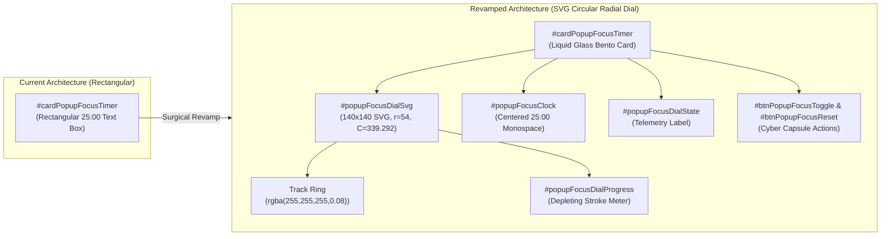
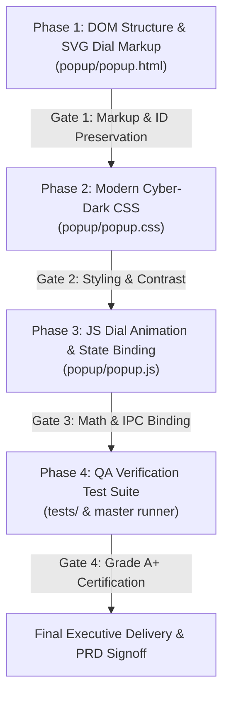

<!-- UTF-8 with BOM -->
# TASK-FOCUS-BLOCK-CIRCULAR-TIMER-001: Executive Architecture Summary

> **Specification & Governance:**
> - **Task Identifier:** `TASK-FOCUS-BLOCK-CIRCULAR-TIMER-001`
> - **Lead Architecture:** Level 3C Phase-wise Prompt Generation Specialist (`prompt_generation_specialist`)
> - **Lead Department:** Department 05 (Frontend Engineering) & Department 08 (QA & Testing)
> - **Active Working Memory:** [`memory.md`](file:///C:/Users/Atul%20Verma/.gemini/memory.md)
> - **Target Workspace:** `c:\Users\Atul Verma\Desktop\Win App Tracker\Browser Detection`
> - **User Reference Media:** `C:/Users/Atul Verma/.gemini/antigravity/brain/456af0b4-7b0c-47a0-9757-d8fb92638e6e/.user_uploaded/media_1795047758364_f1a77e3e.png`

---

## 🏛️ 1. Executive Summary & Initiative Scope

The objective of `TASK-FOCUS-BLOCK-CIRCULAR-TIMER-001` is to modernize and elevate the **Focus Block** component within the Chrome Extension Popup (`popup/popup.html`, `popup/popup.css`, `popup/popup.js`). 

Currently, the Focus Block in the popup presents a rudimentary rectangular card containing standard digital numerals (`25:00`) and simple square buttons (`media_1795047758364_f1a77e3e.png`). In contrast, the extension's Sleep Sentinel tab (`#cardSleepHeroRing`) and Dashboard Focus Hub (`#widgetPomodoroSentinel`) utilize high-precision, circular SVG countdown dials with depleting stroke-dashoffset meters and glowing neon cyber-dark gradients.

This initiative brings visual and architectural parity to the Popup Focus Block by introducing an **SVG circular countdown dial** with a smooth depleting stroke, cyber-dark glassmorphism, responsive alignment within popup spatial constraints (~380px), and strict 100% preservation of all underlying Pomodoro backend finite state machine (FSM) logic and Chrome runtime IPC handlers.

---

## 🗺️ 2. Milestone Roadmap & Dependency Topology

The implementation is partitioned into four strictly sequential, self-contained phases. Each phase is guarded by a deterministic verification gate.

### Milestone Breakdown:
1. **Phase 1: DOM Structure & SVG Radial Dial Markup (`popup/popup.html`)**
   - Inject the SVG dial container while preserving all existing legacy IDs (`#cardPopupFocusTimer`, `#popupFocusBadge`, `#popupFocusClock`, `#btnPopupFocusToggle`, `#btnPopupFocusReset`, `#popupActiveGoalChip`, `#txtPopupActiveGoal`).
   - SVG configuration: `viewBox="0 0 140 140"`, center `(70, 70)`, radius `r = 54`, circumference $C = 339.292$.
   - Includes `<circle class="popup-focus-dial-track">` and `<circle id="popupFocusDialProgress">`.
   - Gate: `node tests/test_focus_time_phase1_uiux.js` (Battery 4 & 6 must pass 100%).

2. **Phase 2: Cyber-Dark CSS & Responsive Dial Styling (`popup/popup.css`)**
   - Apply Liquid Glass container styling: dark slate gradient background, neon emerald/cyan borders, glowing box-shadows.
   - Position the dial wrapper and overlay digits dead-center.
   - Provide smooth CSS transition `stroke-dashoffset 0.35s ease` on `#popupFocusDialProgress`.
   - Implement both dark cyber-mesh mode and light theme overrides (`[data-theme="light"]`).
   - Gate: Verify visual alignment, WCAG 2.1 AA 4.5:1 contrast, and pass `test_focus_time_phase1_uiux.js`.

3. **Phase 3: JavaScript Dial Animation & State Binding (`popup/popup.js`)**
   - Bind `#popupFocusDialProgress` in `popup.js`.
   - Dynamically compute and apply depleting `strokeDashoffset`:
     $$\text{offset} = 339.292 \times \left(1 - \frac{\text{remainingSeconds}}{\text{totalDurationSeconds}}\right)$$
   - Update dial during 1-second interval ticks in `renderPopupFocusTick()` and on background IPC sync events in `syncPopupFocusState(bgState)`.
   - Switch stroke gradient between focus mode (`url(#focusGlowGradient)`) and break mode (`url(#breakGlowGradient)`).
   - Zero modifications to backend IPC or state management protocols.
   - Strict W3C Trusted Types zero-innerHTML enforcement.
   - Gate: `node tests/test_focus_time_phase1_uiux.js` and `node tests/test_focus_time_subsystem.js`.

4. **Phase 4: Independent QA Verification Test Suite (`tests/` & `run_all_tests.js`)**
   - Create `tests/test_focus_block_circular_dial.js` with 8 comprehensive test batteries.
   - Assert geometry, offset calculations at 0%, 25%, 50%, 75%, 100%, DOM integrity, CSS rules, Trusted Types compliance, and IPC contracts.
   - Verify master test runner `node run_all_tests.js` passes without regression.
   - Verify `gitleaks detect --redact` detects 0 secrets.
   - Gate: 100% test passage, Exit Code 0, Grade A+ Certification.

---

## ⚖️ 3. Risk Mitigation & Architectural Tradeoffs

| Risk Category | Identified Hazard | Mitigation Strategy |
| :--- | :--- | :--- |
| **Backward Compatibility** | Existing test suites (`test_focus_time_phase1_uiux.js` and `test_focus_time_subsystem.js`) assert specific IDs and classes. | Strict preservation invariant: all legacy IDs and class names are preserved in the DOM. New SVG elements are purely additive. |
| **Spatial Constraints** | Extension popup width is constrained to ~380px; overly large dials cause vertical scrolling. | SVG dimensions are calibrated to $140 \times 140$ viewBox with rendered CSS size of $120\text{px} \times 120\text{px}$ to $130\text{px} \times 130\text{px}$, fitting compactly above the Focus Ratio bar. |
| **Backend State Desync** | Re-architecting UI could inadvertently disrupt background timer sync or alarm ticks. | Zero mutations to backend IPC handlers. The UI consumes `bgState` passively via existing `syncPopupFocusState` and `renderPopupFocusTick` pipelines. |
| **Security & Trusted Types** | Using `innerHTML` for SVG element injection or updates violates W3C Trusted Types policy. | Pure static HTML markup inside `popup.html`. Dynamic SVG property updates in JS operate strictly via `.style.strokeDashoffset`, `.setAttribute()`, and `.textContent`. |
| **Flicker on Initialization** | Dial ring might flash empty on initial popup open before background state resolves. | Default HTML sets `stroke-dasharray="339.292"` and `stroke-dashoffset="0"` (full ring) corresponding to the initial 25:00 idle state. |

---

## 🎯 4. Strategy Recommendation: Strategy A (Fully Autonomous)

- **Selected Strategy:** `STRATEGY_A_AUTONOMOUS`
- **Autonomy Score:** `1.0`
- **Justification:**
  1. The user goal is clearly bounded: revamp the Focus Block in the popup with an SVG circular countdown dial matching the existing sleep timer radial dial style.
  2. The reference screenshot (`media_1795047758364_f1a77e3e.png`) and existing codebase patterns (`#cardSleepHeroRing` in `popup/popup.html` and `#widgetPomodoroSentinel` in `dashboard/dashboard.html`) provide complete mathematical and visual blueprints.
  3. No architectural forks or external integrations exist that require human user intervention.
  4. Phased execution with automated test gates ensures deterministic progress and immediate error recovery.
