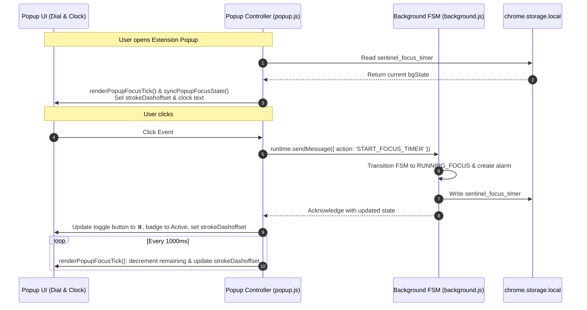

<!-- UTF-8 with BOM -->
# TASK-FOCUS-BLOCK-CIRCULAR-TIMER-001: Technical Requirements Document (TRD)

> **Specification & Governance:**
> - **Task Identifier:** `TASK-FOCUS-BLOCK-CIRCULAR-TIMER-001`
> - **Lead Department:** Department 05 (Frontend Engineering) & Department 08 (QA & Testing)
> - **Lead Architecture:** Level 3C Phase-wise Prompt Generation Specialist (`prompt_generation_specialist`)
> - **Active Working Memory:** [`memory.md`](file:///C:/Users/Atul%20Verma/.gemini/memory.md)
> - **Target Workspace:** `c:\Users\Atul Verma\Desktop\Win App Tracker\Browser Detection`

---

## 🏛️ 1. High-Level Design (HLD) & Architectural Overview

The Chrome Extension popup is an HTML/CSS/JS client that displays and controls extension features inside a sandboxed browser action window. 

The Focus subsystem operates as a distributed system:
1. **Background Engine (`background.js`):**
   - Owns the authoritative Pomodoro Finite State Machine (FSM) with states: `IDLE`, `RUNNING_FOCUS`, `PAUSED_FOCUS`, `RUNNING_BREAK`, `PAUSED_BREAK`, `COMPLETED`.
   - Schedules native `chrome.alarms` for deterministic background timing.
   - Synchronizes state into `chrome.storage.local` under the key `sentinel_focus_timer`.
   - Broadcasts IPC messages (`FOCUS_TIMER_STATE_CHANGED`, `FOCUS_TIMER_COMPLETED`, `FOCUS_BREAK_COMPLETED`).
2. **Popup Client Controller (`popup/popup.js`):**
   - Initializes local state from `sentinel_focus_timer` upon opening.
   - Listens to `browserAPI.storage.onChanged` and runtime IPC messages.
   - Dispatches user intent via `browserAPI.runtime.sendMessage` (`START_FOCUS_TIMER`, `PAUSE_FOCUS_TIMER`, `RESUME_FOCUS_TIMER`, `RESET_FOCUS_TIMER`).
   - Executes local 1000ms ticker (`renderPopupFocusTick`) to calculate and animate smooth 1-second countdown decrements between background sync events.
3. **Popup Focus View Pane (`popup/popup.html` & `popup/popup.css`):**
   - Renders `#cardPopupFocusTimer` inside `#viewFocusPane` -> `#cardFocusWellness`.
   - Houses the new SVG circular dial, centered telemetry clock, and action controls.



---

## 📐 2. Low-Level Design (LLD): SVG Radial Dial Geometry & Mathematics

### 2.1 Geometric Parameters
- **ViewBox:** `0 0 140 140`
- **Rendered Dimensions:** Width `130px`, Height `130px`
- **Center Coordinates:** $cx = 70$, $cy = 70$
- **Radius ($r$):** `54`
- **Stroke Width:** `7` (track `rgba(255, 255, 255, 0.08)`, progress meter with glowing linear gradient)
- **Stroke Linecap:** `round`
- **Coordinate Orientation:** Starts at 12 o'clock (top) via `transform="rotate(-90 70 70)"`

### 2.2 Mathematical Formula
The circumference of the circle is given by:
$$C = 2 \times \pi \times r = 2 \times \pi \times 54 = 339.292006587... \approx 339.292$$

For a **depleting stroke** countdown:
- When remaining time is $100\%$ ($t = T_{\text{total}}$), the stroke is complete:
  $$\text{offset} = 0.000$$
- When remaining time decreases ($t < T_{\text{total}}$), the depleted portion is:
  $$\text{fractionElapsed} = 1 - \frac{\text{remainingSeconds}}{\text{totalDurationSeconds}}$$
- The `strokeDashoffset` is:
  $$\text{strokeDashoffset} = C \times \left(1 - \frac{\text{remainingSeconds}}{\text{totalDurationSeconds}}\right)$$
- When remaining time reaches $0$ ($t = 0$), the stroke is fully depleted:
  $$\text{strokeDashoffset} = C = 339.292$$

### 2.3 Boundary Clamps & Benchmark Table

| Session Progress | Remaining Time (25m Total) | Ratio ($t / T$) | Stroke Dashoffset (px) | Visual Status |
| :---: | :---: | :---: | :---: | :--- |
| **0% Elapsed (Start)** | 25:00 (1500s) | 1.000 | `0.000` | Full circular neon ring |
| **25% Elapsed** | 18:45 (1125s) | 0.750 | `84.823` | 3/4 ring remaining |
| **50% Elapsed (Half)** | 12:30 (750s) | 0.500 | `169.646` | Half ring remaining |
| **75% Elapsed** | 06:15 (375s) | 0.250 | `254.469` | 1/4 ring remaining |
| **100% Elapsed (Done)** | 00:00 (0s) | 0.000 | `339.292` | Ring fully depleted (empty) |
| **Negative Clamp** | `< 0s` | `< 0.000` | `339.292` | Clamped to $C$ (empty) |
| **Overflow Clamp** | `> 1500s` | `> 1.000` | `0.000` | Clamped to $0$ (full) |

---

## 🔄 3. State Transition Matrix & UI Binding

| FSM State (`bgState.state`) | Mode (`bgState.mode`) | `#popupFocusBadge` | `#btnPopupFocusToggle` | `#popupFocusDialProgress` Stroke | Dial Ring State |
| :--- | :--- | :--- | :--- | :--- | :--- |
| `IDLE` | `'focus'` | `25m idle` | `▶️` (Start) | Slate / Muted Track | Static, offset = 0 |
| `RUNNING_FOCUS` | `'focus'` | `Active running` | `⏸️` (Pause) | Neon Emerald (`#focusGlowGradient`) | Depleting tick-by-tick |
| `PAUSED_FOCUS` | `'focus'` | `Paused paused` | `▶️` (Resume) | Warm Amber / Muted | Frozen at current offset |
| `RUNNING_BREAK` | `'break'` | `Break running` | `⏸️` (Pause) | Warm Amber (`#breakGlowGradient`) | Depleting tick-by-tick |
| `PAUSED_BREAK` | `'break'` | `Paused paused` | `▶️` (Resume) | Warm Amber / Muted | Frozen at current offset |
| `COMPLETED` | `'focus'` / `'break'` | `Done idle` | `▶️` (Start) | Slate / Muted | Fully depleted (offset = 339.292) |

---

## 📡 4. Chrome Runtime IPC Contracts (Preserved 100%)

The following Chrome runtime messaging interfaces are strictly preserved:

1. **Start Focus:**
   ```javascript
   browserAPI.runtime.sendMessage({ action: 'START_FOCUS_TIMER', durationMinutes: 25, mode: 'focus' }, (res) => {
     if (res && res.state) syncPopupFocusState(res.state);
   });
   ```
2. **Pause Focus:**
   ```javascript
   browserAPI.runtime.sendMessage({ action: 'PAUSE_FOCUS_TIMER' }, (res) => {
     if (res && res.state) syncPopupFocusState(res.state);
   });
   ```
3. **Resume Focus:**
   ```javascript
   browserAPI.runtime.sendMessage({ action: 'RESUME_FOCUS_TIMER' }, (res) => {
     if (res && res.state) syncPopupFocusState(res.state);
   });
   ```
4. **Reset Focus:**
   ```javascript
   browserAPI.runtime.sendMessage({ action: 'RESET_FOCUS_TIMER' }, (res) => {
     if (res && res.state) syncPopupFocusState(res.state);
   });
   ```
5. **Storage Listener:**
   ```javascript
   if (changes.sentinel_focus_timer && changes.sentinel_focus_timer.newValue) {
     if (typeof syncPopupFocusState === 'function') {
       syncPopupFocusState(changes.sentinel_focus_timer.newValue);
     }
   }
   ```

---

## 🛡️ 5. W3C Trusted Types & DOM Node Preservation Specification

### 5.1 Zero-innerHTML Compliance
In strict compliance with W3C Trusted Types CSP:
- The SVG elements and markup are declared statically in `popup/popup.html`.
- Dynamic JavaScript updates in `popup/popup.js` use exclusively:
  - `element.textContent = ...` for text strings.
  - `element.style.strokeDashoffset = ...` for stroke offsets.
  - `element.setAttribute('stroke', ...)` or `element.classList.add/remove(...)` for styling.
  - 0 assignments to `.innerHTML` or `.outerHTML`.

### 5.2 Legacy DOM Nodes Retention Checklist
| Element ID | Tag | Purpose | Backward Compatibility Invariant |
| :--- | :--- | :--- | :--- |
| `cardPopupFocusTimer` | `<div>` | Top-level card container | Required by tests & CSS selectors |
| `popupFocusBadge` | `<span>` | Status/duration badge | Required by tests & state updates |
| `popupActiveGoalChip` | `<div>` | Active intent chip | Required by tests & goal storage |
| `txtPopupActiveGoal` | `<span>` | Active intent text | Required by tests & goal storage |
| `popupFocusClock` | `<span>` | Numeric clock readout | Required by tests & tick interval |
| `btnPopupFocusToggle` | `<button>` | Primary toggle button | Required by tests & click handlers |
| `btnPopupFocusReset` | `<button>` | Reset button | Required by tests & click handlers |
| `popupFocusDialSvg` | `<svg>` | **NEW:** SVG dial container | Additive, child of card |
| `popupFocusDialProgress` | `<circle>` | **NEW:** Depleting stroke meter | Additive, progress calculation |
| `popupFocusDialState` | `<span>` | **NEW:** Subtitle mode readout | Additive, state label |
