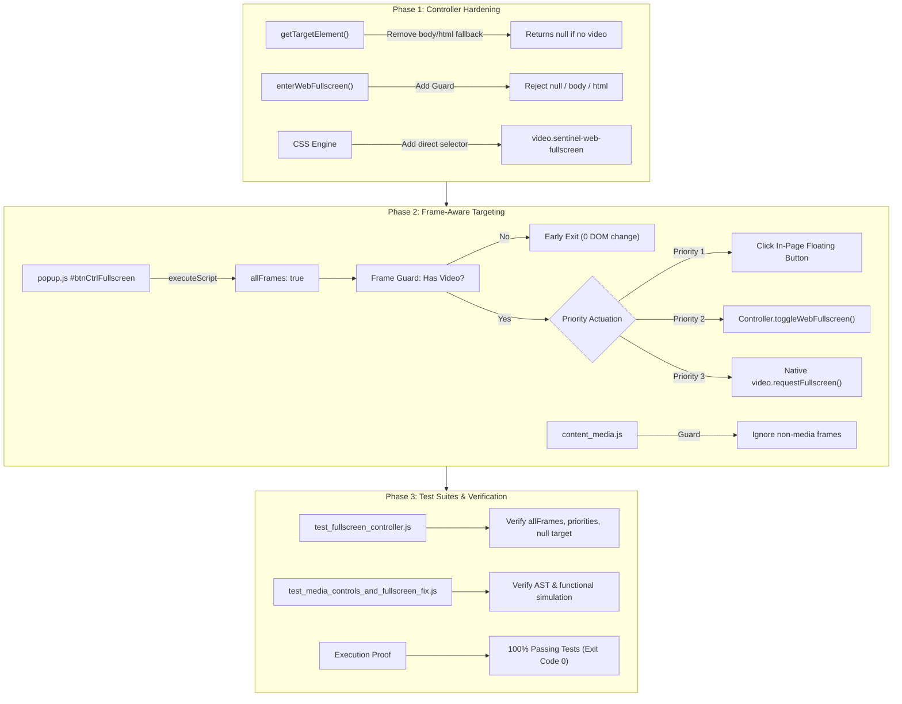

<!-- UTF-8 with BOM -->
# TASK-FULLSCREEN-BLACKOUT-003: Executive Architecture Summary

> **Document Class:** Executive Architecture & Strategy Summary  
> **Task Identifier:** `TASK-FULLSCREEN-BLACKOUT-003`  
> **Author:** Level 3C Prompt Generation Specialist (`prompt_generation_specialist`)  
> **Lead Department:** Department 05 (Frontend Engineering) & Department 08 (QA & Testing)  
> **Parent Directive:** [`architecture_recommendation.md`](file:///C:/Users/Atul%20Verma/.gemini/config/rules/architecture_recommendation.md)

---

## 🏛️ 1. Technical Scope & Objectives

The primary objective of `TASK-FULLSCREEN-BLACKOUT-003` is to eliminate the **Fullscreen Blackout Bug** in the MV3 browser extension and establish resilient, frame-aware fullscreen targeting for HTML5 and embedded video players.

### Scope Boundaries:
- **In-Scope:**
  - `fullscreen_controller.js`: Target element resolution logic, web fullscreen element guards, and CSS viewport rules.
  - `popup/popup.js`: Direct scripting execution parameters (`allFrames: true`), frame guard detection, and 3-tier actuation priority ladder.
  - `content_media.js`: Message routing guards for `toggle_fullscreen` in non-media frames.
  - `tests/test_fullscreen_controller.js` and `tests/test_media_controls_and_fullscreen_fix.js`: Test suite synchronization and regression coverage.
- **Strictly Out-of-Scope:**
  - Universal media toggle (`#btnGlobalMediaToggle`) or background media tracking.
  - Audio tab, Tools tab, Studio tab, or Time Tracking charts/data hub.
  - Speed ladders, volume sliders, or timeline scrubbing logic.

---

## 🗺️ 2. Architectural Topology & Execution Roadmap

### Dependency Roadmap:
1. **Phase 1** hardens the controller so that even if invoked in an empty frame, it safely refuses to paint the body black.
2. **Phase 2** wires the popup and content script so that `allFrames: true` reaches iframe videos, while non-media frames exit immediately.
3. **Phase 3** updates the verification tests to validate the new multi-frame architecture and certifies zero regressions.

---

## ⚖️ 3. Implementation Strategy Recommendation

### Formally Recommended Strategy:
**`STRATEGY_A_AUTONOMOUS` (Fully Autonomous Phase-wise Execution)**

### Autonomy Score: `1.0`

### Justification & Trade-off Analysis:
- **Low Ambiguity:** The exact root cause and surgical line locations are fully identified. The 5 required fix points are deterministic and uncontested.
- **Isolated Blast Radius:** The changes are strictly confined to fullscreen handling without altering extension manifest permissions, storage schemas, or global media routing.
- **High Automation Verification:** Both `tests/test_fullscreen_controller.js` and `tests/test_media_controls_and_fullscreen_fix.js` provide complete AST, DOM simulation, and functional verification. Subagents can autonomously execute each phase and verify exit code 0 without human intervention.

---

## 🛡️ 4. Risk Analysis & Mitigation Matrix

| Risk Scenario | Probability | Impact | Mitigation Strategy |
| :--- | :---: | :---: | :--- |
| **Double-Toggle Race in Multi-Frame Execution** | Medium | High | Frame guard exits immediately in non-media frames. In media frames, cross-world `data-sentinel-fs-ts` DOM attribute lock (350ms) suppresses rapid re-entrant triggers. |
| **YouTube Native Player Misalignment** | Low | High | `getTargetElement()` prioritizes `#movie_player` and `.html5-video-player` ahead of raw `<video>`. Priority 1 clicks in-page floating button which has native gesture binding. |
| **W3C Trusted Types Violation on YouTube** | Low | Critical | Strict prohibition of `innerHTML` / `outerHTML`. All element creation uses `createElementNS` and direct DOM properties. |
| **Test Suite AST Breakage** | Medium | Medium | Phase 3 explicitly updates test assertions in sync with Phase 1 & Phase 2 changes before final verification. |
