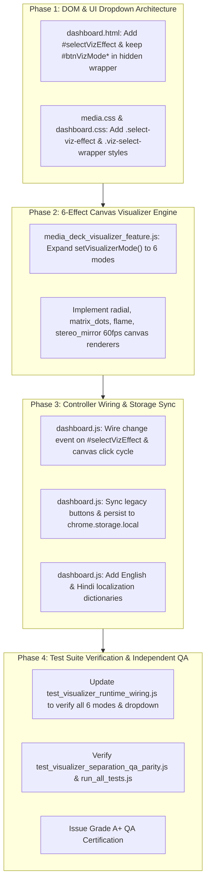

<!-- UTF-8 with BOM -->
# TASK-VIZ-DROPDOWN-EFFECTS-002: Architectural Summary & Engineering Blueprint

> **Specification & Governance:**
> - **Task Identifier:** `TASK-VIZ-DROPDOWN-EFFECTS-002`
> - **Lead Architecture:** Level 3C Phase-wise Prompt Generation Specialist (`prompt_generation_specialist`)
> - **Target Systems:** Media Deck Visualizer Engine, Dashboard Bento Deck, Audio Telemetry Substrate
> - **Active Working Memory:** [`memory.md`](file:///C:/Users/Atul%20Verma/.gemini/memory.md)

---

## 🎯 1. High-Level Initiative Scope & Objectives

The primary objective of `TASK-VIZ-DROPDOWN-EFFECTS-002` is to modernize and expand the Real-Time Spectrum Visualizer on the Media Analytics Dashboard (`#heroAudioLabStatus`). In response to user feedback, the current hardcoded two-button toggle (`32-Band FFT` and `Waveform`) is replaced by an accessible, responsive, Liquid Glass dropdown (`<select id="selectVizEffect">`) supporting at least **six distinct, high-performance 60fps audio visualizer effects**.

### Key Deliverables:
1. **Dropdown UI Component:** Modern Liquid Glass select element with smooth focus ring, chevron indicator, and full accessibility (`aria-label`, keyboard navigation).
2. **Backward-Compatible Button Facades:** Preservation of `#btnVizModeBars` and `#btnVizModeWave` elements in the DOM (synchronized automatically with dropdown value) ensuring 0 regressions for legacy consumers and existing tests.
3. **Six Distinct 60fps Canvas 2D Effects:**
   - **Effect 1: `bars` (32-Band Spectrum Analyzer):** Frequency spectrum bars with triple-stop gradient and falling peak-hold dots.
   - **Effect 2: `wave` (Oscilloscope Neon Waveform):** Neon sine wave oscilloscope trace with glow blur and dynamic harmonic modulation.
   - **Effect 3: `radial` (Circular Frequency Burst):** Solar flare / radial audio ring radiating frequency spokes outward from center with reactive core pulsing.
   - **Effect 4: `matrix_dots` (Matrix Digital Dots / Cyber Voxel Grid):** Vertical matrix grid of discrete glowing dots illuminating according to frequency intensity.
   - **Effect 5: `flame` (Neon Flame Peaks):** Sinuous upward flame ribbons with warm kinetic energy gradient (crimson to amber gold).
   - **Effect 6: `stereo_mirror` (Stereo Dual-Channel Butterfly):** Bilateral mirrored spectrum expanding symmetrically left and right from center baseline.
4. **State Persistence:** User preference stored in `chrome.storage.local` / `localStorage` under `media_sentinel_viz_effect` and seamlessly restored on dashboard initialization.
5. **Interactive Cycling:** Clicking directly on `<canvas id="canvasAudioVisualizer">` smoothly cycles through all 6 visualizer modes in sequence.
6. **Bilingual Support:** Complete English and Hindi localization for dropdown labels and effect names.

---

## 🗺️ 2. Cross-Phase Milestone Roadmap & Dependency Topology

### Dependency Rules:
- **Phase 2 depends on Phase 1:** Engine mode handling references DOM elements initialized in Phase 1.
- **Phase 3 depends on Phase 2:** Controller event listeners invoke the newly expanded methods in the visualizer feature.
- **Phase 4 depends on Phase 3:** Test suites exercise the integrated DOM, visualizer engine, and controller.

---

## 🛡️ 3. Risk Mitigation & Architectural Tradeoffs

| Risk Factor | Severity | Potential Failure Mode | Surgical Mitigation Strategy |
| :--- | :---: | :--- | :--- |
| **Breaking Existing Tests** | High | Tests expecting `#btnVizModeBars` and `#btnVizModeWave` fail if buttons are deleted. | Keep legacy buttons in DOM inside `.visually-hidden` container; mirror state bidirectionally between select and buttons. |
| **Canvas 2D Frame Drops (<60fps)** | Medium | Complex mathematical effects causing RAF frame lag on low-end hardware. | Avoid allocating objects inside RAF loop; precompute constants, lookup tables, and use integer math / single canvas path batches. |
| **BOM Corruption** | High | PowerShell/Node file writes stripping UTF-8 BOM, causing Universal Rule 5/8 test failures. | Explicitly verify and write BOM byte signature (`0xEF, 0xBB, 0xBF`) on all modified files. |
| **Untrusted Types CSP Violations** | Critical | Using `innerHTML` for dropdown options violates Chrome Manifest V3 CSP and project rules. | Build DOM nodes strictly via standard `document.createElement('option')` or static HTML in `dashboard.html`. |
| **CPU Spikes in Background Tabs** | High | Visualizer continuing to draw when dashboard tab is hidden or audio is paused. | Preserve strict Zero-Overhead Idle Sleep Sentinel: abort RAF and sleep when `doc.visibilityState === 'hidden'` or `!isVisualizerPlaying`. |

---

## 🔍 4. Blast Radius Analysis

- **Target Files:**
  - `dashboard/dashboard.html` (lines ~740-745)
  - `dashboard/styles/media.css` (lines ~1110-1185, ~1305-1335)
  - `dashboard/dashboard.css` (lines ~5900-5975, ~6095-6125)
  - `src/dashboard/features/media_deck_visualizer_feature.js` (lines ~395-730)
  - `dashboard/dashboard.js` (lines ~235-245, ~655-665, ~2255-2295, ~7890-7920)
  - `tests/test_visualizer_runtime_wiring.js` (lines ~45-60, ~100-145)
- **Zero-Touch Out-of-Scope Files:**
  - Fullscreen controller (`fullscreen_controller.js`)
  - Content scripts (`content_media.js`)
  - Background worker (`background.js`)
  - Equalizer / Audio Lab filters (`audio_lab_service.js`, `audio_eq_card`)
  - Popup interface (`popup/popup.*`)
  - Tracking & Analytics SQLite Hub (`sqlite_data_hub.js`)
