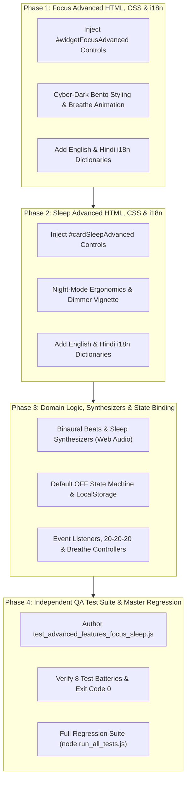

# Advanced Suite Integration for Focus & Sleep Hubs: Executive Architecture Summary

> **Document Type:** Executive Architecture & Initiative Summary  
> **Task ID:** `TASK-ADVANCED-FEATURES-FOCUS-SLEEP-001`  
> **Workspace Container:** `temp_prompt/advanced_features_focus_sleep/`  
> **Governing Architecture:** [`PHASE_WISE_PROMPT_GENERATION_ARCHITECTURE.md`](file:///C:/Users/Atul%20Verma/.gemini/config/rules/PHASE_WISE_PROMPT_GENERATION_ARCHITECTURE.md)  
> **Command Hierarchy Role:** Level 3C Phase-wise Prompt Generation Specialist (`prompt_generation_specialist`)  
> **Lead Departments:** Dept 01 (Product Requirements), Dept 02 (Solution Architecture), Dept 04 (UI/UX Design), Dept 05 (Frontend), Dept 08 (QA & Testing)  

---

## 🎯 1. High-Level Initiative Scope & Technical Objectives

The objective of this initiative is to integrate an advanced, opt-in bio-hacking, distraction management, and circadian relaxation suite into the Web Activity & Media Sentinel dashboard.

### 1.1 Structural Placement & Architecture
The new features are strictly localized within two dedicated sub-hub containers:
1. **Focus Advanced Controls Container (`#widgetFocusAdvanced`):** Located inside `#containerFocusHub`, directly following the basic Pomodoro hero widget.
2. **Sleep Advanced Controls Container (`#cardSleepAdvanced`):** Located inside `#containerSleepHub`, directly following the basic Sleep hero widget.

### 1.2 The Absolute Untouched Invariant
- `#widgetPomodoroSentinel` (Basic Pomodoro Sentinel Hub) **MUST REMAIN COMPLETELY UNTOUCHED**.
- `#cardSleepSentinelHub` (Basic Sleep Sentinel Hub) **MUST REMAIN COMPLETELY UNTOUCHED**.
- No existing IDs, event listeners, timer ticks, radial dial SVG arcs, preset buttons, or primary CTA logic in these basic containers are modified.

### 1.3 The Absolute Default OFF Invariant
To ensure 100% user consent, predictable behavior, and zero surprise interference:
- Every new toggle checkbox is unchecked by default (`checked = false`).
- Every new select dropdown defaults to `'none'` / `'off'`.
- Every new mode button is inactive by default.
- Storage keys under `sentinel_focus_adv_*` and `sentinel_sleep_adv_*` initialize strictly to `false` or `'none'`.

---

## 🛠️ 2. Comprehensive Feature Breakdown

### 2.1 Focus Advanced Hub Suite (5 Features)
1. **Focus Integrity Score & Distraction Counter:**
   - **DOM ID:** `#toggleFocusIntegrityScore` (Checkbox, default OFF)
   - **Metric Display:** `#badgeFocusIntegrityScore` (e.g. `100%`) and `#cntFocusDistractions` (e.g. `0 distractions`).
   - **Mechanism:** When enabled during an active Pomodoro session, tracks domain switching and interruptions. If the user navigates away from productive tasks or triggers distraction domains, the integrity score decreases and distraction tally increments.
2. **Auto-Mute Background Tabs on Focus:**
   - **DOM ID:** `#toggleFocusAutoMuteBg` (Checkbox, default OFF)
   - **Mechanism:** When active focus begins, background tabs playing audio are automatically muted via Chrome Tabs IPC (`chrome.tabs.update(tabId, {muted: true})`). Upon session completion, break, or reset, previously muted tabs are smoothly un-muted.
3. **Binaural Beats & Flow Frequencies:**
   - **Target Control:** `#selectFocusSoundscape` dropdown expansion.
   - **New Options:**
     - `value="binaural_alpha"`: 🧘 Alpha 10Hz (Deep Relaxation & Flow State, Carrier: 200Hz Left / 210Hz Right)
     - `value="binaural_beta"`: 🧠 Beta 18Hz (Analytical Focus & Problem Solving, Carrier: 220Hz Left / 238Hz Right)
     - `value="binaural_gamma"`: ⚡ Gamma 40Hz (Peak Cognition & Information Processing, Carrier: 240Hz Left / 280Hz Right)
   - **Synthesis:** Dual-oscillator stereo panner architecture using the native Web Audio API. Zero external audio downloads. Default remains `none`.
4. **Soft-Nudge Breathe Overlay on Distracting Domains:**
   - **DOM ID:** `#toggleFocusBreatheNudge` (Checkbox, default OFF)
   - **Mechanism:** In lieu of a jarring hard block, navigating to blacklisted/distracting domains during active focus presents a calm 12-second box-breathing mindfulness overlay (`#overlayBreatheNudge`) encouraging intentional attention recovery. Includes a "Return to Focus" button and an "Allow Once" bypass.
5. **20-20-20 Screen-Break & Posture Alert:**
   - **DOM ID:** `#toggleFocus2020Alert` (Checkbox, default OFF)
   - **Mechanism:** Every 20 minutes of continuous focus, triggers a non-disruptive, auto-fading visual toast HUD (`#toast2020PostureAlert`) reminding the user to gaze at a 20-foot distance for 20 seconds and calibrate neck/shoulder posture.

### 2.2 Sleep Advanced Hub Suite (6 Features)
1. **Auto-Disable Video Autoplay:**
   - **DOM ID:** `#toggleSleepAutoplayBlock` (Checkbox, default OFF)
   - **Mechanism:** Dispatches an IPC signal to media content scripts (`content_media.js`) to disable infinite playlist autoplay and countdown triggers on supported video players (YouTube, Netflix, etc.) while the sleep timer is active.
2. **Sleep Aid Soundscapes:**
   - **DOM ID:** `#selectSleepAidSoundscape` (Dropdown, default `none`)
   - **Options:**
     - `value="none"`: Off (Silent)
     - `value="pink_noise"`: 🌸 Deep Pink Noise (Equal energy per octave, ideal for deep sleep induction)
     - `value="midnight_ocean"`: 🌊 Midnight Ocean Waves (Low-frequency rolling resonant wash)
     - `value="delta_rain"`: 🌧️ Delta Rain (Gentle precipitation paired with subtle 2.5Hz delta hum)
   - **Mechanism:** Real-time Web Audio API synthesizer that synchronizes its gain envelope with the active sleep fade curve.
3. **Inactivity Fast-Cutoff:**
   - **DOM ID:** `#toggleSleepInactivityFastCutoff` (Checkbox, default OFF)
   - **Mechanism:** Monitors browser idle state (`chrome.idle` or local mouse/keystroke heartbeat). If zero user activity is detected for > 5 minutes while media is running under sleep countdown, accelerates the cutoff sequence to conserve power and prevent sleep disruption.
4. **Progressive Screen Dimmer Nudge:**
   - **DOM ID:** `#toggleSleepScreenDimmer` (Checkbox, default OFF)
   - **Mechanism:** During the final 10% of sleep countdown (or configurable 30s-60s window), applies a gentle CSS circadian dimming vignette (`#overlaySleepDimmer`) to simulate nightfall.
5. **Memory-Saver Tab Hibernation:**
   - **DOM ID:** `#toggleSleepTabHibernate` (Checkbox, default OFF)
   - **Mechanism:** Safely discards non-active background tabs using `chrome.tabs.discard(tabId)` upon sleep timer expiration, freeing memory, dropping CPU load, and suppressing laptop cooling fan noise during sleep.
6. **Power-Nap Mode 20m:**
   - **DOM ID:** `#btnSleepPowerNapMode` (Button, default inactive)
   - **Mechanism:** 1-click circadian nap trigger. Instantly configures countdown to exactly 20 minutes, activates Gentle Delta soundscape, auto-enables audio fade curve, and sets a soft wake chime.

---

## 🗺️ 3. Cross-Phase Milestone Roadmap & Dependency Topology

---

## 🛡️ 4. Risk Mitigation & Architectural Tradeoffs

| Potential Risk | Severity | Mitigation Strategy |
| :--- | :---: | :--- |
| **Audio Context Autoplay Policy** | Medium | AudioContext resumes strictly on user gesture (e.g. click on preset, play button, or toggle change). Never calls `.resume()` unconditionally. |
| **Binaural Beats Phase Distortion** | Low | Uses ChannelSplitterNode and ChannelMergerNode / StereoPannerNode to maintain clean discrete stereo separation (Left Ear vs Right Ear carrier frequencies). |
| **Tab Muting Permission Failure** | Low | Wraps `chrome.tabs.update` in try/catch with permission capability check; falls back gracefully if running in standalone web dashboard without extension permissions. |
| **Tab Discard Data Loss** | Medium | Tab hibernation filters strictly ignores: 1) Active tab, 2) Pinned tabs, 3) Tabs with form inputs/unsubmitted data. Only discards idle background tabs. |
| **DOM ID Collisions** | Low | All new DOM IDs follow explicit namespaces: `#toggleFocus*`, `#selectFocus*`, `#toggleSleep*`, `#selectSleep*`, `#btnSleep*`. Basic container IDs remain untouched. |
| **W3C Trusted Types Violation** | Critical | 100% forbidden to use `innerHTML` or `outerHTML`. All UI elements are statically defined in `dashboard.html` or constructed via `document.createElement` + `textContent`. |

---

## 📦 5. File Manifest & Change Plan

| File Path | Nature of Change | Target Sections & Scope |
| :--- | :--- | :--- |
| `dashboard/dashboard.html` | Surgical Edit | Add new control rows inside `#widgetFocusAdvanced` (lines 1431-1525) and `#cardSleepAdvanced` (lines 1528-1593). Basic containers unchanged. |
| `dashboard/dashboard.css` | Append / Style | Add `.focus-integrity-score`, `.focus-distraction-counter`, `.binaural-badge`, `.breathe-nudge-overlay`, `.sleep-soundscape-panel`, `.btn-power-nap`, `.screen-dimmer-overlay`. |
| `dashboard/dashboard.js` | Surgical Edit | Add bilingual i18n keys to `I18N_DICTIONARY.en` and `I18N_DICTIONARY.hi`. Add Web Audio synthesizers, state managers, and event binding functions. |
| `tests/test_advanced_features_focus_sleep.js` | New Test Suite | Comprehensive 8-battery automated test suite validating all 11 features, basic container preservation, default OFF states, and audio safety. |
