# Advanced Suite Integration for Focus & Sleep Hubs: Technical Requirements Document (TRD)

> **Document Type:** Technical Requirements Document (TRD) & Low-Level Design (LLD)  
> **Task ID:** `TASK-ADVANCED-FEATURES-FOCUS-SLEEP-001`  
> **Workspace Container:** `temp_prompt/advanced_features_focus_sleep/`  
> **Governing Architecture:** [`PHASE_WISE_PROMPT_GENERATION_ARCHITECTURE.md`](file:///C:/Users/Atul%20Verma/.gemini/config/rules/PHASE_WISE_PROMPT_GENERATION_ARCHITECTURE.md)  
> **Lead Departments:** Dept 02 (Solution Architecture), Dept 05 (Frontend Engineering), Dept 08 (QA & Testing)  

---

## 🏛️ 1. Technical Scope & Architecture Overview

This document specifies the exact Low-Level Design (LLD), DOM hierarchy, state management contracts, Web Audio DSP algorithms, browser extension IPC integrations, and testing harnesses for integrating the 11 advanced features into `#widgetFocusAdvanced` and `#cardSleepAdvanced`.

```mermaid
flowchart TD
    subgraph Storage ["LocalStorage State Contracts (Default OFF)"]
        S_Focus["sentinel_focus_adv_* (All default false / 'none')"]
        S_Sleep["sentinel_sleep_adv_* (All default false / 'none')"]
    end

    subgraph FocusAdv ["#widgetFocusAdvanced (Focus Sub-Hub)"]
        F1["#toggleFocusIntegrityScore -> Focus Integrity & Distraction Counter"]
        F2["#toggleFocusAutoMuteBg -> Auto-Mute Background Tabs"]
        F3["#selectFocusSoundscape -> Binaural Beats (Alpha, Beta, Gamma)"]
        F4["#toggleFocusBreatheNudge -> Soft-Nudge Breathe Overlay"]
        F5["#toggleFocus2020Alert -> 20-20-20 Screen-Break & Posture Alert"]
    end

    subgraph SleepAdv ["#cardSleepAdvanced (Sleep Sub-Hub)"]
        SL1["#toggleSleepAutoplayBlock -> Auto-Disable Video Autoplay"]
        SL2["#selectSleepAidSoundscape -> Pink Noise, Ocean, Delta Rain"]
        SL3["#toggleSleepInactivityFastCutoff -> 5m Inactivity Cutoff"]
        SL4["#toggleSleepScreenDimmer -> Progressive Circadian Dimmer"]
        SL5["#toggleSleepTabHibernate -> Memory-Saver Tab Hibernation"]
        SL6["#btnSleepPowerNapMode -> 20m Circadian Power-Nap Trigger"]
    end

    subgraph WebAudio ["Web Audio API Real-Time DSP"]
        WA_Bin["Stereo Channel Splitter / Panner (Binaural Carrier L/R)"]
        WA_Sleep["Pink Noise Multi-Pole + LFO Ocean Surf + Delta Rain"]
        WA_Fade["Synchronous Gain Ramp to Sleep Fade Curve"]
    end

    F3 --> WA_Bin
    SL2 --> WA_Sleep
    SL2 --> WA_Fade
```



---

## 🏗️ 2. DOM Architecture & Element Hierarchy

### 2.1 `#widgetFocusAdvanced` Container Layout
Located inside `#containerFocusHub`, following `#widgetPomodoroSentinel`:

```html
<div id="widgetFocusAdvanced" class="bento-card liquid-glass-card bento-span-6 pomodoro-advanced-card">
  <!-- Preserved Header -->
  <div class="card-header-row settings-card-header">...</div>
  
  <div class="pomodoro-advanced-body">
    <!-- Preserved Goal Input & Custom Stepper Rows -->
    ...

    <!-- Preserved Ambient Soundscape Panel (Expanded with Binaural Beats) -->
    <div class="focus-soundscape-panel">
      <div class="soundscape-header">
        <span class="soundscape-title" data-i18n="focus_ambient_soundscapes">🎧 Ambient Soundscapes</span>
        <select id="selectFocusSoundscape" class="styled-select soundscape-select" aria-label="Ambient Soundscape Selector">
          <option value="none" selected data-i18n="soundscape_opt_none">Off (Silent)</option>
          <option value="rain" data-i18n="soundscape_opt_rain">🌧️ Gentle Rain</option>
          <option value="cafe" data-i18n="soundscape_opt_cafe">☕ Coffee Shop</option>
          <option value="ocean" data-i18n="soundscape_opt_ocean">🌊 Ocean Waves</option>
          <option value="forest" data-i18n="soundscape_opt_forest">🌲 Forest Birds</option>
          <option value="whitenoise" data-i18n="soundscape_opt_whitenoise">💨 Pink/White Noise</option>
          <!-- NEW: Binaural Beats Frequencies (Default None, User Selected) -->
          <option value="binaural_alpha" data-i18n="soundscape_opt_binaural_alpha">🧘 Alpha 10Hz (Flow State)</option>
          <option value="binaural_beta" data-i18n="soundscape_opt_binaural_beta">🧠 Beta 18Hz (Analytical Focus)</option>
          <option value="binaural_gamma" data-i18n="soundscape_opt_binaural_gamma">⚡ Gamma 40Hz (Peak Cognition)</option>
        </select>
        <button type="button" id="btnToggleSoundscape" class="btn-soundscape-play" title="Play/Pause Ambient Sound">▶</button>
      </div>
      ...
    </div>

    <!-- Preserved Chime Row -->
    ...

    <!-- NEW: Focus Advanced Features Toggles Container -->
    <div class="dash-focus-toggles-container">
      <!-- Existing 3 Toggles (AutoPauseMedia, Chime, StrictShield) Preserved -->
      ...

      <!-- Feature 1: Focus Integrity Score & Distraction Counter -->
      <div class="dash-focus-toggle-row focus-integrity-row">
        <label class="toggle-text-group" for="toggleFocusIntegrityScore">
          <span class="toggle-title" data-i18n="lbl_focus_integrity">Focus Integrity Score</span>
          <span class="toggle-desc" data-i18n="desc_focus_integrity">Live attention score and distraction tally</span>
        </label>
        <div class="focus-integrity-meta-group">
          <span id="badgeFocusIntegrityScore" class="badge-integrity-score">100%</span>
          <span id="cntFocusDistractions" class="badge-distraction-counter">0</span>
          <input type="checkbox" id="toggleFocusIntegrityScore" class="styled-checkbox">
        </div>
      </div>

      <!-- Feature 2: Auto-Mute Background Tabs on Focus -->
      <label class="dash-focus-toggle-row" for="toggleFocusAutoMuteBg">
        <span class="toggle-text-group">
          <span class="toggle-title" data-i18n="toggle_focus_automute_bg">Auto-Mute Background Tabs</span>
          <span class="toggle-desc" data-i18n="desc_focus_automute_bg">Mute noisy background tabs during focus</span>
        </span>
        <input type="checkbox" id="toggleFocusAutoMuteBg" class="styled-checkbox">
      </label>

      <!-- Feature 4: Soft-Nudge Breathe Overlay on Distracting Domains -->
      <label class="dash-focus-toggle-row" for="toggleFocusBreatheNudge">
        <span class="toggle-text-group">
          <span class="toggle-title" data-i18n="toggle_focus_breathe_nudge">Soft-Nudge Breathe Overlay</span>
          <span class="toggle-desc" data-i18n="desc_focus_breathe_nudge">12s box-breathing prompt on distracting domains</span>
        </span>
        <input type="checkbox" id="toggleFocusBreatheNudge" class="styled-checkbox">
      </label>

      <!-- Feature 5: 20-20-20 Screen-Break & Posture Alert -->
      <label class="dash-focus-toggle-row" for="toggleFocus2020Alert">
        <span class="toggle-text-group">
          <span class="toggle-title" data-i18n="toggle_focus_2020_alert">20-20-20 Screen-Break & Posture</span>
          <span class="toggle-desc" data-i18n="desc_focus_2020_alert">Remind every 20m to look 20ft away for 20s and check posture</span>
        </span>
        <input type="checkbox" id="toggleFocus2020Alert" class="styled-checkbox">
      </label>
    </div>
  </div>
</div>
```

### 2.2 `#cardSleepAdvanced` Container Layout
Located inside `#containerSleepHub`, following `#cardSleepSentinelHub`:

```html
<div id="cardSleepAdvanced" class="bento-card liquid-glass-card bento-span-6 sleep-advanced-card">
  <!-- Preserved Header -->
  <div class="card-header-row settings-card-header">...</div>

  <div class="sleep-advanced-body">
    <!-- Preserved Custom Duration & Extenders Row -->
    ...

    <!-- NEW Feature 6 (Sleep): 20m Power-Nap Mode Action Card -->
    <div class="sleep-power-nap-banner">
      <div class="power-nap-info">
        <span class="power-nap-title" data-i18n="btn_sleep_power_nap">⚡ 20m Power-Nap Mode</span>
        <span class="power-nap-desc" data-i18n="desc_sleep_power_nap">1-click restorative 20m nap with delta rain and gentle wake</span>
      </div>
      <button type="button" id="btnSleepPowerNapMode" class="btn-power-nap" data-i18n="btn_start_nap">Start Nap</button>
    </div>

    <!-- NEW Feature 2 (Sleep): Sleep Aid Soundscapes Panel -->
    <div class="sleep-soundscape-panel">
      <div class="soundscape-header">
        <span class="soundscape-title" data-i18n="lbl_sleep_aid_soundscapes">🌙 Sleep Aid Soundscapes</span>
        <select id="selectSleepAidSoundscape" class="styled-select soundscape-select" aria-label="Sleep Aid Soundscape Selector">
          <option value="none" selected data-i18n="sleep_soundscape_none">Off (Silent)</option>
          <option value="pink_noise" data-i18n="sleep_soundscape_pink">🌸 Deep Pink Noise</option>
          <option value="midnight_ocean" data-i18n="sleep_soundscape_ocean">🌊 Midnight Ocean</option>
          <option value="delta_rain" data-i18n="sleep_soundscape_rain">🌧️ Delta Rain (2.5Hz)</option>
        </select>
        <button type="button" id="btnToggleSleepSoundscape" class="btn-soundscape-play" title="Play/Pause Sleep Soundscape">▶</button>
      </div>
      <div class="soundscape-volume-row">
        <span class="volume-icon">🔈</span>
        <input type="range" id="sliderSleepSoundscapeVolume" class="styled-range soundscape-range" min="0" max="100" value="40" aria-label="Sleep Soundscape Volume">
        <span id="txtSleepSoundscapeVolume" class="volume-num">40%</span>
      </div>
    </div>

    <!-- Toggles Container -->
    <div class="dash-sleep-toggles-container">
      <!-- Preserved Fade, EndOfVideo, Inactivity, and TimeoutAction Controls -->
      ...

      <!-- NEW Feature 1 (Sleep): Auto-Disable Video Autoplay -->
      <label class="dash-sleep-toggle-row" for="toggleSleepAutoplayBlock">
        <span class="toggle-text-group">
          <span class="toggle-title" data-i18n="toggle_sleep_autoplay_block">Auto-Disable Video Autoplay</span>
          <span class="toggle-desc" data-i18n="desc_sleep_autoplay_block">Block next video autoplay during bedtime</span>
        </span>
        <input type="checkbox" id="toggleSleepAutoplayBlock" class="styled-checkbox dash-sleep-switch-input">
      </label>

      <!-- NEW Feature 3 (Sleep): Inactivity Fast-Cutoff (5m) -->
      <label class="dash-sleep-toggle-row" for="toggleSleepInactivityFastCutoff">
        <span class="toggle-text-group">
          <span class="toggle-title" data-i18n="toggle_sleep_inactivity_cutoff">Inactivity Fast-Cutoff (5m)</span>
          <span class="toggle-desc" data-i18n="desc_sleep_inactivity_cutoff">Cut off media if idle for 5m during countdown</span>
        </span>
        <input type="checkbox" id="toggleSleepInactivityFastCutoff" class="styled-checkbox dash-sleep-switch-input">
      </label>

      <!-- NEW Feature 4 (Sleep): Progressive Screen Dimmer Nudge -->
      <label class="dash-sleep-toggle-row" for="toggleSleepScreenDimmer">
        <span class="toggle-text-group">
          <span class="toggle-title" data-i18n="toggle_sleep_screen_dimmer">Progressive Screen Dimmer</span>
          <span class="toggle-desc" data-i18n="desc_sleep_screen_dimmer">Circadian screen dimming during final countdown</span>
        </span>
        <input type="checkbox" id="toggleSleepScreenDimmer" class="styled-checkbox dash-sleep-switch-input">
      </label>

      <!-- NEW Feature 5 (Sleep): Memory-Saver Tab Hibernation -->
      <label class="dash-sleep-toggle-row" for="toggleSleepTabHibernate">
        <span class="toggle-text-group">
          <span class="toggle-title" data-i18n="toggle_sleep_tab_hibernate">Memory-Saver Tab Hibernation</span>
          <span class="toggle-desc" data-i18n="desc_sleep_tab_hibernate">Suspend idle tabs on timeout to quiet cooling fans</span>
        </span>
        <input type="checkbox" id="toggleSleepTabHibernate" class="styled-checkbox dash-sleep-switch-input">
      </label>
    </div>
  </div>
</div>
```

---

## 💾 3. State Schema & LocalStorage Contracts

All persistent settings are stored under explicit namespaces with strict default values:

```javascript
const ADVANCED_FOCUS_DEFAULT_STATE = {
  integrityScoreEnabled: false,      // sentinel_focus_adv_integrity_enabled
  autoMuteBgEnabled: false,          // sentinel_focus_adv_automute_bg
  soundscapeType: 'none',            // sentinel_focus_adv_soundscape (or 'binaural_alpha', etc.)
  breatheNudgeEnabled: false,        // sentinel_focus_adv_breathe_nudge
  postureAlertEnabled: false,        // sentinel_focus_adv_posture_alert
  distractionCount: 0,               // in-memory session reset
  integrityScore: 100                // in-memory session reset
};

const ADVANCED_SLEEP_DEFAULT_STATE = {
  autoplayBlockEnabled: false,       // sentinel_sleep_adv_autoplay_block
  soundscapeType: 'none',            // sentinel_sleep_adv_soundscape (or 'pink_noise', etc.)
  soundscapeVolume: 40,              // sentinel_sleep_adv_soundscape_vol
  inactivityCutoffEnabled: false,    // sentinel_sleep_adv_inactivity_cutoff
  screenDimmerEnabled: false,        // sentinel_sleep_adv_screen_dimmer
  tabHibernateEnabled: false,        // sentinel_sleep_adv_tab_hibernate
  powerNapActive: false              // in-memory timer flag
};
```

---

## 🎵 4. Web Audio API Real-Time DSP Architectures

### 4.1 Binaural Beats Real-Time Generator
Binaural beats require sending slightly different sine frequencies to the left and right ears. The brain perceives the frequency difference (e.g. $210 - 200 = 10\text{ Hz}$ Alpha wave):

```javascript
function createBinauralBeats(ctx, carrierFreq, beatFreq, gainNode) {
  const oscL = ctx.createOscillator();
  const oscR = ctx.createOscillator();
  oscL.type = 'sine';
  oscR.type = 'sine';
  oscL.frequency.setValueAtTime(carrierFreq, ctx.currentTime);
  oscR.frequency.setValueAtTime(carrierFreq + beatFreq, ctx.currentTime);

  const merger = ctx.createChannelMerger(2);
  oscL.connect(merger, 0, 0); // Channel 0 -> Left Ear
  oscR.connect(merger, 0, 1); // Channel 1 -> Right Ear

  merger.connect(gainNode);
  oscL.start();
  oscR.start();
  return [oscL, oscR, merger];
}
```

- **Alpha 10Hz:** `carrier = 200Hz`, `beat = 10Hz` (Left: 200Hz, Right: 210Hz)
- **Beta 18Hz:** `carrier = 220Hz`, `beat = 18Hz` (Left: 220Hz, Right: 238Hz)
- **Gamma 40Hz:** `carrier = 240Hz`, `beat = 40Hz` (Left: 240Hz, Right: 280Hz)

### 4.2 Sleep Aid Soundscapes DSP Algorithms
- **Pink Noise:** 1/f spectral curve generated using Paul Kellet's filtered white noise algorithm (3 poles) providing equal energy per octave, clinically proven to enhance deep slow-wave sleep.
- **Midnight Ocean:** White noise source passed through a resonant bandpass filter (280Hz, Q=2.2) modulated by an ultra-slow LFO (0.08Hz sine wave) with low-frequency sub-bass enhancement (60Hz boost).
- **Delta Rain:** Dual-layer synthesizer: Layer 1 is rain noise (lowpass 1200Hz, highpass 200Hz), Layer 2 is a subtle 2.5Hz binaural sine drone (100Hz Left / 102.5Hz Right) at -18dB.

---

## 🔌 5. Tab Management & Extension IPC Interfaces

### 5.1 Auto-Mute Background Tabs Handler
```javascript
async function executeAutoMuteBackgroundTabs(isMute) {
  if (typeof chrome !== 'undefined' && chrome.tabs && chrome.tabs.query) {
    try {
      const tabs = await chrome.tabs.query({ active: false });
      for (const tab of tabs) {
        if (tab.audible && !tab.mutedInfo?.muted && isMute) {
          chrome.tabs.update(tab.id, { muted: true }).catch(() => {});
        } else if (!isMute && tab.mutedInfo?.muted) {
          chrome.tabs.update(tab.id, { muted: false }).catch(() => {});
        }
      }
    } catch (_) {}
  }
}
```

### 5.2 Memory-Saver Tab Hibernation Handler
```javascript
async function executeSleepTabHibernation() {
  if (typeof chrome !== 'undefined' && chrome.tabs && chrome.tabs.discard) {
    try {
      const tabs = await chrome.tabs.query({ active: false, pinned: false });
      for (const tab of tabs) {
        chrome.tabs.discard(tab.id).catch(() => {});
      }
    } catch (_) {}
  }
}
```

---

## 🔒 6. Universal Rule 28 Compliance & Functional Modularity
- Every controller function strictly adheres to `<= 50 lines`.
- Separation of concerns: DOM binding functions (`initFocusAdvancedToggles`), Audio synthesis functions (`playBinauralBeat`), and IPC notification helpers (`sendSleepAutoplaySignal`) reside in distinct modular blocks.
- Strict W3C Trusted Types compliance: All element mutations use `textContent`, `classList`, or `setAttribute`. No `innerHTML` or `outerHTML`.
