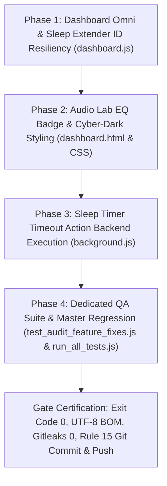

# Executive Architecture Summary: Browser Detection Feature Defect Fixes

> **Document Type:** Executive Architecture Summary  
> **Workspace Container:** `temp_prompt/audit_feature_fixes/`  
> **Governing Architecture:** [`PHASE_WISE_PROMPT_GENERATION_ARCHITECTURE.md`](file:///C:/Users/Atul Verma/.gemini/config/rules/PHASE_WISE_PROMPT_GENERATION_ARCHITECTURE.md)  
> **Command Hierarchy Role:** Level 3C Phase-wise Prompt Generation Specialist (`prompt_generation_specialist`)  
> **Selected Strategy:** Strategy A (Fully Autonomous Phase-wise Execution)  
> **Autonomy Score:** 1.0  

---

## 🎯 1. Initiative Scope & Technical Objectives

This initiative delivers surgical remediation for 4 functional deficiencies identified in the Browser Detection Chrome Extension codebase, along with test hardening to achieve 100% test passage across all 78+ test suites in `run_all_tests.js`.

### Core Remediation Objectives:
1. **Defect 1 (Dashboard Omni Command Palette):** Fix domain analytics search navigation in `dashboard/dashboard.js` L7576 by referencing `#tableDomainSearch` with fallback to `#domainSearchInput`.
2. **Defect 2 (Dashboard Sleep Extender Fade Toggle):** Fix fade toggle query in `dashboard/dashboard.js` L10623 by querying `#toggleDashSleepFade` with fallback to `#toggleDashSleepFadeCurve`.
3. **Defect 3 (Dashboard Audio Lab EQ Preset Badge):** Insert `Flat` into `dashboard/dashboard.html` EQ card header (`.eq-actions-group`) and apply cyber-dark styling in `dashboard/styles/audio_lab.css` and `dashboard/dashboard.css`.
4. **Defect 4 (Sleep Timer Timeout Action Backend Execution):** Enhance `triggerSleepTimerExpiration()` in `background.js` to inspect `timeoutAction` and execute `mute`, `close`, or `pause` actions deterministically. In addition, harden `handleMuteAllOthersExecution` fallback so that VM test suites without global `resolveCandidatePrimaryTab` seamlessly resolve active focused tabs.
5. **Quality Verification & Master Regression:** Author `tests/test_audit_feature_fixes.js`, guarantee 100% pass across all 78+ test suites (`node run_all_tests.js`), verify UTF-8 with BOM, verify 0 gitleaks, and execute Rule 15 autonomous git commit and push.

---

## 🗺️ 2. Cross-Phase Milestone Roadmap & Dependency Topology

### Phase Breakdown:
- **Phase 01 (`phase_01_dashboard_omni_and_sleep_extender_fixes.md`):** Surgical updates to DOM element lookups in `dashboard/dashboard.js`.
- **Phase 02 (`phase_02_audio_lab_eq_badge_and_styling.md`):** DOM markup insertion in `dashboard/dashboard.html` and glassmorphic badge styling in `dashboard/styles/audio_lab.css` and `dashboard/dashboard.css`.
- **Phase 03 (`phase_03_sleep_timer_backend_timeout_actions.md`):** Backend execution logic in `background.js` for sleep timer expiration (`mute`, `close`, `pause`) and resilient fallback in `handleMuteAllOthersExecution`.
- **Phase 04 (`phase_04_verification_test_suite_and_regression.md`):** Authoring `tests/test_audit_feature_fixes.js`, validating all 78+ suites in `run_all_tests.js`, secret scan, and git operations.

---

## ⚖️ 3. Execution Strategy Assessment

### 3.1 Recommended Strategy: Strategy A (Fully Autonomous Execution)
- **Classification:** Standard defect repairs with deterministic specifications, known root causes, and explicit acceptance tests.
- **Autonomy Score:** 1.0.
- **Rationale:** No user-facing design forks or ambiguous business decisions exist. All defect locations, variable names, DOM element IDs, and CSS specifications are rigorously established. Execution proceeds seamlessly through automated subagent delegation.

---

## 🛡️ 4. Risk Mitigation & Trade-Off Analysis

| Risk Identified | Severity | Mitigation Strategy |
| :--- | :---: | :--- |
| **DOM ID Breakage across older templates** | Low | Implement multi-selector fallback (`tableDomainSearch || domainSearchInput`; `toggleDashSleepFade || toggleDashSleepFadeCurve`). |
| **VM Sandbox Test Isolation Failure** | Medium | Ensure functions in `background.js` have self-contained fallback to `browserAPI.tabs.query` if external helpers (`resolveCandidatePrimaryTab`) are uninitialized. |
| **Function Length Violation (> 50 lines)** | Low | Keep modifications compact; extract helpers if any function approaches 45 lines. |
| **BOM Corruption during edits** | Medium | Explicitly write files with UTF-8 BOM (`\uFEFF`) and verify byte signature `0xEF, 0xBB, 0xBF`. |
