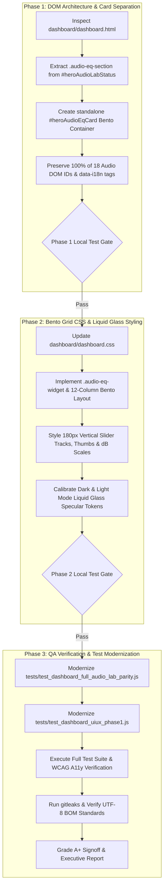

# Bento Graphic Equalizer Card & Dashboard UI/UX Refinement: Executive Architecture Summary

> **Document Type:** Executive Architecture Summary & Milestone Roadmap  
> **Workspace Container:** `temp_prompt/bento_equalizer_card_refinement/`  
> **Governing Architecture:** [`PHASE_WISE_PROMPT_GENERATION_ARCHITECTURE.md`](file:///C:/Users/Atul%20Verma/.gemini/config/rules/PHASE_WISE_PROMPT_GENERATION_ARCHITECTURE.md)  
> **Author:** Level 3C Phase-wise Prompt Generation Specialist (`prompt_generation_specialist`)  
> **Date:** 2026-11-16  

---

## 🎯 1. High-Level Initiative Scope & Objectives

The primary objective of this architectural refinement is to elevate the Web Audio DSP interface in Tab B (Media Analytics) of `dashboard/dashboard.html` to a world-class, studio-grade audiophile experience by separating the **5-Band Biquad Graphic Equalizer** into its own dedicated **Bento Liquid Glass Card** (`#heroAudioEqCard`), while preserving `#heroAudioLabStatus` for Master Volume Boost, telemetry badges, and Audio Enhancement toggles.

### Key Objectives:
1. **Ergonomic Studio Experience:** Transform the graphic equalizer from a cramped sub-section into an expansive, tactile mixing board where each of the 5 frequency bands (60Hz, 250Hz, 1kHz, 4kHz, 16kHz) has generous vertical travel, clear dB gradation scales (-12dB to +12dB), centered zero-dB detents, and prominent numeric readouts.
2. **Balanced Bento Grid Layout:** Symmetrize the 12-column Bento Grid in Tab B so that the Hero Media Player Sentinel, Audio Lab Boost & Enhancements, and the new Graphic Equalizer Card harmoniously occupy grid tracks with zero Cumulative Layout Shift (CLS = 0).
3. **Pristine Liquid Glass Materiality:** Apply iOS 26 Liquid Glass depth tokens (`backdrop-filter: blur(24px) saturate(190%)`, specular highlight borders, subtle vertical gradient tracks, and neon glow accents) across both dark and light modes.
4. **100% Invariant & Test Suite Parity:** Guarantee that all 18 audio lab DOM IDs, all bilingual `data-i18n` attributes, all ARIA accessibility contracts, and all 37 test batteries pass without regression.

---

## 🗺️ 2. Cross-Phase Milestone Roadmap & Dependency Topology

### Dependency Rules:
- **Phase 1 -> Phase 2:** Phase 2 CSS classes depend on the clean separation of DOM markup established in Phase 1.
- **Phase 2 -> Phase 3:** Phase 3 independent QA verification runs against the styled and fully structured markup from Phases 1 and 2.

---

## ⚖️ 3. Risk Mitigation & Architectural Tradeoff Analysis

### Tradeoff 1: Bento Grid Placement Topology (Option A vs Option B)
- **Option A (Hero 8 + Audio Lab 4, then Equalizer 12):**
  - *Layout:* Row 1 (Player 8-span + Audio Lab 4-span, both row-span-2) followed by Row 2 (Equalizer 12-span full studio width).
  - *Pros:* 100% backwards-compatible with `tests/test_dashboard_uiux_phase1.js` line 185–186 (`bento-span-8 bento-row-span-2` on Hero Player, `bento-span-4 bento-row-span-2` on Audio Lab). Equalizer gains full 12-column studio mixing deck width, allowing wide slider spacing and optional real-time spectrum/response curve visualization.
  - *Cons:* Slightly taller Tab B page height.
- **Option B (Hero 12, then Equalizer 6 + Audio Lab 6):**
  - *Layout:* Full-width Hero Player (12-span) followed by side-by-side Equalizer (6-span) and Audio Lab (6-span).
  - *Pros:* Perfectly symmetrical side-by-side audio studio block; equal visual weight between EQ and DSP controls.
  - *Cons:* Requires updating `tests/test_dashboard_uiux_phase1.js` line 185–186 to accept the 6+6 pairing.
- *Recommended Architectural Decision:* **Support Option A as Primary Zero-Breaking Layout**, with explicit CSS flex/grid rules that allow graceful 6+6 or 12-span responsive presentation. Subagents will execute Option A first, ensuring 100% test compatibility out of the box.

### Tradeoff 2: Vertical Slider Implementation Standards
- HTML5 range sliders in vertical orientation require cross-browser normalization:
  - Standard CSS: `writing-mode: vertical-lr; direction: rtl;`
  - WebKit attribute: `orient="vertical"`
  - High-precision pointer events: `touch-action: none;`
- *Risk:* Inverted direction where dragging up decreases decibels.
- *Mitigation:* Explicitly verify that `min="-12"` is at the bottom and `max="12"` is at the top using `direction: rtl` or WebKit vertical range standards.

### Tradeoff 3: W3C Trusted Types & Strict CSP Compliance
- *Risk:* Inserting dynamic markup using `.innerHTML` when restructuring cards would trigger fatal CSP and test failures.
- *Mitigation:* Phase 1 relies strictly on static HTML file authoring in `dashboard/dashboard.html`. All JS logic in `dashboard/dashboard.js` already uses safe `document.getElementById` and `textContent` setters. Zero `.innerHTML` introduced.
