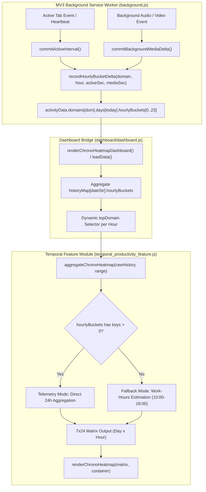

# Architectural Roadmap & Scope Summary: Accurate Hourly Activity Tracking

> **Document Type:** Executive Architecture Summary & Dependency Topology  
> **Workspace Container:** `temp_prompt/chrono_heatmap_hourly_tracking/`  
> **Governing Architecture:** [`PHASE_WISE_PROMPT_GENERATION_ARCHITECTURE.md`](file:///C:/Users/Atul%20Verma/.gemini/config/rules/PHASE_WISE_PROMPT_GENERATION_ARCHITECTURE.md)  
> **Author:** Level 3C Phase-wise Prompt Generation Specialist (`prompt_generation_specialist`)  

---

## 🏛️ 1. Technical Scope & Architecture Overview

The Chrono-Activity Heatmap is an interactive 24h x 7d distribution matrix displayed within the Sentinel Dashboard. It visualizes hourly web browsing intensity and background media playback across all days of the week, enabling users to identify peak productivity windows, late-night media consumption, and daily focus rhythms.

### Data Flow Diagram

---

## 📦 2. Module Dependency Topology & File Anchors

| Subsystem | Target File | Role & Touchpoints |
| :--- | :--- | :--- |
| **Backend Telemetry** | [`background.js`](file:///c:/Users/Atul%20Verma/Desktop/Win%20App%20Tracker/Browser%20Detection/background.js) | - Line 2846: `commitActiveInterval()` - Line 2904: `commitBackgroundMediaDelta()` - Telemetry storage schema: `domainEntry.days[today].hourlyBuckets` |
| **Dashboard Bridge** | [`dashboard/dashboard.js`](file:///c:/Users/Atul%20Verma/Desktop/Win%20App%20Tracker/Browser%20Detection/dashboard/dashboard.js) | - Line 2830–2870: `historyMap` transformation - Hourly aggregation with competitive top domain resolution |
| **Feature Engine** | [`src/dashboard/features/temporal_productivity_feature.js`](file:///c:/Users/Atul%20Verma/Desktop/Win%20App%20Tracker/Browser%20Detection/src/dashboard/features/temporal_productivity_feature.js) | - Line 279–448: `aggregateChronoHeatmap()` - Checking keys length & non-zero seconds in `hourlyBuckets` - Fallback to `dayData.domains` if empty or zero |
| **QA Verification** | [`tests/test_chrono_heatmap_hourly_tracking.js`](file:///c:/Users/Atul%20Verma/Desktop/Win%20App%20Tracker/Browser%20Detection/tests/test_chrono_heatmap_hourly_tracking.js) | - Standalone test battery verifying all 3 layers and end-to-end data pipelines |

---

## ⚡ 3. Risk Assessment & Mitigation Strategy

| Risk Factor | Severity | Mitigation Strategy |
| :--- | :---: | :--- |
| **Storage Bloat in `chrome.storage.local`** | Medium | Hourly buckets are keyed 0–23 integers with minimal scalar values (`activeSeconds`, `backgroundMediaSeconds`, `sessions`). At 24 entries per domain per day, storage impact is negligible (< 1 KB/day). |
| **Backwards Compatibility with Legacy Data** | High | The temporal engine explicitly checks if `hourlyBuckets` contains non-zero entries. If not present (legacy user data), it smoothly falls back to the existing 10:00–18:00 domain estimation without UI breakage. |
| **Function Length Violation (Universal Rule 28)** | Medium | In `background.js`, keep modifications strictly within <= 50 lines per function. Use a compact inline update or reusable helper function. |
| **Timezone & Midnight Rollover** | Low | Uses standard local machine hour (`new Date().getHours()`) matching the user's system clock and dashboard rendering. |

---

## 🎯 4. Milestone Roadmap

- **Milestone 1 (Phase 1):** Real-time hourly tracking operational in service worker with zero memory leak.
- **Milestone 2 (Phase 2):** Dashboard data bridge transforms domain buckets into unified hourly history with accurate top domain calculation.
- **Milestone 3 (Phase 3):** Heatmap engine renders exact hourly distributions when available and falls back gracefully when historical buckets are absent.
- **Milestone 4 (Phase 4):** 100% automated test coverage in `tests/test_chrono_heatmap_hourly_tracking.js` and all master regression tests green (`node run_all_tests.js`).
