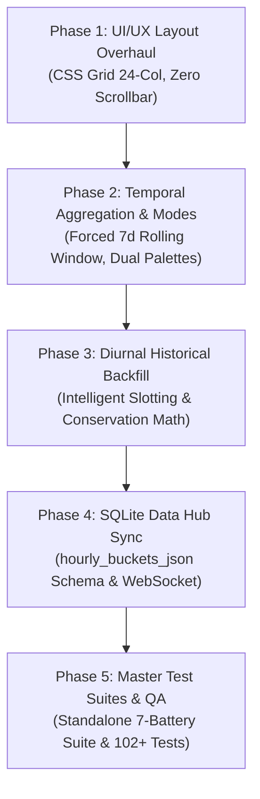

# Executive Architecture Summary: Chrono-Activity Heatmap (24h x 7d) Overhaul

> **Document Type:** Executive Architecture Summary  
> **Workspace Container:** `temp_prompt/chrono_heatmap_overhaul/`  
> **Initiative Scope:** UI/UX Layout Overhaul, Rolling 7-Day Window Enforcement, Focus vs Media Mode Differentiation, Diurnal Historical Backfill Algorithm, and SQLite Data Hub Sync Schema Migration.  
> **Architectural Standard:** Universal Rule 28 (Modularity), Universal Rule 15 (Autonomous Push/Commit), W3C Trusted Types (Zero-innerHTML).  

---

## 🏛️ 1. Initiative Scope & Objectives

The Chrono-Activity Heatmap (24h x 7d) represents the central visual anchor of the Web Activity & Media Sentinel analytics dashboard. It plots a 7-day row by 24-hour column matrix that visualizes user focus and media consumption rhythms. 

This overhaul addresses four critical operational bottlenecks and delivers a cohesive, responsive experience:
1. **Eliminate Layout Restrictions:** Remove the artificial horizontal scrollbar and fixed column widths (`minmax(14px, 20px)`) in favor of a fluid 24-column CSS Grid spanning 100% card width.
2. **Standardize Matrix Aggregation:** Decouple heatmap rendering from erratic external date filters by enforcing an immutable 7-day rolling window (`Today - 6d` to `Today`).
3. **Elevate Dual-Mode Analytics:** Distinctly differentiate Focus & Browsing Time (Emerald/Cyan palette) from Media Watch Time (Violet/Fuchsia palette) with dedicated tooltips, color tiers, and Week-over-Week metrics.
4. **Intelligent Historical Backfill:** For legacy records lacking discrete hourly buckets, dynamically slot daily activity into a diurnal circadian distribution that respects domain categories while mathematically conserving exact total seconds.
5. **SQLite Hub Synchronization:** Expand WebSocket payloads and database schema to serialize `hourly_buckets_json` into the Standalone SQLite Data Hub daemon for multi-browser telemetry parity.

---

## 🗺️ 2. Cross-Phase Milestone Roadmap & Dependency Topology

### Dependency Architecture:
- **Phase 1 (Layout)** establishes the responsive CSS container and grid styles. It has no backward dependencies.
- **Phase 2 (Aggregation & Modes)** hooks into the Phase 1 CSS classes and data attributes (`data-mode="focus"|"media"`, `data-intensity="0..4"`).
- **Phase 3 (Backfill)** supplies sanitized, complete hourly datasets to Phase 2's aggregation engine for legacy dates.
- **Phase 4 (SQLite Hub)** persists and replicates the enriched hourly bucket structures across the WebSocket bridge.
- **Phase 5 (QA & Verification)** validates the entire pipeline against automated regression gates.

---

## ⚖️ 3. Risk Mitigation & Architectural Tradeoffs

| Technical Risk | Blast Radius | Mitigation Strategy |
| :--- | :--- | :--- |
| **Grid Column Distortion on Mobile/Compact Screens** | Layout breaking or text truncation on narrow viewports (< 480px). | Use `minmax(0, 1fr)` with `clamp()` font sizes (`clamp(9px, 0.75vw, 11px)`) and abbreviated day labels (`M`, `T`, `W` or `Mon`...`Sun`). |
| **Historical Data Corruption During Backfill** | Altering recorded user seconds or introducing drift. | Strict invariant: `sum(backfilledHours[0..23]) === dayRecord.totalSeconds`. The backfill operates in-memory by default and never mutates historical raw totals. |
| **WebSocket Sync Payload Bloat** | High memory or bandwidth usage from 24-bucket JSON arrays. | Compress hourly records: omit empty (0 second) hour buckets from the serialized payload; only transmit non-zero entries. |
| **Theme / Mode Inconsistency in Light Mode** | Poor contrast for neon fuchsia/violet in light theme. | Explicit CSS variables for light mode (`--heatmap-media-tier-1..4`) tuned to pass WCAG 2.1 AA 4.5:1 contrast ratio. |

---

## 📈 4. Autonomy Evaluation
- **Recommended Execution Strategy:** **Strategy A (Fully Autonomous Phase-wise Execution)**
- **Target Autonomy Score:** **1.0**
- **Justification:** Clear requirements, isolated UI/feature layers, existing 102-test regression safety net, and strictly defined test gates.
