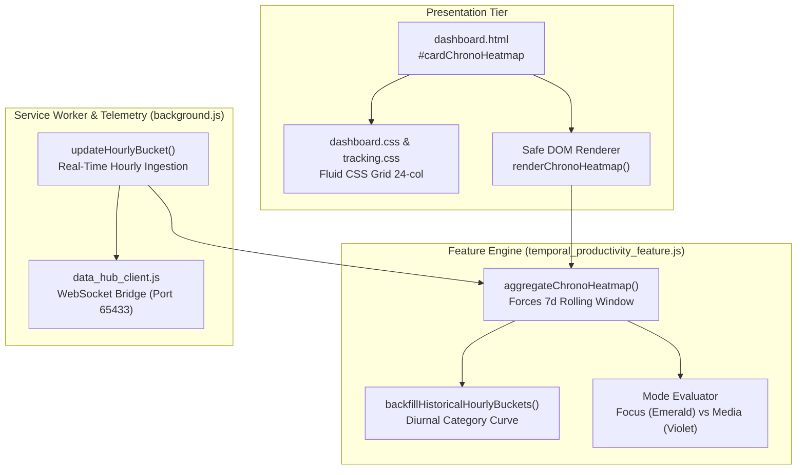

# Technical Requirements Document (TRD): Chrono-Activity Heatmap (24h x 7d) Overhaul

> **Document Type:** Technical Requirements Document & Engineering Specification  
> **Workspace Container:** `temp_prompt/chrono_heatmap_overhaul/`  
> **Target Subsystems:** `dashboard/dashboard.css`, `dashboard/styles/tracking.css`, `dashboard/dashboard.js`, `src/dashboard/features/temporal_productivity_feature.js`, `background.js`, `src/background/ws/data_hub_client.js`  
> **Compliance Standard:** Universal Rule 28 (<= 50 lines / function), W3C Trusted Types (Zero-innerHTML), UTF-8 with BOM.  

---

## 🏛️ 1. Technical Architecture & Component Interaction



---

## 📐 2. Low-Level Design (LLD) Specifications

### 2.1 Presentation Tier: Fluid CSS Grid & Zero Scrollbar
- **Container Selector:** `.chrono-heatmap-wrapper`
  - `overflow-x: hidden !important;` (removes horizontal scrollbar completely).
  - `width: 100%; box-sizing: border-box;`
- **Grid Selector:** `.chrono-heatmap-grid`
  - `display: grid;`
  - `grid-template-columns: minmax(36px, 48px) repeat(24, minmax(0, 1fr)) !important;`
  - `gap: 3px; align-items: center; width: 100%;`
- **Cell Selector:** `.heatmap-cell`
  - `width: 100% !important;`
  - `height: clamp(14px, 1.8vw, 22px) !important;`
  - `border-radius: 3px; cursor: pointer;`
  - `transition: transform 120ms ease, box-shadow 120ms ease;`
- **Labels:**
  - `.heatmap-hour-label`: `text-align: center; font-size: clamp(9px, 0.75vw, 11px); color: var(--text-tertiary);`
  - `.heatmap-day-label`: `font-size: clamp(10px, 0.8vw, 12px); font-weight: 600;`

### 2.2 Temporal Engine: 7-Day Rolling Window Contract
- Function signature: `aggregateChronoHeatmap(rawHistory, options)`
- Enforced date boundaries:
  ```javascript
  const today = new Date();
  const endDate = formatYMD(today);
  const startObj = new Date(today);
  startObj.setDate(startObj.getDate() - 6);
  const startDate = formatYMD(startObj);
  // targetDates is strictly 7 days: [start..today]
  ```
- Matrix schema output:
  - 7 rows representing days 0 (Monday) through 6 (Sunday).
  - 24 columns representing hours 0 through 23.
  - Cell object schema:
    ```javascript
    {
      hour: 0..23,
      dayOfWeek: 0..6,
      activeSeconds: Number,
      mediaSeconds: Number,
      topDomain: String,
      sessionCount: Number,
      intensity: 0..4,        // Focus intensity
      mediaIntensity: 0..4    // Media intensity
    }
    ```

### 2.3 Mode Differentiation & Color Token Architecture
- Grid container attribute: `data-active-mode="focus" | "media"`
- Cells render with:
  - `data-mode="focus"`: uses emerald tokens (`var(--heatmap-tier-0..4)`).
  - `data-mode="media"`: uses violet tokens (`var(--heatmap-media-tier-0..4)`).
- Mode switching handler in `dashboard.js`:
  ```javascript
  function handleHeatmapModeToggle(mode) {
    currentHeatmapMode = mode;
    // update button active classes
    // update data-active-mode attribute on grid
    // recalculate WoW metric
    // re-render cells & legend bar
  }
  ```

### 2.4 Diurnal Historical Backfill Algorithm
- Function signature: `backfillHistoricalHourlyBuckets(dayData, dateStr)`
- Invariant 1: If `hasValidHourlyTelemetry(dayData)` is `true`, return existing data without alteration.
- Invariant 2: Mathematical conservation:
  $$\sum_{h=0}^{23} \text{bucket}[h].\text{activeSeconds} = \text{dayData.totalActiveSeconds}$$
- Diurnal Curve Weight Distributions:
  - Work / Productivity Curve (Peak 09:00–12:00, 14:00–17:00):
    Weights: `[0, 0, 0, 0, 0, 0, 0, 0.02, 0.05, 0.12, 0.15, 0.14, 0.08, 0.08, 0.12, 0.12, 0.08, 0.04, 0, 0, 0, 0, 0, 0]`
  - Media / Entertainment Curve (Peak 12:00–13:00, 19:00–23:00):
    Weights: `[0.02, 0, 0, 0, 0, 0, 0, 0, 0.02, 0.03, 0.03, 0.05, 0.12, 0.08, 0.04, 0.04, 0.05, 0.07, 0.12, 0.15, 0.12, 0.04, 0.02, 0]`
  - Social / Communication Curve (Distributed waking hours 08:00–22:00).
- Integer rounding remainder is allocated to the highest weighted hour bucket to guarantee 0 drift.

### 2.5 SQLite Data Hub Schema Extension & WebSocket Sync
- Payload extension for `SYNC_HISTORY_UPSERT`:
  ```json
  {
    "type": "SYNC_HISTORY_UPSERT",
    "client_id": "chrome_client_1",
    "date_str": "2026-11-20",
    "tracking_history": { ... },
    "hourly_buckets_json": "{\"9\":{\"activeSeconds\":1800,\"topDomain\":\"github.com\"}, ...}",
    "timestamp": 1732050000000
  }
  ```
- SQLite Table Schema target in Data Hub:
  ```sql
  ALTER TABLE daily_activity_aggregates ADD COLUMN hourly_buckets_json TEXT DEFAULT '{}';
  ```

---

## 🔒 3. Modularity & Quality Standards
- All functions added or modified MUST comply with Universal Rule 28:
  - <= 50 physical lines.
  - Max cyclomatic nesting depth <= 3.
- All files MUST retain UTF-8 with BOM (`0xEF, 0xBB, 0xBF`).
- Zero `innerHTML` assignments across all dashboard and feature scripts.
