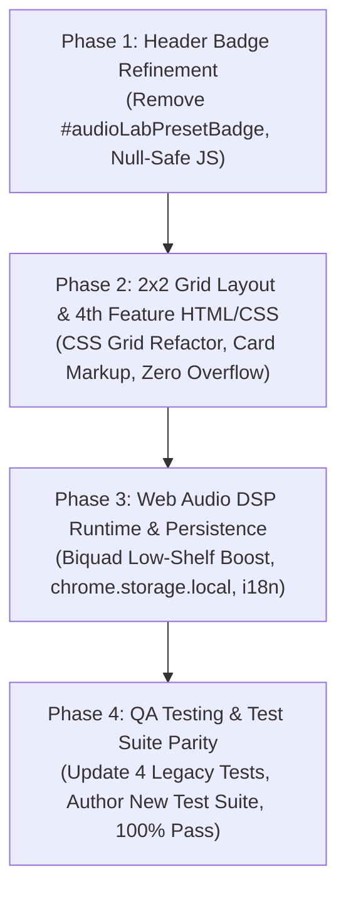

# Executive Architecture Summary: Dashboard Audio Lab 2x2 Grid & Sub-Bass Enhancer

> **Task ID:** `TASK-DASHBOARD-AUDIOLAB-2X2-GRID-001`  
> **Document:** `temp_prompt/dashboard_audio_lab_2x2_grid_and_bass_boost/SUMMARY.md`  
> **Specialist Role:** Level 3C Phase-wise Prompt Generation Specialist  
> **Recommended Strategy:** `STRATEGY_A_AUTONOMOUS` (Autonomy Score: 1.0)  

---

## 🎯 1. High-Level Initiative Scope & Technical Objectives

The Web Activity & Media Sentinel extension features an offscreen Web Audio DSP pipeline and an interactive Audio Lab within the primary Dashboard. The current implementation exhibits two UI/UX ergonomic defects and an incomplete feature set:
1. **Redundant Status Badge:** `#audioLabPresetBadge` ("Flat") is rendered directly adjacent to the section title, duplicating the preset display inside the Equalizer card.
2. **Switch Overflow:** The bottom audio enhancements section (`.enhancements-grid`) renders 3 cards in a cramped 3-column layout, forcing `.switch-toggle` controls to overflow outside the card boundaries on common laptop/desktop resolutions.
3. **Incomplete Grid:** A 3-item grid in a modern bento layout creates asymmetric, unbalanced whitespace.
4. **DSP Gap:** Low-end sub-bass frequencies require dedicated enhancement to complement existing "Vocal Clarity" (mid-range boost) and "Night Shield" (dynamics compression).

### Objectives
- Eliminate `#audioLabPresetBadge` safely without breaking JavaScript lookups or theme cascading.
- Convert `.enhancements-grid` into a balanced 2-column layout (`grid-template-columns: repeat(2, minmax(0, 1fr))`) with 12px gap.
- Introduce a 4th audio DSP feature: **"Sub-Bass Boost / Enhancer"** with `BiquadFilterNode` low-shelf boost at 60Hz.
- Guarantee state persistence in `chrome.storage.local` and runtime IPC message dispatch.
- Preserve bilingual English and Hindi parity across all UI strings.
- Update legacy test assertions and author comprehensive automated verification ensuring 0 regressions.

---

## 🗺️ 2. Cross-Phase Milestone Roadmap & Dependency Topology

### Phase Dependencies
- **Phase 1 -> Phase 2:** Cleaning the header badge declutters the top DOM structure before modifying the bottom controls container.
- **Phase 2 -> Phase 3:** HTML markup (`toggleBassBoost`, labels) and CSS classes must exist before wiring event listeners, storage persistence, and Web Audio API dispatch.
- **Phase 3 -> Phase 4:** All runtime logic, persistence keys, and DSP nodes must be in place before running full end-to-end unit and integration tests.

---

## 🛡️ 3. Risk Mitigation & Architectural Tradeoffs

| Risk Factor | Likelihood | Impact | Architectural Mitigation Strategy |
| :--- | :---: | :---: | :--- |
| **Legacy JavaScript NPE on missing `#audioLabPresetBadge`** | Medium | High | Add defensive null checks in `dashboard.js` and `audio_lab_controller.js` (`const el = getElementById(...); if (el) ...`) so scripts never throw TypeError if the element is absent. |
| **Mobile responsive breakpoint collapse** | Low | Medium | Enforce `@media (max-width: 640px)` media query rule: `.enhancements-grid { grid-template-columns: 1fr; }` so cards stack vertically on small screens. |
| **Biquad filter gain distortion / clipping** | Low | High | Clamp low-shelf bass boost calculation to a maximum of `+12dB` and integrate with existing master gain and compressor nodes to prevent digital clipping (0dBFS overdrive). |
| **Test regressions across existing suites** | High | High | Explicitly identified 4 test files (`test_dashboard_full_audio_lab_parity.js`, `test_dashboard_theme_and_a11y_verification.js`, `test_dashboard_uiux_phase1.js`, `test_equalizer_layout_separation_phase1_2.js`) that assert the badge, updating them to assert the new clean architecture. |

---

## 📊 4. Execution Strategy Justification

- **Selected Strategy:** `STRATEGY_A_AUTONOMOUS`
- **Target Autonomy Score:** 1.0
- **Rationale:** The feature requirements are fully specified, the codebase topology is thoroughly understood, and all file targets and line anchors are cataloged. No user trade-offs or breaking schema changes require interactive pauses. Level 4 Subagents can execute each phase sequentially, gating on deterministic test suites.
