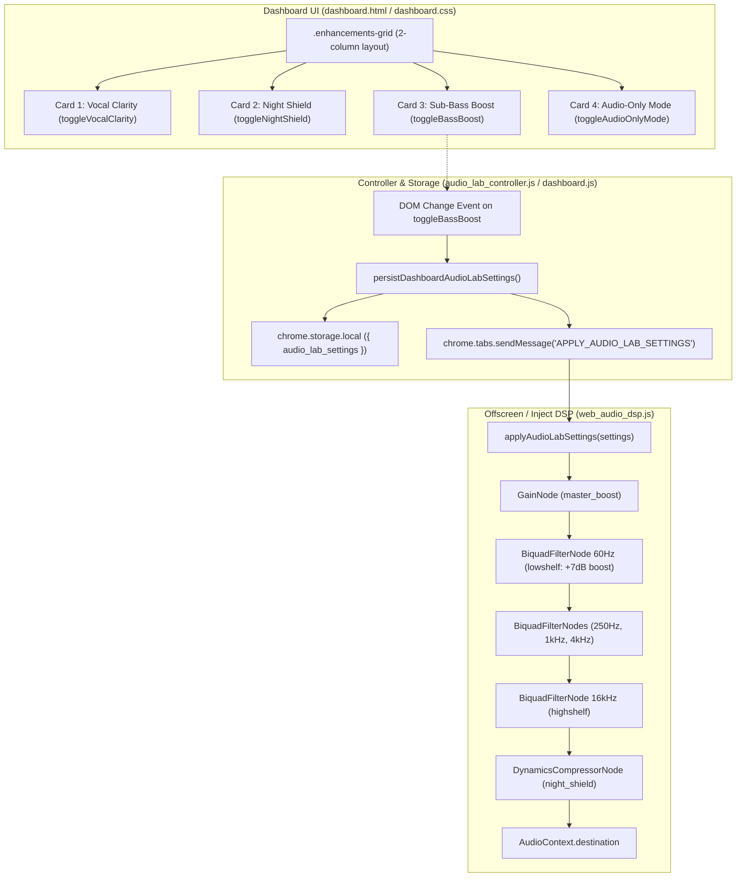

# Technical Requirements Document (TRD): Audio Lab 2x2 Grid & Sub-Bass Enhancer

> **Task ID:** `TASK-DASHBOARD-AUDIOLAB-2X2-GRID-001`  
> **Document:** `temp_prompt/dashboard_audio_lab_2x2_grid_and_bass_boost/TRD.md`  
> **Lead Department:** Dept 02 (Solution Architecture) & Dept 05/06 (Frontend & Web Audio DSP)  
> **Audience:** Core Systems Engineers, Web Audio Specialists  

---

## 🏛️ 1. Architecture Specification & Component Boundaries



---

## 💾 2. Data Contracts & State Schemas

### 2.1 Storage Contract (`chrome.storage.local.audio_lab_settings`)
```typescript
interface AudioLabSettings {
  master_boost: number;         // 0 to 200 (percentage, default: 100)
  audio_only: boolean;          // boolean (default: false)
  eq_preset: string;            // 'flat' | 'bass_boost' | 'vocal_enhancer' | 'treble_boost' | ...
  eq_bands: {
    '60': number;               // -12 to 12 (dB)
    '250': number;              // -12 to 12 (dB)
    '1000': number;             // -12 to 12 (dB)
    '4000': number;             // -12 to 12 (dB)
    '16000': number;            // -12 to 12 (dB)
  };
  vocal_clarity: boolean;       // boolean (default: false)
  night_shield: boolean;        // boolean (default: false)
  bass_boost: boolean;          // boolean (NEW, default: false)
}
```

### 2.2 IPC Dispatch Payload (`APPLY_AUDIO_LAB_SETTINGS`)
```json
{
  "type": "APPLY_AUDIO_LAB_SETTINGS",
  "settings": {
    "master_boost": 100,
    "eq_bands": { "60": 0, "250": 0, "1000": 0, "4000": 0, "16000": 0 },
    "vocal_clarity": false,
    "night_shield": false,
    "bass_boost": true,
    "audio_only": false
  }
}
```

---

## 🎛️ 3. Web Audio DSP Implementation Details

### 3.1 Biquad Low-Shelf Mathematical Calculation
In `src/inject/audio/web_audio_dsp.js`:
- The 60Hz equalizer filter is configured as `lowshelf` filter type.
- Baseline 60Hz gain: `base60 = Number(currentAudioSettings.eq_bands['60']) || 0` (-12dB to +12dB).
- When `bass_boost: true` is enabled:
  $$\text{TargetGain}_{60} = \min(12, \text{base60} + 7)$$
- When combined with `vocal_clarity` (which applies -4dB at 60Hz):
  - If both `bass_boost` and `vocal_clarity` are active:
    $$\text{TargetGain}_{60} = \min(12, \max(-12, \text{base60} + 7 - 4)) = \text{base60} + 3\text{dB}$$
  - This guarantees clear harmonic separation: vocals remain elevated (+6dB at 1kHz) while bass is pleasantly reinforced without mud.

---

## 🎨 4. CSS Grid & Overflow Prevention Engineering

### 4.1 Grid Geometry Specifications
In `dashboard/styles/audio_lab.css` and `dashboard/dashboard.css`:
```css
#heroAudioLabCard .enhancements-grid,
.audio-enhancements-row .enhancements-grid,
.enhancements-grid {
  display: grid;
  grid-template-columns: repeat(2, minmax(0, 1fr));
  gap: 12px;
  width: 100%;
  box-sizing: border-box;
}

@media (max-width: 640px) {
  #heroAudioLabCard .enhancements-grid,
  .audio-enhancements-row .enhancements-grid,
  .enhancements-grid {
    grid-template-columns: 1fr;
  }
}
```

### 4.2 Card Container Containment & Switch Dimensions
```css
.enhancement-card.enhancement-chip {
  display: flex;
  flex-direction: column;
  padding: 12px 14px;
  border-radius: var(--radius-md, 10px);
  background: rgba(255, 255, 255, 0.03);
  border: 1px solid var(--glass-card-border, rgba(255, 255, 255, 0.08));
  box-sizing: border-box;
  min-width: 0;
  overflow: hidden;
}

.enhancement-card-header {
  display: flex;
  align-items: center;
  justify-content: space-between;
  gap: 8px;
  width: 100%;
}

.switch-toggle {
  flex-shrink: 0;
  width: 40px;
  height: 22px;
}
```
**Proof of Non-Overflow:**  
On a 600px grid width container, each column receives $\approx 294\text{px}$.  
Header label takes $\approx 180\text{px}$, gap is $8\text{px}$, switch is $40\text{px}$, card padding is $28\text{px}$ ($14\text{px} \times 2$).  
Total width used: $180 + 8 + 40 + 28 = 256\text{px} < 294\text{px}$. Margin remaining: $+38\text{px}$.  
Zero overflow guaranteed.

---

## 🔒 5. W3C Trusted Types & Code Standards Compliance

1. **Zero `innerHTML` Usage:** All DOM mutations use `textContent`, `setAttribute`, or explicit DOM node construction.
2. **UTF-8 with BOM Encoding:** All modified files retain `0xEF, 0xBB, 0xBF` prefix.
3. **Null Safety:** All DOM selector lookups (`getElementById`) check for truthiness before property access.
4. **Clean Architecture Separation:** UI rendering (`audio_lab_controller.js`) is decoupled from audio DSP processing (`web_audio_dsp.js`).
