# Web Activity & Media Sentinel - Dashboard Future Features (8 Capabilities Across 4 Phases)
## Executive Architecture Summary & Technical Roadmap

> **Task ID:** `TASK-DASHBOARD-FUTURE-8-FEATURES-001`  
> **Target Workspace:** [`c:\Users\Atul Verma\Desktop\Win App Tracker\Browser Detection`](file:///c:/Users/Atul%20Verma/Desktop/Win%20App%20Tracker/Browser%20Detection)  
> **Lead Architect:** Level 3C Phase-wise Prompt Generation Specialist (`prompt_generation_specialist`)  
> **Master Reference:** [`dashboard_future_features_prompt.md`](file:///c:/Users/Atul%20Verma/Desktop/Win%20App%20Tracker/Browser%20Detection/dashboard_future_features_prompt.md)  
> **Ephemeral Container:** `temp_prompt/dashboard_future_features_8_phases/`  

---

## 🏛️ 1. Executive Vision & Scope

The purpose of this initiative is to elevate the **Web Activity & Media Sentinel Dashboard** from a single-session tracking and playback interface into an enterprise-grade **"Web Activity Analytics, Multi-Stream Media Deck & Digital Wellbeing Suite"**.

Over 4 sequential implementation phases, 8 advanced capabilities will be introduced into the extension's dashboard, background service worker, and modular architecture:

```mermaid
flowchart LR
    subgraph Phase1 ["Phase 1: Analytics & Focus Core"]
        F1["Feature 1: Custom Temporal Range & Chrono Heatmap"]
        F2["Feature 2: Productivity Scoring & Domain Classifier"]
    end

    subgraph Phase2 ["Phase 2: Multi-Stream Media Deck & DSP Visualizer"]
        F3["Feature 3: Multi-Tab Live Media Deck"]
        F4["Feature 4: 60fps Real-Time Audio Spectrum Visualizer"]
    end

    subgraph Phase3 ["Phase 3: Data Resilience & Executive Reporting"]
        F5["Feature 5: Advanced Backup, Snapshots & SQLite Hub Sync"]
        F6["Feature 6: Executive PDF & HTML Digest Generator"]
    end

    subgraph Phase4 ["Phase 4: Privacy, Governance & Wellbeing Sentinel"]
        F7["Feature 7: Domain Annotations & Privacy Blacklist"]
        F8["Feature 8: Wellbeing Sentinel, Doom-Scroll Guard & Pomodoro"]
    end

    Phase1 -->|Test Gate 1 Clean| Phase2
    Phase2 -->|Test Gate 2 Clean| Phase3
    Phase3 -->|Test Gate 3 Clean| Phase4
```

---

## 🗺️ 2. Milestone Topology & Phased Breakdown

### 2.1 Phase 1: Temporal Engine & Productivity Classifier (Features 1 & 2)
- **Feature 1: Custom Temporal Range & Chrono-Distribution Heatmap:**
  - Expanded filter selector: `Today`, `Yesterday`, `Last 7 Days`, `Last 30 Days`, `Custom Range` (datepicker).
  - 7x24 Matrix: 7 rows (Monday - Sunday), 24 columns (00:00 - 23:00) with 168 cells colored by activity intensity tiers (0 to 4).
  - Mode switch: "Focus & Browsing Time" vs. "Media Watch Time".
  - Week-over-Week (WoW) productivity and consumption delta percentages.
- **Feature 2: Productivity Scoring & Smart Domain Classifier:**
  - 5-Tier Taxonomy: `work`, `learning`, `entertainment`, `social`, `utility`.
  - Dynamic score formula ($0-100$) balancing constructive vs. distracting domains against total active time.
  - Radial score gauge visualizer with tier color-coding (Deep Focus 🟢, Balanced 🟡, Distracted 🔴).
  - 1-click inline category override dropdown in the domain analytics table with immediate score recalculation and persistence in `chrome.storage.local`.
- **Test Gate 1:** `tests/test_dashboard_features_phase1.js` passing 100% clean with exit code 0.

### 2.2 Phase 2: Multi-Tab Live Media Deck & Audio Visualizer (Features 3 & 4)
- **Feature 3: Multi-Tab Live Media Deck:**
  - Background audible & active media tab scanner (`DASHBOARD_GET_ALL_MEDIA_STREAMS`).
  - Card deck layout in `#paneMedia` rendering all playing, paused, or audible tabs with favicons and metadata.
  - Individual mini scrubbers, volume sliders, and mute toggles per tab card.
  - "Solo Tab" mode (muting all other tabs with a single click) and "Global Mute Others".
- **Feature 4: Real-Time Audio Visualizer & Frequency Spectrum Analyzer:**
  - 60fps HTML5 Canvas engine (`#canvasAudioVisualizer`, 600x120px) with zero dropped frames.
  - Mode A: 32-Band FFT Frequency Bars with gradient styling and peak-hold dropping dots.
  - Mode B: Oscilloscope Waveform trace with glowing neon accents.
  - Stereo VU peak meters (-40dB to +6dB) with red clipping indicators at +0dB.
  - Zero-overhead idle sleep loop pausing `requestAnimationFrame` when media is paused or tab is hidden.
- **Test Gate 2:** `tests/test_dashboard_features_phase2.js` passing 100% clean with exit code 0.

### 2.3 Phase 3: Data Integrity, Backup, Snapshots & SQLite Hub Sync (Features 5 & 6)
- **Feature 5: Advanced Backup, Snapshot Restore & SQLite Data Hub Sync:**
  - Bidirectional JSON importer with v2.0 schema validation, checksum verification, and graceful error handling.
  - 3 Conflict resolution strategies: `Merge` (recommended default), `Overwrite`, `Append-Only`.
  - Automatic 7-day rolling daily snapshots (`snapshot_YYYY_MM_DD`) in `chrome.storage.local` with 1-click rollback.
  - Bidirectional synchronization with the local desktop SQLite Data Hub daemon (`ws://127.0.0.1:65433`).
- **Feature 6: Executive PDF & HTML Digest Generator:**
  - Zero-dependency `@media print` CSS engine formatting clean A4/Letter pages via native `window.print()`.
  - Automatically suppresses navigation sidebars, controls, search inputs, and decorative elements during printing.
  - Executive summary header with branding, date range, and high-level KPI cards.
  - 1-click "Download Standalone HTML Report" compiling an offline, self-contained HTML document with inline CSS and JSON telemetry.
- **Test Gate 3:** `tests/test_dashboard_features_phase3.js` passing 100% clean with exit code 0.

### 2.4 Phase 4: Wellbeing Sentinel, Annotations & Blacklist (Features 7 & 8)
- **Feature 7: Domain Annotations, Bookmarks & Exclusion Blacklist:**
  - Starred/pinned domain ranking keeping prioritized client domains at the top of the table.
  - Custom domain project notes with inline tooltip display and search bar integration.
  - Privacy Tracking Exclusion Blacklist in `#cardTrackingBlacklist` supporting wildcards (`localhost:*`, `192.168.*:*`, `*bank*`).
  - Strict zero-tracking background policy for blacklisted origins, plus a retroactive historical purge button.
- **Feature 8: Digital Wellbeing Sentinel & Doom-Scrolling Guard:**
  - Per-domain daily time budgets with visual warning badges (80% yellow notice, 100% red budget reached indicator).
  - Doom-scroll velocity heuristic in `content_media.js` triggering a gentle, non-disruptive "Take a Breath" nudge after 20 minutes of continuous infinite scrolling.
  - Integrated Pomodoro focus sentinel (25m Focus / 5m Break) in the dashboard sidebar, featuring gentle audio chimes and automatic hero media pausing during breaks.
- **Test Gate 4:** `tests/test_dashboard_features_phase4.js` passing 100% clean with exit code 0.

---

## 🛡️ 3. Architectural Invariants & Safety Guarantees

1. **Zero Telemetry Loss Invariant:**
   - In-memory metrics and session counters write to `chrome.storage.local` at 5-second intervals via atomic queues.
2. **MV3 Lifecycle Resilience:**
   - Service worker idle recycling handled seamlessly via `chrome.alarms` and persistent storage state; no reliance on transient in-memory variables.
3. **W3C Trusted Types & Safe DOM (Zero-innerHTML):**
   - Zero tolerance for `element.innerHTML = ...`. All DOM construction must use `document.createElement`, `textContent`, and safe DOM fragments.
4. **Sub-10ms Render Budget:**
   - Visualizer animation loops run strictly under `requestAnimationFrame` and immediately shut down when idle or hidden.
5. **Dual-Core Sync Invariant:**
   - Seamless data reconciliation between browser local storage and the native SQLite daemon (`ws://127.0.0.1:65433`).
6. **Bilingual Parity:**
   - Every single newly introduced UI label, badge, button, and tooltip is 100% translated across English (`en`) and Hindi (`hi`).
7. **Strict UTF-8 with BOM (`0xEF, 0xBB, 0xBF`):**
   - Universal file encoding standard across all project assets.
8. **Node.js AST Cleanliness (`node -c`):**
   - Syntax validation verified across all script files before any gate signoff.

---

## ⚡ 4. Risk Mitigation & Trade-Off Matrix

| Technical Risk | Impact | Likelihood | Mitigation Strategy |
| :--- | :--- | :--- | :--- |
| **Canvas CPU/GPU Drain** | High | Low | Implement auto-pause on `document.visibilitychange` and media pause state; limit canvas resolution to 600x120. |
| **Large Storage Bloat from Hourly Buckets** | Medium | Medium | Aggregate hourly buckets only for the last 60 days; prune older granular records while preserving daily totals. |
| **JSON Backup Schema Corruption** | High | Low | Validate version, checksum, and structure strictly before touching `chrome.storage.local`. Support instant abort. |
| **Cross-Tab Audio Capture Permissions** | High | Medium | Utilize `chrome.tabs.query({ audible: true })` and message passing to existing content scripts without requiring extra invasive permissions. |
| **DOM Invalidation during Print** | Low | Low | Rely entirely on CSS `@media print` rules; zero destructive DOM restructuring needed during printing. |
