# Executive Architecture Summary: Dashboard Future UI/UX Enhancements
# कार्यकारी वास्तुकला सारांश: डैशबोर्ड भविष्य यूआई/यूएक्स संवर्धन

> **पहल का नाम (Initiative Title):** Web Activity & Media Sentinel - Dashboard Future UI/UX Enhancement & Refinement Architecture  
> **दस्तावेज़ प्रकार (Document Type):** Executive Architecture Summary & System Roadmap (Universal Rule 22)  
> **कार्यक्षेत्र (Target Workspace):** [`c:\Users\Atul Verma\Desktop\Win App Tracker\Browser Detection`](file:///c:/Users/Atul%20Verma/Desktop/Win%20App%20Tracker/Browser%20Detection)  
> **प्राथमिक विनिर्देश स्रोत (Master Source):** [`dashboard_future_uiux_recommendations.md`](file:///c:/Users/Atul%20Verma/Desktop/Win%20App%20Tracker/Browser%20Detection/dashboard_future_uiux_recommendations.md)  
> **लीड आर्किटेक्ट (Lead Architect):** Level 3C Phase-wise Prompt Generation Specialist (`prompt_generation_specialist`)  

---

## 🎯 1. सामरिक उद्देश्य एवं कार्यक्षेत्र (Strategic Scope & Objectives)

वेब एक्टिविटी व मीडिया सेंटिनल के डैशबोर्ड में सभी पूर्ववर्ती 44 कोर फीचर्स एवं 4 फेज़ / 8 सिस्टम 100% कार्यशील हैं। यह नई इंजीनियरिंग पहल डैशबोर्ड को सामान्य एनालिटिक्स डैशबोर्ड से उन्नत कर एक **हाई-परफॉर्मेंस डिजिटल मीडिया वर्कस्टेशन (High-Performance Digital Media Workstation)** के रूप में स्थापित करती है।

### 1.1 मुख्य तकनीकी उद्देश्य (Core Technical Objectives)
1. **विज़ुअल कंसिस्टेंसी एवं माइक्रो-इंटरैक्शन पैरिटी (System A & D):**
   - हीरो वॉल्यूम स्लाइडर को टाइमलाइन स्क्रबर के समान प्रीमियम ग्रेडिएंट कैप्सूल ट्रैक, कंसेंट्रिक ग्लास थंब और फ्लोटिंग रियल-टाइम पर्सेंटेज टूलटिप प्रदान करना।
   - SVG डोनट चार्ट के केंद्रीय हिस्से को इंटरैक्टिव डायनामिक HUD में बदलना जो पाई स्लाइस होवर पर सटीक डोमेन फेविकॉन, डोमेन नाम, खर्च समय और प्रतिशत अनुपात प्रदर्शित करे।
2. **काइनेटिक टेलीमेट्री एवं स्थानिक इंडिकेटर्स (System C & E):**
   - साइडबार और हेडर में 3-बार काइनेटिक ऑडियो विज़ुअलाइज़र जोड़ना जो मीडिया बजने पर 60fps GPU बाउंस करे और पॉज़ होने पर शांत बिंदु में सिकुड़ जाए।
   - ओम्नी कमांड पैलेट (`Ctrl+K`) में 16px Google S2 फेविकॉन्स, सिमेंटिक `<kbd>` कीबोर्ड शॉर्टकट बैज और हालिया खोज हिस्ट्री चिप्स का एकीकरण।
3. **व्यूपोर्ट टेलीमेट्री निरंतरता (System B):**
   - `IntersectionObserver` आधारित व्यूपोर्ट सेंटिनल जो हीरो प्लेयर कार्ड के व्यूपोर्ट से बाहर जाने पर बॉटम-राइट में एक फ्रॉस्टेड लिक्विड ग्लास मिनी-प्लेयर डॉक (`#stickyMiniPlayerDock`) को स्लाइड-इन करे।
   - मिनी-डॉक से 1-क्लिक प्ले/पॉज़, नेटिव PiP, और पेज के शीर्ष पर स्मूथ स्क्रोल बैक की सुविधा।
4. **मॉड्यूलर कस्टमाइज़ेबल लेआउट इंजन (System F):**
   - 12-कॉलम बेंटो ग्रिड कार्ड्स पर सब्टल 6-डॉट ड्रैग हैंडल (`⠿`), स्मूथ HTML5 ड्रैग-एंड-ड्रॉप रिऑर्डरिंग, और लेआउट प्रेफरेंस को `chrome.storage.local` में सुरक्षित करना।
   - 1-क्लिक लेआउट रीसेट बटन जो मूल गोल्डन रेशियो डिफ़ॉल्ट लेआउट तुरंत बहाल करे।
5. **शून्य-रिग्रेशन एवं WCAG 2.1 AAA गारंटी:**
   - 7:1 हाई-कंट्रास्ट अनुपात, डुअल-रिंग नियॉन फोकस, शून्य संचयी लेआउट शिफ्ट (CLS = 0), सब-10ms रनटाइम ओवरहेड, और मौजूदा सभी 37+ टेस्ट सुइट्स का 100% सफल सत्यापन।

---

## 🗺️ 2. क्रॉस-फेज़ माइलस्टोन रोडमैप एवं निर्भरता टोपोलॉजी (Milestone Roadmap & Dependency Topology)

```mermaid
flowchart TD
    subgraph Phase1 ["Phase 1: Visual Parity & Micro-Interactions"]
        SysA["System A: Hero Volume Slider Visual Parity
        - Gradient Track & Concentric Thumb
        - Floating Real-Time Tooltip
        - Morphing Icon (🔇/🔈/🔉/🔊)"]
        SysD["System D: SVG Donut Dynamic Center HUD
        - Slice Hover Dilation (28px -> 34px)
        - Dynamic Center Cross-fade HUD
        - Sibling Slices Dimming (0.35)"]
    end

    subgraph Phase2 ["Phase 2: Kinetic Telemetry & Spatial Indicators"]
        SysC["System C: Live 3-Bar Audio Equalizer Pulse
        - 60fps CSS GPU Spring Kinetics
        - Active Playing vs Paused Rest States
        - Sidebar Nav & Header Integration"]
        SysE["System E: Omni Command Palette Rich UI
        - 16px Favicon / Initials Avatar
        - Semantic <kbd> Shortcut Badges
        - Recent Searches History Chips"]
    end

    subgraph Phase3 ["Phase 3: Sticky Viewport Sentinel & Floating Mini-Dock"]
        SysB["System B: Sticky PiP Mini-Player Dock
        - IntersectionObserver Sentinel (15% threshold)
        - Floating Glass Pill (#stickyMiniPlayerDock)
        - Marquee Title & Quick Transport Bar
        - Smooth Scroll-to-Top Backlink"]
    end

    subgraph Phase4 ["Phase 4: Bento Modular Layout Engine & Persistence"]
        SysF["System F: Bento Drag-and-Drop Layout
        - 6-Dot Drag Handle (⠿) & 3D Elevation
        - HTML5 Drop Target Reordering
        - chrome.storage.local Layout State
        - One-Click Restore Default Layout"]
    end

    subgraph Phase5 ["Phase 5: Polish, WCAG AAA High-Contrast & Full Regression"]
        SysQA["Quality & Accessibility Certification
        - 7:1 High-Contrast Color Token Audit
        - Zero CLS & 60fps Hardware Render Audit
        - 37+ Repository Test Suites (100% Pass)
        - Gitleaks Zero-Secret Verification"]
    end

    Phase1 --> Phase2
    Phase2 --> Phase3
    Phase3 --> Phase4
    Phase4 --> Phase5
```

---

## ⚖️ 3. तकनीकी जोखिम विश्लेषण एवं आर्किटेक्चरल ट्रेडऑफ (Risk Mitigation & Tradeoff Analysis)

| जोखिम (Technical Risk) | जोखिम स्तर | संभावित प्रभाव (Impact) | शमन रणनीति (Mitigation Strategy) |
| :--- | :---: | :--- | :--- |
| **1. Viewport Scrolling Thrashing & Reflow** | मध्यम | भारी `scroll` लिसनर्स मुख्य थ्रेड पर फ्रेम ड्रॉप और जंकी स्क्रॉलिंग उत्पन्न कर सकते हैं। | `window.onscroll` पूर्णतः वर्जित; शून्य-थ्रेड `IntersectionObserver` का प्रयोग (threshold: 0.15) तथा हार्डवेयर-त्वरित CSS ट्रांज़िशन। |
| **2. Layout Shift from Floating Mini-Dock** | मध्यम | डॉक के आने-जाने से मुख्य सामग्री विस्थापित हो सकती है (CLS > 0)। | मिनी-डॉक को स्वतंत्र कम्पोजिटिंग लेयर (`position: fixed; z-index: 9999`) में रखा जाएगा, मुख्य ग्रिड लेआउट पूर्णतः अप्रभावित रहेगा (CLS = 0)। |
| **3. Favicon Load Failure & Rate Limiting** | निम्न | Google S2 फेविकॉन API कभी-कभी ऑफलाइन या ब्लॉक हो सकती है। | `onerror` हैंडलर के साथ त्वरित फॉलबैक ग्रेडिएंट इनिशियल बैज (`createFallbackAvatar`), जिससे कोई ब्रोकन इमेज आइकन प्रदर्शित न हो। |
| **4. Bento Drag DOM Collisions** | मध्यम | ड्रैग-एंड-ड्रॉप के दौरान इवेंट्स आंतरिक क्लिक्स और स्लाइडर्स को बाधित कर सकते हैं। | ड्रैग केवल समर्पित ग्रिप हैंडल (`⠿`) पर `draggable="true"` सेट करके सक्रिय होगा; कार्ड के मुख्य हिस्से पर सामान्य इंटरैक्शन चालू रहेंगे। |
| **5. W3C CSP & Trusted Types Violation** | उच्च | स्ट्रिंग इनहेरिटेंस या `innerHTML` असाइनमेंट सुरक्षा नीति को तोड़ सकते हैं। | शून्य-innerHTML नीति: केवल `document.createElement`, `textContent`, और `setAttribute` का प्रयोग अनिवार्य है। |
| **6. Stale Audio Equalizer State** | निम्न | मीडिया रुकने के बाद भी इक्वलाइज़र बार्स एनिमेट होते रह सकते हैं। | `mediaPlaybackStatusChanged` इवेंट के साथ सटीक सिंक; पॉज़ पर तत्काल `.eq-paused` क्लास लागू कर बार्स को 3px शांत अवस्था में लाना। |

---

## 🚀 4. निष्पादन रणनीति अनुशंसा (Execution Strategy Recommendation)

- **अनुशंसित रणनीति:** **`STRATEGY_A_AUTONOMOUS` (पूरी तरह से स्वायत्त फेज़-वार निष्पादन)**
- **लक्षित स्वायत्तता स्कोर (Target Autonomy Score):** `1.0`
- **औचित्य (Rationale):**
  1. मास्टर इंजीनियरिंग डॉसियर [`dashboard_future_uiux_recommendations.md`](file:///c:/Users/Atul%20Verma/Desktop/Win%20App%20Tracker/Browser%20Detection/dashboard_future_uiux_recommendations.md) में सभी 6 सिस्टम्स के उत्पादन-ग्रेड सीएसएस और जावास्क्रिप्ट लॉजिक पूर्णतः परिभाषित हैं।
  2. कोई अस्पष्ट आर्किटेक्चरल या व्यावसायिक विकल्प नहीं है जिसके लिए उपयोगकर्ता से मध्यवर्ती परामर्श की आवश्यकता हो।
  3. प्रत्येक फेज़ का अपना समर्पित टेस्ट सुइट और सत्यापन गेट है, जिससे लेवल 2 मैनेजर स्वायत्त रूप से फेज़ 1 से 5 तक क्रमिक रूप से आगे बढ़ सकता है।
