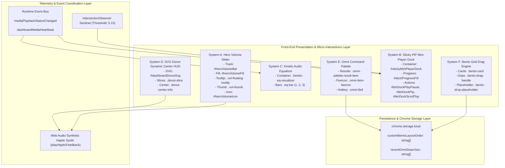

# Technical Requirements Document (TRD): Dashboard Future UI/UX Enhancements
# तकनीकी आवश्यकता दस्तावेज़: डैशबोर्ड भविष्य यूआई/यूएक्स संवर्धन

> **दस्तावेज़ प्रकार (Document Type):** Technical Requirements Document & Engineering Specifications (Universal Rule 22)  
> **पहल (Initiative):** Web Activity & Media Sentinel - Future UI/UX Enhancements  
> **कार्यक्षेत्र (Target Workspace):** [`c:\Users\Atul Verma\Desktop\Win App Tracker\Browser Detection`](file:///c:/Users/Atul%20Verma/Desktop/Win%20App%20Tracker/Browser%20Detection)  
> **प्रॉम्प्ट आर्किटेक्ट (Lead Architect):** Level 3C Phase-wise Prompt Generation Specialist (`prompt_generation_specialist`)  
> **मास्टर विनिर्देश डॉसियर (Master Source):** [`dashboard_future_uiux_recommendations.md`](file:///c:/Users/Atul%20Verma/Desktop/Win%20App%20Tracker/Browser%20Detection/dashboard_future_uiux_recommendations.md)  

---

## 🏛️ 1. उच्च-स्तरीय वास्तुकला (High-Level Architecture - HLD)



---

## ⚙️ 2. निम्न-स्तरीय डिज़ाइन एवं डेटा अनुबंध (Low-Level Design & Data Contracts - LLD)

### 2.1 DOM एलिमेंट्स एवं आईडी अनुबंध (DOM Element Contract)

| आईडी / क्लास (ID / Class) | प्रकार (Tag) | उद्देश्य एवं व्यवहार | संबंधित सिस्टम |
| :--- | :--- | :--- | :--- |
| `#heroVolumeBar` | `div` (role=slider) | वॉल्यूम ट्रैक कंटेनर, `tabindex="0"`, `aria-valuenow`, pointerdown/drag | System A |
| `#heroVolumeFill` | `div` | डायनेमिक लीनियर प्रोग्रेस फिल बार (`width: 0% - 100%`) | System A |
| `.vol-thumb` | `div` | 14px कंसेंट्रिक ग्लास थंब, 4px कोर ग्लो डॉट के साथ | System A |
| `.vol-floating-tooltip` | `div` | फ्लोटिंग रियल-टाइम पर्सेंटेज टूलटिप (`bottom: calc(100% + 10px)`) | System A |
| `#heroVolumeIcon` | `button` | मोर्फिंग वॉल्यूम आइकन बटन (🔇 / 🔈 / 🔉 / 🔊), क्लिक पर म्यूट टॉगल | System A |
| `#dashboardDonutSvg` | `svg` | 240x240 SVG डोनट चार्ट, 8px एम्बिएंट ड्रॉप-शैडो | System D |
| `.donut-slice` | `path` | डेटा स्लाइस (`data-domain`, `data-time`, `data-pct`), स्ट्रोक 28px->34px | System D |
| `.donut-center-info` | `div` | 130x130px सेंट्रल HUD बॉक्स, स्प्रिंग क्रॉस-फेड ट्रांज़िशन | System D |
| `.kinetic-eq-visualizer` | `span` | 3-बार इक्वलाइज़र कंटेनर, `.eq-playing` पर बाउंस, `.eq-paused` पर रेस्ट | System C |
| `.omni-kbd` | `kbd` | सिमेंटिक एक्सीलरेटर बैज (उदा. `↵ Enter`, `Ctrl+1`) | System E |
| `.omni-recent-chips` | `div` | हालिया सर्च हिस्ट्री चिप्स स्क्रोलर | System E |
| `#stickyMiniPlayerDock` | `div` (role=region) | बॉटम-राइट फ्लोटिंग फ्रॉस्टेड ग्लास डॉक (360x72px, `z-index: 9999`) | System B |
| `#btnDockPlayPause` | `button` | मिनी-डॉक प्ले/पॉज़ टॉगल बटन, हीरो प्लेयर से सिंक | System B |
| `#btnDockPip` | `button` | क्रोम नेटिव Picture-in-Picture विंडो ट्रिगर | System B |
| `#btnDockScrollTop` | `button` | स्मूथ स्क्रोल बैक टू हीरो प्लेयर सेक्शन (`scrollIntoView`) | System B |
| `.bento-drag-handle` | `div` | 6-डॉट ड्रैग ग्रिप (`⠿`), होवर पर विज़िबल, `draggable="true"` | System F |
| `#btnResetBentoLayout` | `button` | सेटिंग्स में 1-क्लिक गोल्डन रेशियो रीसेट बटन | System F |

### 2.2 स्टोरेज स्कीमा अनुबंध (Chrome Storage Contract)

```typescript
interface DashboardStorageSchema {
  // Custom Bento Grid layout card ID order
  customBentoLayoutOrder?: string[]; 
  // Example: ['heroMediaPlayerCard', 'timeDistributionCard', 'dataTableCard', 'audioLabCard']

  // Recent searches executed in Omni Command Palette (capped at 5)
  recentOmniSearches?: string[];
  // Example: ['youtube.com', 'github.com', 'Settings', 'Mute All']
}
```

### 2.3 IPC एवं इवेंट बस अनुबंध (Runtime Event Contracts)

1. **`mediaPlaybackStatusChanged` Event:**
   - **डिटेल पेलोड:** `{ isPlaying: boolean, tabId?: number, domain?: string }`
   - **लिसनर्स:** `initSidebarAudioEqualizer()`, `syncMiniDockTelemetry()`
2. **`dashboardMediaHeartbeat` Event:**
   - **डिटेल पेलोड:** `{ currentTime: number, duration: number, percent: string, title: string }`
   - **लिसनर्स:** `syncMiniDockTelemetry()`
3. **`playHapticFeedback(type, freq, duration)` Function:**
   - **पैरामीटर्स:** `type: 'click' | 'tick' | 'toggle'`, `freq: number` (Hz), `duration: number` (sec)
   - **निष्पादन:** Web Audio API ऑसिलेटर द्वारा तात्कालिक सिंथेटिक हैप्टिक फीडबैक

---

## 🔒 3. सुरक्षा, सीएसपी एवं एरर बजट (Security, CSP & Error Budgets)

1. **W3C Trusted Types एवं शून्य-innerHTML (Zero-innerHTML Policy):**
   - कोडबेस में `innerHTML` का प्रत्यक्ष असाइनमेंट वर्जित है।
   - सभी गतिशील तत्व `document.createElement`, `textContent`, और `setAttribute` द्वारा ही रेंडर होंगे।
   - जहां टेम्पलेट स्ट्रिंग अपरिहार्य हो, वहां सुरक्षित सैनिटाइज्ड नोड्स बनाए जाएंगे।
2. **Google S2 Favicon API सैनिटाइजेशन:**
   - डोमेन स्ट्रिंग को हमेशा `encodeURIComponent(domain)` से सुरक्षित किया जाएगा ताकि किसी भी प्रकार का XSS या इंजेक्शन संभव न हो।
   - फेविकॉन लोड न होने पर `onerror` हैंडलर तुरंत इमेज को फॉलबैक इनिशियल बैज से प्रतिस्थापित करेगा।
3. **एरर बजट एवं सब-10ms रनटाइम ओवरहेड:**
   - कोई भी एनीमेशन या इवेंट हैंडलर 10ms से अधिक मुख्य थ्रेड समय नहीं लेगा।
   - स्क्रोलिंग पर कोई पोलिंग नहीं; केवल गैर-अवरोधक `IntersectionObserver` का उपयोग होगा।
