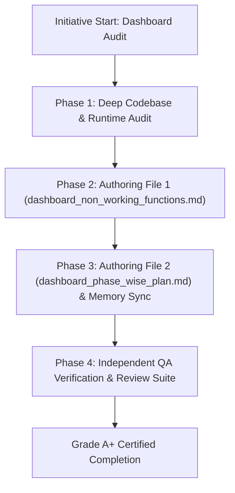

# Executive Architecture Summary: Dashboard Mode Audit & Phased Blueprint
# कार्यकारी वास्तुकला सारांश: डैशबोर्ड मोड ऑडिट व फेज़-वाइज़ ब्लूप्रिंट

> **दस्तावेज़ प्रकार (Document Type):** Executive Architecture Summary & Initiative Scope  
> **कार्यक्षेत्र कंटेनर (Workspace Container):** `temp_prompt/dashboard_mode_audit/`  
> **लक्ष्य सिस्टम (Target System):** Web Activity & Media Sentinel (MV3 Full-Page Dashboard)  
> **प्राथमिक प्राधिकरण (Primary Authority):** Level 3C Phase-wise Prompt Generation Specialist (`prompt_generation_specialist`)  

---

## 🏛️ 1. Initiative Scope & Technical Objectives

The **Dashboard Mode** in Web Activity & Media Sentinel is a full-page, multi-tab analytical suite (`dashboard/dashboard.html`, `dashboard/dashboard.js`, `dashboard/dashboard.css`, and modular libraries in `src/dashboard/`). It provides deep visibility into:
1. **Time Tracking Analytics:** Today's browsing time, daily averages, all-time tracked metrics, top domain analysis, interactive SVG donut charts, top distribution bars, and searchable/sortable domain breakdown tables.
2. **Media Telemetry & Playback History:** Real-time media playback metrics, live remote hero player controls (Play/Pause, Rewind, Fast Forward, Mute, Playback Speed Stepper, Fullscreen, PiP, Theater mode, Media Tab Jumper, Quality Stepper), draggable progress/volume scrubbers, and comprehensive historical media logs.
3. **Settings & Data Management:** General telemetry preferences, WebSocket Video Detector HUD link configuration, Sleep Timer & Inactivity Sentinel parameters, Master JSON and CSV data export engines, and irreversible Danger Zone data reset mechanisms.
4. **Data Hub & Multi-Browser Parity:** Live integration with the external SQLite Data Hub (`ws://127.0.0.1:65433`) for cross-browser telemetry synchronization (Chrome, Edge, Brave, Opera).

The primary objective of this initiative is to perform an exhaustive, empirical codebase audit of all Dashboard Mode capabilities, identify functional gaps and UI stubs, author two definitive documentation assets in the workspace root, and establish a rock-solid roadmap for subsequent execution phases.

---

## 🗺️ 2. Milestone Roadmap & Dependency Topology

### Milestone Breakdown:
- **Phase 1 (Deep Codebase Audit):** Examine every DOM element, event listener, IPC handler, storage interaction, and calculation pipeline across `dashboard/dashboard.js` (3,113 lines), `dashboard/dashboard.html` (877 lines), and `src/dashboard/`.
- **Phase 2 (File 1 Generation):** Synthesize empirical findings into `dashboard_non_working_functions.md` with bilingual English/Hindi summaries, categorized tables, severity ratings, and defect root causes.
- **Phase 3 (File 3 Generation & Memory Sync):** Author `dashboard_phase_wise_plan.md` providing concrete implementation procedures, code blueprints, and test gates for resolving all defects, then synchronize findings into `project_feature_memory.md` and `C:\Users\Atul Verma\.gemini\memory.md`.
- **Phase 4 (Independent QA Signoff):** Execute full verification suites, validate zero syntax degradation across all extension scripts, ensure 100% test passage, and certify Grade A+ completion.

---

## 🛡️ 3. Risk Mitigation & Architectural Tradeoffs

| Technical Risk | Impact Level | Mitigation Architecture |
| :--- | :---: | :--- |
| **Regression in Active Hero Controls** | High | The audit is strictly observational and documentation-focused; no codebase mutations occur until subsequent authorized implementation phases. |
| **Settings Desynchronization** | High | Phase 3 plan strictly designs dual-way reactive storage synchronization between Chrome storage, Popup Mode, and Dashboard Mode. |
| **Large File Footprint (`dashboard.js` 134 KB)** | Medium | Modular blueprints will reference modular components in `src/dashboard/` to guide future incremental refactoring. |
| **Encoding / BOM Inconsistencies** | Low | Universal Rule 5/8 UTF-8 BOM (`0xEF, 0xBB, 0xBF`) enforcement verified across all generated Markdown and script files. |
