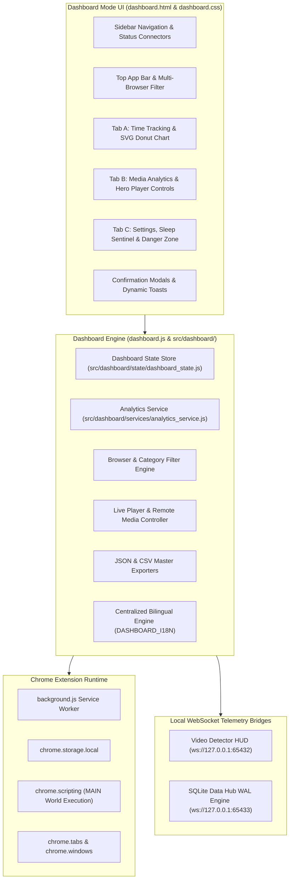

# Technical Requirements Document (TRD): Dashboard Mode Audit & Blueprint
# तकनीकी आवश्यकता दस्तावेज़ (TRD): डैशबोर्ड मोड ऑडिट व ब्लूप्रिंट

> **दस्तावेज़ प्रकार (Document Type):** Technical Requirements Document (TRD)  
> **कार्यक्षेत्र कंटेनर (Workspace Container):** `temp_prompt/dashboard_mode_audit/`  
> **लक्ष्य सिस्टम (Target System):** Web Activity & Media Sentinel (MV3 Full-Page Dashboard)  
> **प्राथमिक प्राधिकरण (Primary Authority):** Level 3C Phase-wise Prompt Generation Specialist (`prompt_generation_specialist`)  

---

## 🏛️ 1. Technical Architecture & Component Decomposition

The Dashboard Mode subsystem is organized into 6 distinct technical modules:

---

## 🔍 2. Audit Verification Targets & Code Anchors

### Module 1: Sidebar & Infrastructure Connectors
- **Files:** `dashboard/dashboard.html` (#L13-L74), `dashboard/dashboard.js` (#L2298-L2310, #L2367-L2425, #L2253-L2295)
- **Targets:**
  - Tab switching between Tracking, Media, and Settings.
  - Video Detector HUD connection monitor and automatic reconnection (`handleConnectOrLaunchHUD`).
  - Standalone SQLite Data Hub websocket monitor (`triggerDataHubConnectAndLaunch`).

### Module 2: Top App Bar & Multi-Browser Filtering
- **Files:** `dashboard/dashboard.html` (#L78-L129), `dashboard/dashboard.js` (#L2216-L2250, #L2314-L2355)
- **Targets:**
  - Multi-Browser selector (`#browserFilterSelect`): All Browsers, Chrome, Edge, Brave, Opera.
  - Tracking mode selector (`#trackingModeSelect`): Combined, Active Only, BG Media.
  - Live clock pill and 1-click language switcher (`#btnLangToggle`).

### Module 3: Time Tracking Analytics (Tab A)
- **Files:** `dashboard/dashboard.html` (#L136-L300), `dashboard/dashboard.js` (#L1200-L1500, #L2440-L2480)
- **Targets:**
  - 4 Key metric cards (Today, Daily Avg, Total, Top Domain).
  - Temporal subtab switching (`today`, `daily`, `total`).
  - SVG donut chart rendering, slices calculation, and legend list population.
  - Top 5 distribution bars rendering.
  - Domain breakdown table pagination, real-time search, category filtering (Web vs Internal), and column sorting.

### Module 4: Media Analytics & Remote Hero Player (Tab B)
- **Files:** `dashboard/dashboard.html` (#L305-L547), `dashboard/dashboard.js` (#L1550-L1750, #L1953-L2150, #L2490-L2900)
- **Targets:**
  - 6 Key media summary metric cards.
  - Live hero player status badge, active video title, platform tag, and resolution badge.
  - Remote media controls: Play/Pause, Rewind, Fast Forward, Mute, Playback Speed Stepper (0.25x-2.0x ladder).
  - Draggable video timeline scrubber and volume scrubber with direct MAIN world `chrome.scripting` acceleration.
  - Advanced display controls: Fullscreen (YouTube native button + KeyF + Web CSS fallback), PiP, Theater mode, Switch to Tab, and Quality stepper.
  - Historical media playback table search, platform filter, and sorting.

### Module 5: Settings, Sleep Sentinel & Danger Zone (Tab C)
- **Files:** `dashboard/dashboard.html` (#L552-L846), `dashboard/dashboard.js` (#L1770-L1950, #L2995-L3055)
- **Targets:**
  - General settings persistence (`settingIdleTimeout`, `settingLanguage`, `settingWsUrl`, `settingMediaToggle`, `settingAutoWsToggle`, `settingHistoryDays`).
  - **Identified Defect:** Sleep timer card (`cardSleepSettings`) UI stubs (`#settingDefaultSleepDuration`, `#settingSleepFadeToggle`, `#settingFadeDuration`, `#settingInactivitySleepToggle`, `#settingInactivityThreshold`, `#settingBadgeCountdownToggle`, `#btnSaveSleepSettings`).
  - Master export triggers: Full Master JSON, Time Tracking CSV, Media History CSV.
  - Danger zone irreversible actions: Clear Media History, Clear Time Tracking, Full Reset, and modal dialog protection.

---

## 🧪 3. Quality & Security Gates

1. **Syntax Check:** `node -c dashboard/dashboard.js` and all extension scripts must exit with code 0.
2. **AST Parsing:** In-memory script compilation via Node.js `vm.Script` must produce 0 parse errors.
3. **CSP & W3C Trusted Types:** 0 assignments to `.innerHTML` in any newly proposed or modified code.
4. **Encoding Compliance:** All generated Markdown artifacts must be verified with UTF-8 BOM (`0xEF, 0xBB, 0xBF`).
