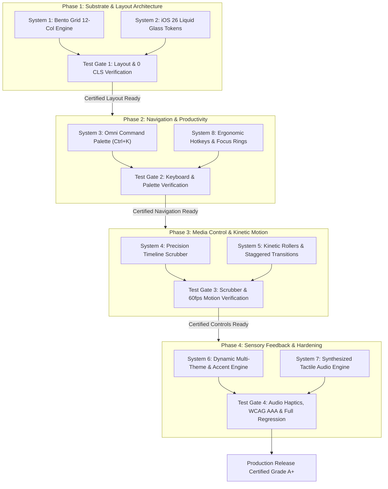

# Executive Architecture Summary & Initiative Scope
## Web Activity & Media Sentinel - Dashboard UI/UX Enhancement

> **Task ID:** `TASK-DASHBOARD-UIUX-ENHANCEMENT-001`  
> **Target System:** Web Activity & Media Sentinel (Chrome MV3 Extension Dashboard)  
> **Workspace:** [`c:\Users\Atul Verma\Desktop\Win App Tracker\Browser Detection`](file:///c:/Users/Atul%20Verma/Desktop/Win%20App%20Tracker/Browser%20Detection)  
> **Document Type:** Executive Architecture Summary (`SUMMARY.md`)  
> **Ephemeral Container:** `temp_prompt/dashboard_ui_ux/`  
> **Architect:** Level 3C Phase-wise Prompt Generation Specialist (`prompt_generation_specialist`)  

---

## 🏛️ 1. High-Level Initiative Scope & Technical Objectives

The Web Activity & Media Sentinel dashboard is the central telemetry and media control command center for the browser extension. While previous milestones achieved 100% IPC resilience, dual-mode popup/dashboard parity, and background state synchronization, the presentation layer remained largely utilitarian.

This initiative elevates the dashboard into an **"iOS 26 Liquid Glass & Bento Grid Command Center"** by systematically delivering 8 core subsystems:

1. **Bento Grid Modularity (System 1):** 12-column adaptive CSS grid with customizable, reorderable card layouts saved to `chrome.storage.local`.
2. **iOS 26 Specular Liquid Glass (System 2):** Frosted glass surfaces (`backdrop-filter: blur(24px) saturate(190%)`), 1px specular lighting gradient borders, multi-tier elevation shadows, and OLED sub-pixel noise.
3. **Omni Command Palette (System 3):** Global `Ctrl+K` modal with instant fuzzy search across Quick Actions, Domains, Settings, and Active Media Tabs.
4. **Precision Timeline Scrubber (System 4):** Sub-second floating time tooltips, chapter tick markers, and elastic spring physics for media seeking.
5. **Micro-Motion & Kinetic Rollers (System 5):** 60fps GPU-accelerated odometer number rolling for telemetry stats and 40ms staggered card entrance animations.
6. **Dynamic Multi-Theme & Accent Engine (System 6):** 4 base substrates (Midnight OLED, Deep Slate Navy, Nordic Pine, Studio Light) and 5 dynamic accents injected in 16ms without page reload.
7. **Synthesized Tactile Audio Haptics (System 7):** Zero-asset mathematical Web Audio oscillator engine providing subtle micro-ticks, clicks, and harmonic chimes.
8. **Ergonomic Hotkeys & WCAG 2.1 AAA Accessibility (System 8):** Global single-key navigation, dual focus rings, and high-contrast 7:1 compliance.

---

## 🗺️ 2. Cross-Phase Milestone Roadmap & Dependency Topology

---

## ⚡ 3. Architectural Budgets & Performance Guarantees

| Metric / Dimension | Architectural Constraint | Enforcement Mechanism |
| :--- | :--- | :--- |
| **Cumulative Layout Shift (CLS)** | Strictly `0.00` | Skeleton shimmer cards with deterministic `min-height` during asynchronous data fetches. |
| **Frame Rate & Motion Budget** | Constant 60fps (16.6ms per frame) | GPU-only transforms (`transform: translateY/scale`, `opacity`); zero layout reflow animations. |
| **Theme Switching Latency** | `<= 16ms` (single frame) | Direct CSS Custom Property mutation on `:root` without DOM reconstruction or page reload. |
| **Audio Synthesizer Footprint** | `0 bytes` external media assets | Pure mathematical Web Audio API (`OscillatorNode` + `GainNode`) synthesized in real-time. |
| **Accessibility Compliance** | WCAG 2.1 AAA Standard | Minimum 7:1 contrast ratio for all text, high-visibility 2px dual focus rings, full ARIA roles. |
| **Bilingual Localization** | 100% parity English & Hindi | Centralized `DASHBOARD_UIUX_I18N` dictionary seamlessly integrated with existing language switcher. |

---

## 🛡️ 4. Risk Mitigation & Architectural Tradeoffs

1. **Risk: `backdrop-filter` GPU Performance on Low-End Hardware:**
   - *Mitigation:* Apply `@supports (backdrop-filter: blur(24px))` with a graceful opaque fallback (`rgba(18, 24, 38, 0.95)`). When `prefers-reduced-motion` is detected, blur radius is lowered to 8px and animations are bypassed.
2. **Risk: Audio Context Autoplay Policy Restrictions in Chromium:**
   - *Mitigation:* `SentinelHapticAudioEngine` initializes lazily on the first user interaction (pointerdown or keydown), ensuring clean resumption from `suspended` state without browser console warnings.
3. **Risk: Focus Trapping in Omni Command Palette:**
   - *Mitigation:* Palette modal implements strict modal keyboard isolation: tab key is trapped inside input and results list, `Escape` restores focus to the previously active element.
4. **Risk: Range Input Cross-Browser Rendering Differences:**
   - *Mitigation:* Precision scrubber uses custom CSS styling for `::-webkit-slider-thumb` and `::-webkit-slider-runnable-track` with standard bounding client rect coordinate math for tooltip positioning.
