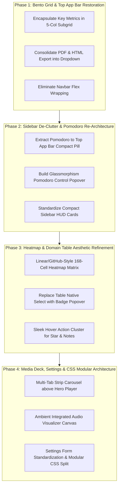

# Web Activity & Media Sentinel - Dashboard UI/UX Restoration & Refinement
## Live Tracking Board & Problem-Solution Dossier (8 Subsystems Across 4 Phases)

> **Task ID:** `TASK-DASHBOARD-UIUX-RESTORATION-001`  
> **Target Workspace:** [`c:\Users\Atul Verma\Desktop\Win App Tracker\Browser Detection`](file:///c:/Users/Atul%20Verma/Desktop/Win%20App%20Tracker/Browser%20Detection)  
> **Lead Architect:** Level 3C Phase-wise Prompt Generation Specialist (`prompt_generation_specialist`)  
> **Governance Standard:** [`PHASE_WISE_PROMPT_GENERATION_ARCHITECTURE.md`](file:///C:/Users/Atul%20Verma/.gemini/config/rules/PHASE_WISE_PROMPT_GENERATION_ARCHITECTURE.md) & Universal Rule 22  
> **Master Specification Anchor:** [`dashboard_ui_ux_restoration_prompt.md`](file:///c:/Users/Atul%20Verma/Desktop/Win%20App%20Tracker/Browser%20Detection/dashboard_ui_ux_restoration_prompt.md)  
> **Project Memory Anchor:** [`project_ui_ux_restoration_memory.md`](file:///c:/Users/Atul%20Verma/Desktop/Win%20App%20Tracker/Browser%20Detection/project_ui_ux_restoration_memory.md) एवं [`project_feature_memory.md`](file:///c:/Users/Atul%20Verma/Desktop/Win%20App%20Tracker/Browser%20Detection/project_feature_memory.md)  
> **Ephemeral Container:** `temp_prompt/dashboard_ui_ux_restoration/`  
> **Decision Gate Assessment:** `PROMPT_FILES_REQUIRED = YES` (Complex Multi-Module UI/UX Refinement & Layout Stabilization)  
> **Recommended Execution Strategy:** `STRATEGY_A_AUTONOMOUS` (Autonomous Forward Momentum, Autonomy Score: 1.0)  
> **Active Status:** SPECIFICATION_LOCKED (Ready for Level 4 Implementation Delegation)

---

## 📌 1. Executive Problem-Solution Dossier (Forensic Audit & Remediation)

### 1.1 Architectural Context & Current UI/UX Clutter Analysis
During the implementation of Phases 1 through 4 (Features 1 to 8), high-powered capabilities were added to the Web Activity & Media Sentinel dashboard. However, rapid DOM insertions disrupted the original liquid-glass Bento Grid architecture (commit `ef7d720`), resulting in visual clutter, inconsistent sizing, awkward wrapping, and CSS bloat.

The table below summarizes the 8 core clutter vectors identified during the deep UI/UX forensic audit and their corresponding restorative architectural solutions:

| Clutter Vector # | Component / Surface | Forensic Flaw Identified | Architectural Restorative Blueprint | Phase Target |
| :---: | :--- | :--- | :--- | :---: |
| **01** | **Bento Grid Metric Cards** | 12-column grid broken by 5th metric card (`#metricProductivityScore`) spanning 3 cols, causing an awkward 1-card wrap with 9 empty columns. | Encapsulate key metrics in a dedicated `.metrics-bento-row.bento-span-12` container using a responsive 5-column subgrid (`repeat(5, 1fr)` on desktop, 3 on tablet, 2 on mobile) to maintain clean horizontal symmetry. | **Phase 1** |
| **02** | **Top App Bar Actions** | PDF (`#btnPrintPdf`) and Report (`#btnDownloadHtmlDigest`) export buttons crammed into top app bar flex row, causing overflow and misaligned buttons on standard screens. | Consolidate export actions into an elegant single dropdown button (`#btnExportMenu`, `[📥 Export ▾]`) opening a glassmorphism popover with PDF, Standalone HTML, Time CSV, and Media CSV options. | **Phase 1** |
| **03** | **Sidebar Navigation** | Large Pomodoro widget (`#widgetPomodoroSentinel`) shoved directly into the sidebar between nav items and HUD cards, forcing vertical scrollbars and cluttering hierarchy. | Relocate Pomodoro Sentinel to an ultra-compact status pill in the Top App Bar (`#pomodoroNavPill`) with click-to-open glassmorphism control popover, restoring clean sidebar navigation. | **Phase 2** |
| **04** | **Sidebar HUD Cards** | Data Hub and HUD status cards squished by oversized widgets, with repetitive button margins. | Standardize `.sidebar-hud-card` to a compact 64px micro-card height with subtle status dots, hover glow, and consistent typography. | **Phase 2** |
| **05** | **168-Cell Activity Heatmap** | 7x24 hourly heatmap (`#cardHourlyHeatmap`) renders as an oversized bulky block with cramped numbers, awkward cell aspect-ratios, and horizontal scrollbars. | Redesign as a sleek GitHub/Linear-style compact contribution matrix with 16px rounded cells, milestone hour labels (00, 04, 08, 12, 16, 20), smooth floating hover tooltip, and compact legend. | **Phase 3** |
| **06** | **Domain Table Row Clutter** | Native HTML `<select class="productivity-select">`, ⭐ favorite button, and 📝 note button crammed into individual table cells, inflating row heights and causing visual jitter. | Replace clunky native dropdown with an ergonomic `.badge-productivity` pill opening a lightweight popover on click; group favorite star and notes into a sleek `.cell-quick-actions` hover cluster. | **Phase 3** |
| **07** | **Media Pane Multi-Tab Deck & Visualizer** | Multi-tab deck added large bulky cards pushing hero player down; audio visualizer canvas plopped with heavy borders, stretching the layout vertically. | Convert Multi-Tab Deck into a sleek horizontal chip strip (`.media-tab-strip`) above hero player; embed Audio Visualizer canvas as an ambient background layer inside hero card with toggle. | **Phase 4** |
| **08** | **Settings Forms & CSS Bloat** | Inconsistent form classes (`.styled-input`, `.btn-save-primary`, `.budget-input-row`) and 1466 CSS lines dumped into `dashboard.css` + 4 fragmented files. | Unify Settings cards to `.settings-section-card` design tokens; refactor CSS into modular domain stylesheets (`tokens.css`, `layout.css`, `tracking.css`, `media.css`, `settings.css`) via `@import`. | **Phase 4** |

---

## 🗺️ 2. Phase-by-Phase Restoration & Refinement Roadmap

---

## 📂 3. Architectural File Manifest

The complete prompt dossier and phase-wise execution blueprints comprise the following files:

| File Name | File Purpose | Document Status |
| :--- | :--- | :---: |
| [`INDEX.md`](file:///c:/Users/Atul%20Verma/Desktop/Win%20App%20Tracker/Browser%20Detection/temp_prompt/dashboard_ui_ux_restoration/INDEX.md) | Master Tracking Board & Problem-Solution Matrix (This File) | ✅ **LOCKED** |
| [`PRD.md`](file:///c:/Users/Atul%20Verma/Desktop/Win%20App%20Tracker/Browser%20Detection/temp_prompt/dashboard_ui_ux_restoration/PRD.md) | Product Requirements Document: Restoration Goals & Acceptance Criteria | ✅ **LOCKED** |
| [`TRD.md`](file:///c:/Users/Atul%20Verma/Desktop/Win%20App%20Tracker/Browser%20Detection/temp_prompt/dashboard_ui_ux_restoration/TRD.md) | Technical Requirements Document: Subgrid Math, Popover Engine & CSS Tree | ✅ **LOCKED** |
| [`DESIGN.md`](file:///c:/Users/Atul%20Verma/Desktop/Win%20App%20Tracker/Browser%20Detection/temp_prompt/dashboard_ui_ux_restoration/DESIGN.md) | Design System Specification: Liquid Glass 2.0 Tokens & 60fps Micro-Motion | ✅ **LOCKED** |
| [`phase_01_bento_grid_and_topbar_restoration.md`](file:///c:/Users/Atul%20Verma/Desktop/Win%20App%20Tracker/Browser%20Detection/temp_prompt/dashboard_ui_ux_restoration/phase_01_bento_grid_and_topbar_restoration.md) | Phase 1 Execution Prompt: 5-Card Metric Subgrid & Export Dropdown | ✅ **LOCKED** |
| [`phase_02_sidebar_and_pomodoro_redesign.md`](file:///c:/Users/Atul%20Verma/Desktop/Win%20App%20Tracker/Browser%20Detection/temp_prompt/dashboard_ui_ux_restoration/phase_02_sidebar_and_pomodoro_redesign.md) | Phase 2 Execution Prompt: Sidebar De-Clutter & Top Bar Pomodoro Pill | ✅ **LOCKED** |
| [`phase_03_heatmap_and_domain_table_refinement.md`](file:///c:/Users/Atul%20Verma/Desktop/Win%20App%20Tracker/Browser%20Detection/temp_prompt/dashboard_ui_ux_restoration/phase_03_heatmap_and_domain_table_refinement.md) | Phase 3 Execution Prompt: Compact Heatmap & Table Badge Popover | ✅ **LOCKED** |
| [`phase_04_media_pane_and_settings_unification.md`](file:///c:/Users/Atul%20Verma/Desktop/Win%20App%20Tracker/Browser%20Detection/temp_prompt/dashboard_ui_ux_restoration/phase_04_media_pane_and_settings_unification.md) | Phase 4 Execution Prompt: Tab Strip, Ambient Visualizer & Modular CSS | ✅ **LOCKED** |
| [`SUMMARY.md`](file:///c:/Users/Atul%20Verma/Desktop/Win%20App%20Tracker/Browser%20Detection/temp_prompt/dashboard_ui_ux_restoration/SUMMARY.md) | Final Executive Architecture Summary & QA Verification Gate | ✅ **LOCKED** |

---

## 🚦 4. Live Decision Gate State Machine

- **Current State:** `READY_FOR_MANAGER_DECISION`
- **Preceding Milestone:** Full Forensic UI/UX Audit & Prompt File Architecture Complete
- **Next Transition:** Manager Issues `AUTH-MGR-20261117-UIUX-RESTORE-001` -> Dispatch to Level 4 Execution Sub-Agent
- **Hard Lock Enforcement:** Application code files remain 100% UNTOUCHED during this specification phase.
