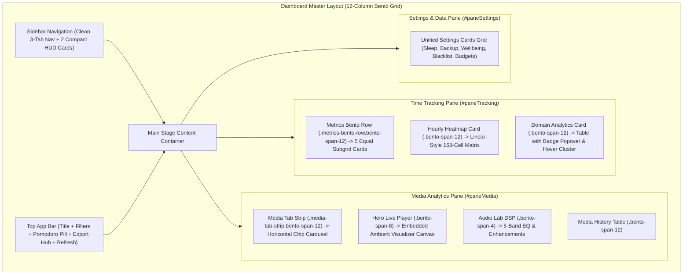

# Web Activity & Media Sentinel - Dashboard UI/UX Restoration TRD
## Technical Requirements Document: DOM Contracts, Subgrid Mechanics & Event Lifecycles

> **Document Type:** Technical Requirements Document (TRD)  
> **Target System:** Web Activity & Media Sentinel (Chrome MV3 Dashboard)  
> **Document Status:** READY_FOR_REVIEW / SPECIFICATION_LOCKED  
> **Author:** Level 3C Phase-wise Prompt Generation Specialist  
> **Governance:** Universal Rule 22 & [`PHASE_WISE_PROMPT_GENERATION_ARCHITECTURE.md`](file:///C:/Users/Atul%20Verma/.gemini/config/rules/PHASE_WISE_PROMPT_GENERATION_ARCHITECTURE.md)  
> **Master Reference:** [`dashboard_ui_ux_restoration_prompt.md`](file:///c:/Users/Atul%20Verma/Desktop/Win%20App%20Tracker/Browser%20Detection/dashboard_ui_ux_restoration_prompt.md)  

---

## 🏛️ 1. Technical Architecture & DOM Topology



---

## 📐 2. DOM Restructuring Blueprints

### Blueprint 1: 5-Card Key Metrics Subgrid Container
In `dashboard.html`, wrap the 5 metric cards inside a dedicated subgrid container:

```html
<!-- RESTORED: 5-Metric Symmetrical Subgrid Row -->
<div class="metrics-bento-row bento-span-12" role="region" aria-label="Key Performance Indicators">
  <!-- Card 1: Today Browsing -->
  <div class="metric-card liquid-glass-card">
    <div class="metric-header">
      <span id="lblMetricToday" class="metric-label">Today's Browsing Time</span>
      <span class="metric-icon-box cyan">⏱️</span>
    </div>
    <div class="metric-body">
      <div id="metricTodayTime" class="metric-value">0h 00m</div>
      <div class="metric-subtext">Active tab focus time</div>
    </div>
  </div>

  <!-- Card 2: All-Time Browsing -->
  <div class="metric-card liquid-glass-card">
    <div class="metric-header">
      <span id="lblMetricTotal" class="metric-label">Total Time Tracked</span>
      <span class="metric-icon-box violet">📊</span>
    </div>
    <div class="metric-body">
      <div id="metricTotalTime" class="metric-value">0h 00m</div>
      <div class="metric-subtext">Across all sessions</div>
    </div>
  </div>

  <!-- Card 3: Tracked Domains -->
  <div class="metric-card liquid-glass-card">
    <div class="metric-header">
      <span id="lblMetricDomains" class="metric-label">Tracked Domains</span>
      <span class="metric-icon-box amber">🌐</span>
    </div>
    <div class="metric-body">
      <div id="metricDomainCount" class="metric-value">0</div>
      <div class="metric-subtext">Unique websites logged</div>
    </div>
  </div>

  <!-- Card 4: Media Consumption -->
  <div class="metric-card liquid-glass-card">
    <div class="metric-header">
      <span id="lblMetricMedia" class="metric-label">Media Consumed</span>
      <span class="metric-icon-box emerald">🎬</span>
    </div>
    <div class="metric-body">
      <div id="metricMediaTime" class="metric-value">0h 00m</div>
      <div class="metric-subtext">Audio & video playback</div>
    </div>
  </div>

  <!-- Card 5: Productivity Score (Restored Symmetrical Integration) -->
  <div id="metricProductivityScore" class="metric-card liquid-glass-card">
    <div class="metric-header">
      <span id="lblMetricProductivity" class="metric-label">Productivity Index</span>
      <span class="metric-icon-box rose">⚡</span>
    </div>
    <div class="metric-body">
      <div id="metricProductivityValue" class="metric-value">--</div>
      <div class="metric-subtext" id="metricProductivityLabel">Calculating ratio...</div>
    </div>
  </div>
</div>
```

**CSS Subgrid Mechanics:**
```css
.metrics-bento-row {
  display: grid;
  grid-template-columns: repeat(5, minmax(0, 1fr));
  gap: 1rem;
  width: 100%;
}

@media (max-width: 1280px) {
  .metrics-bento-row {
    grid-template-columns: repeat(3, minmax(0, 1fr));
  }
}

@media (max-width: 768px) {
  .metrics-bento-row {
    grid-template-columns: repeat(2, minmax(0, 1fr));
  }
}

@media (max-width: 480px) {
  .metrics-bento-row {
    grid-template-columns: 1fr;
  }
}
```

---

### Blueprint 2: Consolidated Export Dropdown Hub
In `dashboard.html`, replace loose export buttons in Top App Bar with a unified export hub:

```html
<!-- RESTORED: Consolidated Export Dropdown Hub -->
<div class="export-dropdown-container">
  <button id="btnExportMenu" class="btn-action-outline btn-export-trigger" aria-haspopup="true" aria-expanded="false" title="Export & Reports">
    <span class="action-btn-icon">📥</span>
    <span id="btnExportMenuText">Export</span>
    <span class="dropdown-chevron">▾</span>
  </button>
  <div id="exportDropdownMenu" class="export-dropdown-menu liquid-glass-card hidden" role="menu" aria-label="Export Formats">
    <button id="btnPrintPdf" class="export-menu-item" role="menuitem">
      <span class="menu-item-icon">🖨️</span>
      <div class="menu-item-info">
        <span class="menu-item-title" id="btnPrintPdfText">Save PDF Executive Digest</span>
        <span class="menu-item-desc">Print-optimized multi-page report</span>
      </div>
    </button>
    <button id="btnDownloadHtmlDigest" class="export-menu-item" role="menuitem">
      <span class="menu-item-icon">📄</span>
      <div class="menu-item-info">
        <span class="menu-item-title" id="btnDownloadHtmlDigestText">Offline HTML Report</span>
        <span class="menu-item-desc">Self-contained interactive dashboard</span>
      </div>
    </button>
    <div class="dropdown-divider"></div>
    <button id="btnExportTimeCsv" class="export-menu-item" role="menuitem">
      <span class="menu-item-icon">📊</span>
      <div class="menu-item-info">
        <span class="menu-item-title">Export Time Data (CSV)</span>
        <span class="menu-item-desc">RFC 4180 raw tabular records</span>
      </div>
    </button>
    <button id="btnExportMediaCsv" class="export-menu-item" role="menuitem">
      <span class="menu-item-icon">🎬</span>
      <div class="menu-item-info">
        <span class="menu-item-title">Export Media History (CSV)</span>
        <span class="menu-item-desc">Full audio/video play records</span>
      </div>
    </button>
  </div>
</div>
```

---

### Blueprint 3: Top App Bar Pomodoro Status Pill & Popover
Extract `#widgetPomodoroSentinel` from sidebar. In `dashboard.html`, place the pill in `.app-bar-right`:

```html
<!-- RESTORED: Pomodoro Interactive Pill in Top App Bar -->
<div class="pomodoro-pill-container">
  <button id="pomodoroNavPill" class="pomodoro-nav-pill" aria-haspopup="true" aria-expanded="false" title="Pomodoro Focus Sentinel">
    <span class="pomodoro-pill-icon">🧘</span>
    <span id="pomodoroPillClock" class="pomodoro-pill-time">25:00</span>
    <span id="pomodoroPillBadge" class="badge-focus-micro">Focus</span>
  </button>

  <!-- Interactive Glassmorphism Popover Modal -->
  <div id="pomodoroPopoverModal" class="pomodoro-popover-card liquid-glass-card hidden" role="dialog" aria-label="Pomodoro Focus Controls">
    <div class="pomodoro-popover-header">
      <div class="pomodoro-popover-title-group">
        <span class="pomodoro-popover-title">🧘 Focus Sentinel & Pomodoro</span>
        <span id="pomodoroModeBadge" class="badge-focus">Focus (25m)</span>
      </div>
      <button id="btnPomodoroPopoverClose" class="btn-icon-close" aria-label="Close">✕</button>
    </div>
    <div class="pomodoro-popover-body">
      <div id="pomodoroTimeDisplay" class="pomodoro-big-time">25:00</div>
      <div class="pomodoro-progress-track">
        <div id="pomodoroProgressBar" class="pomodoro-progress-fill" style="width: 100%;"></div>
      </div>
      <div class="pomodoro-popover-actions">
        <button type="button" id="btnStartPomodoro" class="btn-pomodoro primary">▶️ Start</button>
        <button type="button" id="btnPausePomodoro" class="btn-pomodoro">⏸️ Pause</button>
        <button type="button" id="btnResetPomodoro" class="btn-pomodoro">🔄 Reset</button>
      </div>
    </div>
  </div>
</div>
```

---

### Blueprint 4: Compact Linear-Style 168-Cell Heatmap Matrix
Refactor `#cardHourlyHeatmap` in `dashboard.html`:

```html
<!-- RESTORED: Compact Linear-Style Chrono-Heatmap Card -->
<div id="cardHourlyHeatmap" class="bento-card liquid-glass-card bento-span-12 heatmap-card-compact">
  <div class="bento-card-header">
    <div class="header-left">
      <h3 id="txtHeatmapTitle" class="bento-card-title">🕒 24-Hour Activity Heatmap</h3>
      <span id="txtHeatmapSub" class="bento-card-sub">Hourly focus intensity matrix (Past 7 Days)</span>
    </div>
    <div class="header-right heatmap-header-controls">
      <!-- Mode Switcher Pill -->
      <div class="segmented-control-mini" role="radiogroup" aria-label="Heatmap Mode">
        <button type="button" id="btnHeatmapModeFocus" class="seg-btn active" role="radio" aria-checked="true">Focus</button>
        <button type="button" id="btnHeatmapModeMedia" class="seg-btn" role="radio" aria-checked="false">Media</button>
      </div>
      <!-- Intensity Legend -->
      <div class="heatmap-legend-mini">
        <span class="legend-lbl">Less</span>
        <span class="legend-cell tier-0"></span>
        <span class="legend-cell tier-1"></span>
        <span class="legend-cell tier-2"></span>
        <span class="legend-cell tier-3"></span>
        <span class="legend-cell tier-4"></span>
        <span class="legend-lbl">More</span>
      </div>
    </div>
  </div>

  <div class="chrono-heatmap-wrapper">
    <div id="hourlyHeatmapGrid" class="chrono-heatmap-grid-compact" role="grid" aria-label="Activity Matrix">
      <!-- 7 rows x 24 columns generated dynamically by temporal_productivity_feature.js -->
    </div>
  </div>
</div>
```

---

### Blueprint 5: Clean Domain Table with Productivity Badge Popover
In `src/dashboard/components/domain_table.js`, eliminate inline `<select>` elements:

```javascript
// RESTORED: Render sleek productivity pill badge instead of crude native <select>
function renderProductivityBadge(domain, currentCategory) {
  const catKey = currentCategory || 'neutral';
  const colorMap = {
    'work': 'emerald',
    'learning': 'cyan',
    'entertainment': 'rose',
    'social': 'amber',
    'utilities': 'violet',
    'neutral': 'slate'
  };
  const color = colorMap[catKey] || 'slate';
  
  return `
    <button type="button" class="badge-productivity ${color}" data-domain="${domain}" data-category="${catKey}" title="Click to change category">
      <span class="prod-dot"></span>
      <span class="prod-text">${formatCategoryName(catKey)}</span>
      <span class="prod-chevron">▾</span>
    </button>
  `;
}
```

Hover Action Cluster:
```html
<div class="cell-quick-actions">
  <button type="button" class="btn-cell-star ${isStarred ? 'active' : ''}" data-domain="${domain}" title="${isStarred ? 'Unstar domain' : 'Star domain'}">
    ${isStarred ? '★' : '☆'}
  </button>
  <button type="button" class="btn-cell-note ${hasNote ? 'has-note' : ''}" data-domain="${domain}" title="${hasNote ? 'Edit project note' : 'Add project note'}">
    📝
  </button>
</div>
```

---

## ⚡ 3. Popover & Event Lifecycle Architecture

All new dropdowns and popovers (`#exportDropdownMenu`, `#pomodoroPopoverModal`, `.productivity-popover`) must adhere to strict single-active popover management:

```javascript
// Global Popover Manager Contract
class DashboardPopoverManager {
  static open(popoverElement, triggerElement) {
    this.closeAll();
    popoverElement.classList.remove('hidden');
    triggerElement.setAttribute('aria-expanded', 'true');
    this.activePopover = popoverElement;
    this.activeTrigger = triggerElement;
  }

  static closeAll() {
    if (this.activePopover) {
      this.activePopover.classList.add('hidden');
      if (this.activeTrigger) this.activeTrigger.setAttribute('aria-expanded', 'false');
      this.activePopover = null;
      this.activeTrigger = null;
    }
  }

  static initGlobalListeners() {
    document.addEventListener('click', (e) => {
      if (this.activePopover && !this.activePopover.contains(e.target) && !this.activeTrigger?.contains(e.target)) {
        this.closeAll();
      }
    });

    document.addEventListener('keydown', (e) => {
      if (e.key === 'Escape') this.closeAll();
    });
  }
}
```
