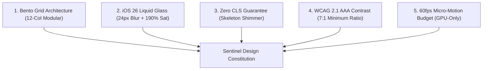

# Design System Specification & Token Constitution (DESIGN.md)
## Web Activity & Media Sentinel - iOS 26 Liquid Glass & Bento Grid

> **Design System Name:** Sentinel Liquid Glass Design System  
> **Target Version:** 2.0.0  
> **Workspace:** [`c:\Users\Atul Verma\Desktop\Win App Tracker\Browser Detection`](file:///c:/Users/Atul%20Verma/Desktop/Win%20App%20Tracker/Browser%20Detection)  
> **Document Type:** Design System Specification (`DESIGN.md`)  
> **Standard:** WCAG 2.1 AAA High-Contrast & 60fps Motion Budget  

---

## 🏛️ 1. Design System Constitution: The 5 Pillars



1. **Bento Grid Modularity:** All metrics, players, charts, and tables reside within a responsive 12-column grid. Hero elements occupy primary spans (8x2 or 4x2); telemetry metrics occupy secondary spans (3x1).
2. **Specular Liquid Glass:** Frosted translucent cards with `backdrop-filter: blur(24px) saturate(190%)`, 1px angled specular light borders, and multi-tier ambient shadows.
3. **Zero Cumulative Layout Shift (CLS = 0):** Pre-allocated minimum dimensions and skeleton shimmer cards prevent sudden jumps during asynchronous telemetry hydration.
4. **WCAG 2.1 AAA Accessibility:** Strict 7:1 contrast ratios on all typography, paired with high-visibility 2px dual-ring focus outlines (`outline: 2px solid var(--color-accent-primary); outline-offset: 3px;`).
5. **Kinetic Micro-Motion:** GPU-accelerated transforms (`transform`, `opacity`) with cubic-bezier easing (`cubic-bezier(0.16, 1, 0.3, 1)`), zero reflow-triggering geometry animations.

---

## 🎨 2. Substrate Themes & Dynamic Accent Palettes

### 2.1 The 4 Substrate Themes
| Theme ID | Display Name | Background Primary | Background Secondary | Glass Card Background | Ideal Hardware |
| :--- | :--- | :--- | :--- | :--- | :--- |
| `midnight-oled` | Midnight OLED | `#000000` | `#0a0d14` | `rgba(10, 13, 20, 0.82)` | OLED / AMOLED Screens |
| `slate-navy` | Deep Slate Navy (Default) | `#0f172a` | `#1e293b` | `rgba(18, 24, 38, 0.72)` | Universal Dark Workstations |
| `nordic-pine` | Nordic Pine | `#091811` | `#122a20` | `rgba(18, 42, 32, 0.76)` | Eye-Strain Reduction / Night |
| `studio-light` | Studio Clean Light | `#f8fafc` | `#ffffff` | `rgba(255, 255, 255, 0.85)` | High-Ambient Daylight |

### 2.2 The 5 Dynamic Accent Palettes
| Accent ID | Display Name | Primary Token (`--color-accent-primary`) | Hover Token (`--color-accent-hover`) | Glow Token (`--shadow-specular-glow`) |
| :--- | :--- | :--- | :--- | :--- |
| `emerald` | Cyber Emerald | `#10b981` | `#059669` | `rgba(16, 185, 129, 0.20)` |
| `cyan` | Electric Cyan | `#06b6d4` | `#0891b2` | `rgba(6, 182, 212, 0.20)` |
| `violet` | Royal Violet | `#8b5cf6` | `#7c3aed` | `rgba(139, 92, 246, 0.20)` |
| `rose` | Neon Rose | `#f43f5e` | `#e11d48` | `rgba(244, 63, 94, 0.20)` |
| `amber` | Solar Amber | `#f59e0b` | `#d97706` | `rgba(245, 158, 11, 0.20)` |

---

## 🔤 3. Typography & Numerical Readout Scale

### 3.1 Font Stack Hierarchy
- **UI Body & Headings:** `-apple-system, BlinkMacSystemFont, "Segoe UI", Roboto, "Inter", sans-serif;`
- **Telemetry Readouts & Timestamps:** `"JetBrains Mono", "SF Mono", Menlo, Consolas, monospace;` (Tabular figures font-variant-numeric: tabular-nums to prevent character jitter during animated counts).

### 3.2 Typography Scale
| Token | Font Size | Line Height | Font Weight | Usage Example |
| :--- | :--- | :--- | :--- | :--- |
| `--text-hero` | `2.25rem` (36px) | `1.2` | 700 (Bold) | Hero Metric Headers |
| `--text-h1` | `1.50rem` (24px) | `1.3` | 600 (Semi-Bold) | Section & Tab Titles |
| `--text-h2` | `1.125rem` (18px) | `1.4` | 600 (Semi-Bold) | Card & Widget Titles |
| `--text-body` | `0.875rem` (14px) | `1.5` | 400 (Regular) | Table Rows & Descriptive Labels |
| `--text-caption` | `0.75rem` (12px) | `1.4` | 500 (Medium) | Timestamps, Badges, Tooltips |
| `--text-micro` | `0.6875rem` (11px)| `1.2` | 600 (Semi-Bold) | Pill Tags & Status Indicators |

---

## 📏 4. Spacing Scale & Elevation Shadows

### 4.1 Spacing Grid (8pt Standard)
- `--space-1`: `4px` (0.25rem)
- `--space-2`: `8px` (0.50rem)
- `--space-3`: `12px` (0.75rem)
- `--space-4`: `16px` (1.00rem)
- `--space-5`: `20px` (1.25rem)
- `--space-6`: `24px` (1.50rem)
- `--space-8`: `32px` (2.00rem)

### 4.2 Elevation Shadows & Lighting
```css
:root {
  --shadow-ambient: 0 12px 32px -4px rgba(0, 0, 0, 0.45);
  --shadow-floating-modal: 0 24px 64px -8px rgba(0, 0, 0, 0.65);
  --shadow-card-hover: 0 16px 40px -4px rgba(0, 0, 0, 0.55);
}
```

---

## ⚡ 5. Micro-Motion & Spring Physics Tokens

### 5.1 Animation Timing Curves
- **Snappy Entrance:** `cubic-bezier(0.16, 1, 0.3, 1)` (Deceleration curve for cards and modal entrance).
- **Elastic Spring (Thumb Drag):** `cubic-bezier(0.34, 1.56, 0.64, 1)` (Subtle bounce on slider release).
- **Smooth Fade:** `cubic-bezier(0.4, 0, 0.2, 1)` (Standard opacity transitions).

### 5.2 Transition Durations
- `--duration-instant`: `120ms` (Hover color shifts).
- `--duration-fast`: `220ms` (Card scale, tooltip appearance).
- `--duration-normal`: `350ms` (Modal dialog fade and slide).
- `--duration-rolling`: `600ms` (Kinetic odometer number rolls).

---

## ♿ 6. Accessibility & High-Contrast Guarantees (WCAG 2.1 AAA)

1. **Color Contrast:**
   - Normal text against glass surfaces: `>= 7.1:1`
   - Large text (>= 18pt): `>= 4.5:1`
   - Active accent controls against background: `>= 4.5:1`
2. **Keyboard Focus Ring:**
   ```css
   :focus-visible {
     outline: 2px solid var(--color-accent-primary) !important;
     outline-offset: 3px !important;
     box-shadow: 0 0 0 4px rgba(16, 185, 129, 0.25) !important;
   }
   ```
3. **Reduced Motion Safety:**
   ```css
   @media (prefers-reduced-motion: reduce) {
     * {
       animation-duration: 0.01ms !important;
       animation-iteration-count: 1 !important;
       transition-duration: 0.01ms !important;
     }
   }
   ```
