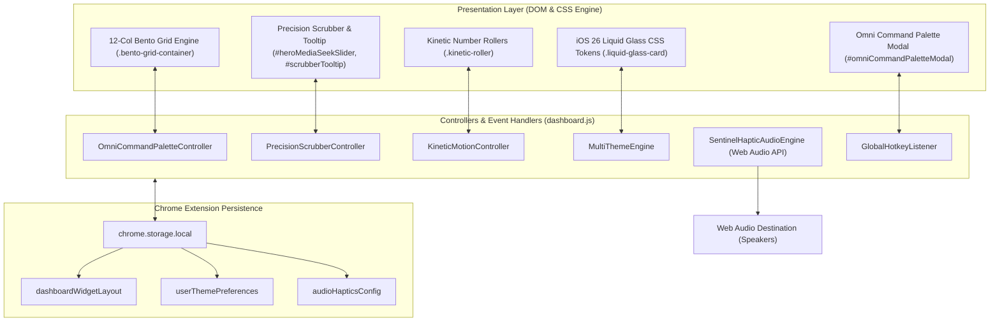

# Technical Requirements Document (TRD)
## Web Activity & Media Sentinel - Dashboard UI/UX Enhancement

> **Document Type:** Technical Requirements Document (`TRD.md`)  
> **Target Workspace:** [`c:\Users\Atul Verma\Desktop\Win App Tracker\Browser Detection`](file:///c:/Users/Atul%20Verma/Desktop/Win%20App%20Tracker/Browser%20Detection)  
> **Ephemeral Container:** `temp_prompt/dashboard_uiux_enhancement/`  
> **Task ID:** `TASK-DASHBOARD-UIUX-ENHANCEMENT-001`  
> **Target Files:** `dashboard/dashboard.html`, `dashboard/dashboard.css`, `dashboard/dashboard.js`, `tests/`  

---

## 🏗️ 1. Technical Architecture & Component Interaction



---

## 🍱 2. Bento Grid 12-Column CSS Grid Engine

### 2.1 CSS Grid Specification
```css
.bento-grid-container {
  display: grid;
  grid-template-columns: repeat(12, minmax(0, 1fr));
  grid-auto-rows: minmax(140px, auto);
  gap: 1.25rem;
  padding: 1.5rem;
  max-width: 1720px;
  margin: 0 auto;
}

/* Span Hierarchies */
.bento-span-12 { grid-column: span 12; }
.bento-span-8  { grid-column: span 8; }
.bento-span-6  { grid-column: span 6; }
.bento-span-4  { grid-column: span 4; }
.bento-span-3  { grid-column: span 3; }
.bento-row-span-2 { grid-row: span 2; }

/* Responsive Container Queries & Media Rules */
@media (max-width: 1200px) {
  .bento-span-8, .bento-span-4 { grid-column: span 12; }
  .bento-span-3 { grid-column: span 6; }
}

@media (max-width: 768px) {
  .bento-span-12, .bento-span-8, .bento-span-6, .bento-span-4, .bento-span-3 {
    grid-column: span 12;
  }
}
```

### 2.2 Drag-to-Reorder Layout Persistence Schema
In `chrome.storage.local`:
```json
{
  "dashboardWidgetLayout": {
    "version": 1,
    "order": [
      "widget-hero-player",
      "widget-time-distribution",
      "widget-metrics-row",
      "widget-domain-table"
    ],
    "collapsed": {
      "widget-domain-table": false
    }
  }
}
```

---

## 🧊 3. iOS 26 Liquid Glass & Specular Depth Engine

### 3.1 CSS Custom Properties (Tokens)
```css
:root {
  --glass-surface-bg: rgba(18, 24, 38, 0.72);
  --glass-surface-hover: rgba(26, 34, 52, 0.85);
  --glass-border-specular: linear-gradient(
    135deg,
    rgba(255, 255, 255, 0.16) 0%,
    rgba(255, 255, 255, 0.04) 50%,
    rgba(0, 0, 0, 0.25) 100%
  );
  --shadow-ambient: 0 12px 32px -4px rgba(0, 0, 0, 0.45);
  --shadow-specular-glow: 0 0 20px -2px rgba(16, 185, 129, 0.15);
  --glass-blur-radius: 24px;
}

.liquid-glass-card {
  background: var(--glass-surface-bg);
  backdrop-filter: blur(var(--glass-blur-radius)) saturate(190%);
  -webkit-backdrop-filter: blur(var(--glass-blur-radius)) saturate(190%);
  border: 1px solid rgba(255, 255, 255, 0.08);
  border-image: var(--glass-border-specular) 1;
  box-shadow: var(--shadow-ambient);
  border-radius: 18px;
  transition: transform 220ms cubic-bezier(0.16, 1, 0.3, 1), box-shadow 220ms ease;
}

.liquid-glass-card:hover {
  background: var(--glass-surface-hover);
  box-shadow: var(--shadow-ambient), var(--shadow-specular-glow);
  transform: translateY(-2px);
}
```

---

## ⚡ 4. Omni Command Palette & Fuzzy Search Controller

### 4.1 Search Pipeline
```javascript
class OmniCommandPalette {
  constructor(options = {}) {
    this.modalEl = document.getElementById('omniCommandPaletteModal');
    this.inputEl = document.getElementById('omniPaletteSearchInput');
    this.resultsEl = document.getElementById('omniPaletteResultsList');
    this.commands = options.commands || [];
    this.selectedIndex = 0;
    this.isOpen = false;
  }

  open() {
    this.isOpen = true;
    this.modalEl.classList.remove('hidden');
    this.inputEl.value = '';
    this.renderResults(this.commands);
    this.inputEl.focus();
    window.sentinelHaptics?.playClick();
  }

  close() {
    this.isOpen = false;
    this.modalEl.classList.add('hidden');
  }

  filter(query) {
    const q = query.trim().toLowerCase();
    if (!q) return this.commands;
    return this.commands.filter(cmd => 
      cmd.title.toLowerCase().includes(q) || 
      (cmd.keywords && cmd.keywords.some(k => k.toLowerCase().includes(q))) ||
      (cmd.category && cmd.category.toLowerCase().includes(q))
    );
  }
}
```

### 4.2 Keyboard Trap & Key Codes
- `Ctrl+K` / `Cmd+K`: Toggle open/close.
- `ArrowDown`: `selectedIndex = (selectedIndex + 1) % filteredResults.length`.
- `ArrowUp`: `selectedIndex = (selectedIndex - 1 + length) % length`.
- `Enter`: Execute `filteredResults[selectedIndex].action()`.
- `Escape`: Close modal, return focus to prior active element.

---

## 🎯 5. Precision Timeline Scrubber Architecture

### 5.1 Math & Coordinate Engine
```javascript
function initPrecisionScrubber(scrubberEl, tooltipEl, durationSec) {
  scrubberEl.addEventListener('mousemove', (e) => {
    const rect = scrubberEl.getBoundingClientRect();
    const offsetX = Math.max(0, Math.min(e.clientX - rect.left, rect.width));
    const percent = offsetX / rect.width;
    const hoverSeconds = percent * durationSec;

    tooltipEl.style.left = `${offsetX}px`;
    tooltipEl.textContent = formatTimeHHMMSS(hoverSeconds);
    tooltipEl.classList.remove('hidden');
    window.sentinelHaptics?.playTick();
  });

  scrubberEl.addEventListener('mouseleave', () => {
    tooltipEl.classList.add('hidden');
  });
}
```

---

## 🌀 6. Kinetic Number Rollers & GPU Micro-Motion

### 6.1 600ms Cubic-Bezier Easing
```javascript
function animateNumberRoll(el, startVal, targetVal, durationMs = 600) {
  const startTime = performance.now();
  const easeOutQuart = (x) => 1 - Math.pow(1 - x, 4);

  function step(currentTime) {
    const elapsed = currentTime - startTime;
    const progress = Math.min(elapsed / durationMs, 1);
    const eased = easeOutQuart(progress);
    const current = Math.round(startVal + (targetVal - startVal) * eased);
    el.textContent = current;

    if (progress < 1) {
      requestAnimationFrame(step);
    }
  }
  requestAnimationFrame(step);
}
```

---

## 🔊 7. Synthesized Web Audio Haptics Engine

### 7.1 Web Audio Frequency & Envelope Parameters
```javascript
class SentinelHapticAudioEngine {
  constructor() {
    this.ctx = null;
    this.enabled = true;
    this.masterGain = 0.15; // 15% subtle volume
  }

  init() {
    if (!this.ctx) {
      const AudioCtx = window.AudioContext || window.webkitAudioContext;
      this.ctx = new AudioCtx();
    }
    if (this.ctx.state === 'suspended') {
      this.ctx.resume();
    }
  }

  playTick() {
    if (!this.enabled) return;
    this.init();
    const osc = this.ctx.createOscillator();
    const gain = this.ctx.createGain();
    osc.type = 'sine';
    osc.frequency.setValueAtTime(800, this.ctx.currentTime);
    gain.gain.setValueAtTime(this.masterGain * 0.4, this.ctx.currentTime);
    gain.gain.exponentialRampToValueAtTime(0.0001, this.ctx.currentTime + 0.006);
    osc.connect(gain);
    gain.connect(this.ctx.destination);
    osc.start();
    osc.stop(this.ctx.currentTime + 0.007);
  }

  playClick() {
    if (!this.enabled) return;
    this.init();
    const osc = this.ctx.createOscillator();
    const gain = this.ctx.createGain();
    osc.type = 'triangle';
    osc.frequency.setValueAtTime(1200, this.ctx.currentTime);
    gain.gain.setValueAtTime(this.masterGain * 0.7, this.ctx.currentTime);
    gain.gain.exponentialRampToValueAtTime(0.0001, this.ctx.currentTime + 0.012);
    osc.connect(gain);
    gain.connect(this.ctx.destination);
    osc.start();
    osc.stop(this.ctx.currentTime + 0.013);
  }

  playSuccessChime() {
    if (!this.enabled) return;
    this.init();
    const now = this.ctx.currentTime;
    [523.25, 659.25].forEach((freq, idx) => {
      const osc = this.ctx.createOscillator();
      const gain = this.ctx.createGain();
      osc.type = 'triangle';
      osc.frequency.setValueAtTime(freq, now + (idx * 0.04));
      gain.gain.setValueAtTime(this.masterGain, now + (idx * 0.04));
      gain.gain.exponentialRampToValueAtTime(0.0001, now + (idx * 0.04) + 0.22);
      osc.connect(gain);
      gain.connect(this.ctx.destination);
      osc.start(now + (idx * 0.04));
      osc.stop(now + (idx * 0.04) + 0.23);
    });
  }
}
```

---

## 🎨 8. Theme Substrates & Accent Palettes

### 8.1 16ms CSS Custom Property Mutation
```javascript
const SUBSTRATE_THEMES = {
  'midnight-oled': { '--bg-primary': '#000000', '--bg-secondary': '#0a0d14', '--glass-surface-bg': 'rgba(10, 13, 20, 0.82)' },
  'slate-navy':    { '--bg-primary': '#0f172a', '--bg-secondary': '#1e293b', '--glass-surface-bg': 'rgba(18, 24, 38, 0.72)' },
  'nordic-pine':   { '--bg-primary': '#091811', '--bg-secondary': '#122a20', '--glass-surface-bg': 'rgba(18, 42, 32, 0.76)' },
  'studio-light':  { '--bg-primary': '#f8fafc', '--bg-secondary': '#ffffff', '--glass-surface-bg': 'rgba(255, 255, 255, 0.85)' }
};

const ACCENT_PALETTES = {
  'emerald': { '--color-accent-primary': '#10b981', '--color-accent-hover': '#059669' },
  'cyan':    { '--color-accent-primary': '#06b6d4', '--color-accent-hover': '#0891b2' },
  'violet':  { '--color-accent-primary': '#8b5cf6', '--color-accent-hover': '#7c3aed' },
  'rose':    { '--color-accent-primary': '#f43f5e', '--color-accent-hover': '#e11d48' },
  'amber':   { '--color-accent-primary': '#f59e0b', '--color-accent-hover': '#d97706' }
};

function applyTheme(themeKey, accentKey) {
  const root = document.documentElement;
  const themeVars = SUBSTRATE_THEMES[themeKey] || SUBSTRATE_THEMES['slate-navy'];
  const accentVars = ACCENT_PALETTES[accentKey] || ACCENT_PALETTES['emerald'];

  Object.entries({ ...themeVars, ...accentVars }).forEach(([prop, val]) => {
    root.style.setProperty(prop, val);
  });

  chrome.storage.local.set({ userThemePreferences: { theme: themeKey, accent: accentKey } });
}
```

---

## 🧪 9. Automated Test Harness Specification

| Phase | Test Suite File | Core Assertions & Automated Checks |
| :---: | :--- | :--- |
| **Phase 1** | `tests/test_dashboard_uiux_phase1.js` | Validates `.bento-grid-container` 12-col template, `.liquid-glass-card` backdrop-filter blur/saturate, specular border gradient, zero CLS on render, and responsive span rules. |
| **Phase 2** | `tests/test_dashboard_uiux_phase2.js` | Simulates `Ctrl+K` keydown, verifies `#omniCommandPaletteModal` unhiding, checks fuzzy search filtering across 4 categories, arrow key selection index, and hotkey trigger dispatch. |
| **Phase 3** | `tests/test_dashboard_uiux_phase3.js` | Simulates mousemove on `#heroMediaSeekSlider`, asserts `#scrubberTooltip` style.left and timestamp calculation, verifies chapter tick mark rendering, and checks 600ms kinetic roller loop. |
| **Phase 4** | `tests/test_dashboard_uiux_phase4.js` | Mocks AudioContext oscillator and gain nodes, asserts frequency parameters (800Hz, 1200Hz, 523Hz+659Hz), tests 16ms theme injection, and verifies WCAG 2.1 AAA 7:1 contrast ratios. |
