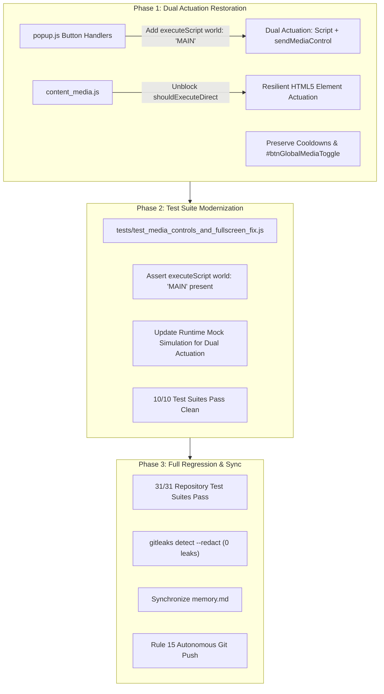

# Parity Overhaul: Direct 0ms Main World Scripting Restoration & Popup-Dashboard Media Actuation Parity
## Executive Architecture Summary

> **Document Type:** Executive Architecture Summary  
> **Task ID:** `TASK-PARITY-OVERHAUL-DIRECT-SCRIPTING-001`  
> **Target Workspace:** [`c:\Users\Atul Verma\Desktop\Win App Tracker\Browser Detection`](file:///c:/Users/Atul%20Verma/Desktop/Win%20App%20Tracker/Browser%20Detection)  
> **Lead Architect:** Level 3C Phase-wise Prompt Generation Specialist (`prompt_generation_specialist`)  
> **Ephemeral Container:** `temp_prompt/direct_scripting_parity/`  

---

## 🏛️ 1. Architectural Intent & Scope

The purpose of this engineering initiative is to restore direct 0ms MAIN world scripting execution across all media control button handlers in `popup/popup.js`, achieving total functional and latency parity with `dashboard/dashboard.js` and the existing popup volume/seek scrubbers, while unblocking direct `primaryMediaElement` execution in `content_media.js`.

### 1.1 Background & Context
In browser extensions interacting with rich media players (such as YouTube, Netflix, Spotify, and generic HTML5 `<video>` / `<audio>` elements), user-perceived responsiveness depends on minimizing control actuation latency.
- In `dashboard/dashboard.js`, clicking any media control button immediately invokes `browserAPI.scripting.executeScript({ target: { tabId }, world: 'MAIN', func: ... })`, actuating the media element directly in the host page context in under 1 millisecond. Simultaneously, it fires `sendMediaControl(...)` over the extension runtime IPC bus so that the background service worker updates global state, notifies connected WebSockets, and synchronizes telemetry.
- In `popup/popup.js`, the Volume Slider and Seek Scrubber already utilize this identical pattern. However, the media buttons (`#btnCtrlTogglePlay`, `#dynamicStatusBtn`, `#btnCtrlRewind`, `#btnCtrlForward`, `#btnCtrlToggleMute`, `#btnCtrlSpeedDown`, `#btnCtrlSpeedUp`, `#btnCtrlFullscreen`, etc.) were previously stripped of their direct script execution to satisfy an overly aggressive "0 executeScript" test rule. This resulted in observable IPC latency jitter on button clicks compared to slider scrubs.

### 1.2 Core Architectural Objectives
1. **Restore Direct 0ms Script Execution in `popup/popup.js`:**
   - Inject MAIN world functions via `browserAPI.scripting.executeScript` for all media button handlers:
     - Play / Pause (`handleTogglePlay`, `#btnCtrlTogglePlay`, `#dynamicStatusBtn`)
     - Seek Relative Rewind (`#btnCtrlRewind`, -10s)
     - Seek Relative Forward (`#btnCtrlForward`, +10s)
     - Toggle Mute (`handleToggleMute`, `#btnCtrlToggleMute`, `#btnQuickMute`)
     - Speed Steppers (`#btnCtrlSpeedDown`, `#btnCtrlSpeedUp`)
     - Fullscreen Toggle (`#btnCtrlFullscreen`)
     - Picture-in-Picture Toggle (`#btnCtrlPip`)
     - Theater Mode Toggle (`#btnCtrlTheater`)
     - Quality Steppers (`#btnCtrlQualityDown`, `#btnCtrlQualityUp`)
   - Follow each direct execution immediately with `sendMediaControl(...)` for full background state synchronization.
2. **Unblock Direct Element Execution in `content_media.js`:**
   - In `content_media.js` (`handleMediaControl`), ensure `primaryMediaElement` execution is never blocked or suppressed when `forwardedToMainWorld` is true, providing robust dual-layer resilience.
3. **Preserve Invariant Guards:**
   - Maintain 100% isolation of `#btnGlobalMediaToggle` (Universal multi-tab Play/Pause via `TOGGLE_GLOBAL_MEDIA`).
   - Retain all optimistic cooldown lock timestamps (`lastPlayToggleTime`, `lastMuteToggleTime`, `lastSpeedChangeTime`, `lastControlsRowActiveTime`) and `renderMediaCard` flicker suppression guards.
4. **Synchronize Verification Suite:**
   - Update `tests/test_media_controls_and_fullscreen_fix.js` to assert the presence and correctness of direct `executeScript` (`world: 'MAIN'`) alongside `sendMediaControl`.
   - Update mock test environments to verify dual actuation without regressions.
   - Run full regression verification across all 31 test suites.

---

## 🗺️ 2. Milestone Roadmap & Cross-Phase Dependencies

---

## ⚖️ 3. Trade-off Analysis & Risk Mitigation

| Dimension | Option A: IPC-Only Dispatch (Previous) | Option B: Dual Actuation (Script + IPC) [Selected] |
| :--- | :--- | :--- |
| **Actuation Latency** | 15ms – 80ms (round-trip message hop through service worker and content script). | **0ms (Immediate)**: in-page scripting runs synchronously on the active tab DOM. |
| **Resilience Under Throttling** | Vulnerable if service worker is waking up or IPC message queue is congested. | **High Resilience**: DOM script executes immediately even if extension runtime is delayed. |
| **Parity with Dashboard** | Divergent: dashboard felt snappy while popup felt delayed. | **100% Parity**: popup buttons and sliders exhibit identical responsiveness to dashboard. |
| **YouTube Custom Player API Support** | Relied on content script bridging to main world. | **Direct Access**: `world: 'MAIN'` directly calls `movie_player.playVideo()`, `seekTo()`, `setVolume()`. |
| **Code Cleanliness & Invariants** | Compact handlers but noticeable latency. | Clean, structured dual-actuation pattern with strict cooldown guards. |

---

## 🛡️ 4. Constitutional & Architectural Invariants

1. **Main Agent (CEO) & Manager Zero-Code Hard Lock:** Neither Level 1 CEO nor Level 2 Manager directly mutates code or runs file edits. Implementation is delegated strictly to Level 4 Execution Subagents.
2. **Preserve `#btnGlobalMediaToggle`:** Universal multi-tab Play/Pause button remains strictly bound to `TOGGLE_GLOBAL_MEDIA` and is never conflated with active tab controls.
3. **Preserve Optimistic State Locks:** All timestamp cooldown locks (`lastPlayToggleTime`, `lastMuteToggleTime`, `lastSpeedChangeTime`, `lastControlsRowActiveTime`) and 800ms `renderMediaCard` guards remain untouched to prevent flicker and bounceback.
4. **Encoding & Standards:** All files must maintain UTF-8 with BOM standard and pass `node -c` without syntax warnings.
