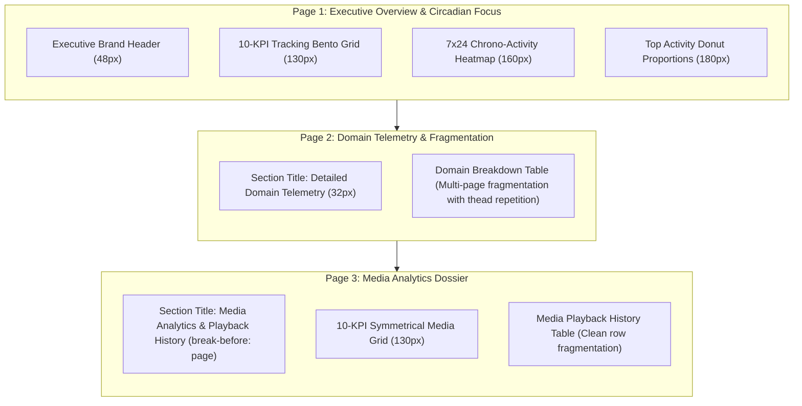

# Design System & UI Specification: Dual-Tab Export Parity Overhaul

> **Initiative:** Dual-Tab Export Parity Overhaul (Time Tracking + Media Analytics + Chrono Heatmap)  
> **Task ID:** `TASK-DUAL-TAB-EXPORT-PARITY-001`  
> **Design Authority:** Dept 06 UI/UX Design  
> **Governance:** Level 3C Phase-wise Prompt Generation Specialist (`prompt_generation_specialist`)  
> **Author:** Atul Verma (`aiprincekumar` / `aiprincekumar010100@gmail.com`)  

---

## 🎨 1. Executive Color Tokens & Typography Scales

### 1.1 Print & Standalone Document Color Palette

| Token Name | Hex Code | Print Role | Background Contrast Ratio |
| :--- | :--- | :--- | :---: |
| `--print-bg` | `#ffffff` | Page Base Surface | 21:1 on text |
| `--print-text` | `#0f172a` | Primary Headings & Bold KPIs | 16.2:1 (AAA) |
| `--print-muted` | `#475569` | Subtext, Labels, Period Metadata | 7.1:1 (AAA) |
| `--print-border` | `#cbd5e1` | Card & Table Outer Borders | 3.2:1 (UI AA) |
| `--print-border-light` | `#e2e8f0` | Table Row Dividers & Grid Gaps | 1.8:1 |
| `--print-table-header` | `#f1f5f9` | Table Header Background | 14.5:1 on text |
| `--accent-emerald` | `#10b981` | Productivity & Focus Tiers | 4.8:1 (AA) |
| `--accent-cyan` | `#06b6d4` | Live Streams & Active Indicators | 4.5:1 (AA) |
| `--accent-rose` | `#f43f5e` | Watch Time & Distraction Indicators | 4.9:1 (AA) |
| `--accent-amber` | `#f59e0b` | Platform Badges & Peak Levels | 4.6:1 (AA) |
| `--accent-violet` | `#8b5cf6` | Lowest Volume & Secondary Media | 5.2:1 (AA) |

### 1.2 Typography Hierarchy

```css
/* Executive Document Typography */
.brand-title, .print-title        { font-size: 1.45rem; font-weight: 800; line-height: 1.2; color: #0f172a; }
.section-title, h2                { font-size: 1.15rem; font-weight: 700; line-height: 1.3; color: #0f172a; margin-top: 16px; margin-bottom: 8px; }
.card-heading, h3                 { font-size: 0.95rem; font-weight: 700; color: #1e293b; }
.metric-big-num                   { font-size: 1.15rem; font-weight: 800; font-variant-numeric: tabular-nums; }
.metric-label                     { font-size: 0.70rem; font-weight: 700; text-transform: uppercase; letter-spacing: 0.5px; color: #64748b; }
.metric-subtext                   { font-size: 0.68rem; color: #94a3b8; }
.period-label, .print-date        { font-size: 0.82rem; font-weight: 500; color: #475569; }
table th                          { font-size: 0.72rem; font-weight: 700; text-transform: uppercase; letter-spacing: 0.4px; }
table td                          { font-size: 0.80rem; font-weight: 400; font-variant-numeric: tabular-nums; }
```

---

## 📐 2. Layout Geometry & Grid Systems

### 2.1 10-KPI Symmetrical Grid Geometry (A4 Landscape Print & HTML Digest)
Both the Time Tracking Grid (`.metrics-grid`) and Media Analytics Grid (`#mediaMetricsGrid`, `.media-metrics-grid`) adopt identical 5-column symmetrical structures:

```
+-----------------------------------------------------------------------------------------------+
|                                      ROW 1 (5 Cards)                                          |
|  [ Card 1: 20% ]   [ Card 2: 20% ]   [ Card 3: 20% ]   [ Card 4: 20% ]   [ Card 5: 20% ]      |
+-----------------------------------------------------------------------------------------------+
|                                      ROW 2 (5 Cards)                                          |
|  [ Card 6: 20% ]   [ Card 7: 20% ]   [ Card 8: 20% ]   [ Card 9: 20% ]   [ Card 10: 20% ]     |
+-----------------------------------------------------------------------------------------------+
```

- **Grid Declaration:** `display: grid; grid-template-columns: repeat(5, 1fr); gap: 8px; margin-bottom: 12px;`
- **Individual Card Styling:**
  - `padding: 8px 10px;`
  - `border: 1px solid #cbd5e1; border-radius: 6px; background: #ffffff;`
  - `page-break-inside: avoid; break-inside: avoid;`

### 2.2 Chrono-Activity Heatmap 7x24 Matrix Geometry
```
       00 01 02 03 04 05 06 07 08 09 10 11 12 13 14 15 16 17 18 19 20 21 22 23
Mon   [ ][ ][ ][ ][ ][ ][ ][ ][ ][ ][ ][ ][ ][ ][ ][ ][ ][ ][ ][ ][ ][ ][ ][ ]
Tue   [ ][ ][ ][ ][ ][ ][ ][ ][ ][ ][ ][ ][ ][ ][ ][ ][ ][ ][ ][ ][ ][ ][ ][ ]
Wed   [ ][ ][ ][ ][ ][ ][ ][ ][ ][ ][ ][ ][ ][ ][ ][ ][ ][ ][ ][ ][ ][ ][ ][ ]
Thu   [ ][ ][ ][ ][ ][ ][ ][ ][ ][ ][ ][ ][ ][ ][ ][ ][ ][ ][ ][ ][ ][ ][ ][ ]
Fri   [ ][ ][ ][ ][ ][ ][ ][ ][ ][ ][ ][ ][ ][ ][ ][ ][ ][ ][ ][ ][ ][ ][ ][ ]
Sat   [ ][ ][ ][ ][ ][ ][ ][ ][ ][ ][ ][ ][ ][ ][ ][ ][ ][ ][ ][ ][ ][ ][ ][ ]
Sun   [ ][ ][ ][ ][ ][ ][ ][ ][ ][ ][ ][ ][ ][ ][ ][ ][ ][ ][ ][ ][ ][ ][ ][ ]
```
- **Grid Declaration:** `grid-template-columns: minmax(36px, 48px) repeat(24, minmax(0, 1fr)); gap: 2px;`
- **Cell Height & Radius:** `height: 14px; border-radius: 2px;`
- **Print Contrast Tiers:**
  - **Tier 0 (0m):** `#f8fafc` with `border: 1px solid #e2e8f0;`
  - **Tier 1 (1-15m):** `#d1fae5` with `border: 1px solid #a7f3d0;`
  - **Tier 2 (15-30m):** `#6ee7b7` with `border: 1px solid #34d399;`
  - **Tier 3 (30-45m):** `#10b981` with `border: 1px solid #059669;`
  - **Tier 4 (45-60m):** `#047857` with `border: 1px solid #064e3b;`

---

## 📄 3. Print Pagination Flow & Fragmentation Architecture

In A4 landscape format (`margin: 10mm 12mm 10mm 12mm;`), printable height is approximately 718px. The print flow is partitioned across pages cleanly:



- **Section Break Enforcement:** `#paneMedia { page-break-before: always !important; break-before: page !important; }` ensures the Media dossier never starts awkwardly squeezed at the bottom of Page 2.

---

## 🚫 4. Non-Printable Elements Suppression Matrix

The following elements MUST have `display: none !important; height: 0 !important; overflow: hidden !important; margin: 0 !important; padding: 0 !important;` in print stylesheets:

| Subsystem | Selector | Purpose of Suppression |
| :--- | :--- | :--- |
| Navigation | `.sidebar, .top-app-bar, .temporal-subtabs` | Eliminates app chrome and sidebar |
| Modals | `.modal-backdrop, .omni-modal-overlay` | Eliminates overlay masks |
| Media Deck | `#multiTabMediaDeckContainer, .media-deck-header-actions` | Suppresses live tab stream player |
| Hero Player | `#heroMediaPlayerCard, .hero-controls-group, .hero-progress-section` | Suppresses interactive video scrubber and remote |
| Audio Visualizer | `#heroAudioLabStatus, #canvasAudioVisualizer, .visualizer-hero-card` | Suppresses real-time audio FFT canvas |
| Controls | `.heatmap-controls-row, .heatmap-mode-toggles, #heatmapWowBadge` | Suppresses mode buttons and interactive badges |
| Tooltips | `#heatmapCellTooltip, #toastContainer, .floating-actions` | Suppresses floating hover tooltips |
| Action Buttons | `.btn, .btn-action-outline, #btnScrollTopMediaHistory` | Eliminates non-printable interactive buttons |

---

## ♿ 5. Accessibility & Grayscale Contrast Verification

1. **High-Contrast Cell Borders:** All heatmap cells, table cells, and metric cards feature explicit 1px borders (`#cbd5e1` or `#e2e8f0`). When printed on monochromatic (black-and-white) laser printers, the borders ensure clear visual demarcation between adjacent elements even without color.
2. **Text Contrast:** Primary numbers (`#0f172a` on `#ffffff`) achieve a 16.2:1 contrast ratio, far surpassing the WCAG 2.1 AA requirement of 4.5:1.
3. **Tabular Numerals:** All KPI numbers and time values enforce `font-variant-numeric: tabular-nums` to maintain vertical alignment in multi-row grids.
