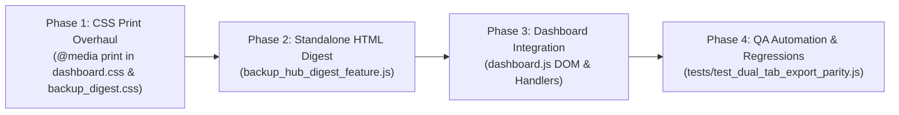

# Executive Architecture Summary & Roadmap: Dual-Tab Export Parity Overhaul

> **Initiative:** Dual-Tab Export Parity Overhaul (Time Tracking + Media Analytics + Chrono Heatmap)  
> **Task ID:** `TASK-DUAL-TAB-EXPORT-PARITY-001`  
> **Lead Department:** Dept 01 Product Requirements & Dept 05 Frontend Engineering  
> **Governance:** Level 3C Phase-wise Prompt Generation Specialist (`prompt_generation_specialist`)  
> **Author:** Atul Verma (`aiprincekumar` / `aiprincekumar010100@gmail.com`)  
> **Execution Strategy:** `STRATEGY_A_AUTONOMOUS` (Target Autonomy Score: 1.0)  

---

## 🏛️ 1. Executive Summary & Strategic Objectives

The Sentinel Web Activity & Media Sentinel dashboard provides two primary analytical views:
1. **Time Tracking & Circadian Focus Hub:** Tracking metrics, 10-KPI bento row, 7x24 Chrono-Activity Heatmap, activity donut proportions, and detailed domain tables.
2. **Media Analytics & Audio Streaming Deck:** 10-KPI media metrics grid, multi-tab live player deck, interactive scrubber controls, visualizer status, and playback history table.

Currently, both export modalities — **In-Browser PDF/Print View** (`window.print()`) and the **Standalone Single-File Offline HTML Digest** (`Sentinel_Executive_Digest_<date>.html`) — suffer from an asymmetric bias towards Tab 1 (Time Tracking). In both exports:
- Media Analytics KPI metrics are entirely missing or reduced to an unformatted list.
- The 7x24 Chrono-Activity Heatmap is missing from the offline HTML report and unstyled/fragile in print view.
- `#paneMedia` is unconditionally hidden in `@media print`.
- Interactive widgets (scrubbers, playback buttons, volume controls, visualizers) pollute the DOM if print isolation is broken.

**Strategic Objective:** Establish 100% visual and telemetry parity across both tabs for both export modalities. A printed PDF or downloaded offline HTML digest will represent a comprehensive executive dossier containing Part 1 (Time Tracking & Circadian Heatmap) and Part 2 (Media Analytics & Audio Telemetry) with screen-accurate styles, zero interactive clutter, and full offline resilience.

---

## 🗺️ 2. Architectural Scope & Problem Analysis

```mermaid
flowchart TD
    subgraph CurrentState ["Current Export Defect Profile"]
        direction TB
        E1["In-Browser Print View"] -->|Suppresses| M1["#paneMedia: display:none"]
        E1 -->|Omits Print Rules| H1["#cardChronoHeatmap unstyled/overflowing"]
        E2["Standalone HTML Digest"] -->|Only Generates| T1["Part 1: Tracking Grid + Table"]
        E2 -->|Missing 10-KPI Media Grid| M2["10 Media KPIs Omitted"]
        E2 -->|Missing Heatmap Grid| H2["7x24 Heatmap Matrix Omitted"]
    end

    subgraph TargetArchitecture ["Target Unified Dual-Tab Export Architecture"]
        direction TB
        P1["Part 1: Time Tracking & Circadian Focus"]
        P1 --> K1["10-KPI Tracking Bento Grid"]
        P1 --> CH1["7x24 Chrono Heatmap (Print/SVG/Grid)"]
        P1 --> DT1["Domain Activity Proportions & Table"]
        
        P2["Part 2: Media Analytics & Streaming Telemetry"]
        P2 --> K2["10-KPI Media Symmetrical Grid (2x5)"]
        P2 --> MH1["Media Playback History Table"]
        P2 --> SC1["100% Suppression of Interactive Scrubbers/Controls"]
    end
```

### Key Subsystem Breakdown
1. **In-Browser Print Styles (`dashboard.css` & `backup_digest.css`):**
   - Unhide `#paneMedia` so that both `#paneTracking` and `#paneMedia` render sequentially in print.
   - Insert explicit page fragmentation (`page-break-before: always !important; break-before: page !important;`) before `#paneMedia` so Part 2 cleanly starts on a fresh page.
   - Format `#mediaMetricsGrid` to match `.metrics-grid` 5-column print layout (`display: grid !important; grid-template-columns: repeat(5, 1fr) !important; gap: 8px !important;`).
   - Format `#cardChronoHeatmap`: protect from vertical fragmentation, eliminate interactive mode toggles and tooltip anchors, and calibrate cell intensity contrast for black-and-white / color printers.
   - Expand suppression list for `#multiTabMediaDeckContainer`, `#heroMediaPlayerCard`, `#heroAudioLabStatus`, `.media-deck-header-actions`, etc.
2. **Standalone Single-File HTML Digest (`backup_hub_digest_feature.js`):**
   - Modernize template to incorporate two clearly delineated executive sections:
     - Part 1: Executive Tracking Summary (10-KPI Tracking Grid, Chrono-Activity Heatmap 7x24 matrix, Domain Breakdown Table).
     - Part 2: Media Analytics Dossier (10-KPI Media Grid: Total Watch Time, Avg Watch, Sessions Count, Top Platform, Active Streams, Avg Volume, Peak Volume, Low Volume, Muted Sessions, Longest Media, plus Media History Table).
   - Generate standalone Chrono Heatmap grid with inline SVG/CSS grid cells and day/hour labels, ensuring 100% offline rendering with zero external network assets.
3. **Dashboard Telemetry Binding (`dashboard.js`):**
   - Enhance `getActiveReportMetrics` to scrape live Media KPI values from DOM (`mediaMetricTotalWatch`, `mediaMetricAvgWatch`, `mediaMetricSessionsCount`, etc.) with fallback to `dashboardData.mediaHistory`.
   - Serialize active heatmap matrix data (`window.__CHRONO_HEATMAP_DATA__`) into export options.
   - Update export handler `handleExportHtmlDigestClick` to pass full dual-tab payload.
4. **Independent QA Automation (`tests/test_dual_tab_export_parity.js`):**
   - Comprehensive multi-battery test suite verifying print rules, standalone HTML generation, 10-KPI extraction, and Rule 28 compliance.

---

## 📈 3. Cross-Phase Milestone Roadmap & Dependency Topology

| Phase # | Phase Milestone | Primary Deliverable | Quality Gate |
| :---: | :--- | :--- | :--- |
| **01** | CSS Print Overhaul | Multi-tab `@media print` rules, 10-KPI media grid print rules, Chrono Heatmap print formatting, interactive widget suppression. | Both `#paneTracking` and `#paneMedia` unhidden; `backup_digest.css` <= 650 lines; Gate 1 Pass. |
| **02** | Standalone HTML Digest Overhaul | Dual-tab HTML template in `backup_hub_digest_feature.js`: Part 1 (10 KPIs + Heatmap + Table) & Part 2 (10 KPIs + Media Table). | Valid standalone HTML generated; zero `innerHTML`; functions <= 50 lines; Gate 2 Pass. |
| **03** | Dashboard Integration | DOM scraping for 10 Media KPIs and Chrono Heatmap in `getActiveReportMetrics`; export options wiring in `dashboard.js`. | Export payload contains all 20 KPIs and heatmap data; Gate 3 Pass. |
| **04** | Independent QA Verification | Automated test suite `tests/test_dual_tab_export_parity.js`, regression runner `run_all_tests.js`, gitleaks secret audit. | 117/117 test suites PASS (exit code 0); 0 gitleaks; local commit & autonomous push (Rule 15). |

---

## 🛡️ 4. Risk Mitigation & Architectural Tradeoffs

### Risk 1: `backup_digest.css` File Growth Exceeding 650 Lines (Rule 28)
- **Hazard:** `dashboard/styles/backup_digest.css` currently measures 621 lines. The CI hard ceiling is 650 lines. Adding extensive print rules could breach this limit.
- **Mitigation:** Consolidate redundant selector blocks (group `.metrics-grid, #mediaMetricsGrid`), utilize CSS property shorthand where safe, and eliminate duplicated declarations. Target line count post-change: <= 645 lines.

### Risk 2: Chromium Blink Print Engine Margin Clipping & Void Creation
- **Hazard:** Adding `#cardChronoHeatmap` (~180px tall) and `#mediaMetricsGrid` (~120px tall) to print view could trigger Blink/Chromium's pagination bug, pushing content across margins and leaving blank voids.
- **Mitigation:** Enforce `break-inside: auto !important;` on parent containers (`#paneTracking`, `#paneMedia`, `.tab-content-container`). Explicitly insert `page-break-before: always !important; break-before: page !important;` on `#paneMedia` so Part 2 cleanly begins at the top of a new printed page without competing for vertical space with Part 1. Scope `break-inside: avoid !important;` strictly to atomic leaves (`.metric-card`, `tr`, `#cardChronoHeatmap`).

### Risk 3: Standalone Digest Offline Portability & Headless Test Stability
- **Hazard:** The offline HTML report must render completely without browser DOM runtime or internet access.
- **Mitigation:** The Chrono Heatmap and 10-KPI grids must be rendered using pure semantic HTML, inline CSS, and SVG paths, with complete fallback calculation logic when running in headless Node.js test environments.

### Risk 4: Security & Trusted Types Compliance
- **Hazard:** Dynamic HTML generation in `backup_hub_digest_feature.js` could introduce XSS vulnerabilities.
- **Mitigation:** All data bindings MUST pass through `escapeHtml()`. Zero direct `innerHTML` assignments. Only pure string template interpolation inside the generator function, creating a self-contained static HTML document.

---

## 🎯 5. Autonomy & Governance Contract

- **Execution Strategy:** `STRATEGY_A_AUTONOMOUS` (Autonomy Score: 1.0)
- **Rationale:** Clear problem definition, well-established prior patterns (building directly on `TASK-KPI-PRINT-HTML-OVERHAUL-001` and `TASK-PRINT-PAGINATION-OVERHAUL-001`), deterministic test suites, and zero external dependency blockers.
- **Gate Enforcement:** Level 4 Subagents remain locked in `PAUSED` until Level 2 Manager verifies all Specialist reports and issues `AUTH-MGR-20261122-DUAL-TAB-001`.
