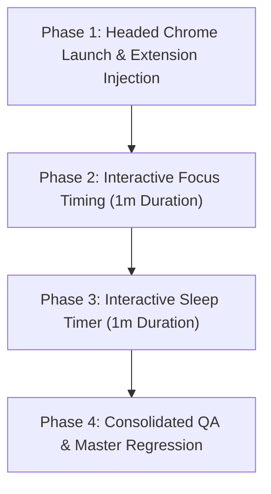

# Executive Architecture Summary: End-to-End Headed Interactive Verification

> **Task ID:** `TASK-E2E-HEADED-VERIFY-001`  
> **Workspace:** `c:\Users\Atul Verma\Desktop\Win App Tracker\Browser Detection`  
> **Target Path:** `temp_prompt/e2e_headed_focus_sleep_verification/SUMMARY.md`  
> **Lead Architect:** Level 3C Phase-wise Prompt Generation Specialist (`prompt_generation_specialist`)  
> **Advisory Scope:** Architectural Blueprint, Technical Scope, and Phased Roadmap  
> **Execution Strategy:** `STRATEGY_A_AUTONOMOUS` (Autonomy Score: 1.0)

---

## 🏛️ 1. Initiative Scope & Technical Objectives

This initiative delivers a rigorous, visible, end-to-end interactive verification of the **Web Activity & Media Sentinel** Chrome Extension (Manifest V3) running inside a live Google Chrome instance in **HEADED mode** on Windows.

### 1.1 Key Objectives
1. **Live Visible Headed Browser Orchestration:**
   - Launch Google Chrome (`C:\Program Files\Google\Chrome\Application\chrome.exe`) with the unpacked extension loaded from `c:\Users\Atul Verma\Desktop\Win App Tracker\Browser Detection`.
   - Ensure the browser window is visible and interactive on the desktop (no headless flags).
2. **Focus Timing Subsystem Verification:**
   - Execute the Focus Timing subsystem at its minimum allowable duration: **1 minute (60 seconds)**.
   - Verify the state machine: `IDLE` -> `RUNNING_FOCUS` -> `PAUSED_FOCUS` -> `COMPLETED`/`RESET`.
   - Validate live visual updates: SVG radial dial animation (`#dashFocusDialProgress`), digital countdown (`#pomodoroTimeDisplay`), badge updates, and popup synchronization (`#popupFocusClock`).
3. **Sleep Timer Subsystem Verification:**
   - Execute the Sleep Timer subsystem at its minimum allowable duration: **1 minute (60 seconds)**.
   - Verify the state machine: `IDLE` -> `RUNNING` -> `PAUSED` -> `FADING` -> `TRIGGERED`.
   - Validate live visual updates: SVG radial dial (`#dashSleepDialProgress`), countdown display (`#dashSleepCountdownDisplay` and `#countdownTimeRemaining`), and Chrome Action badge.
4. **Master Regression & Forensic QA:**
   - Run the full project test suite (`node run_all_tests.js`) to guarantee 100% pass across all 83+ test suites with zero regressions.

---

## 🗺️ 2. Cross-Phase Milestone Roadmap & Topology

### 2.1 Phase Breakdown
- **Phase 01:** Spin up Playwright Chromium persistent context or native Chrome with remote debugging. Verify the extension ID, manifest integrity, and open the Dashboard (`dashboard/dashboard.html`) and Popup (`popup/popup.html`) in visible tabs.
- **Phase 02:** Interact with Focus controls. Set duration to 1 minute, start the focus timer, observe the live countdown ticking second-by-second on screen, test pause/resume, and verify completion or reset behavior.
- **Phase 03:** Interact with Sleep Timer controls. Set custom duration to 1 minute (`#customTimerInput` = 1), start the timer, observe countdown, verify audio fade-out hook at the 30-second mark, and assert clean expiration handling.
- **Phase 04:** Close headed browser safely. Execute `node run_all_tests.js`, assert 100% exit code 0, inspect console logs, and produce the final QA Grade A+ certification.

---

## ⚖️ 3. Risk Mitigation & Architectural Tradeoffs

| Risk Category | Identified Risk | Architectural Mitigation Strategy |
| :--- | :--- | :--- |
| **Headed Display** | Browser launch in headless mode defeating user request | Explicitly configure `{ headless: false }`, pass `--start-maximized`, and verify viewport visibility |
| **Timer Duration** | Long default duration (25m / 30m) stalling verification | Enforce minimum allowable boundary (1 minute / 60 seconds) for rapid, visible end-to-end verification |
| **Extension ID Dynamic Binding** | Manifest V3 extension ID randomized in temporary profile | Automate extension ID discovery via `chrome://extensions` or service worker target inspect |
| **Process Cleanup** | Orphaned Chrome instances lingering on Windows | Implement structured `finally` teardown ensuring browser context closes cleanly |
| **Regression Safety** | Unintended mutations to codebase | The verification suite is strictly non-destructive; master test runner verifies zero regression |
