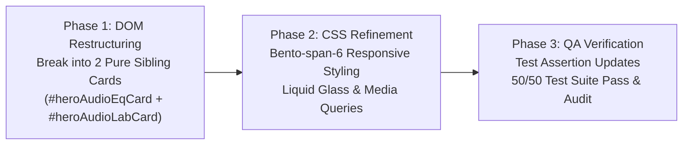

# 5-Band Equalizer & Audio Lab: Pure Separate Split Containers Executive Summary

> **Document Type:** Executive Architecture Summary & Strategy Recommendation  
> **Workspace Container:** `temp_prompt/equalizer_pure_split_containers/`  
> **Governing Architecture:** [`PHASE_WISE_PROMPT_GENERATION_ARCHITECTURE.md`](file:///C:/Users/Atul%20Verma/.gemini/config/rules/PHASE_WISE_PROMPT_GENERATION_ARCHITECTURE.md)  
> **Author:** Level 3C Phase-wise Prompt Generation Specialist (`prompt_generation_specialist`)  
> **Date:** 2026-11-17  
> **Target Task ID:** `TASK-EQ-PURE-SPLIT-CONTAINERS-001`

---

## 🎯 1. High-Level Scope & Technical Objectives

This initiative directly addresses user feedback requiring complete physical and visual container separation of the **5-Band Graphic Equalizer** and the **Audio Lab & DSP Enhancements** in Tab B (Media Analytics) of the Web Activity & Media Sentinel extension dashboard.

### Core Objectives
1. **Dismantle Single Monolithic Wrapper:** Eliminate the single parent `#heroAudioEqCard` enclosing `.audio-eq-split-deck` that merely divided the components internally.
2. **Establish Two Pure Sibling Bento Containers:**
   - **Container 1:** `#heroAudioEqCard` (`.audio-eq-widget .bento-card .liquid-glass-card .bento-span-6`) dedicated exclusively to the 5-Band Graphic Equalizer.
   - **Container 2:** `#heroAudioLabCard` (`.audio-lab-widget .bento-card .liquid-glass-card .bento-span-6`) dedicated exclusively to the Audio Lab & DSP Enhancements.
3. **Responsive Side-by-Side Bento Grid:**
   - On desktop screens (>1024px): The two sibling containers sit side-by-side in the 12-column Bento grid, each spanning 6 columns (`bento-span-6`).
   - On tablet/mobile screens (<=1024px): Responsive CSS cleanly reflows both containers into full-width cards (`bento-span-12`), stacked vertically.
4. **Preserve 100% Behavioral & Test Parity:**
   - Retain all 18 DOM IDs and event bindings across `dashboard.js`.
   - Maintain 100% W3C Trusted Types compliance (zero innerHTML/outerHTML).
   - Maintain bilingual i18n localization keys in `DASHBOARD_UIUX_I18N`.
   - Update assertions in existing test files and pass all 50 test suites cleanly.

---

## 🗺️ 2. Cross-Phase Milestone Roadmap & Dependency Topology

### Dependency Chain
- **Phase 1 (DOM Restructuring):** Precondition for Phase 2. Moves the markup of Equalizer and Audio Lab into two top-level sibling `
` elements directly under the Bento grid.
- **Phase 2 (CSS Refinement):** Depends on Phase 1 DOM structure. Removes obsolete `.audio-eq-split-deck` internal styles and applies robust `.bento-span-6` grid styling with media queries for seamless responsiveness.
- **Phase 3 (QA Verification):** Depends on Phase 1 & 2 completion. Adjusts test assertions that previously looked for `.audio-eq-split-deck` or single-card `bento-span-12`, verifies both sibling cards, and executes the entire 50-suite test battery.

---

## 🧭 3. Execution Strategy Assessment & Recommendation

### Recommendation: Strategy A (Fully Autonomous Phase-wise Execution)
- **Selected Strategy:** `STRATEGY_A_AUTONOMOUS`
- **Autonomy Score:** `1.0`
- **Rationale:**
  1. **Zero Requirement Ambiguity:** The user's Hindi feedback explicitly and unambiguously specified the exact architectural requirement: *"तुमने इसे सिर्फ़ डिवाइड कर दिया है, स्प्लिट नहीं किया है... दो सेपरेट अलग-अलग पार्ट होने चाहिए, मतलब कंटेनर होने चाहिए, डिव होने चाहिए। एक ही में दो अलग-अलग पार्ट नहीं होने चाहिए, तो अलग-अलग प्योर सेपरेट होने चाहिए।"*
  2. **Standardized Technical Pattern:** Transforming a single container with a 2-column internal split into two separate sibling `bento-span-6` cards is a well-established, canonical pattern in the existing Bento grid layout of `dashboard.html`.
  3. **Low Blast Radius:** Scope is strictly confined to `dashboard/dashboard.html`, `dashboard/dashboard.css`, and test assertions. Zero backend or API surface changes.
  4. **Deterministic Quality Gates:** Each phase is backed by automated deterministic test commands (`node -c`, DOM queries, `node run_all_tests.js`).

---

## 🛡️ 4. Risk Analysis & Trade-Off Matrix

| Risk Factor | Impact | Mitigation Strategy |
| :--- | :--- | :--- |
| **Grid Alignment & Height Mismatch** | Medium | Use `align-self: stretch` or Flexbox column layout inside both cards so both cards achieve equal visual height and clean vertical rhythm side-by-side. |
| **Broken Test Assertions** | Medium | Phase 3 specifically targets tests expecting `.audio-eq-split-deck` or `bento-span-12` on `#heroAudioEqCard`, updating them to assert two distinct sibling containers with `bento-span-6`. |
| **Missing DOM IDs** | High | Strict invariant checklist enforces that all 18 DOM IDs are preserved without alteration. |
| **CSP / Trusted Types Violation** | Critical | Strict prohibition against `.innerHTML` or `.outerHTML`. Direct structural HTML editing in `dashboard.html` only. |
| **UTF-8 BOM Corruption** | Critical | All file write/edit operations preserve `0xEF, 0xBB, 0xBF` BOM signature. |
