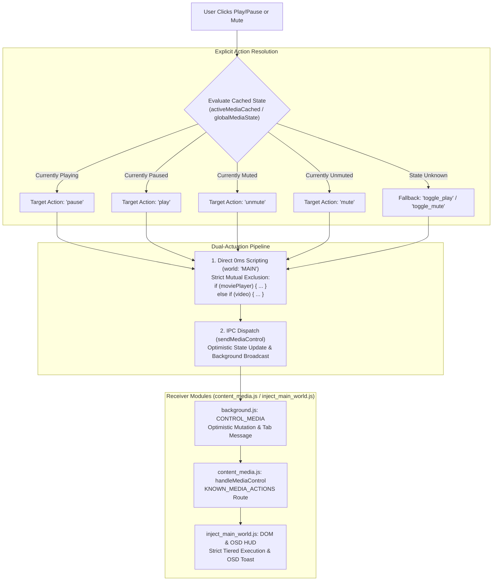
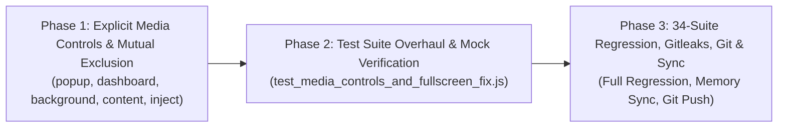

# Executive Architecture Summary
## Explicit Idempotent State & Strict Mutual Exclusion Media Controls

> **Initiative:** Web Activity & Media Sentinel (MV3)  
> **Task ID:** `TASK-IDEMPOTENT-MEDIA-CONTROLS-001`  
> **Target Workspace:** [`c:\Users\Atul Verma\Desktop\Win App Tracker\Browser Detection`](file:///c:/Users/Atul%20Verma/Desktop/Win%20App%20Tracker/Browser%20Detection)  
> **Lead Architect:** Level 3C Phase-wise Prompt Generation Specialist (`prompt_generation_specialist`)  
> **Standard:** [`PHASE_WISE_PROMPT_GENERATION_ARCHITECTURE.md`](file:///C:/Users/Atul%20Verma/.gemini/config/rules/PHASE_WISE_PROMPT_GENERATION_ARCHITECTURE.md)  

---

## 🏛️ 1. Architecture Overview & High-Level Scope

The Web Activity & Media Sentinel browser extension provides real-time media detection and control across all open tabs, bridging modern web applications (including YouTube, Netflix, Spotify, and generic HTML5 media) with a local Windows Activity Tracker HUD.

While media controls operate via a high-performance dual-actuation pattern (0ms direct `world: 'MAIN'` scripting combined with background IPC synchronization), this initiative resolves two critical system vulnerabilities:
1. **Ambiguous Toggle Semantics:** Replacing blind `toggle_play` and `toggle_mute` commands with explicit, idempotent `play`, `pause`, `mute`, and `unmute` commands derived from observed state, preventing state desynchronization and unintended state flipping.
2. **Double-Actuation Inversion:** Enforcing strict `else if (video)` mutual exclusion between YouTube's `#movie_player` API and standard HTML5 `<video>` elements in injected execution scripts, preventing dual-trigger race conditions on YouTube.

---

## 🗺️ 2. Milestone Roadmap & Dependency Topology

### Milestone Specifications
- **Milestone 1 (Phase 1): Full Pipeline Idempotent Media Control**
  - All 5 extension files updated to natively support explicit actions (`play`, `pause`, `mute`, `unmute`) and legacy toggles (`toggle_play`, `toggle_mute`).
  - Strict `else if (video)` mutual exclusion enforced in all MAIN-world execution snippets.
  - `#btnGlobalMediaToggle` preserved 100% untouched.
  - Cooldown timestamps (`lastPlayToggleTime`, `lastMuteToggleTime`, etc.) preserved.
- **Milestone 2 (Phase 2): Automated Verification Suite Modernization**
  - `tests/test_media_controls_and_fullscreen_fix.js` overhauled to assert explicit command routing, strict mutual exclusion, and simulated dual-actuation mocks.
  - Local test gate exit code 0 achieved.
- **Milestone 3 (Phase 3): Enterprise Regression & Hardening**
  - Full workspace regression: all 34 core test suites pass 100%.
  - Zero gitleaks detected across repository history.
  - `memory.md` updated with completed milestone.
  - Autonomous Git micro-commit and push certified per Universal Rule 15.

---

## 🔒 3. Invariant Bounds & Architectural Guardrails

1. **Global Media Invariant Guard (`#btnGlobalMediaToggle`):**
   - The universal Play/Pause button in `popup/popup.js` (`#btnGlobalMediaToggle`, lines ~3194–3207) controls multi-tab global media across all browser tabs via `TOGGLE_GLOBAL_MEDIA`.
   - **STRICT PROHIBITION:** Under no circumstances may `#btnGlobalMediaToggle` be merged, renamed, or modified to use single-tab explicit controls. It must remain 100% frozen.
2. **Optimistic Cooldown Lock Invariant:**
   - Cooldown timestamps (`lastPlayToggleTime`, `lastMuteToggleTime`, `lastSpeedChangeTime`, `lastControlsRowActiveTime`) and the 800ms suppression guard in `renderMediaCard` must remain strictly intact to suppress UI bounce-back flicker while asynchronous DOM events settle.
3. **W3C Trusted Types & Sandboxing Standard:**
   - Zero `innerHTML` assignments in any injected script (`content_media.js`, `inject_main_world.js`, `fullscreen_controller.js`).
   - Clean AST parsing via `node -c` and `vm.Script` with 0 syntax errors.
4. **Backward Compatibility Guarantee:**
   - External callers, keyboard shortcuts, or background automations sending `toggle_play` or `toggle_mute` must continue to execute flawlessly without regressions.

---

## ⚖️ 4. Tradeoff Analysis & Risk Mitigation Matrix

| Architectural Dimension | Chosen Design | Rejected Alternative | Tradeoff & Mitigation |
| :--- | :--- | :--- | :--- |
| **Command Semantics** | Explicit idempotent actions (`play`, `pause`, `mute`, `unmute`) with fallback to toggles when state is unknown. | Blindly keeping `toggle_play` / `toggle_mute` everywhere. | Minor branching overhead in UI handlers is heavily outweighed by zero desynchronization risk and zero unintended state reversals. |
| **Player Mutual Exclusion** | Strict `if (moviePlayer) { ... } else if (video) { ... }` in all injected scripts. | Sequential `if (moviePlayer)` followed by `if (video)`. | Eliminates double-actuation on YouTube completely; fallback to `video` remains instant for non-YouTube pages. |
| **Mute Action Surface** | Adding explicit `mute` and `unmute` to `KNOWN_MEDIA_ACTIONS`, `handleMediaControl`, `background.js`, and `inject_main_world.js`. | Only handling mute inversion in the UI. | Full-stack support ensures IPC router, content script, background tracker, and OSD HUD reflect exact state consistently. |
| **Execution Autonomy** | `STRATEGY_A_AUTONOMOUS` (Autonomy Score: 1.0). | Human consultation at every phase (`STRATEGY_C`). | Tasks are strictly deterministic with comprehensive unit test coverage; intermediate pauses would introduce unnecessary friction. |
