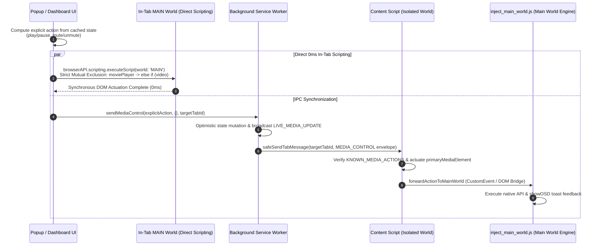

# Technical Requirements Document (TRD)
## Explicit Idempotent State & Strict Mutual Exclusion Media Controls

> **Initiative:** Web Activity & Media Sentinel (MV3)  
> **Document Status:** Authoritative Engineering Specification  
> **Task ID:** `TASK-IDEMPOTENT-MEDIA-CONTROLS-001`  
> **Target Workspace:** [`c:\Users\Atul Verma\Desktop\Win App Tracker\Browser Detection`](file:///c:/Users/Atul%20Verma/Desktop/Win%20App%20Tracker/Browser%20Detection)  
> **Lead Architect:** Level 3C Phase-wise Prompt Generation Specialist (`prompt_generation_specialist`)  

---

## 🏗️ 1. High-Level Architecture (HLA)

The media control pipeline operates across 4 distinct execution environments in Google Chrome MV3:
1. **Extension UI Context (`popup/popup.js` / `dashboard/dashboard.js`):** Interacts with the user, calculates explicit target states, triggers direct 0ms MAIN-world scripting for immediate DOM actuation, and dispatches IPC envelopes to background.
2. **Extension Service Worker (`background.js`):** Maintains global and per-tab media state tables (`tabMediaMap`, `globalMedia`), performs optimistic state mutations, dispatches commands to target tabs, and sends telemetry to the external Windows Activity Tracker HUD over WebSocket.
3. **Isolated World Content Script (`content_media.js`):** Intercepts IPC messages from background, validates them against `KNOWN_MEDIA_ACTIONS`, applies fallback DOM manipulation on `primaryMediaElement`, and relays actions to the page's MAIN world.
4. **Main World Injected Execution Engine (`inject_main_world.js`):** Interacts directly with the page's JavaScript execution context, calling YouTube's native `#movie_player` API and displaying visual OSD toasts over the video viewport.



---

## 💻 2. Low-Level Design (LLD) & Code Specifications

### 2.1 `popup/popup.js` Code Transformation

#### Problem Area: `handleTogglePlay` (lines ~3356–3397)
Current implementation always dispatches `'toggle_play'` and executes `if (video)` immediately after `if (moviePlayer)`, causing YouTube double-actuation.

#### Refactored Implementation:
```javascript
  // Media Controls: Explicit Idempotent Play/Pause with Strict Mutual Exclusion
  const handleTogglePlay = () => {
    lastPlayToggleTime = Date.now();
    let targetAction = 'toggle_play';
    if (activeMediaCached) {
      // Determine explicit idempotent target state
      const isCurrentlyPlaying = Boolean(activeMediaCached.isPlaying || activeMediaCached.state === 'playing');
      const targetPlaying = !isCurrentlyPlaying;
      targetAction = targetPlaying ? 'play' : 'pause';
      activeMediaCached.isPlaying = targetPlaying;
      activeMediaCached.state = targetPlaying ? 'playing' : 'paused';
      renderMediaCard({ primaryMedia: activeMediaCached });
    }
    const targetTabId = getActiveMediaTabId();

    if (browserAPI.scripting && typeof browserAPI.scripting.executeScript === 'function' && targetTabId) {
      browserAPI.scripting.executeScript({
        target: { tabId: targetTabId },
        world: 'MAIN',
        args: [targetAction],
        func: (action) => {
          const moviePlayer = document.getElementById('movie_player') || window.movie_player;
          const video = Array.from(document.querySelectorAll('video')).find(v => !v.paused) || document.querySelector('video');
          if (moviePlayer && (typeof moviePlayer.getPlayerState === 'function' || typeof moviePlayer.playVideo === 'function')) {
            try {
              if (action === 'play') {
                if (typeof moviePlayer.playVideo === 'function') moviePlayer.playVideo();
              } else if (action === 'pause') {
                if (typeof moviePlayer.pauseVideo === 'function') moviePlayer.pauseVideo();
              } else {
                const state = typeof moviePlayer.getPlayerState === 'function' ? moviePlayer.getPlayerState() : -1;
                if (state === 1) {
                  if (typeof moviePlayer.pauseVideo === 'function') moviePlayer.pauseVideo();
                } else {
                  if (typeof moviePlayer.playVideo === 'function') moviePlayer.playVideo();
                }
              }
            } catch (_) {}
          } else if (video) {
            // Strict 'else if' mutual exclusion ensures video is NOT touched when moviePlayer is present
            try {
              if (action === 'play') {
                const p = video.play();
                if (p && typeof p.catch === 'function') p.catch(() => {});
              } else if (action === 'pause') {
                video.pause();
              } else {
                if (video.paused) {
                  const p = video.play();
                  if (p && typeof p.catch === 'function') p.catch(() => {});
                } else {
                  video.pause();
                }
              }
            } catch (_) {}
          }
        }
      }).catch(() => {});
    }

    sendMediaControl(targetAction, {}, targetTabId);
  };
```

#### Problem Area: `handleToggleMute` (lines ~3480–3512)
Current implementation always dispatches generic `'toggle_mute'`.

#### Refactored Implementation:
```javascript
  // Media Controls: Explicit Idempotent Mute/Unmute with Strict Mutual Exclusion
  const handleToggleMute = () => {
    lastMuteToggleTime = Date.now();
    let targetAction = 'toggle_mute';
    if (activeMediaCached) {
      const isCurrentlyMuted = Boolean(activeMediaCached.isMuted);
      const targetMuted = !isCurrentlyMuted;
      targetAction = targetMuted ? 'mute' : 'unmute';
      activeMediaCached.isMuted = targetMuted;
      renderMediaCard({ primaryMedia: activeMediaCached });
    }
    const targetTabId = getActiveMediaTabId();

    if (browserAPI.scripting && typeof browserAPI.scripting.executeScript === 'function' && targetTabId) {
      browserAPI.scripting.executeScript({
        target: { tabId: targetTabId },
        world: 'MAIN',
        args: [targetAction],
        func: (action) => {
          const moviePlayer = document.getElementById('movie_player') || window.movie_player;
          const video = Array.from(document.querySelectorAll('video')).find(v => !v.paused) || document.querySelector('video');
          if (moviePlayer && (typeof moviePlayer.isMuted === 'function' || typeof moviePlayer.mute === 'function')) {
            try {
              if (action === 'mute') {
                if (typeof moviePlayer.mute === 'function') moviePlayer.mute();
              } else if (action === 'unmute') {
                if (typeof moviePlayer.unMute === 'function') moviePlayer.unMute();
              } else {
                if (typeof moviePlayer.isMuted === 'function' && moviePlayer.isMuted()) {
                  if (typeof moviePlayer.unMute === 'function') moviePlayer.unMute();
                } else {
                  if (typeof moviePlayer.mute === 'function') moviePlayer.mute();
                }
              }
            } catch (_) {}
          } else if (video) {
            // Strict 'else if' mutual exclusion
            try {
              if (action === 'mute') {
                video.muted = true;
              } else if (action === 'unmute') {
                video.muted = false;
              } else {
                video.muted = !video.muted;
              }
            } catch (_) {}
          }
        }
      }).catch(() => {});
    }

    sendMediaControl(targetAction, {}, targetTabId);
  };
```

---

### 2.2 `dashboard/dashboard.js` Code Transformation

#### Problem Area: `handleTogglePlayHero` & `btnHeroMute` (lines ~4615–4698)
Missing `moviePlayer` support with mutual exclusion, and dispatches generic toggles.

#### Refactored Implementation:
```javascript
  const handleTogglePlayHero = () => {
    const pm = dashboardData && dashboardData.globalMediaState && dashboardData.globalMediaState.primaryMedia;
    const targetTabId = (pm && pm.tabId) ? pm.tabId : undefined;
    let targetAction = 'toggle_play';
    if (pm) {
      const isCurrentlyPlaying = Boolean(pm.isPlaying || pm.state === 'playing');
      const targetPlaying = !isCurrentlyPlaying;
      targetAction = targetPlaying ? 'play' : 'pause';
      pm.isPlaying = targetPlaying;
      pm.state = targetPlaying ? 'playing' : 'paused';
    }

    if (browserAPI.scripting && typeof browserAPI.scripting.executeScript === 'function' && targetTabId) {
      browserAPI.scripting.executeScript({
        target: { tabId: targetTabId },
        world: 'MAIN',
        args: [targetAction],
        func: (action) => {
          const moviePlayer = document.getElementById('movie_player') || window.movie_player;
          const video = Array.from(document.querySelectorAll('video')).find(v => !v.paused) || document.querySelector('video');
          if (moviePlayer && (typeof moviePlayer.getPlayerState === 'function' || typeof moviePlayer.playVideo === 'function')) {
            try {
              if (action === 'play') {
                if (typeof moviePlayer.playVideo === 'function') moviePlayer.playVideo();
              } else if (action === 'pause') {
                if (typeof moviePlayer.pauseVideo === 'function') moviePlayer.pauseVideo();
              } else {
                const state = typeof moviePlayer.getPlayerState === 'function' ? moviePlayer.getPlayerState() : -1;
                if (state === 1) {
                  if (typeof moviePlayer.pauseVideo === 'function') moviePlayer.pauseVideo();
                } else {
                  if (typeof moviePlayer.playVideo === 'function') moviePlayer.playVideo();
                }
              }
            } catch (_) {}
          } else if (video) {
            try {
              if (action === 'play') {
                const p = video.play();
                if (p && typeof p.catch === 'function') p.catch(() => {});
              } else if (action === 'pause') {
                video.pause();
              } else {
                if (video.paused) {
                  const p = video.play();
                  if (p && typeof p.catch === 'function') p.catch(() => {});
                } else {
                  video.pause();
                }
              }
            } catch (_) {}
          }
        }
      }).catch(() => {});
    }
    sendMediaControl(targetAction, {}, targetTabId);
  };
```

And similarly for `btnHeroMute`:
```javascript
  const btnHeroMute = document.getElementById('btnHeroMute');
  if (btnHeroMute) {
    btnHeroMute.addEventListener('click', () => {
      const pm = dashboardData && dashboardData.globalMediaState && dashboardData.globalMediaState.primaryMedia;
      const targetTabId = (pm && pm.tabId) ? pm.tabId : undefined;
      let targetAction = 'toggle_mute';
      if (pm) {
        const isCurrentlyMuted = Boolean(pm.isMuted);
        const targetMuted = !isCurrentlyMuted;
        targetAction = targetMuted ? 'mute' : 'unmute';
        pm.isMuted = targetMuted;
      }

      if (browserAPI.scripting && typeof browserAPI.scripting.executeScript === 'function' && targetTabId) {
        browserAPI.scripting.executeScript({
          target: { tabId: targetTabId },
          world: 'MAIN',
          args: [targetAction],
          func: (action) => {
            const moviePlayer = document.getElementById('movie_player') || window.movie_player;
            const video = Array.from(document.querySelectorAll('video')).find(v => !v.paused) || document.querySelector('video');
            if (moviePlayer && (typeof moviePlayer.isMuted === 'function' || typeof moviePlayer.mute === 'function')) {
              try {
                if (action === 'mute') {
                  if (typeof moviePlayer.mute === 'function') moviePlayer.mute();
                } else if (action === 'unmute') {
                  if (typeof moviePlayer.unMute === 'function') moviePlayer.unMute();
                } else {
                  if (typeof moviePlayer.isMuted === 'function' && moviePlayer.isMuted()) {
                    if (typeof moviePlayer.unMute === 'function') moviePlayer.unMute();
                  } else {
                    if (typeof moviePlayer.mute === 'function') moviePlayer.mute();
                  }
                }
              } catch (_) {}
            } else if (video) {
              try {
                if (action === 'mute') {
                  video.muted = true;
                } else if (action === 'unmute') {
                  video.muted = false;
                } else {
                  video.muted = !video.muted;
                }
              } catch (_) {}
            }
          }
        }).catch(() => {});
      }
      sendMediaControl(targetAction, {}, targetTabId);
    });
  }
```

---

### 2.3 `background.js` Code Transformation

#### Problem Area: `CONTROL_MEDIA` handler (lines ~2820–2840)
Lacks optimistic state handling for explicit `mute` and `unmute` actions.

#### Refactored Implementation:
```javascript
      if (tabMedia && tabMedia.primaryMedia) {
        const pm = tabMedia.primaryMedia;
        if (message.action === 'toggle_play') {
          pm.isPlaying = !pm.isPlaying;
          pm.state = pm.isPlaying ? 'playing' : 'paused';
          tabMedia.anyPlaying = pm.isPlaying;
          if (session) session.isPlaying = pm.isPlaying;
        } else if (message.action === 'play') {
          pm.isPlaying = true;
          pm.state = 'playing';
          tabMedia.anyPlaying = true;
          if (session) session.isPlaying = true;
        } else if (message.action === 'pause') {
          pm.isPlaying = false;
          pm.state = 'paused';
          tabMedia.anyPlaying = false;
          if (session) session.isPlaying = false;
        } else if (message.action === 'toggle_mute') {
          pm.isMuted = !pm.isMuted;
        } else if (message.action === 'mute') {
          pm.isMuted = true;
        } else if (message.action === 'unmute') {
          pm.isMuted = false;
        } else if (message.action === 'step_speed' || message.action === 'set_speed') {
```

---

### 2.4 `content_media.js` Code Transformation

#### Problem Area 1: `KNOWN_MEDIA_ACTIONS` array (line ~2288)
Add `'mute'` and `'unmute'` to the list:
```javascript
    const KNOWN_MEDIA_ACTIONS = [
      'play', 'pause', 'toggle_play', 'seek_relative', 'seek_percent',
      'toggle_mute', 'mute', 'unmute', 'set_volume', 'SET_VOLUME', 'step_speed', 'set_speed',
      'cycle_speed', 'toggle_fullscreen', 'toggle_pip', 'toggle_theater',
      'step_quality', 'set_quality'
    ];
```

#### Problem Area 2: `handleMediaControl` switch (lines ~1880–1915)
Add `case 'mute':` and `case 'unmute':`:
```javascript
          case 'toggle_mute': {
            primaryMediaElement.muted = !primaryMediaElement.muted;
            break;
          }
          case 'mute': {
            primaryMediaElement.muted = true;
            break;
          }
          case 'unmute': {
            primaryMediaElement.muted = false;
            break;
          }
```

---

### 2.5 `inject_main_world.js` Code Transformation

#### Problem Area 1: Command Router Mute cases (lines ~635–658)
Add explicit `case 'mute':` and `case 'unmute':`:
```javascript
      case 'mute': {
        if (moviePlayer && typeof moviePlayer.mute === 'function') {
          try { moviePlayer.mute(); } catch (_) {}
        } else if (video) {
          try { video.muted = true; } catch (_) {}
        }
        showOSD('Muted', '🔇');
        break;
      }

      case 'unmute': {
        if (moviePlayer && typeof moviePlayer.unMute === 'function') {
          try { moviePlayer.unMute(); } catch (_) {}
        } else if (video) {
          try { video.muted = false; } catch (_) {}
        }
        showOSD('Unmuted', '🔊');
        break;
      }

      case 'toggle_mute': {
        let isNowMuted = false;
        if (moviePlayer && typeof moviePlayer.isMuted === 'function') {
          try {
            if (moviePlayer.isMuted()) {
              if (typeof moviePlayer.unMute === 'function') moviePlayer.unMute();
              isNowMuted = false;
            } else {
              if (typeof moviePlayer.mute === 'function') moviePlayer.mute();
              isNowMuted = true;
            }
          } catch (_) {}
        } else if (video) {
          try {
            video.muted = !video.muted;
            isNowMuted = video.muted;
          } catch (_) {}
        }

        showOSD(isNowMuted ? 'Muted' : 'Unmuted', isNowMuted ? '🔇' : '🔊');
        break;
      }
```

#### Problem Area 2: Play/Pause short-circuiting (lines ~860–925)
Ensure `isHandled` properly short-circuits so fallback tiers never re-actuate:
```javascript
      case 'play': {
        let isHandled = false;
        // Tier 1: YouTube moviePlayer
        if (moviePlayer && typeof moviePlayer.playVideo === 'function') {
          try {
            moviePlayer.playVideo();
            isHandled = true;
          } catch (_) {}
        }
        // Tier 2: YouTube play button (only if not handled)
        if (!isHandled) {
          const ytPlayBtn = document.querySelector('.ytp-play-button');
          if (ytPlayBtn) {
            const label = (ytPlayBtn.getAttribute('data-title-no-tooltip') || ytPlayBtn.getAttribute('aria-label') || '').toLowerCase();
            if (label.includes('play') || !label.includes('pause')) {
              try { ytPlayBtn.click(); isHandled = true; } catch (_) {}
            }
          }
        }
        // Tier 3: Standard HTML5 video (only if not handled)
        if (!isHandled && video) {
          try {
            const p = video.play();
            if (p && typeof p.catch === 'function') p.catch(() => {});
            isHandled = true;
          } catch (_) {}
        }
        showOSD('Playing', '▶️');
        break;
      }

      case 'pause': {
        let isHandled = false;
        // Tier 1: YouTube moviePlayer
        if (moviePlayer && typeof moviePlayer.pauseVideo === 'function') {
          try {
            moviePlayer.pauseVideo();
            isHandled = true;
          } catch (_) {}
        }
        // Tier 2: YouTube pause button (only if not handled)
        if (!isHandled) {
          const ytPlayBtn = document.querySelector('.ytp-play-button');
          if (ytPlayBtn) {
            const label = (ytPlayBtn.getAttribute('data-title-no-tooltip') || ytPlayBtn.getAttribute('aria-label') || '').toLowerCase();
            if (label.includes('pause') || !label.includes('play')) {
              try { ytPlayBtn.click(); isHandled = true; } catch (_) {}
            }
          }
        }
        // Tier 3: Standard HTML5 video (only if not handled)
        if (!isHandled && video) {
          try {
            video.pause();
            isHandled = true;
          } catch (_) {}
        }
        showOSD('Paused', '⏸️');
        break;
      }
```

---

## 🔒 3. Idempotency Proof & State Transition Table

| Starting Media State | Incoming Action | Target Media State | Idempotency Verification |
| :--- | :--- | :--- | :--- |
| `paused` | `play` | `playing` | State transitions to playing. |
| `playing` | `play` | `playing` | **No-op / Safe re-affirmation.** Stays playing; no double-toggle. |
| `playing` | `pause` | `paused` | State transitions to paused. |
| `paused` | `pause` | `paused` | **No-op / Safe re-affirmation.** Stays paused; no audio restart. |
| `unmuted` | `mute` | `muted` | Audio silenced; `muted = true`. |
| `muted` | `mute` | `muted` | **No-op / Safe re-affirmation.** Stays muted; volume preserved. |
| `muted` | `unmute` | `unmuted` | Audio restored; `muted = false`. |
| `unmuted` | `unmute` | `unmuted` | **No-op / Safe re-affirmation.** Stays unmuted. |
| `playing` | `toggle_play` | `paused` | Inverts playing to paused (backward compatible). |
| `paused` | `toggle_play` | `playing` | Inverts paused to playing (backward compatible). |
| `unmuted` | `toggle_mute` | `muted` | Inverts unmuted to muted (backward compatible). |
| `muted` | `toggle_mute` | `unmuted` | Inverts muted to unmuted (backward compatible). |

---

## 🛡️ 4. Security & Error Budget

- **Context Validation:** `isExtensionContextValid()` is called before dispatching runtime messages.
- **Promise Rejection Guards:** All `.play()` and `.executeScript()` promises attach `.catch(() => {})` handlers to prevent unhandled rejection crashes when autoplay is blocked by Chrome policy.
- **Resource Constraints:** Injected script functions execute in under 1ms, well below the 16.6ms 60fps frame budget.
