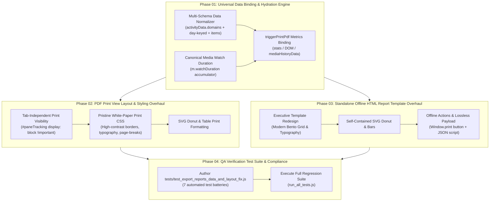

# Executive Architecture Summary: Export Reports Data Population & Layout Fix

> **Initiative:** Web Activity & Media Sentinel - Report Export System Hardening  
> **Container:** `temp_prompt/export_reports_data_and_layout_fix/`  
> **Task ID:** `TASK-EXPORT-REPORTS-DATA-LAYOUT-FIX-001`  
> **Author:** Level 3C Phase-wise Prompt Generation Specialist (`prompt_generation_specialist`)  
> **Governing Framework:** [`PHASE_WISE_PROMPT_GENERATION_ARCHITECTURE.md`](file:///C:/Users/Atul%20Verma/.gemini/config/rules/PHASE_WISE_PROMPT_GENERATION_ARCHITECTURE.md)  

---

## 🎯 1. High-Level Initiative Scope & Objectives

The primary objective of `TASK-EXPORT-REPORTS-DATA-LAYOUT-FIX-001` is to resolve critical data hydration and visual layout defects in both report export pipelines of the Web Activity & Media Sentinel dashboard:
1. **"Save PDF" (triggerPrintPdf / @media print Executive View):**
   - Eliminate blank placeholder metrics (`0h 00m`, `--`, `0h 00m`) by binding real computed metrics from active dashboard memory (`stats`, DOM KPI cards, `lastCalculatedProductivityScore`, and `mediaHistoryData`).
   - Guarantee tab-independent print rendering so that triggering print from the Settings tab or Topbar export menu forces `#paneTracking` to render in print.
   - Refactor `@media print` CSS for pristine white-paper layout: high-contrast typography, border-defined cards, clean donut chart, formatted data table, and strict page-break avoidance (`page-break-inside: avoid;`).
2. **"Offline HTML Report" (downloadStandaloneHtmlDigest / Standalone Template):**
   - Replace rigid legacy day-keyed schema parsing with a universal multi-schema data normalizer that seamlessly ingests modern `activityData.domains`, day-keyed historical snapshots, and pre-computed `items` arrays.
   - Correct media duration aggregation by reading canonical `m.watchDuration`.
   - Overhaul the standalone HTML template into an ultra-premium, self-contained, 100% offline executive digest featuring responsive KPI tiles, SVG proportional donut chart, top distribution progress bars, categorized domain table, and an embedded "Print / Save PDF" utility button.
3. **Automated QA Verification:**
   - Deliver a dedicated 7-battery automated test suite guaranteeing multi-schema normalization, zero NaN or blank fallback values, valid HTML5 output, zero external network calls, and Universal Rule 28 code modularity compliance.

---

## 🗺️ 2. Cross-Phase Milestone Roadmap & Dependency Topology

### Dependency Chain:
- **Phase 01** provides the core multi-schema data normalization engine and data hydration helpers. Both Phase 02 and Phase 03 depend on Phase 01 to receive clean, non-zero telemetry datasets.
- **Phase 02** refines the `@media print` stylesheet and DOM print header in the dashboard context.
- **Phase 03** refines the standalone single-file HTML report template generated by `backup_hub_digest_feature.js`.
- **Phase 04** executes end-to-end unit, integration, and security test batteries against deliverables from Phases 01, 02, and 03.

---

## ⚖️ 3. Execution Strategy Assessment

In accordance with Section 5 of [`PHASE_WISE_PROMPT_GENERATION_ARCHITECTURE.md`](file:///C:/Users/Atul%20Verma/.gemini/config/rules/PHASE_WISE_PROMPT_GENERATION_ARCHITECTURE.md), the implementation scope is evaluated against the three standard execution strategies:

| Strategy | Feasibility & Fit | Tradeoff Analysis | Autonomy Score |
| :--- | :--- | :--- | :---: |
| **Strategy A: Fully Autonomous Phase-wise Execution** | **RECOMMENDED (Optimal Fit)** | Scope is fully defined, root causes are pinpointed to line-level code, requirements and acceptance criteria are mathematically precise, zero external vendor dependencies, test gates are deterministic. Phases execute sequentially with automatic transitions. | **1.0** |
| **Strategy B: Single User Consultation** | Not Required | Upfront requirements are already solidified by user feedback ("ब्लैंक डेटा आ रहा है, फॉर्मेट भी सही नहीं है"). No ambiguous architectural forks exist. | 0.8 |
| **Strategy C: Phase-by-Phase User Consultation** | Inefficient | Introduces unnecessary friction for a surgical defect resolution with existing automated test harnesses. | 0.4 |

### Final Strategy Determination:
**Strategy A (Fully Autonomous Phase-wise Execution)** is officially recommended. Level 2 Tactical Manager will orchestrate Phases 01 through 04 sequentially with Level 4 Execution Subagents.

---

## 🛡️ 4. Risk Mitigation & Architectural Invariants

| Technical Risk | Likelihood | Impact | Surgical Mitigation Strategy |
| :--- | :---: | :---: | :--- |
| **Data Schema Incompatibility** (Users having different storage formats) | High | Critical | The normalizer in Phase 01 dynamically tests for `.domains`, day-keyed keys (`YYYY-MM-DD`), and raw array formats, extracting domain metrics uniformly without throwing errors. |
| **Print Layout Clipping / Awkward Page Breaks** | Medium | High | Apply `@page { size: A4 portrait; margin: 15mm 12mm; }` and `page-break-inside: avoid; break-inside: avoid;` on all cards, charts, and table rows in `@media print`. |
| **Dark Theme Bleed in Paper Print** | Medium | High | Override all container backgrounds, text colors, and border colors with `#ffffff`, `#0f172a`, and `#cbd5e1` respectively, stripping translucent gradients and box shadows in print stylesheets. |
| **External Resource Failure in Offline HTML Report** | Low | High | Strictly mandate zero external fonts or stylesheets (`@import`, `<link href="http...">`, `<script src="http...">`). All SVG icons, styles, and logic are 100% self-contained inline. |
| **Code Bloat & Modularity Violations (Universal Rule 28)** | Medium | High | Decompose normalization, template generation, and print hydration into atomic helper functions $\le 50$ lines with cyclomatic depth $\le 3$. |
| **Regression in Existing Dropdown Wiring** | Low | Critical | Ensure `tests/test_export_dropdown_reports_wiring.js` remains 100% green without modifying button IDs or existing event listener contracts. |
