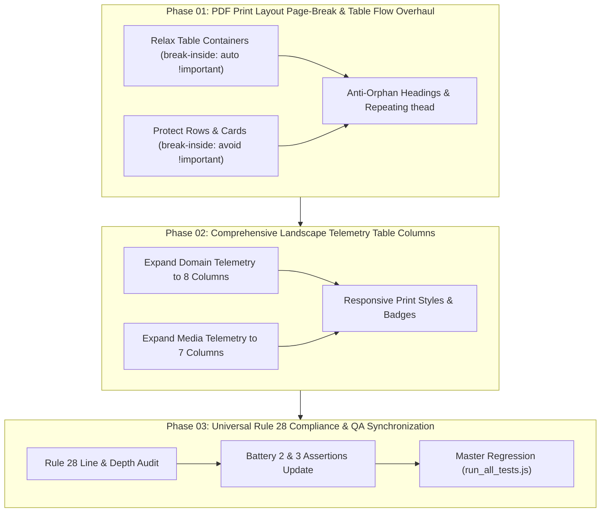

# Executive Architecture Summary: Export Reports Data Population & Layout Fix

> **Initiative:** Web Activity & Media Sentinel - Report Export System Hardening  
> **Container:** `temp_prompt/export_reports_data_and_layout_fix/`  
> **Task ID:** `TASK-EXPORT-REPORTS-DATA-LAYOUT-FIX-001`  
> **Author:** Level 3C Phase-wise Prompt Generation Specialist (`prompt_generation_specialist`)  
> **Governing Framework:** [`PHASE_WISE_PROMPT_GENERATION_ARCHITECTURE.md`](file:///C:/Users/Atul%20Verma/.gemini/config/rules/PHASE_WISE_PROMPT_GENERATION_ARCHITECTURE.md)  

---

## 🎯 1. High-Level Initiative Scope & Objectives

The primary objective of `TASK-EXPORT-REPORTS-DATA-LAYOUT-FIX-001` (Landscape & Page-Break Overhaul) is to deliver an executive-grade reporting experience across both PDF Print and Standalone Offline HTML exports:
1. **PDF Print Layout Page-Break Overhaul:**
   - Overhaul `@media print` in `dashboard/dashboard.css` and `dashboard/styles/backup_digest.css`.
   - Separate table container break rules (`break-inside: auto !important;`) from row rules (`break-inside: avoid !important;`) to allow natural multi-page pagination without clipping.
   - Enforce anti-orphan headings (`h1, h2, h3, .section-title { break-after: avoid !important; }`) and repeating table headers (`thead { display: table-header-group !important; }`).
2. **Comprehensive Landscape Telemetry Table Columns (Domain and Media):**
   - Expand Domain Telemetry table to 8 columns: `Rank`, `Domain & Host`, `Category`, `Active Duration`, `Proportion Share`, `Total Sessions`, `Avg Session Duration`, `Productivity Impact`.
   - Expand Media Playback table to 7 columns: `#`, `Media Title`, `Platform / Source`, `Watch Duration`, `Playback Share`, `Audio State`, `Playback Status / Type`.
   - Harmonize styling across `backup_hub_digest_feature.js` (inline template CSS) and `dashboard/dashboard.css`.
3. **Universal Rule 28 Compliance & Automated QA Suite:**
   - Ensure all refactored rendering helpers in `backup_hub_digest_feature.js` are $\le 50$ lines with cyclomatic depth $\le 3$.
   - Update `tests/test_export_reports_data_and_layout_fix.js` to assert page breaks, 8-column domain telemetry, 7-column media telemetry, Rule 28 compliance, and UTF-8 with BOM.

---

## 🗺️ 2. Cross-Phase Milestone Roadmap & Dependency Topology

---

## ⚖️ 3. Execution Strategy Assessment

In accordance with Section 5 of [`PHASE_WISE_PROMPT_GENERATION_ARCHITECTURE.md`](file:///C:/Users/Atul%20Verma/.gemini/config/rules/PHASE_WISE_PROMPT_GENERATION_ARCHITECTURE.md):

| Strategy | Feasibility & Fit | Tradeoff Analysis | Autonomy Score |
| :--- | :--- | :--- | :---: |
| **Strategy A: Fully Autonomous Phase-wise Execution** | **RECOMMENDED (Optimal Fit)** | Well-defined scope, line-level code anchors, deterministic test suites with 6 automated batteries, zero external vendor dependencies. Execution transitions autonomously between phases upon Grade A+ signoff. | **1.0** |
| **Strategy B: Single User Consultation** | Alternative | Useful if the user wishes to customize specific table column names, but standard requirements are already explicit. | 0.8 |
| **Strategy C: Phase-by-Phase User Consultation** | Inefficient | Introduces unnecessary friction for a surgical CSS/JS layout refinement with local regression tests. | 0.4 |

### Final Strategy Determination:
**Strategy A (Fully Autonomous Phase-wise Execution)** is officially recommended.

---

## 🛡️ 4. Risk Mitigation & Architectural Invariants

| Technical Risk | Likelihood | Impact | Surgical Mitigation Strategy |
| :--- | :---: | :---: | :--- |
| **Table Clipping Across Page Boundaries** | High | Critical | Relax container to `break-inside: auto !important;` while maintaining `break-inside: avoid !important;` on `tr`. |
| **Orphaned Table Headings at Page Bottom** | Medium | High | Apply `break-after: avoid !important; page-break-after: avoid !important;` to `.section-title`, `h1, h2, h3`. |
| **Code Bloat & Modularity Violations (Rule 28)** | Medium | High | Decompose row rendering and productivity logic into atomic helper functions $\le 50$ lines with depth $\le 3$. |
| **UTF-8 BOM Truncation** | Low | High | Ensure all modified files maintain `[0xEF, 0xBB, 0xBF]` preamble. |
