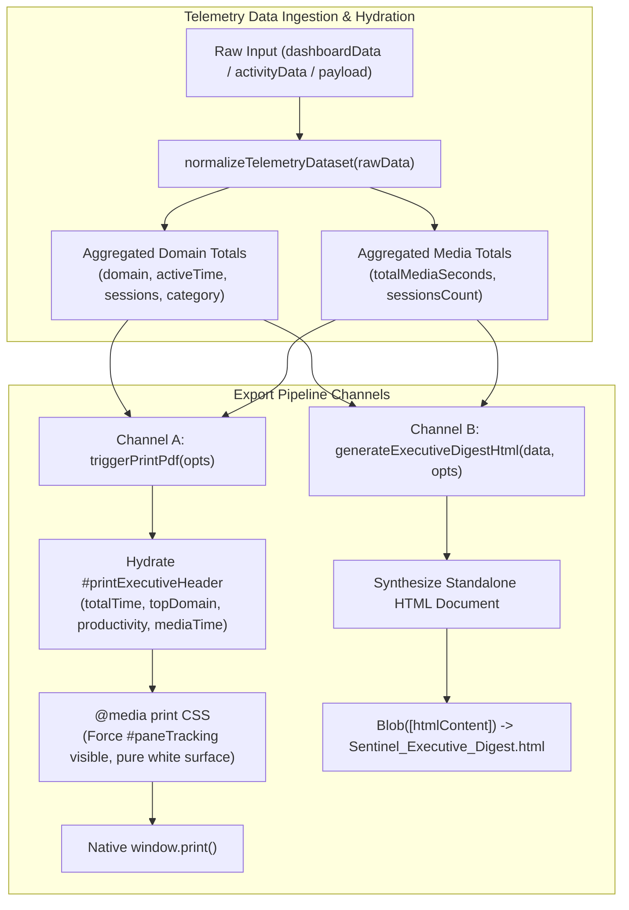

# Technical Requirements Document (TRD): Export Reports Data Population & Layout Fix

> **Initiative:** Web Activity & Media Sentinel - Report Export System Hardening  
> **Document Type:** Technical Requirements Document (TRD)  
> **Container:** `temp_prompt/export_reports_data_and_layout_fix/`  
> **Task ID:** `TASK-EXPORT-REPORTS-DATA-LAYOUT-FIX-001`  
> **Author:** Level 3C Phase-wise Prompt Generation Specialist (`prompt_generation_specialist`)  
> **Lead Department:** Dept 05 (Frontend Engineering & Architecture)  

---

## 🏛️ 1. Architecture Overview (HLD / LLD)

The export subsystem provides two complementary export channels for browser activity telemetry:
1. **In-Dashboard PDF Print View (`triggerPrintPdf`):** Prepares the active dashboard DOM by populating `#printExecutiveHeader`, ensuring printable section visibility (`#paneTracking`), and invoking `window.print()`.
2. **Standalone Offline HTML Digest (`downloadStandaloneHtmlDigest`):** Synthesizes a completely self-contained single-file HTML document containing embedded CSS, SVG visualizations, formatted data tables, and an embedded lossless JSON payload for round-trip archiving.



---

## 📐 2. Data Contract Schemas

### 2.1 Schema A: Modern Chrome Storage Schema (`activityData.domains`)
Emitted by `background.js` and stored in `chrome.storage.local`:
```typescript
interface ModernActivityData {
  domains: {
    [domainName: string]: {
      seconds?: number;
      totalSeconds?: number;
      foregroundSeconds?: number;
      backgroundMediaSeconds?: number;
      sessionCount?: number;
      category?: 'work' | 'social' | 'entertainment' | 'utility' | 'learning' | string;
      days?: {
        [dateKey: string]: { // "YYYY-MM-DD"
          seconds?: number;
          foregroundSeconds?: number;
          backgroundMediaSeconds?: number;
          sessions?: number;
          hourlyBuckets?: Record<string, number>;
        };
      };
    };
  };
  historyDaysCount?: number;
  firstTrackedDate?: string;
  lastUpdated?: number;
}
```

### 2.2 Schema B: Legacy Day-Keyed History Snapshot
Found in older backups, exports, or snapshot dumps:
```typescript
interface LegacyTrackingHistory {
  [dateKey: string]: { // "YYYY-MM-DD"
    totalActiveTime?: number;
    domains?: {
      [domainName: string]: {
        activeTime?: number;
        seconds?: number;
        sessions?: number;
        category?: string;
      };
    };
  };
}
```

### 2.3 Schema C: Pre-Computed Dashboard `stats.items` Array
Computed inside `dashboard.js` by `processTimeTrackingData()`:
```typescript
interface ProcessedDomainItem {
  domain: string;
  computedSeconds: number;
  totalSeconds: number;
  foregroundSeconds?: number;
  backgroundMediaSeconds?: number;
  combinedSeconds?: number;
  sessions: number;
  category?: string;
  ratio?: number;
  ratioPercent?: string;
}
```

### 2.4 Canonical Media History Schema
Emitted by `background.js` in `mediaHistory`:
```typescript
interface MediaHistoryEntry {
  id: string;
  title: string;
  platform: string;
  domain: string;
  url: string;
  watchDuration: number; // Canonical duration in seconds
  videoDuration?: number;
  watchTime?: number;    // Legacy fallback
  duration?: number;     // Legacy fallback
  isMuted?: boolean;
  timestamp: number;
  lastUpdated: number;
}
```

---

## ⚙️ 3. Universal Data Normalization Algorithm

To resolve schema fragmentation, `backup_hub_digest_feature.js` must implement `normalizeTelemetryDataset(rawData, options)`:

```javascript
function normalizeTelemetryDataset(rawData, options = {}) {
  const dataset = rawData || {};
  const tracking = dataset.tracking_history || dataset.activityData || dataset.trackingHistory || dataset;
  const media = dataset.media_history || dataset.mediaHistory || [];
  const selectedDateRange = options.dateRange || null; // Optional Set or filter

  let totalActiveSeconds = 0;
  const domainTotals = {};

  // Case 1: Pre-computed items array passed
  if (Array.isArray(tracking.items)) {
    tracking.items.forEach(item => {
      if (!item || !item.domain) return;
      const sec = Number(item.computedSeconds || item.totalSeconds || item.seconds || 0);
      totalActiveSeconds += sec;
      domainTotals[item.domain] = {
        activeTime: sec,
        sessions: Number(item.sessions || item.sessionCount || 1),
        category: item.category || 'work'
      };
    });
  }
  // Case 2: Modern activityData.domains dictionary
  else if (tracking.domains && typeof tracking.domains === 'object') {
    Object.keys(tracking.domains).forEach(dom => {
      const entry = tracking.domains[dom];
      if (!entry) return;
      
      let domSeconds = 0;
      let domSessions = entry.sessionCount || 0;

      // If filtering by specific date range and days map exists
      if (selectedDateRange && entry.days) {
        Object.keys(entry.days).forEach(dateKey => {
          if (selectedDateRange.has(dateKey)) {
            const day = entry.days[dateKey];
            domSeconds += (day.seconds || 0);
            if (!entry.sessionCount) domSessions += (day.sessions || 1);
          }
        });
      } else {
        domSeconds = Number(entry.seconds || entry.totalSeconds || 0);
        if (domSeconds === 0 && entry.days) {
          Object.keys(entry.days).forEach(d => {
            domSeconds += (entry.days[d].seconds || 0);
          });
        }
      }

      if (domSeconds > 0) {
        totalActiveSeconds += domSeconds;
        domainTotals[dom] = {
          activeTime: domSeconds,
          sessions: Math.max(1, domSessions),
          category: entry.category || 'work'
        };
      }
    });
  }
  // Case 3: Legacy day-keyed map { "YYYY-MM-DD": { totalActiveTime, domains: {} } }
  else {
    Object.keys(tracking).forEach(dateKey => {
      const day = tracking[dateKey];
      if (!day || typeof day !== 'object' || !day.domains) return;
      if (selectedDateRange && !selectedDateRange.has(dateKey)) return;

      totalActiveSeconds += (day.totalActiveTime || 0);
      Object.keys(day.domains).forEach(dom => {
        const d = day.domains[dom];
        if (!domainTotals[dom]) {
          domainTotals[dom] = { activeTime: 0, sessions: 0, category: d.category || 'work' };
        }
        domainTotals[dom].activeTime += (d.activeTime || d.seconds || 0);
        domainTotals[dom].sessions += (d.sessions || 1);
      });
    });
  }

  // Canonical Media Duration Accumulator
  let totalMediaSeconds = 0;
  if (Array.isArray(media)) {
    media.forEach(m => {
      totalMediaSeconds += Number(m.watchDuration || m.watchTime || m.duration || 0);
    });
  }

  const sortedDomains = Object.keys(domainTotals).map(dom => ({
    domain: dom,
    ...domainTotals[dom]
  })).sort((a, b) => b.activeTime - a.activeTime);

  return {
    totalActiveSeconds,
    totalMediaSeconds,
    sortedDomains,
    topDomain: sortedDomains.length > 0 ? sortedDomains[0].domain : 'None',
    domainCount: sortedDomains.length
  };
}
```

---

## 📡 4. Target API Signatures & Modifications

### 4.1 `triggerPrintPdf(options)` in `dashboard/dashboard.js`
```javascript
/**
 * Gathers active dashboard telemetry, populates #printExecutiveHeader, and triggers print.
 * @param {Object} [options]
 * @returns {{ printed: boolean, error?: string }}
 */
function triggerPrintPdf(options = {})
```
**Modifications:**
- Retrieve current total active seconds from rendered `#trackMetricTotalTime` or `stats.totalSec` or `stats.activeTemporalSum`.
- Retrieve top focus domain from rendered `#statTopFocusDomain` or `stats.topDomain?.domain`.
- Retrieve productivity score from `lastCalculatedProductivityScore` or `#statProductivityScore`.
- Retrieve media watch seconds by summing `(m.watchDuration || m.watchTime || m.duration || 0)` across `mediaHistoryData`.
- Pass current active filter string (e.g., `currentTemporalRange || 'All Time'`) to update `#printReportPeriod`.
- Forward options to `_BackupHubDigest.triggerPrintPdf(opts)`.

### 4.2 `generateExecutiveDigestHtml(data, options)` in `src/dashboard/features/backup_hub_digest_feature.js`
```javascript
/**
 * Synthesizes self-contained single-file HTML executive digest.
 * @param {Object} [data] Telemetry payload (activityData, tracking_history, media_history)
 * @param {Object} [options] Presentation options (reportingPeriod, productivityIndex, generatedDate)
 * @returns {string} Complete HTML document string
 */
function generateExecutiveDigestHtml(data, options = {})
```
**Modifications:**
- Delegate data extraction to `normalizeTelemetryDataset(data, options)`.
- Format time values using robust `formatHoursMinutes(seconds)`.
- Generate proportional SVG donut slices and color-coded distribution bars.
- Render sanitized domain rows with rank, favicon placeholder, category badge, duration, % share, and session count.
- If `sortedDomains.length === 0`, render clean empty state banner.
- Embed round-trip JSON payload in `<script id="sentinel-digest-payload" type="application/json">`.

---

## 🔒 5. Security & Error Handling

1. **HTML Sanitization & XSS Prevention:**
   All user-controlled strings (domain names, category strings, report title labels) injected into HTML template literals must pass through a strict `escapeHtml()` utility:
   ```javascript
   function escapeHtml(str) {
     if (typeof str !== 'string') return '';
     return str.replace(/[&<>"']/g, ch => ({
       '&': '&amp;',
       '<': '&lt;',
       '>': '&gt;',
       '"': '&quot;',
       "'": '&#39;'
     }[ch]));
   }
   ```
2. **Zero `innerHTML` / W3C Trusted Types Compliance:**
   In `dashboard.js` and `backup_hub_digest_feature.js`, all DOM updates on the dashboard document (`#printStatTotalTime`, etc.) must exclusively use `textContent`.
3. **Fail-Safe Fallbacks:**
   If `data` or `options` are completely `undefined` or null, functions must never throw unhandled exceptions. All calculations must guard with `|| 0`, `|| '--'`, and `|| []`.
