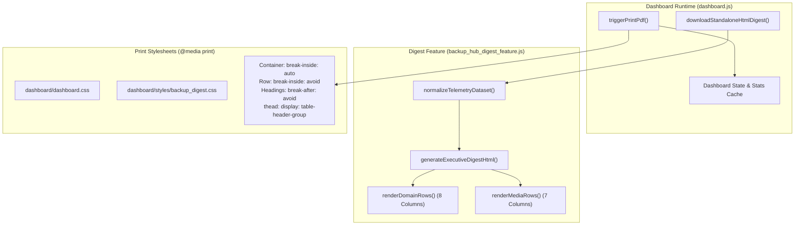

# Technical Requirements Document (TRD): Export Reports Data Population & Layout Fix

> **Initiative:** Web Activity & Media Sentinel - Report Export System Hardening  
> **Document Type:** Technical Requirements Document (TRD)  
> **Container:** `temp_prompt/export_reports_data_and_layout_fix/`  
> **Task ID:** `TASK-EXPORT-REPORTS-DATA-LAYOUT-FIX-001`  
> **Author:** Level 3C Phase-wise Prompt Generation Specialist (`prompt_generation_specialist`)  
> **Lead Department:** Dept 05 (Frontend Engineering) & Dept 08 (QA & Testing)  

---

## 🏛️ 1. Technical Architecture & Component Interaction



---

## 📐 2. Detailed Technical Specifications

### 2.1 CSS Print Engine Page-Break Architecture
In `dashboard/styles/backup_digest.css` and `dashboard/dashboard.css`:
```css
@media print {
  @page {
    size: A4 landscape;
    margin: 10mm 12mm 10mm 12mm;
  }

  /* Relax table containers to allow natural multi-page pagination */
  .data-table-card,
  .table-card,
  .domain-table-container,
  .table-responsive-container {
    page-break-inside: auto !important;
    break-inside: auto !important;
    overflow: visible !important;
  }

  /* Prevent row splitting across printed page sheets */
  tr {
    page-break-inside: avoid !important;
    break-inside: avoid !important;
  }

  /* Prevent orphan headings at page bottoms */
  h1, h2, h3, .section-title, .print-executive-header {
    break-after: avoid !important;
    page-break-after: avoid !important;
  }

  /* Repeat table column headers on every sheet */
  thead {
    display: table-header-group !important;
  }
  tbody {
    display: table-row-group !important;
  }

  /* Protect discrete visual components from being split */
  .print-executive-header,
  .metrics-grid,
  .metric-card,
  .analytics-hero-card,
  .donut-chart-container,
  .chart-section,
  .print-summary-card {
    page-break-inside: avoid !important;
    break-inside: avoid !important;
  }
}
```

### 2.2 Comprehensive Landscape Table Specifications

#### Domain Telemetry Table (8 Columns):
| Col # | Header Title | Data Source / Computation | Alignment | Width % |
| :---: | :--- | :--- | :---: | :---: |
| 1 | `Rank` | `#${i + 1}` | Center | 5% |
| 2 | `Domain & Host` | `escapeHtml(d.domain)` | Left | 22% |
| 3 | `Category` | `<span class="badge ${cat}">${cat}</span>` | Center | 10% |
| 4 | `Active Duration` | `formatHoursMinutes(d.activeTime)` | Right | 14% |
| 5 | `Proportion Share`| `(d.activeTime / totalActiveSeconds * 100).toFixed(1)%` | Right | 11% |
| 6 | `Total Sessions` | `d.sessions` | Center | 9% |
| 7 | `Avg Session Duration` | `formatHoursMinutes(Math.round(d.activeTime / Math.max(1, d.sessions)))` | Right | 15% |
| 8 | `Productivity Impact` | `getProductivityBadge(d.category)` | Center | 14% |

#### Media Playback Telemetry Table (7 Columns):
| Col # | Header Title | Data Source / Computation | Alignment | Width % |
| :---: | :--- | :--- | :---: | :---: |
| 1 | `#` | `#${i + 1}` | Center | 5% |
| 2 | `Media Title` | `escapeHtml(m.title)` | Left | 30% |
| 3 | `Platform / Source` | `<span class="badge utility">${platform}</span>` | Center | 14% |
| 4 | `Watch Duration` | `formatHoursMinutes(dur)` | Right | 14% |
| 5 | `Playback Share` | `(dur / totalMediaSeconds * 100).toFixed(1)%` | Right | 11% |
| 6 | `Audio State` | `<span class="badge ${state}">${state}</span>` | Center | 12% |
| 7 | `Playback Status` | `<span class="badge ${type}">${type}</span>` | Center | 14% |

---

## 🔒 3. Modularity & Quality Gates (Universal Rule 28)
- Every function in `src/dashboard/features/backup_hub_digest_feature.js` must be decomposed into small helpers with lines $\le 50$ and nesting depth $\le 3$:
  - `getProductivityBadge(category)`
  - `computeSessionAvg(activeTime, sessions)`
  - `renderDomainRows(sortedDomains, totalActiveSeconds)`
  - `renderMediaRows(mediaHistory, totalMediaSeconds)`
  - `renderMediaSection(mediaHistory, totalMediaSeconds)`
  - `renderExecutiveMetricsGrid(...)`
- Standalone suite: `tests/test_export_reports_data_and_layout_fix.js` must execute 6 batteries with 100% pass and exit code 0.
