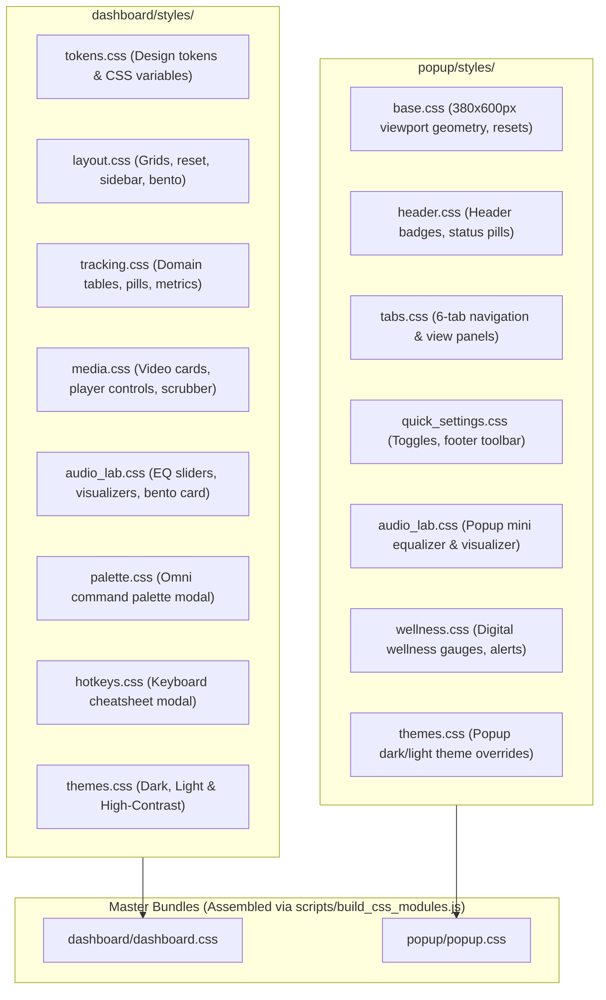

# Design System & UI/UX Specification: Monolithic Facade Slimming & Modular Decomposition

> **Document Type:** Design System, Token Architecture & CSS Modular Organization  
> **Workspace Container:** [`temp_prompt/facade_slimming_and_modular_decomposition/DESIGN.md`](DESIGN.md)  
> **Specialist Role:** Level 3C Phase-wise Prompt Generation Specialist (`prompt_generation_specialist`)  
> **Target System:** Web Activity & Media Sentinel (Chrome / Edge / Firefox MV3 Extension)  
> **Active Working Memory:** [`memory.md`](file:///C:/Users/Atul%20Verma/.gemini/memory.md)  
> **Authoritative Specification:** [`PHASE_WISE_PROMPT_GENERATION_ARCHITECTURE.md`](file:///C:/Users/Atul%20Verma/.gemini/config/rules/PHASE_WISE_PROMPT_GENERATION_ARCHITECTURE.md)  
> **Status:** ARCHITECTED / READY FOR IMPLEMENTATION  

---

## 🎨 1. Design System Architecture

### 1.1 Context & Purpose
The user's explicit directive highlights the future evolution of styling:
> *"साथ ही डिजाइन एंड स्टाइल जो है ऐड करना है। इसके लिए जो है तुम ध्यान में रखते हुए यह देखो कि किसी फाइल में और स्प्लिट करने की जरूरत हो सकती है तो जरूरत के अनुसार स्प्लिट करो और सेम मटेरियल यूज करना जो अभी यूज किया हो स्प्लिट करने के लिए।"*

To allow new designs, components, and styles to be added seamlessly, the styling architecture is organized into dedicated modular stylesheets under `dashboard/styles/` and `popup/styles/`, while preserving unified master files (`dashboard/dashboard.css` and `popup/popup.css`) for zero-build runtime and test compatibility.



---

## 💎 2. Semantic Token System (iOS 26 Liquid Glass)

### 2.1 Color & Surface Tokens
| Token Name | Value (Dark Theme) | Value (Light Theme) | Semantic Role |
| :--- | :--- | :--- | :--- |
| `--bg-canvas` | `rgba(13, 17, 23, 0.96)` | `rgba(246, 248, 250, 0.98)` | Master page backdrop |
| `--glass-substrate` | `rgba(22, 27, 34, 0.72)` | `rgba(255, 255, 255, 0.85)` | Primary card & bento panel surface |
| `--glass-specular-edge` | `rgba(255, 255, 255, 0.12)`| `rgba(0, 0, 0, 0.08)` | 1px top highlight / specular rim |
| `--border-subtle` | `rgba(240, 246, 252, 0.10)`| `rgba(31, 35, 40, 0.15)` | Perimeter hairline dividers |
| `--accent-cyan` | `#38bdf8` | `#0284c7` | Active media, primary badges, buttons |
| `--accent-emerald` | `#34d399` | `#059669` | Tracking active, online indicators |
| `--accent-amber` | `#fbbf24` | `#d97706` | Pause status, warning pill, timer |
| `--accent-rose` | `#f87171` | `#dc2626` | Offline status, delete action, stop |
| `--text-primary` | `#f0f6fc` | `#1f2328` | Main headings, body labels |
| `--text-secondary` | `#8b949e` | `#656d76` | Meta information, timestamps |

### 2.2 Specular Glass Physics
```css
/* Liquid Glass Component Class Standard */
.liquid-glass-card {
  background: var(--glass-substrate);
  backdrop-filter: blur(24px) saturate(180%);
  -webkit-backdrop-filter: blur(24px) saturate(180%);
  border: 1px solid var(--border-subtle);
  border-top: 1px solid var(--glass-specular-edge);
  border-radius: 14px;
  box-shadow: 0 8px 32px 0 rgba(0, 0, 0, 0.37);
  transition: transform 0.2s cubic-bezier(0.16, 1, 0.3, 1), box-shadow 0.2s ease;
}

.liquid-glass-card:hover {
  transform: translateY(-2px);
  box-shadow: 0 12px 40px 0 rgba(0, 0, 0, 0.45);
}
```

---

## 📐 3. Layout, Viewport & A11y Guidelines

### 3.1 Dimensions & Viewport Constraints
- **Popup Viewport:** Strict `380px` width by `600px` height. Zero horizontal scrollbars (`overflow-x: hidden`).
- **Dashboard Grid:** Responsive 12-column Bento Grid layout with fluid container wrapping (`min-width: 960px`).
- **Touch & Click Targets:** All interactive buttons and toggles must maintain minimum hit areas of `32x32px` (e.g. Pause toolbar is `34x32px`).

### 3.2 Accessibility (WCAG 2.1 AA) Standards
1. **Color Contrast:** All body text (`--text-primary` on `--bg-canvas`) must achieve a minimum contrast ratio of `4.5:1` in both Dark and Light modes.
2. **Focus Visibility:** Interactive elements must display a distinct focus ring:
   ```css
   :focus-visible {
     outline: 2px solid var(--accent-cyan);
     outline-offset: 2px;
   }
   ```
3. **Motion Sensitivity:** Respect user preference for reduced motion:
   ```css
   @media (prefers-reduced-motion: reduce) {
     * {
       animation-duration: 0.01ms !important;
       transition-duration: 0.01ms !important;
     }
   }
   ```
