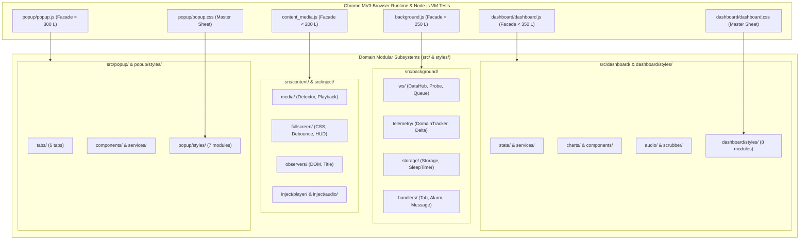

# Executive Architecture Summary: Monolithic Facade Slimming & Modular Decomposition

> **Document Type:** Executive Architecture Summary, Milestone Roadmap & Technical Scope  
> **Workspace Container:** [`temp_prompt/facade_slimming_and_modular_decomposition/SUMMARY.md`](SUMMARY.md)  
> **Specialist Role:** Level 3C Phase-wise Prompt Generation Specialist (`prompt_generation_specialist`)  
> **Target System:** Web Activity & Media Sentinel (Chrome / Edge / Firefox MV3 Extension)  
> **Active Working Memory:** [`memory.md`](file:///C:/Users/Atul%20Verma/.gemini/memory.md)  
> **Authoritative Specification:** [`PHASE_WISE_PROMPT_GENERATION_ARCHITECTURE.md`](file:///C:/Users/Atul%20Verma/.gemini/config/rules/PHASE_WISE_PROMPT_GENERATION_ARCHITECTURE.md)  
> **Status:** ARCHITECTED / READY FOR REVIEW  

---

## 🏛️ 1. Executive Initiative Overview

### 1.1 Context & Motivation
The Web Activity & Media Sentinel browser extension is a mission-critical tool for cross-browser activity tracking, multi-media inspection, audio DSP equalization, and local WebSocket HUD synchronization. Over multiple development sprints, the system has grown into a highly sophisticated platform containing over 27,500 lines of code across its root entrypoint files:
- `dashboard/dashboard.js`: 6,335 lines
- `dashboard/dashboard.css`: 4,528 lines
- `popup/popup.js`: 4,195 lines
- `popup/popup.css`: 4,329 lines
- `background.js`: 3,450 lines
- `content_media.js`: 2,630 lines
- `inject_main_world.js`: 1,262 lines
- `fullscreen_controller.js`: 792 lines

The user has explicitly requested to add new features, functions, designs, and styles:
> *"मुझे और भी फीचर एंड फंक्शन ऐड करना है और साथ ही डिजाइन एंड स्टाइल जो है ऐड करना है। इसके लिए जो है तुम ध्यान में रखते हुए यह देखो कि किसी फाइल में और स्प्लिट करने की जरूरत हो सकती है तो जरूरत के अनुसार स्प्लिट करो और सेम मटेरियल यूज करना जो अभी यूज किया हो स्प्लिट करने के लिए।"*

To prepare the codebase for seamless feature additions and UI enhancements, the monolithic inline blocks inside the root files must be decomposed into their respective modular subsystems in `src/` and `styles/`, and the root files must be slimmed into pure, backward-compatible facades.

---

## 🗺️ 2. Architectural Vision: The Facade & Barrel Aggregator Pattern

### 2.1 Core Architectural Principles
1. **Single Source of Truth:** Core logic resides in dedicated single-responsibility domain modules under `src/` and `styles/`.
2. **Zero-Downtime Facades:** Root entrypoint files remain as facades that assemble or delegate to the modular subsystems.
3. **Dual Compatibility:** Facades must function seamlessly in:
   - Chrome MV3 execution (service worker, content script, window context).
   - Node.js test execution (`node -c`, `new vm.Script()`, `vm.runInContext()`).
4. **100% W3C Trusted Types Compliance:** Absolute zero `innerHTML` assignments across all newly created or modified modules.
5. **Zero Test Regressions:** All 39 test suites in `tests/` must remain green (exit code 0) after every single phase.

---

## 🎯 3. Cross-Phase Milestone Roadmap

| Milestone | Phase Name | Primary Files Affected | Blast Radius | Verification Gate |
| :--- | :--- | :--- | :--- | :--- |
| **M1** | Background Facade Slimming | `background.js`, `src/background/**` | High | `test_syntax_and_manifest_integrity.js`, `test_timer_and_dual_media_tracking.js` |
| **M2** | Content & Controller Slimming | `content_media.js`, `inject_main_world.js`, `fullscreen_controller.js`, `src/content/**` | High | `test_context_invalidation_guards.js`, `test_fullscreen_controller.js`, `test_media_controls_and_fullscreen_fix.js` |
| **M3** | Dashboard JS Slimming | `dashboard/dashboard.js`, `src/dashboard/**` | Very High | `test_dashboard_full_audio_lab_parity.js`, `test_dashboard_uiux_phase1.js` through `phase4.js` |
| **M4** | Popup JS Slimming | `popup/popup.js`, `src/popup/**` | Very High | `test_popup_phase1` through `phase5`, `test_popup_sqlite_data_hub_sync.js`, `test_six_tab_popup_architecture.js` |
| **M5** | CSS Facade Deconstruction | `dashboard/dashboard.css`, `popup/popup.css`, `dashboard/styles/**`, `popup/styles/**` | Medium | `test_dashboard_theme_and_a11y_verification.js`, `test_six_tab_popup_architecture.js` |
| **M6** | Independent QA Verification | Full codebase & test suites | Global | All 39 Test Suites (100% exit code 0), `gitleaks detect --redact` (0 leaks) |

---

## ⚖️ 4. Technical Trade-off & Risk Mitigation Analysis

| Risk Category | Technical Hazard | Mitigation Strategy |
| :--- | :--- | :--- |
| **AST Parse Errors** | Using ES module `import`/`export` in classic scripts breaks `node -c` and `vm.Script`. | Use Universal Module Definition (UMD) / Global Namespace Delegation (`globalThis.Sentinel*`) with Node `require` fallback. |
| **Test Sandbox Isolation** | Tests executing via `vm.runInContext(code, sandbox)` without a file system bundler. | Ensure facades export all functions, variables, and classes directly into the evaluation scope or provide seamless in-memory assembly. |
| **Event Listener Double Binding** | Splitting scripts could lead to duplicate event listener registrations on tabs or alarms. | Enforce idempotent listener guards (`if (!hasBoundListeners) { ... }`) in all module handlers. |
| **CSS Selector Collisions** | Modular CSS might omit critical selector overrides or alter cascade specificity. | Use automated stylesheet builder (`scripts/build_css_modules.js`) to guarantee selector order and token inheritance. |
