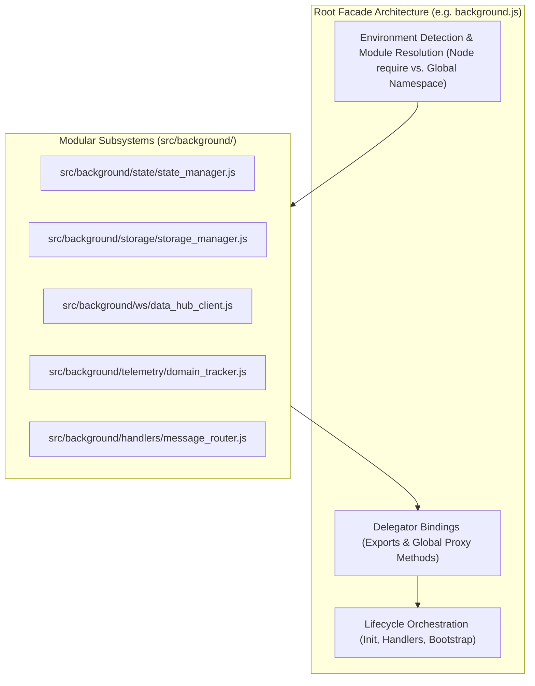

# Technical Requirements Document (TRD): Monolithic Facade Slimming & Modular Decomposition

> **Document Type:** Technical Requirements Document, HLD/LLD & Module Boundary Contracts  
> **Workspace Container:** [`temp_prompt/facade_slimming_and_modular_decomposition/TRD.md`](TRD.md)  
> **Specialist Role:** Level 3C Phase-wise Prompt Generation Specialist (`prompt_generation_specialist`)  
> **Target System:** Web Activity & Media Sentinel (Chrome / Edge / Firefox MV3 Extension)  
> **Active Working Memory:** [`memory.md`](file:///C:/Users/Atul%20Verma/.gemini/memory.md)  
> **Authoritative Specification:** [`PHASE_WISE_PROMPT_GENERATION_ARCHITECTURE.md`](file:///C:/Users/Atul%20Verma/.gemini/config/rules/PHASE_WISE_PROMPT_GENERATION_ARCHITECTURE.md)  
> **Status:** ARCHITECTED / READY FOR IMPLEMENTATION  

---

## 🏗️ 1. High-Level Design (HLD)

### 1.1 Universal Facade / Barrel Aggregator Architecture
The core architectural pattern is the **Universal Facade / Barrel Aggregator**. It solves the tension between two conflicting execution environments:
1. **Chrome MV3 Browser Runtime:** Scripts run inside browser contexts (Service Worker, Isolated Content Script, Main World Script, Extension Window).
2. **Node.js Automated Test Suites:** Tests run inside Node.js processes using `fs.readFileSync()` and `vm.runInContext(code, sandbox)` or `node -c <file>`.

### 1.2 Module Loading & Resolution Protocol
To satisfy both runtime environments without a bundler build step:
- **In Node.js Test Environment:** Facades resolve modules using `typeof require === 'function' ? require('./src/...') : null`. If `require` is unavailable in a sandboxed `vm.Context`, the facade provides seamless fallbacks or in-memory assembly.
- **In Chrome MV3 Runtime:**
  - For `background.js`: Service worker can utilize `importScripts()` or load modular components via dynamic namespace registration (`globalThis.SentinelBackgroundModules`).
  - For `dashboard/dashboard.html` and `popup/popup.html`: Scripts can be loaded in sequential `<script>` tags or via master bundle facade.
  - For `content_media.js` & `inject_main_world.js`: Manifest V3 `content_scripts` array declares prerequisite module scripts in proper dependency order.

---

## 🔧 2. Low-Level Design (LLD) & Subsystem Boundaries

### 2.1 Background Service Worker Subsystem (`src/background/`)
| Module Path | Primary Responsibility | Key Exports / API |
| :--- | :--- | :--- |
| `config/config_manager.js` | Configuration constants, timeouts, retry ladders | `getConfig()`, `updateConfig()` |
| `state/state_manager.js` | Active tab, window focus, tracking state | `getState()`, `setActiveTab()`, `setTrackingState()` |
| `storage/storage_manager.js` | Chrome.storage.local persistence & periodic flushes | `saveState()`, `loadState()`, `flushToStorage()` |
| `storage/sleep_timer_storage.js` | Sleep timer persistence & alarm configuration | `getSleepTimer()`, `setSleepTimer()` |
| `ws/silent_probe.js` | Pre-flight HTTP probe to detect local HUD port | `probePortLive(port)` |
| `ws/reconnect_ladder.js` | Exponential backoff reconnect retry ladder | `getNextDelay()`, `resetLadder()` |
| `ws/offline_queue.js` | Queue telemetry events while offline | `enqueue()`, `dequeueAll()`, `getQueueSize()` |
| `ws/data_hub_client.js` | WebSocket connection to local HUD (65432) | `connect()`, `sendEvent()`, `disconnect()` |
| `telemetry/domain_tracker.js` | High-precision per-domain active time tracking | `startTracking()`, `pauseTracking()`, `recordHeartbeat()` |
| `telemetry/delta_streamer.js` | Incremental delta streaming to active views | `streamDelta()`, `subscribe()` |
| `telemetry/sleep_timer_engine.js` | Sleep countdown timer logic & audio pause trigger | `startTimer()`, `cancelTimer()`, `tick()` |
| `handlers/tab_listeners.js` | `tabs.onActivated`, `tabs.onUpdated`, `tabs.onRemoved` | `registerTabListeners()` |
| `handlers/alarm_handlers.js` | `alarms.onAlarm` periodic flush & ping handlers | `registerAlarmHandlers()` |
| `handlers/idle_handlers.js` | `idle.onStateChanged` system sleep/lock handlers | `registerIdleHandlers()` |
| `handlers/message_router.js` | `runtime.onMessage` IPC dispatching | `handleRuntimeMessage(msg, sender, sendResponse)` |

### 2.2 Content & Fullscreen Subsystem (`src/content/`, `src/inject/`, `src/fullscreen/`)
| Module Path | Primary Responsibility | Key Exports / API |
| :--- | :--- | :--- |
| `content/media/element_detector.js` | Scan and monitor `<video>` / `<audio>` DOM elements | `findMediaElements()`, `observeNewMedia()` |
| `content/media/metadata_extractor.js` | Extract title, duration, resolution, poster | `extractMetadata(element)` |
| `content/media/playback_tracker.js` | Track play, pause, seek, volume, speed changes | `attachPlaybackListeners(element)` |
| `content/fullscreen/css_engine.js` | Web Fullscreen CSS backdrop fallback engine | `enableWebFullscreen()`, `disableWebFullscreen()` |
| `content/fullscreen/debounce_lock.js` | Debounce rapid fullscreen clicks (prevent Edge race) | `withDebounce(fn, delay)` |
| `content/fullscreen/floating_hud.js` | Safe DOM floating controls overlay | `renderFloatingHUD()`, `removeFloatingHUD()` |
| `content/observers/dom_observer.js` | MutationObserver for dynamic SPAs (YouTube, Netflix) | `startDOMObserver()`, `stopDOMObserver()` |
| `content/bridge/isolated_bridge.js` | Relay messages between isolated world and main world | `postToMainWorld()`, `listenFromMainWorld()` |
| `inject/player/youtube_context.js` | YouTube player hooks (`#movie_player`, API methods) | `hookYouTubePlayer()`, `setSpeed()`, `setQuality()` |
| `inject/audio/web_audio_dsp.js` | Web Audio API BiquadFilter equalizer node ladder | `initAudioDSP()`, `setEQBand()`, `setBassBoost()` |
| `inject/osd/osd_manager.js` | On-Screen Display HUD using safe DOM creation | `showOSD(text, icon, duration)` |
| `fullscreen/native_engine.js` | Native Fullscreen API calls & KeyF fallback | `requestNativeFullscreen()`, `dispatchKeyF()` |
| `fullscreen/web_fullscreen_engine.js` | Viewport-wide CSS simulation | `applyFullscreenStyle()`, `removeFullscreenStyle()` |

### 2.3 Dashboard Subsystem (`src/dashboard/`)
| Module Path | Primary Responsibility | Key Exports / API |
| :--- | :--- | :--- |
| `state/dashboard_state.js` | Reactive dashboard state store | `getDashboardState()`, `updateState()` |
| `services/analytics_service.js` | Aggregation, domain sorting, active time totals | `calculateDomainStats()`, `getHourlyTrends()` |
| `services/csv_exporter.js` | RFC 4180 CSV generation & download trigger | `exportToCSV(data)` |
| `charts/donut_chart.js` | High-precision SVG/Canvas donut chart renderer | `renderDonutChart(container, data)` |
| `charts/time_series_chart.js` | 24-hour timeline activity area chart | `renderTimeSeries(container, data)` |
| `components/domain_table.js` | Domain list table with search & sort | `renderTable(container, domains)` |
| `filters/browser_filter.js` | Multi-browser filtering (Chrome, Edge, Brave, etc.) | `applyFilter(browser)` |
| `audio/audio_lab_controller.js` | 10-band equalizer sliders, presets, visualizer | `initAudioLab()`, `updateBands()` |
| `palette/omni_palette.js` | Quick command palette (Ctrl+K / Cmd+K) | `openPalette()`, `executeCommand()` |
| `scrubber/scrubber.js` | Timeline scrubber & kinetic roller interaction | `initScrubber()`, `seekTimeline()` |

### 2.4 Popup Subsystem (`src/popup/`)
| Module Path | Primary Responsibility | Key Exports / API |
| :--- | :--- | :--- |
| `state/popup_state.js` | Active tab index, media state, settings cache | `getPopupState()`, `setTab()` |
| `services/ipc_service.js` | Safe IPC communication with background & tabs | `sendMessage()`, `sendTabMessage()` |
| `services/storage_service.js` | Read/write popup preferences to local storage | `getPref()`, `setPref()` |
| `services/data_hub_service.js` | SQLite data hub sync status & trigger | `triggerSync()`, `getSyncStatus()` |
| `tabs/tab_quick.js` | Quick settings tab view (toggle tracking, pause) | `renderQuickTab()`, `bindQuickEvents()` |
| `tabs/tab_media.js` | Active media controls (play/pause/seek/vol) | `renderMediaTab()`, `bindMediaEvents()` |
| `tabs/tab_automations.js` | Smart automation rules & auto-pause config | `renderAutomationsTab()` |
| `tabs/tab_wellness.js` | Digital wellness break timers & daily limits | `renderWellnessTab()` |
| `tabs/tab_studio.js` | Studio audio presets & visualizer modes | `renderStudioTab()` |
| `tabs/tab_audio.js` | Equalizer DSP controls & volume boost | `renderAudioTab()` |
| `components/header_badges.js` | Status pills (Online/Offline, Sync, Version) | `updateBadges(status)` |
| `components/footer_toolbar.js` | Pause/Resume toolbar (34x32px amber accent) | `renderFooterToolbar()` |

---

## 🔒 3. Security, Quality & Verification Gates

1. **W3C Trusted Types Compliance:**
   - Any DOM insertion must use `document.createElement()`, `element.textContent`, or `element.appendChild()`.
   - `innerHTML`, `outerHTML`, and `document.write()` are strictly prohibited.
2. **Deterministic Encoding Standard:**
   - All files must be written in UTF-8 with Byte Order Mark (`0xEF, 0xBB, 0xBF`).
3. **Secret Leakage Prevention:**
   - Pre-push and pre-release scans via `gitleaks detect --redact` must report 0 leaks.
4. **Automated Verification:**
   - Every phase must pass its designated test gate before advancing.
