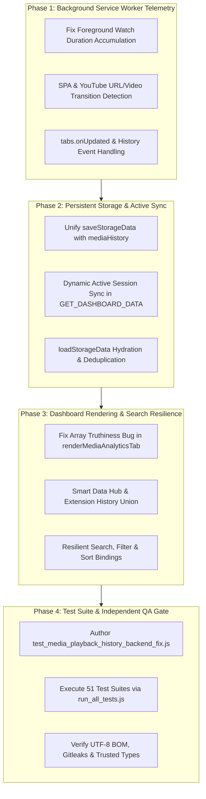

# Media Playback History Restoration: Executive Architecture Summary

> **Document Type:** Executive Architecture Summary & Strategic Roadmap  
> **Workspace Container:** `temp_prompt/fix_media_playback_history/`  
> **Governing Architecture:** [`PHASE_WISE_PROMPT_GENERATION_ARCHITECTURE.md`](file:///C:/Users/Atul%20Verma/.gemini/config/rules/PHASE_WISE_PROMPT_GENERATION_ARCHITECTURE.md)  
> **Command Hierarchy Role:** Level 3C Phase-wise Prompt Generation Specialist (`prompt_generation_specialist`)  
> **Target Systems:** Extension Background Service Worker (`background.js`) & Extension Dashboard (`dashboard/dashboard.js`)  
> **Creation Timestamp:** 2026-11-17  

---

## 🏛️ 1. Initiative Scope & Technical Objectives

The objective of this initiative is the surgical restoration of the Media Playback History subsystem in Web Activity & Media Sentinel. Due to subtle logic conflicts between active domain foreground tracking, background audible delta accumulation, SPA video transitions, MV3 service worker lifecycle constraints, and JavaScript array truthiness semantics, media playback sessions were failing to accumulate duration, failing to persist across worker restarts, and failing to render in the dashboard.

### Core Objectives:
1. **Unconditional Playback Telemetry:** Guarantee that all active media streams (whether playing in the foreground active tab or background tabs) reliably accumulate elapsed playback duration in real time.
2. **Seamless SPA Video Transitions:** Automatically detect video changes on YouTube and other Single Page Applications, finalizing the completed video into `mediaHistory` and initiating a fresh session for the new video.
3. **Atomic MV3 Storage Persistence:** Unify `mediaHistory` with `activityData` inside `saveStorageData()` and `scheduleStorageSave()` so that all active and finalized media history survives Chrome MV3 service worker terminations.
4. **Live In-Flight Active Session Hydration:** Flush and sync active playing media sessions into `mediaHistory` before responding to `GET_DASHBOARD_DATA`, making live playback immediately visible in the dashboard.
5. **Truthiness & Data Hub Fallback Resilience:** Eliminate JavaScript truthiness pitfalls in `dashboard.js`, seamlessly combining extension storage history with SQLite Data Hub analytics without data drops.
6. **Search & Filter Table Stability:** Prevent table-wiping side effects during search, platform filtering, and sorting by decoupling table rendering from unhydrated dashboard payloads.
7. **Zero-Regression Quality Gate:** Preserve 100% pass rate across the existing 50 test suites and add a comprehensive new test suite (`tests/test_media_playback_history_backend_fix.js`).

---

## 🗺️ 2. Cross-Phase Milestone Roadmap & Dependency Topology

### Phase Breakdown:
- **Phase 1 (Backend Telemetry & Session Management):** Modifies `background.js` to ensure `session.watchDuration` accumulates during foreground playback and that SPA video transitions finalize previous sessions.
  - *Prerequisites:* None.
  - *Dependencies:* Unblocks Phase 2.
- **Phase 2 (Debounced Storage & Active Session Sync):** Modifies `background.js` to ensure atomic persistence of `media_sentinel_media_history` alongside `activityData` and live synchronization during `GET_DASHBOARD_DATA`.
  - *Prerequisites:* Phase 1.
  - *Dependencies:* Unblocks Phase 3.
- **Phase 3 (Dashboard Rendering & Table Resilience):** Modifies `dashboard/dashboard.js` to resolve `[]` truthiness bugs, merge Data Hub and extension histories, and harden search/filter/sort listeners.
  - *Prerequisites:* Phase 2.
  - *Dependencies:* Unblocks Phase 4.
- **Phase 4 (Test Suite Implementation & Verification Gate):** Authors `tests/test_media_playback_history_backend_fix.js` and runs the complete workspace regression suite (`node run_all_tests.js`).
  - *Prerequisites:* Phases 1, 2, and 3.
  - *Dependencies:* Final milestone signoff.

---

## ⚖️ 3. Risk Mitigation & Architectural Tradeoffs

| Architectural Decision | Potential Risk | Mitigation & Defense |
| :--- | :--- | :--- |
| **Separating Media Watch Duration from Active Domain Seconds** | Accidental double-counting of browsing time. | Foreground browsing time continues to be tracked exclusively by `commitActiveInterval()`. `commitBackgroundMediaDelta()` is strictly restricted to `!isForeground`. `session.watchDuration` is an independent media-only metric tracking how many seconds the media stream actually played. |
| **SPA Video Detection via URL/Identity Matching** | Rapid consecutive video switches causing excessive micro-sessions. | Enforce minimum threshold: sessions with `watchDuration < 1` second and no control events are discarded in `finalizeMediaSession()`. Only genuine playback sessions enter `mediaHistory`. |
| **Atomic Storage Flushing in MV3** | High-frequency disk writes wearing SSD or hitting Chrome storage rate limits. | Maintain the proven 1.5-second debounce window in `scheduleStorageSave()`. Flush both `activityData` and `mediaHistory` in a single atomic `browserAPI.storage.local.set()` call. Cap `mediaHistory` at `CONFIG.MAX_MEDIA_HISTORY` (500 items). |
| **Merging Extension Storage & Data Hub Media History** | Duplicate entries or ID collisions between SQLite and extension storage. | Use session `id` (or `(domain + title + timestamp)` hash) as unique keys in a `Map` structure. When conflicts occur, prioritize the record with higher `watchDuration` or fresher `lastUpdated`. |
| **Search/Filter Re-rendering in Dashboard** | Performance lag when filtering large media histories. | Maintain an in-memory cached filtered array and avoid DOM thrashing; rebuild table rows using DocumentFragment and native DOM element creation with zero `innerHTML`. |
