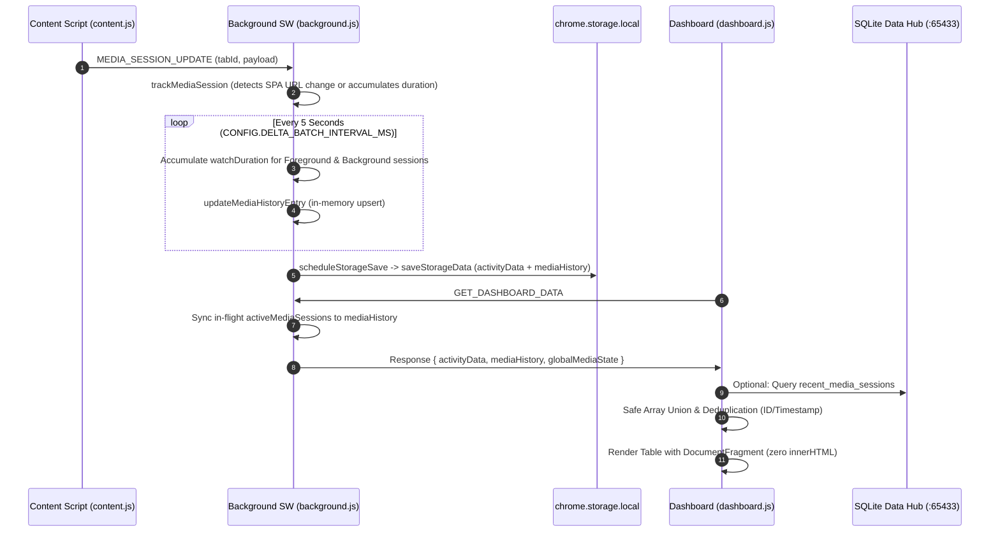

# Media Playback History Restoration: Technical Requirements Document (TRD)

> **Document Type:** Technical Requirements Document (TRD) & System Architecture Specification  
> **Workspace Container:** `temp_prompt/fix_media_playback_history/`  
> **Governing Architecture:** [`PHASE_WISE_PROMPT_GENERATION_ARCHITECTURE.md`](file:///C:/Users/Atul%20Verma/.gemini/config/rules/PHASE_WISE_PROMPT_GENERATION_ARCHITECTURE.md)  
> **Command Hierarchy Role:** Level 3C Phase-wise Prompt Generation Specialist (`prompt_generation_specialist`)  
> **Target Subsystems:** Extension Background Telemetry (`background.js`) & Dashboard Presentation Layer (`dashboard/dashboard.js`)  
> **Creation Timestamp:** 2026-11-17  

---

## 🏛️ 1. High-Level Design (HLD) & Architectural Overview

The Media Playback Subsystem in Web Activity & Media Sentinel connects three distributed components:
1. **Content Script (`content.js`):** Injected into web pages, observes HTML5 `<video>` and `<audio>` elements, tracks play/pause/timeupdate/ratechange/volumechange events, and emits `MEDIA_SESSION_UPDATE` messages to the background worker.
2. **Background Service Worker (`background.js`):** Manages active media sessions in memory (`activeMediaSessions`), maintains historical media logs (`mediaHistory`), handles periodic audible sweeps and remainder-preserving duration calculations, and flushes state to `chrome.storage.local`.
3. **Dashboard & UI Deck (`dashboard/dashboard.js`):** Connects to `background.js` via runtime messaging (`GET_DASHBOARD_DATA`) and optionally to the local SQLite Data Hub WebSocket (`ws://127.0.0.1:65433`). Renders metrics cards, the live hero player, and the searchable/filterable Media History table.



---

## 🔧 2. Low-Level Design (LLD) Specifications

### 2.1 Background Duration Accumulation (`background.js`)
**Current Flaw (Lines 3959-3978):**
```javascript
const isForeground = (tabId === activeTabId && isBrowserFocused);
if (!isForeground) {
  if (isTrackingPaused) {
    session.lastHeartbeat = now;
  } else {
    const elapsedMs = now - session.lastHeartbeat;
    const elapsedSec = Math.max(0, Math.min(30, Math.floor(elapsedMs / 1000)));
    if (elapsedSec > 0) {
      session.watchDuration += elapsedSec;
      session.lastHeartbeat += (elapsedSec * 1000);
      session.lastUpdated = now;
      commitBackgroundMediaDelta(session.domain, elapsedSec);
      updateMediaHistoryEntry(session, false);
    }
  }
} else {
  // Tab is in foreground; keep lastHeartbeat synced with now
  session.lastHeartbeat = now;
}
```

**Surgical Correction:**
```javascript
const isForeground = (tabId === activeTabId && isBrowserFocused);
if (isTrackingPaused) {
  session.lastHeartbeat = now;
} else {
  const elapsedMs = now - session.lastHeartbeat;
  const elapsedSec = Math.max(0, Math.min(30, Math.floor(elapsedMs / 1000)));
  if (elapsedSec > 0) {
    session.watchDuration += elapsedSec;
    session.lastHeartbeat += (elapsedSec * 1000);
    session.lastUpdated = now;
    if (!isForeground) {
      commitBackgroundMediaDelta(session.domain, elapsedSec);
    }
    updateMediaHistoryEntry(session, false);
  }
}
```
*Rationale:* `session.watchDuration` tracks how long media played. It must accumulate regardless of foreground or background status. Only `commitBackgroundMediaDelta()` is conditional on `!isForeground` to prevent double-counting active domain browsing seconds.

### 2.2 SPA & YouTube Video Transition Detection (`background.js`)
In `trackMediaSession(tabId, payload)`:
```javascript
if (session) {
  const currentUrl = payload.url || (pm && pm.url) || '';
  const isDifferentVideo = Boolean(
    currentUrl && 
    session.url && 
    currentUrl !== session.url && 
    (extractVideoId(currentUrl) !== extractVideoId(session.url))
  );

  if (isDifferentVideo) {
    // 1. Finalize the preceding video session and record into mediaHistory
    finalizeMediaSession(tabId);
    // 2. Initialize fresh session for new video
    session = createMediaSessionObject(tabId, payload, pm, now);
    activeMediaSessions.set(tabId, session);
  } else {
    // Existing session continue accumulation...
  }
}
```
Helper function `extractVideoId(url)`:
```javascript
function extractVideoId(url) {
  if (!url) return '';
  try {
    const u = new URL(url);
    if (u.searchParams && u.searchParams.has('v')) return u.searchParams.get('v');
    if (u.pathname.includes('/shorts/')) return u.pathname.split('/shorts/')[1].split('/')[0];
    return u.pathname;
  } catch (_) {
    return url;
  }
}
```

### 2.3 Atomic Storage Persistence & MV3 Hydration (`background.js`)
**Update `saveStorageData()`:**
```javascript
async function saveStorageData() {
  if (!isStorageLoaded) return;
  if (isSaving) return;
  isSaving = true;
  try {
    activityData.lastUpdated = Date.now();
    const cappedHistory = Array.isArray(mediaHistory) 
      ? mediaHistory.slice(0, CONFIG.MAX_MEDIA_HISTORY)
      : [];
    await browserAPI.storage.local.set({ 
      [CONFIG.STORAGE_KEY]: activityData,
      [CONFIG.MEDIA_HISTORY_STORAGE_KEY]: cappedHistory,
      [`${CONFIG.STORAGE_KEY}_backup`]: {
        domainsCount: Object.keys(activityData.domains || {}).length,
        mediaCount: cappedHistory.length,
        lastUpdated: activityData.lastUpdated
      }
    });
  } catch (e) {
    console.error('[MediaSentinel] Error saving storage:', e);
  } finally {
    isSaving = false;
  }
}
```

### 2.4 Active Session Hydration in `GET_DASHBOARD_DATA` (`background.js`)
```javascript
if (message.type === 'GET_DASHBOARD_DATA') {
  (async () => {
    await ensureStorageLoaded();
    commitActiveInterval();
    cleanStaleTabMedia();

    // Live sync active in-progress media sessions into mediaHistory
    const now = Date.now();
    for (const [, s] of activeMediaSessions.entries()) {
      if (s && s.isPlaying) {
        const elapsedMs = now - s.lastHeartbeat;
        const elapsedSec = Math.max(0, Math.min(30, Math.floor(elapsedMs / 1000)));
        if (elapsedSec > 0) {
          s.watchDuration += elapsedSec;
          s.lastHeartbeat += (elapsedSec * 1000);
          s.lastUpdated = now;
        }
        updateMediaHistoryEntry(s, false);
      }
    }

    scheduleStorageSave(false);
    // Continue responding with fresh data...
```

### 2.5 Dashboard Truthiness & Union Algorithm (`dashboard/dashboard.js`)
```javascript
function getResolvedMediaHistory(data) {
  const bgHistory = (data && Array.isArray(data.mediaHistory)) ? data.mediaHistory : [];
  const hubHistory = Array.isArray(mediaHistoryData) ? mediaHistoryData : [];

  if (bgHistory.length === 0 && hubHistory.length === 0) return [];
  if (bgHistory.length > 0 && hubHistory.length === 0) return bgHistory;
  if (bgHistory.length === 0 && hubHistory.length > 0) return hubHistory;

  // Merge and deduplicate by ID or unique key (domain + title + timestamp)
  const map = new Map();
  // Insert hubHistory first
  for (const item of hubHistory) {
    if (item && item.id) map.set(item.id, item);
  }
  // Overlay bgHistory (has richer realtime volume and playback metadata)
  for (const item of bgHistory) {
    if (item && item.id) map.set(item.id, item);
  }

  return Array.from(map.values()).sort((a, b) => (b.timestamp || 0) - (a.timestamp || 0));
}
```

---

## 📊 3. Data Contracts & Schema Definitions

### Media History Entry Schema (`MediaHistoryEntry`):
```typescript
interface MediaHistoryEntry {
  id: string;                 // Format: "media_<timestamp>_<random>"
  title: string;              // Video/Audio title (e.g., "YouTube Video Title")
  platform: string;           // Domain name (e.g., "youtube.com")
  domain: string;             // Normalized domain (e.g., "youtube.com")
  url: string;                // Full canonical URL (e.g., "https://www.youtube.com/watch?v=...")
  mediaType: "video" | "audio";
  resolution: string;         // e.g., "1920x1080", "1080p", "Audio / Standard"
  watchDuration: number;      // Seconds actively watched (integer >= 1)
  videoDuration: number;      // Total duration in seconds from media element
  averageVolume: number;      // Integer 0-100 (or boosted)
  peakVolume: number;         // Integer 0-100
  lowVolume: number;          // Integer 0-100
  volumeSamples: number[];    // Trailing 20 samples
  playbackRate: number;       // Float (e.g., 1.0, 1.25, 1.5, 2.0)
  lastWindowMode: string;     // "standard" | "pip" | "fullscreen"
  controlEvents: string[];    // Trailing 10 events
  timestamp: number;          // Session start epoch in ms
  lastUpdated: number;        // Last telemetry sync epoch in ms
  isPlaying: boolean;         // True if in-flight, False if finalized
}
```

---

## 🔒 4. Security, Error Handling & CSP Hardening

1. **W3C Trusted Types Compliance:**
   No `element.innerHTML` or `element.outerHTML` may be introduced. All dynamic table rows must be assembled using `document.createElement('tr')`, `document.createElement('td')`, and `node.textContent = ...`.
2. **Error Isolation:**
   All storage read/write calls must be wrapped in `try...catch` blocks to prevent unhandled rejection crashes from taking down the service worker.
3. **Storage Bounds:**
   `cappedHistory = mediaHistory.slice(0, CONFIG.MAX_MEDIA_HISTORY)` guarantees that the array size cannot exceed storage limits.
