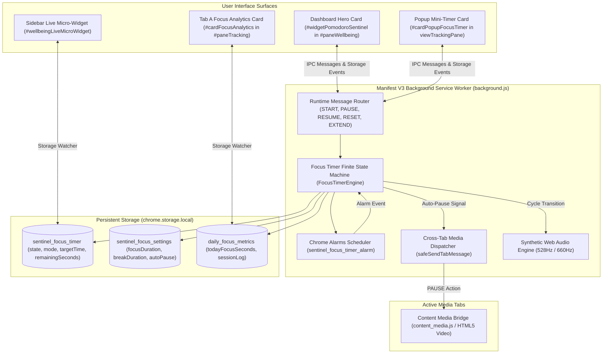
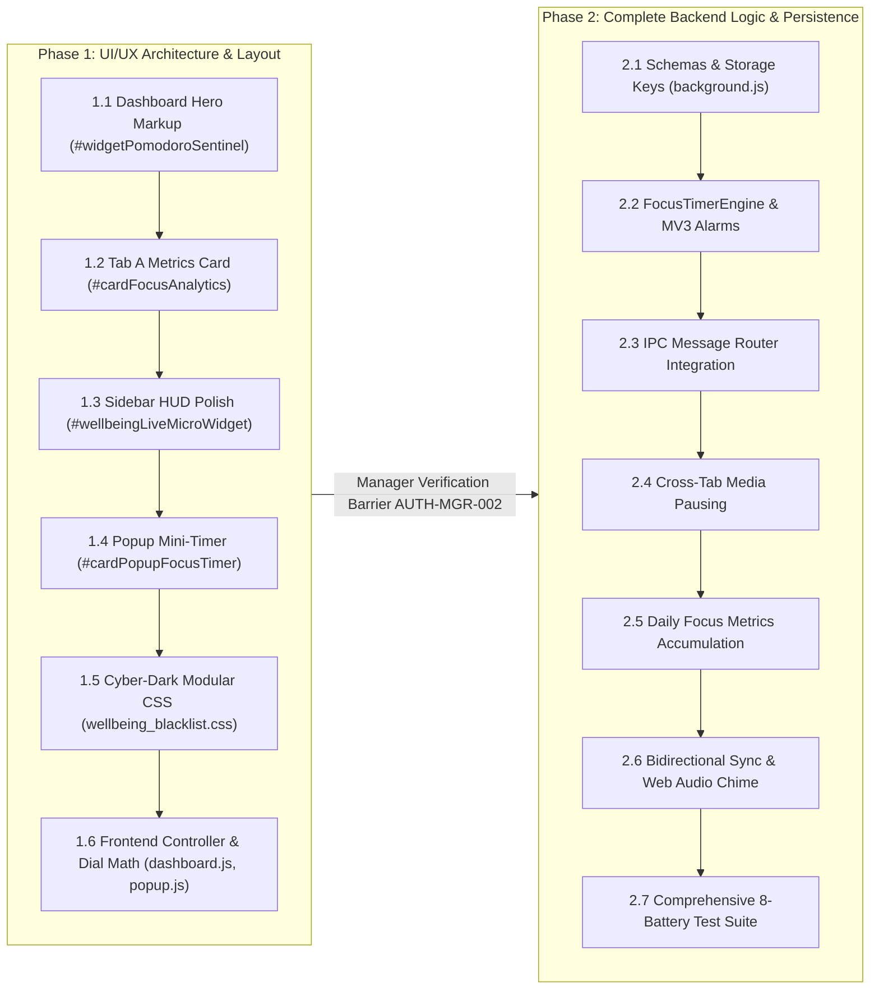

# 📑 Focus Time & Focus Sentinel Subsystem: Executive Architecture Summary

> **Document Type:** Executive Architecture Summary & Strategic Roadmap  
> **Initiative:** Focus Time & Focus Sentinel Subsystem End-to-End Implementation  
> **Container Directory:** [`temp_prompt/focus_time/`](.)  
> **Governing Architecture:** [`PHASE_WISE_PROMPT_GENERATION_ARCHITECTURE.md`](file:///C:/Users/Atul%20Verma/.gemini/config/rules/PHASE_WISE_PROMPT_GENERATION_ARCHITECTURE.md)  
> **Specialist Role:** Level 3C Phase-wise Prompt Generation Specialist (`prompt_generation_specialist`)  

---

## 🏛️ 1. Executive Summary

The **Focus Time & Focus Sentinel Subsystem** initiative transforms the extension's rudimentary, volatile client-only Pomodoro timer into an enterprise-grade, background-persisted, cross-surface productivity engine. By implementing a dedicated finite state machine within the Manifest V3 background service worker, leveraging `chrome.alarms` for deterministic interval tracking, integrating automated cross-tab media playback pausing, and surfacing real-time telemetry across the Dashboard, Popup, and Sidebar HUD, users obtain seamless flow-state protection without fear of timer loss upon tab navigation or browser backgrounding.

The initiative is split cleanly into two sequential phases to satisfy the explicit user mandate:
1. **Phase 1 (UI/UX Architecture & Layout Specifications):** Focuses entirely on the visual presentation, bento card elevation, SVG radial countdown dial ($r=54$, $C=339.292$), presets, extenders, Tab A metrics card, and popup mini-timer.
2. **Phase 2 (Complete Backend Logic, State Machine & Persistence):** Implements the background service worker engine, alarm scheduler, IPC message routing, persistent storage schemas, synthetic Web Audio chime, cross-tab media cutoff, daily metrics accumulation, and the comprehensive 8-battery test suite.

---

## 🎯 2. High-Level Technical Objectives

1. **Visual Parity & Bento Modernization:**
   - Elevate `#widgetPomodoroSentinel` in [dashboard.html](file:///c:/Users/Atul%20Verma/Desktop/Win%20App%20Tracker/Browser%20Detection/dashboard/dashboard.html#L1192-L1215) to match the visual elegance of `#cardSleepSentinelHub`, featuring an SVG radial countdown dial ($r=54$, $C=339.292$), big digital clock display, dynamic status badges, quick duration presets (15m, 25m, 45m, 60m), and quick extenders (+5m, +15m).
2. **Persistent Background State Machine:**
   - Build a rock-solid background engine in [background.js](file:///c:/Users/Atul%20Verma/Desktop/Win%20App%20Tracker/Browser%20Detection/background.js) supporting states: `IDLE`, `RUNNING_FOCUS`, `PAUSED_FOCUS`, `RUNNING_BREAK`, `PAUSED_BREAK`, and `COMPLETED`.
   - Use `chrome.alarms` (`sentinel_focus_timer_alarm`, `sentinel_focus_break_alarm`) and persistent epoch math (`targetTime = Date.now() + remainingMs`) to ensure the timer never drifts or dies when the service worker hibernates.
3. **Automated Cross-Tab Media Control:**
   - When focus sessions start or are active, automatically locate playing audio/video tabs and dispatch pause signals to eliminate distraction, honoring user preference toggle `autoPauseMedia`.
4. **Dedicated Focus Analytics in Tab A:**
   - Introduce `#cardFocusAnalytics` into `#trackingMetricsGrid` in Tab A (Time Tracking Analytics) showing today's accumulated focus minutes and completed intervals, backed by persistent `daily_focus_metrics`.
5. **Multi-Surface Bidirectional Reactivity:**
   - Synchronize timer state, remaining seconds, and mode badges instantly across the Dashboard Hub (`#widgetPomodoroSentinel`), Sidebar HUD (`#wellbeingLiveMicroWidget`), and Popup Mini-Timer (`#cardPopupFocusTimer`) via `chrome.storage.onChanged` and runtime IPC broadcasts.
6. **Synthetic Audio Chime Synthesis:**
   - Synthesize a gentle two-tone harmonic Solfeggio bell chime (528 Hz / 660 Hz) on cycle transitions using the Web Audio API without requiring external audio assets.

---

## 🗺️ 3. Architecture & Data Flow Topology

---

## 🛣️ 4. Two-Phase Milestone Roadmap & Dependency Topology

---

## 🛡️ 5. Risk Mitigation & Architectural Trade-offs

| Risk Category | Technical Hazard | Architectural Mitigation |
| :--- | :--- | :--- |
| **Service Worker Lifespan** | MV3 background service workers terminate after ~30s of inactivity, killing JavaScript `setInterval` timers. | Never rely on background intervals. All duration math is calculated from epoch timestamps (`targetTime = Date.now() + remainingMs`). Alarms wake the worker at expiration. |
| **Alarm Granularity** | `chrome.alarms` enforces a minimum granularity of ~1 minute for recurring alarms in release Chrome. | Alarms are scheduled using exact target epochs (`when: targetTime`). High-frequency (1s) visual countdown ticking occurs exclusively on visible client surfaces (Dashboard, Popup) by interpolating `targetTime - Date.now()`. |
| **CSP & W3C Trusted Types** | Extension manifests enforce strict CSP prohibiting `eval()` and unsanitized `innerHTML` DOM mutations. | Strict zero-innerHTML policy: All DOM element authoring and clock updating in `dashboard.js` and `popup.js` use `textContent`, `setAttribute`, `createElement`, and `appendChild`. |
| **Tab Media Permission Restrictions** | Calling `chrome.tabs.sendMessage` on restricted internal pages (`chrome://`, Edge extensions store) throws unhandled rejections. | Wrap all tab communications in `isRestrictedTabUrl()` checks and `safeSendTabMessage()` with promise catch handlers. |
| **Scope Creep & Feature Regression** | Overwriting shared sections in `dashboard.html` or `popup.html` could break Sleep Sentinel, Doomscroll Breaker, or Domain Budgets. | Strict isolation: Only `#widgetPomodoroSentinel` and `#wellbeingLiveMicroWidget` in `#paneWellbeing`, `#cardFocusAnalytics` in `paneTracking`, and `#cardPopupFocusTimer` in `viewTrackingPane` are modified. All existing IDs, event listeners, and CSS selectors for unrelated features remain strictly preserved. |

---

## 🚫 6. Strict Out-of-Scope Boundary Declarations

To ensure zero collateral damage to the existing codebase, the following systems are strictly **OUT OF SCOPE**:
1. **Sleep Sentinel Hub (`#cardSleepSentinelHub`):** Zero modifications to sleep dial math, sleep presets, sleep alarms, or bedtime automation logic.
2. **Doomscroll Breaker (`#doomscrollBreakerCard`):** Zero modifications to social media threshold detection or nudge alarms.
3. **Domain Budgets & Tracking Blacklist:** Zero alterations to budget limit checks or domain exclusion lists.
4. **Media Deck & Audio Lab:** Zero changes to equalizer filters, bass boost, visualizers, or media playback tables.
5. **Data Export / Settings Reset:** Zero alterations to CSV/JSON export or extension reset handlers.
