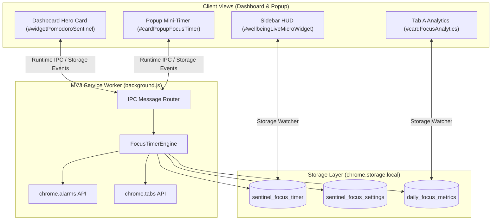
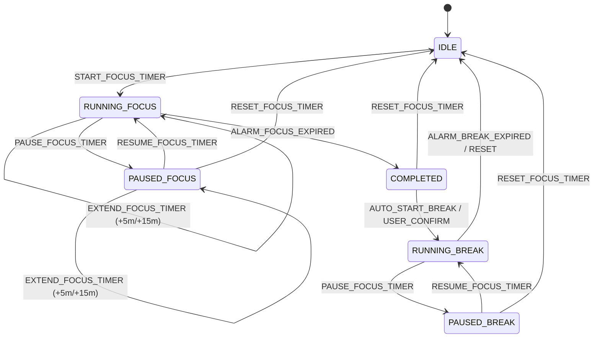

# ⚙️ Focus Time & Focus Sentinel Subsystem: Technical Requirements Document (TRD)

> **Document Type:** Technical Requirements Document (TRD) & Low-Level Design (LLD)  
> **Initiative:** Focus Time & Focus Sentinel Subsystem End-to-End Implementation  
> **Container Directory:** [`temp_prompt/focus_time/`](.)  
> **Governing Architecture:** [`PHASE_WISE_PROMPT_GENERATION_ARCHITECTURE.md`](file:///C:/Users/Atul%20Verma/.gemini/config/rules/PHASE_WISE_PROMPT_GENERATION_ARCHITECTURE.md)  
> **Specialist Role:** Level 3C Phase-wise Prompt Generation Specialist (`prompt_generation_specialist`)  

---

## 🏗️ 1. System Architecture & Subsystem Boundaries

The Focus Time & Focus Sentinel subsystem coordinates three distinct runtime environments:
1. **Background Service Worker (`background.js`):** The single source of truth for timer state, alarms scheduling, cross-tab media commands, and persistent storage hydration.
2. **Dashboard SPA (`dashboard/dashboard.js` & `dashboard/dashboard.html`):** Renders the Hero Bento Card (`#widgetPomodoroSentinel`), SVG Radial Countdown Dial, Tab A Focus Analytics Card (`#cardFocusAnalytics`), and Sidebar Micro-HUD (`#wellbeingLiveMicroWidget`).
3. **Popup Action View (`popup/popup.js` & `popup/popup.html`):** Renders the compact Focus Time card (`#cardPopupFocusTimer`) in `viewTrackingPane`.



---

## 🔄 2. Finite State Machine (FSM) Specification

### 2.1 State Definitions
- `IDLE`: No active focus or break session. Dial displays the selected preset duration (default 25:00).
- `RUNNING_FOCUS`: Active focus block in progress. `sentinel_focus_timer_alarm` is armed. Visual ring is neon emerald.
- `PAUSED_FOCUS`: Focus block paused by user. Alarm is cleared; elapsed time is preserved. Visual ring is neon amber.
- `RUNNING_BREAK`: Rest interval in progress (5m short break or 15m long break). Visual ring is neon cyan.
- `PAUSED_BREAK`: Rest interval paused by user. Alarm is cleared. Visual ring is neon amber.
- `COMPLETED`: Focus session successfully elapsed; chime triggered; metrics recorded; awaiting next cycle.



### 2.2 State Transition Matrix

| Initial State | Event / Trigger | Target State | Actions & Side Effects |
| :--- | :--- | :--- | :--- |
| `IDLE` | `START_FOCUS_TIMER` | `RUNNING_FOCUS` | Set `targetTime = Date.now() + durationMs`; arm `sentinel_focus_timer_alarm`; if `autoPauseMedia`, dispatch `PAUSE` to active media tabs; persist `sentinel_focus_timer`; broadcast `FOCUS_TIMER_STATE_CHANGED`. |
| `RUNNING_FOCUS` | `PAUSE_FOCUS_TIMER` | `PAUSED_FOCUS` | Record `pausedAt = Date.now()`; calculate `remainingSeconds = (targetTime - now) / 1000`; clear `sentinel_focus_timer_alarm`; persist `sentinel_focus_timer`; broadcast state. |
| `PAUSED_FOCUS` | `RESUME_FOCUS_TIMER` | `RUNNING_FOCUS` | Set `targetTime = Date.now() + remainingSeconds * 1000`; re-arm `sentinel_focus_timer_alarm`; persist `sentinel_focus_timer`; broadcast state. |
| `RUNNING_FOCUS` | `EXTEND_FOCUS_TIMER` | `RUNNING_FOCUS` | Add `extraMinutes * 60000` to `targetTime`; add `extraMinutes * 60` to `remainingSeconds`; reschedule `sentinel_focus_timer_alarm`; persist state. |
| `RUNNING_FOCUS` | `RESET_FOCUS_TIMER` | `IDLE` | Clear `sentinel_focus_timer_alarm`; reset `remainingSeconds = focusDuration`; state = `IDLE`; persist state; broadcast state. |
| `RUNNING_FOCUS` | `ALARM_FOCUS_EXPIRED` | `COMPLETED` / `RUNNING_BREAK` | Log completed session into `daily_focus_metrics`; trigger Web Audio chime; if `autoStartBreak`, transition to `RUNNING_BREAK` with 5m break alarm; otherwise state = `COMPLETED`. |
| `RUNNING_BREAK` | `ALARM_BREAK_EXPIRED` | `IDLE` | Trigger gentle alert chime; reset to `IDLE` with default focus duration; persist state; broadcast state. |

---

## 💾 3. Low-Level Data Contracts & Schemas

### 3.1 `sentinel_focus_timer` (Runtime State)
Stored in `chrome.storage.local` under key `'sentinel_focus_timer'`:
```typescript
interface SentinelFocusTimerState {
  state: 'IDLE' | 'RUNNING_FOCUS' | 'PAUSED_FOCUS' | 'RUNNING_BREAK' | 'PAUSED_BREAK' | 'COMPLETED';
  mode: 'focus' | 'break';
  durationMinutes: number;           // e.g., 25
  remainingSeconds: number;          // e.g., 1500
  targetTime: number | null;         // Epoch timestamp in milliseconds (null when IDLE/PAUSED)
  sessionStartedAt: number | null;   // Epoch timestamp when current session initiated
  pausedAt: number | null;           // Epoch timestamp when session was paused
  completedSessionsToday: number;    // Count of completed intervals today
  autoPauseMedia: boolean;           // Inherited from settings or overridden
  soundChime: boolean;               // Inherited from settings or overridden
  updatedAt: number;                 // Date.now()
}
```

### 3.2 `sentinel_focus_settings` (Configuration Preferences)
Stored in `chrome.storage.local` under key `'sentinel_focus_settings'`:
```typescript
interface SentinelFocusSettings {
  focusDurationMinutes: number;       // Default: 25
  shortBreakMinutes: number;          // Default: 5
  longBreakMinutes: number;           // Default: 15
  sessionsBeforeLongBreak: number;    // Default: 4
  autoPauseMedia: boolean;            // Default: true
  soundChime: boolean;                // Default: true
  autoStartBreak: boolean;            // Default: false
  autoStartNextFocus: boolean;        // Default: false
  showBadgeCountdown: boolean;        // Default: true (shows badge on extension icon)
}
```

### 3.3 `daily_focus_metrics` (Analytics Ledger)
Stored in `chrome.storage.local` under key `'daily_focus_metrics'`:
```typescript
interface DailyFocusMetrics {
  [dateKey: string]: {                // Format: 'YYYY-MM-DD'
    totalFocusSeconds: number;        // Accumulated deep work seconds
    completedSessions: number;        // Completed pomodoro intervals
    sessionHistory: Array<{
      startTime: number;
      durationMinutes: number;
      mode: 'focus' | 'break';
      completed: boolean;
    }>;
  };
}
```

---

## 🔌 4. IPC Message Contracts

### 4.1 Message Specifications

#### 1. `START_FOCUS_TIMER`
- **Sender:** Dashboard / Popup
- **Receiver:** `background.js`
- **Request Payload:**
  ```javascript
  {
    action: 'START_FOCUS_TIMER',
    durationMinutes: 25, // Optional, defaults to current preset
    mode: 'focus'        // Optional, defaults to 'focus'
  }
  ```
- **Response Payload:**
  ```javascript
  {
    success: true,
    state: 'RUNNING_FOCUS',
    targetTime: 1731908400000,
    durationMinutes: 25,
    remainingSeconds: 1500
  }
  ```

#### 2. `PAUSE_FOCUS_TIMER`
- **Request Payload:** `{ action: 'PAUSE_FOCUS_TIMER' }`
- **Response Payload:**
  ```javascript
  {
    success: true,
    state: 'PAUSED_FOCUS',
    remainingSeconds: 840
  }
  ```

#### 3. `RESUME_FOCUS_TIMER`
- **Request Payload:** `{ action: 'RESUME_FOCUS_TIMER' }`
- **Response Payload:**
  ```javascript
  {
    success: true,
    state: 'RUNNING_FOCUS',
    targetTime: 1731909240000,
    remainingSeconds: 840
  }
  ```

#### 4. `RESET_FOCUS_TIMER`
- **Request Payload:** `{ action: 'RESET_FOCUS_TIMER' }`
- **Response Payload:**
  ```javascript
  {
    success: true,
    state: 'IDLE',
    remainingSeconds: 1500
  }
  ```

#### 5. `EXTEND_FOCUS_TIMER`
- **Request Payload:**
  ```javascript
  {
    action: 'EXTEND_FOCUS_TIMER',
    extraMinutes: 5 // or 15
  }
  ```
- **Response Payload:**
  ```javascript
  {
    success: true,
    state: 'RUNNING_FOCUS', // or 'PAUSED_FOCUS'
    targetTime: 1731909540000,
    remainingSeconds: 1140
  }
  ```

#### 6. `GET_FOCUS_TIMER_STATE`
- **Request Payload:** `{ action: 'GET_FOCUS_TIMER_STATE' }`
- **Response Payload:**
  ```javascript
  {
    success: true,
    timer: { ...SentinelFocusTimerState },
    settings: { ...SentinelFocusSettings },
    todayFocusMinutes: 75
  }
  ```

#### 7. `SAVE_FOCUS_SETTINGS`
- **Request Payload:** `{ action: 'SAVE_FOCUS_SETTINGS', settings: { autoPauseMedia: true, soundChime: true } }`
- **Response Payload:** `{ success: true, settings: { ... } }`

---

## ⏰ 5. Chrome Alarms Architecture & Epoch Math

### 5.1 Alarm Naming Constants
```javascript
const FOCUS_TIMER_ALARM_NAME = 'sentinel_focus_timer_alarm';
const FOCUS_BREAK_ALARM_NAME = 'sentinel_focus_break_alarm';
```

### 5.2 Deterministic Epoch Time Math
Because service workers are terminated by Chromium when idle:
1. **Target Calculation:**
   $$\text{targetTime} = \text{Date.now()} + (\text{remainingSeconds} \times 1000)$$
2. **Scheduling the Alarm:**
   ```javascript
   chrome.alarms.create(FOCUS_TIMER_ALARM_NAME, { when: targetTime });
   ```
3. **Hydration on Wakeup or Page Load:**
   ```javascript
   function calculateRemaining(timerState) {
     if (timerState.state !== 'RUNNING_FOCUS' && timerState.state !== 'RUNNING_BREAK') {
       return timerState.remainingSeconds;
     }
     const now = Date.now();
     if (!timerState.targetTime || timerState.targetTime <= now) {
       return 0;
     }
     return Math.max(0, Math.round((timerState.targetTime - now) / 1000));
   }
   ```
4. **Client-Side High Frequency Visual Ticking:**
   Dashboard and popup tick every 1000ms locally using `targetTime - Date.now()`. If a frame drops or the laptop sleeps, the clock immediately recalculates the exact remaining seconds upon wake with zero drift.

---

## 🎬 6. Cross-Tab Media Control Engine

When a focus session starts and `autoPauseMedia` is `true`:
```javascript
async function pauseAllMediaTabs() {
  try {
    const tabs = await chrome.tabs.query({});
    for (const tab of tabs) {
      if (!tab.id || !tab.url || isRestrictedTabUrl(tab.url)) continue;
      // Send pause action to content_media.js
      safeSendTabMessage(tab.id, { action: 'PAUSE' });
    }
  } catch (err) {
    console.warn('[FocusSentinel] Media pause dispatch error:', err);
  }
}
```

---

## 🔔 7. Synthetic Web Audio API Chime Synthesis

Zero external audio file dependencies. Synthesizes a gentle two-tone harmonic Solfeggio chime:
```javascript
function playSyntheticFocusChime() {
  try {
    const AudioCtx = window.AudioContext || window.webkitAudioContext;
    if (!AudioCtx) return false;
    const ctx = new AudioCtx();
    if (ctx.state === 'suspended') ctx.resume();

    const now = ctx.currentTime;
    // Harmonic Solfeggio Pair: 528Hz (Transformation/Focus) + 660Hz (Harmonic Fifth)
    const notes = [
      { freq: 528, start: 0.00, dur: 0.65 },
      { freq: 660, start: 0.18, dur: 0.85 }
    ];

    notes.forEach(note => {
      const osc = ctx.createOscillator();
      const gain = ctx.createGain();
      osc.type = 'sine';
      osc.frequency.setValueAtTime(note.freq, now + note.start);

      gain.gain.setValueAtTime(0.0001, now + note.start);
      gain.gain.exponentialRampToValueAtTime(0.20, now + note.start + 0.04);
      gain.gain.exponentialRampToValueAtTime(0.0001, now + note.start + note.dur);

      osc.connect(gain);
      gain.connect(ctx.destination);
      osc.start(now + note.start);
      osc.stop(now + note.start + note.dur + 0.05);
    });
    return true;
  } catch (_) {
    return false;
  }
}
```

---

## 📐 8. Radial Countdown Dial Mathematical Specifications

### 8.1 Geometric Parameters
- SVG ViewBox: `0 0 120 120`
- Center Point: $(x_0, y_0) = (60, 60)$
- Dial Radius: $r = 54\text{px}$
- Stroke Width: $8\text{px}$
- Circumference ($C$):
  $$C = 2 \times \pi \times r = 2 \times 3.14159265 \times 54 = 339.292\text{px}$$

### 8.2 Stroke Offset Calculation
$$\text{fraction} = \frac{\text{remainingSeconds}}{\text{totalDurationSeconds}}$$
$$\text{strokeDashoffset} = C \times (1 - \text{fraction})$$
- When `remainingSeconds == totalDurationSeconds` (0% elapsed):
  $$\text{strokeDashoffset} = 339.292 \times (1 - 1) = 0\text{px} \quad \text{(Full Ring)}$$
- When `remainingSeconds == 0` (100% elapsed):
  $$\text{strokeDashoffset} = 339.292 \times (1 - 0) = 339.292\text{px} \quad \text{(Empty Ring)}$$
- Safe monotonic clamp:
  ```javascript
  const clampedOffset = Math.max(0, Math.min(C, C * (1 - remaining / total)));
  circleEl.style.strokeDashoffset = clampedOffset.toFixed(3);
  ```

---

## 🛡️ 9. Security & W3C Trusted Types Compliance

1. **Zero innerHTML:** No assignments to `.innerHTML` or `.outerHTML` anywhere in `dashboard.js`, `popup.js`, or `background.js`.
2. **Safe Text Nodes:** All countdown readouts use `element.textContent = formattedTime`.
3. **Safe Attribute Manipulation:** All CSS class updates use `element.className = ...` or `element.classList.add/remove()`.
4. **Trusted Types Compatibility:** Strict adherence to Content Security Policy v3.
