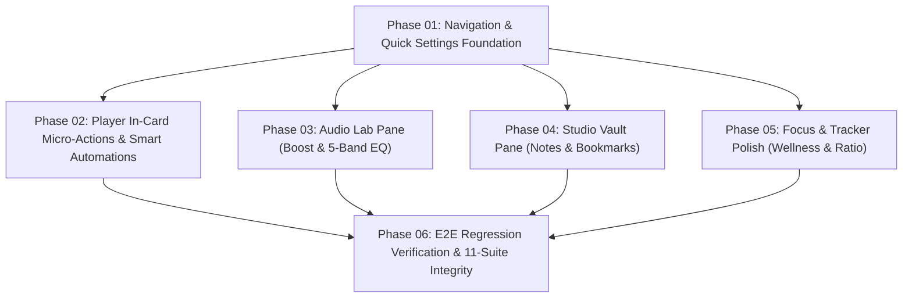

# 4-Pillar Hub Architecture UI/UX Implementation — Executive Summary

> **Document Type:** Executive Architecture Summary  
> **Initiative:** Web Activity & Media Sentinel — Extension Popup 4-Pillar Hub Redesign  
> **Workspace:** `c:\Users\Atul Verma\Desktop\Win App Tracker\Browser Detection`  
> **Author & Lead Architect:** Atul Verma (`aiprincekumar` / `aiprincekumar010100@gmail.com`)  
> **Target Path:** `temp_prompt/four_pillar_hub_ui/SUMMARY.md`

---

## 🏛️ 1. High-Level Initiative Scope & Objectives

The primary objective of this initiative is to elevate the Web Activity & Media Sentinel extension popup from a basic 2-tab utility into a full-featured, modular **4-Pillar Hub** without touching backend daemons or modifying WebSocket sockets on port 65432 / 65433.

### Core Objectives:
1. **Four-Pillar Structural Hierarchy:**
   - **Pillar 1 (`Player`):** Media streaming telemetry, timeline scrubbers, volume controls, in-card micro-actions (Screenshot, Cinema Dimmer, Loop, Next Track, Copy Timestamp Link), and smart automations.
   - **Pillar 2 (`Audio Lab`):** Audiophile controls: 0% to 200% Volume Boost, Audio-Only Mode, 5-Band Graphic Equalizer (-12dB to +12dB across 60Hz, 250Hz, 1kHz, 4kHz, 16kHz) with presets, Dialogue Vocal Clarity, and Night Listening Shield.
   - **Pillar 3 (`Studio`):** Content curation: Real-time timestamp note-taking with "📌 Pin Note", bookmarked clips, screenshot gallery, and resume playback card.
   - **Pillar 4 (`Focus`):** Digital wellness & analytics: Preserved domain breakdown and donut chart, augmented by a Doomscroll Breaker card (15m/30m/45m intervals) and Productive vs Entertainment Focus Ratio Gauge.
2. **Strict Invariant Governance:**
   - **Zero Backend / Socket Mutations:** The task is strictly "add or update only UI and UX". No modifications to background service worker daemon sockets or RFC 6455 protocols.
   - **100% Backward Compatibility:** All existing DOM IDs (`#viewMediaPane`, `#viewTrackingPane`, `#mediaSentinelCard`, `#btnCtrlTogglePlay`, `#btnRefresh`, etc.) remain fully functional and intact.
   - **Single-Row Footer Invariant:** The 7-button footer toolbar must strictly remain on a single row without wrapping or layout shifts.
   - **11/11 Test Suite Pass Rate:** All 11 existing automated test suites must pass cleanly without a single failure or regression.

---

## 🗺️ 2. Cross-Phase Milestone Roadmap & Dependency Topology

### Milestone Schedule:
- **Phase 01:** 4-Pillar Tab Bar Layout, CSS Flex sizing, Quick Settings Gear & Slide-over popover, General Tab Switching Engine.
- **Phase 02:** Player card micro-actions toolbar (`#btnCardScreenshot`, `#btnCardCinemaDim`, `#btnCardLoopMedia`, `#btnCardNextTrack`, `#btnCardCopyTimestamp`), Smart Automations card.
- **Phase 03:** Audio Lab layout (`#viewAudioPane`), 0-200% Master Volume Boost slider, 5-band EQ sliders, presets dropdown, Vocal Clarity, and Night Shield toggles.
- **Phase 04:** Studio Vault layout (`#viewStudioPane`), timestamp note pin input, bookmarks list, screenshots gallery preview, and resume session card.
- **Phase 05:** Focus pane polish (`#viewTrackingPane`), Doomscroll Breaker timer card, Focus Ratio balance gauge, single-row footer layout verification.
- **Phase 06:** Comprehensive verification: All 11 existing test suites pass + new 4-Pillar automated test suite passes with 100% success.

---

## ⚖️ 3. Risk Mitigation & Architectural Tradeoffs

| Risk Category | Technical Risk | Mitigation Strategy |
| :--- | :--- | :--- |
| **Viewport Constraint** | Chrome extension popup has fixed width (420px max). Adding 4 tabs could cause text truncation or vertical wrapping. | Use compact horizontal tabs with SVG/emoji icons + clean concise labels (`Player`, `Audio`, `Studio`, `Focus`), flex shrink rules, and sub-pixel padding. |
| **Backward Compatibility** | Existing automated tests look for specific DOM IDs (`#mainTabMedia`, `#mainTabTracking`, `#viewMediaPane`, `#viewTrackingPane`, `#mediaSentinelCard`). | Retain all existing IDs for Tab 1 and Tab 4. Add `#mainTabAudio` and `#mainTabStudio` alongside existing tabs. Ensure aliases maintain dual compatibility. |
| **Footer Toolbar Breakage** | Existing tests verify single-row 7-button layout (`test_syntax_and_manifest_integrity.js`, `test_jump_to_media_tab_and_bottom_toast.js`). | Do NOT add extra buttons to footer toolbar. Header Quick Settings button is placed in the top header badges area, leaving the 7 footer buttons completely untouched. |
| **State Persistence** | EQ settings, volume boost, and automations need persistent retention between popup closes. | Store preferences in `chrome.storage.local` with fallback to `localStorage`. Use asynchronous debounced sync to prevent IO blocking. |
| **Performance Overhead** | Multiple sliders and rich UI elements could slow down initial popup render. | Lightweight vanilla DOM architecture with zero external UI libraries. Pure CSS transitions and hardware-accelerated transforms (`will-change: transform`). |
