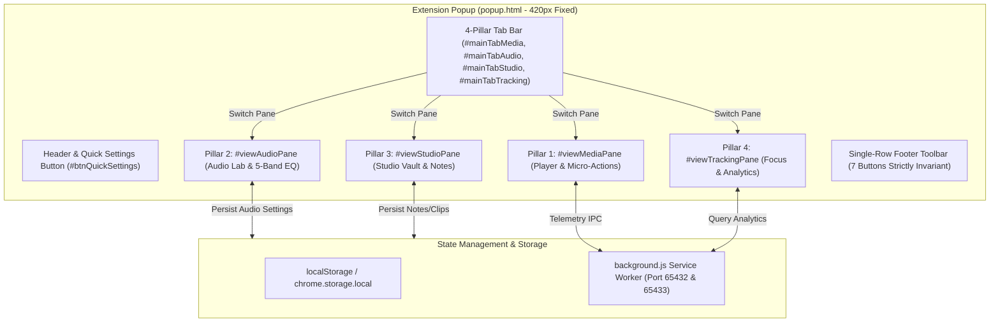

# 4-Pillar Hub Architecture UI/UX — Technical Requirements Document (TRD)

> **Document Type:** Technical Requirements Document (TRD)  
> **Initiative:** Web Activity & Media Sentinel — Extension Popup 4-Pillar Hub  
> **Target Path:** `temp_prompt/four_pillar_hub_ui/TRD.md`  
> **Author & Lead Architect:** Atul Verma (`aiprincekumar` / `aiprincekumar010100@gmail.com`)

---

## 🏗️ 1. High-Level Design (HLD) Architecture

The extension popup architecture is updated to support 4 independent view panes controlled by a single reactive state router within `popup/popup.js`.



---

## ⚙️ 2. Low-Level Design (LLD) Specifications

### 2.1 DOM Element Hierarchy & Identification

```html
<!-- Top Navigation Bar -->
<nav class="top-nav-tabs" role="tablist">
  <button id="mainTabMedia" class="top-tab-btn active" data-view="media" role="tab" aria-selected="true" aria-controls="viewMediaPane">
    <span class="top-tab-icon">🎬</span>
    <span id="topTabMediaText" class="top-tab-label">Player</span>
    <span id="tabMediaLiveDot" class="tab-live-dot hidden" title="Media Active"></span>
  </button>
  <button id="mainTabAudio" class="top-tab-btn" data-view="audio" role="tab" aria-selected="false" aria-controls="viewAudioPane">
    <span class="top-tab-icon">🎛️</span>
    <span id="topTabAudioText" class="top-tab-label">Audio</span>
  </button>
  <button id="mainTabStudio" class="top-tab-btn" data-view="studio" role="tab" aria-selected="false" aria-controls="viewStudioPane">
    <span class="top-tab-icon">📚</span>
    <span id="topTabStudioText" class="top-tab-label">Studio</span>
  </button>
  <button id="mainTabTracking" class="top-tab-btn" data-view="tracking" role="tab" aria-selected="false" aria-controls="viewTrackingPane">
    <span class="top-tab-icon">⏱️</span>
    <span id="topTabTrackingText" class="top-tab-label">Focus</span>
  </button>
</nav>
```

### 2.2 Pillar 1: Player Micro-Actions & Smart Automations Card
- **Micro-Actions Bar (`#playerMicroActionsBar`):**
  - `#btnCardScreenshot`: Calls `chrome.tabs.captureVisibleTab` or sends IPC to capture active video frame.
  - `#btnCardCinemaDim`: Sends IPC to inject/toggle `.sentinel-cinema-overlay` in the active media tab.
  - `#btnCardLoopMedia`: Sends IPC to toggle `video.loop = !video.loop` on the target tab.
  - `#btnCardNextTrack`: Sends IPC to click next track (`.ytp-next-button` or media session action).
  - `#btnCardCopyTimestamp`: Formats active video URL with current seconds and copies to `navigator.clipboard`.
- **Smart Automations Card (`#cardSmartAutomations`):**
  - `#toggleAutoPauseNewTab`: Stored under key `pref_auto_pause_new_tab`.
  - `#toggleAutoAdSilence`: Stored under key `pref_auto_ad_silence`.
  - `#toggleDomainSpeedMemory`: Stored under key `pref_domain_speed_memory`.

### 2.3 Pillar 2: Audio Lab (`#viewAudioPane`)
- **Master Boost Slider (`#masterBoostSlider`):**
  - Range: `0` to `200`, step `1`, default `100`.
  - Stored under key `audio_master_boost`.
  - Label readout: `#masterBoostReadout` displaying `0%` to `200%`.
- **Audio-Only Mode Switch (`#toggleAudioOnlyMode`):**
  - Stored under key `pref_audio_only_mode`.
- **5-Band Equalizer (`#audioEqCard`):**
  - Presets dropdown `#audioEqPresetSelect`: options `flat`, `bass_boost`, `vocal_clarify`, `rock`, `night`.
  - Band sliders:
    - Band 60Hz: `#eqBand60` (Range: -12 to 12, step 1)
    - Band 250Hz: `#eqBand250` (Range: -12 to 12, step 1)
    - Band 1kHz: `#eqBand1000` (Range: -12 to 12, step 1)
    - Band 4kHz: `#eqBand4000` (Range: -12 to 12, step 1)
    - Band 16kHz: `#eqBand16000` (Range: -12 to 12, step 1)
- **Sound Enhancements:**
  - Vocal Clarity toggle: `#toggleVocalClarity` (key `audio_vocal_clarity`).
  - Night Listening Shield toggle: `#toggleNightShield` (key `audio_night_shield`).

### 2.4 Pillar 3: Studio Vault (`#viewStudioPane`)
- **Timestamp Note Card (`#studioNoteCard`):**
  - Note input text field: `#studioNoteInput` (placeholder: "Add note for current timestamp...").
  - Pin button: `#btnStudioPinNote` (captures `activeVideoTitle`, `domain`, `currentTime`, `timestampFormatted`).
- **Bookmarked Clips Card (`#studioBookmarksCard`):**
  - Clips list container: `#studioBookmarksList`.
  - Item buttons: `#btnJumpClip_<id>` (sends `SEEK_POSITION` IPC to target tab), `#btnDeleteClip_<id>`.
- **Screenshots Gallery Card (`#studioScreenshotsCard`):**
  - Gallery grid: `#studioScreenshotsGrid`.
- **Pick Up Where You Left Off Card (`#studioResumeCard`):**
  - Resume button: `#btnStudioResumeLastMedia`.

### 2.5 Pillar 4: Focus & Tracker Polish (`#viewTrackingPane`)
- **Existing Elements Preserved:**
  - `#donutSvg`, `#donutCenterTime`, `#donutCenterLabel`, `.tabs-nav`, `.stats-pills`, `#domainSearchInput`, `#browserFilterSelect`, `#trackingModeSelect`, `#domainCategorySelect`, `#domainsListContainer`.
- **Doomscroll Breaker Card (`#cardDoomscrollBreaker`):**
  - Toggle switch: `#toggleDoomscrollBreaker` (key `focus_doomscroll_enabled`).
  - Interval select: `#doomscrollIntervalSelect` (15m, 30m, 45m).
- **Focus Ratio Bar (`#cardFocusRatio`):**
  - Ratio bar fill: `#focusRatioProductiveBar`, `#focusRatioEntertainmentBar`.
  - Ratio text readout: `#focusRatioText`.

---

## 💾 3. Data Schema & Persistence Contracts

### Storage Schema (`chrome.storage.local`):
```json
{
  "active_popup_tab": "media",
  "audio_lab_settings": {
    "master_boost": 100,
    "audio_only": false,
    "eq_preset": "flat",
    "eq_bands": {
      "60": 0,
      "250": 0,
      "1000": 0,
      "4000": 0,
      "16000": 0
    },
    "vocal_clarity": false,
    "night_shield": false
  },
  "studio_notes": [
    {
      "id": "note_1730761800",
      "timestamp": 125,
      "timestampFormatted": "02:05",
      "title": "Quantum Physics Lecture",
      "url": "https://www.youtube.com/watch?v=...",
      "text": "Key formula at this timestamp",
      "createdAt": 1730761800000
    }
  ],
  "focus_settings": {
    "doomscroll_enabled": false,
    "doomscroll_interval_minutes": 30
  }
}
```

---

## 🔒 4. Backward Compatibility & Verification Invariants

1. **Test Suite Invariants:**
   - `test_syntax_and_manifest_integrity.js`: Validates `#btnRefresh`, `#btnGlobalMediaToggle`, `#btnToggleTrackingPause`, `#btnSleepTimerTrigger`, `#btnReconnectWs`, `#btnSwitchMediaTab`, `#btnOpenDashboard` in footer.
   - `test_tab_switch_and_storage_persistence.js`: Validates `#mainTabMedia`, `#mainTabTracking`, `#viewMediaPane`, `#viewTrackingPane`.
   - `test_popup_sqlite_data_hub_sync.js`: Validates `#browserFilterSelect`, `#hubStatusBadge`, `#hubStatusText`.
   - `test_tracking_modes_and_audible_bg_media.js`: Validates `#trackingModeSelect`, `#domainCategorySelect`.
   - `test_volume_timeline_fullscreen_controls.js`: Validates volume sliders, timeline dragging, and scrubbing.
2. **Strict Rule:**
   - NEVER alter, remove, or rename any existing ID.
   - NEVER add elements that alter footer layout from single-row flex.
