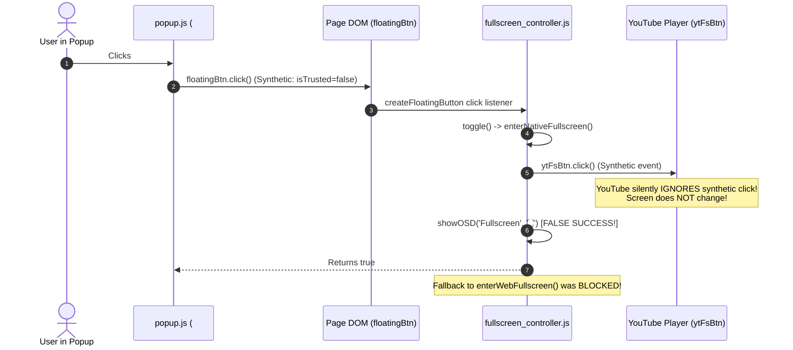
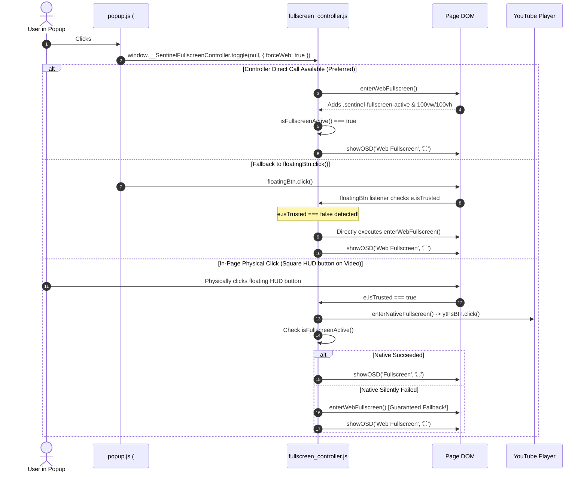
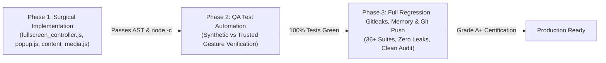

# Executive Architecture Summary: Fullscreen Parity & Reliable Execution

> **Task ID:** `TASK-FULLSCREEN-PARITY-002`  
> **Workspace:** [`c:\Users\Atul Verma\Desktop\Win App Tracker\Browser Detection`](file:///c:/Users/Atul%20Verma/Desktop/Win%20App%20Tracker/Browser%20Detection)  
> **Lead Specialist:** Level 3C Phase-wise Prompt Generation Specialist (`prompt_generation_specialist`)  
> **Container:** `temp_prompt/fullscreen_reliable_execution/`  

---

## 🏛️ 1. Executive Context & Objective

The objective of this initiative is to resolve a critical behavioral disparity in the Antigravity Browser Detection & Media Sentinel extension where:
1. The **in-page floating square HUD button** (`#__sentinel_fs_floating_btn__`) located on the video player reliably triggers fullscreen when clicked directly with the mouse.
2. The **extension popup fullscreen button** (`#btnCtrlFullscreen`) displays the "Fullscreen ⛶" On-Screen Display (OSD) overlay on screen, but fails to actually make the video fullscreen.

The user explicitly instructed:
> *"बाकी किसी भी कमांड को टच नहीं करना है, सिर्फ फुल स्क्रीन वाला रिलेटेड जो बटन है उसे को टेस्ट करना है... जब उससे काम कर रहा है वीडियो पर राइट साइड में स्क्वायर वाला बटन आ रहा है उससे काम कर रहा है, तो ये जब उसी से लिंक है डायनेमिक राउटिंग हुआ हुआ है, तो फिर ये काम क्यों नहीं कर रहा है?"*

---

## 🔍 2. Architectural Call Flow: Before vs. After

### 2.1 The Flawed State (Before)

### 2.2 The Unified Reliable State (After)

---

## 🎯 3. Technical Objectives & Success Criteria

1. **Parity Between Popup & Floating Button:**
   Clicking `#btnCtrlFullscreen` in the popup MUST produce a full viewport video fill just as clicking the in-page floating button does.
2. **Elimination of Fake OSD Success:**
   `showOSD('Fullscreen', '⛶')` MUST NEVER be displayed unless fullscreen mode has actually been confirmed by `isFullscreenActive()`.
3. **Guaranteed Fallback to Web Fullscreen:**
   If `enterNativeFullscreen()` fails to engage native OS fullscreen (due to untrusted events, missing user gesture, or YouTube rejecting the API call), the controller MUST immediately fall back to `enterWebFullscreen()`.
4. **Synthetic Event Awareness:**
   The in-page floating button click handler MUST detect if `!e.isTrusted`. If synthetic, it directly engages `enterWebFullscreen()` instead of making doomed native fullscreen attempts.
5. **Popup Scripting Priority Alignment:**
   `popup/popup.js` line 3669 MUST be aligned with `dashboard/dashboard.js`, directly invoking `window.__SentinelFullscreenController.toggle(null, { forceWeb: true })` or `toggleWebFullscreen()` first, and using `floatingBtn.click()` only as secondary fallback.
6. **Zero-Side-Effect Scope Isolation:**
   Strict isolation of all non-fullscreen media controls: `#btnGlobalMediaToggle`, play/pause, volume, timeline, speed ladder, and PiP MUST remain 100% untouched.

---

## 🗺️ 4. Milestone Roadmap

- **Phase 1: Surgical Fullscreen Parity & Synthetic Click Fallback**
  - Update `fullscreen_controller.js`: State verification in `enterNativeFullscreen()`, synthetic click guard in `createFloatingButton()`.
  - Update `popup/popup.js`: Direct controller priority with `{ forceWeb: true }`.
  - Update `content_media.js`: Parity in IPC `toggle_fullscreen` handler.
- **Phase 2: QA Test Automation & Synthetic Gesture Verification**
  - Update/extend `tests/test_fullscreen_controller.js` to simulate synthetic clicks (`isTrusted === false`) and verify fallback to web fullscreen without fake OSD.
  - Verify `tests/test_media_controls_and_fullscreen_fix.js`.
- **Phase 3: Full Regression, Security Audit & Autonomous Git Push**
  - Run all 36+ test suites in `tests/`.
  - Run `gitleaks detect --redact` to ensure zero secrets.
  - Update `memory.md` and 5-tier changes log.
  - Autonomous Git micro-commit and push intelligence evaluation per Universal Rule 15.

---

## 🛡️ 5. Risk Mitigation & Trade-Off Analysis

| Risk | Severity | Mitigation Strategy |
| :--- | :---: | :--- |
| **Accidental mutation of non-fullscreen controls** | CRITICAL | Strict file-boundary isolation. Prompt explicitly bans modifications to `#btnGlobalMediaToggle`, play/pause, volume, timeline, and speed ladder. |
| **Double-toggle race conditions** | HIGH | Preserved cross-world DOM attribute debounce lock (`data-sentinel-fs-ts`) and 350ms cooldown timer. |
| **Broken native fullscreen on physical mouse click** | HIGH | When `e.isTrusted === true`, `enterNativeFullscreen()` executes normally first; fallback only triggers if `isFullscreenActive()` is false. |
| **W3C Trusted Types violations** | HIGH | All DOM element insertions and SVG updates maintain strict Trusted Types compliance with zero `innerHTML` usage. |
| **Git & Security Integrity** | HIGH | Pre-push secret scan with `gitleaks`, UTF-8 BOM encoding validation, and 3-point terminal proof. |
